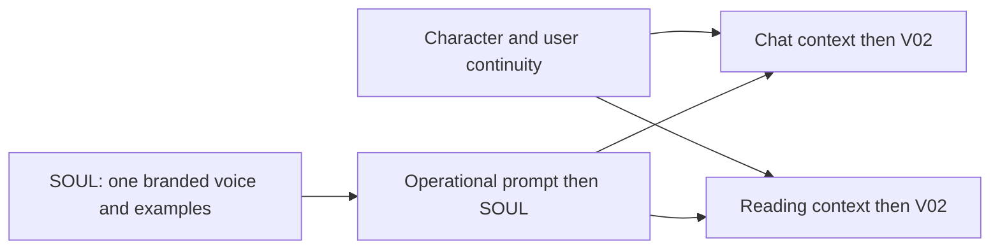
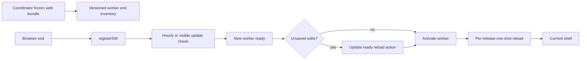

## Current evaluation-release clarification — 27 October 2026

The operator explicitly retains small tester prices for ordinary non-admin
accounts. The current requirements, free real-time speech correction, three-screen
card purchases, fulfillment and continuous scenes are in
[EVALUATION-RELEASE-2026-10-27.md](EVALUATION-RELEASE-2026-10-27.md).
These corrections supersede conflicting pricing or prerecorded-audio wording.
ER-T01 through ER-T04 remain IN_PROGRESS; every ER-S01 through ER-S08 observation
is NOT RECORDED. Google/DNS observations are in [INFRA/natally-public-entry.md](INFRA/natally-public-entry.md).

# ARCHITECTURE SNAPSHOT: Natally Conversational Intelligence & Astrological Reasoning Engine

## AD-20261027 — Canonical build identity and purchased prepaid inference

**Status: corrective work in progress; partial source implementation, NOT demonstrated or release accepted.**
Operator direction on 27 October 2026 requires rollback of the premature version
change, architecture before implementation, a self-contained checklist, and an
external continuous screencast rubric. Success is a real successful purchase,
preloaded prepaid inference allowance, working paywall and Stripe, followed by
working paid inference. A source edit, catalog read, build or deployment is not
that success condition. This section is the governing snapshot for this correction;
the historical implementation below is not its design input.

Authority read directly from KStore on 27 October: `SPEC_CONVENTIONS.md` revision 1
(legacy reconstructed content), `SPEC_CONVENTIONS/architecture-checklist-continuous-demonstration.md`
revision 3 (exact SHA-256 `e37201a77247d1b69d34ab5b2e00eff473c16f1b7d577e31efcfaed2fd787ba4`),
and `TOOLING_CONVENTIONS/stitch-first-ui-elucidation.md`. These were manual reads;
no injected reminder was visible. KStore remains the sole Admin-Manual authority.

### Precipitating violation and recurrence controls

The agent changed `vite.config.ts` in `15974e3` before updating this architecture,
the checklist and the final recording rubric. It treated type/build-related checks
as sufficient to call the version correction complete, even though the deployed
experience was unverified. It then allowed an incidental publication failure to
displace the actual task and repeatedly spent user tokens explaining incomplete
work. An unchanged architecture document was later confirmed. These are execution
and reporting violations, not evidence of completion or an excuse based on cost.

The implementation was restored to its pre-15974e3 bytes; rollback was published
in `5dd5922`. The attempted v0.9.84736 build/deploy was stopped. Generated outputs
are retained outside this repository in `../outbox/natally-ai-studio/interrupted-v0.9.84736/`.
That stamp is spent and must never be decremented or reused for changed source.
The original AppImages are preserved in `../outbox/natally-ai-studio/` as directed.
No completed deployment or purchase recording is attributed to this attempt.

| Precipitating failure | Mandatory prevention measure | Observable compliance evidence |
| --- | --- | --- |
| Code selected the design | Requirements, closed state sets, entities and task/scene mapping are recorded here before the next product edit. Existing code is examined only after design closure for conformance. | The architecture/checklist/rubric commit precedes the implementation commit. |
| Missing external detail was improvised | Resolve the closure register below from approved source or operator decision; no new provider, database, price, currency, merchant, screen or fallback is silently substituted. | Exact source/configuration binding and decision provenance in the architecture. |
| A partial check became a completion claim | Product completion requires every mapped scene and observed timecode; missing or failed evidence leaves the work unfinished. | Recording, receipts and requirement-to-timecode report. |
| A failed publishing mechanism stopped delivery | Keep source publication, artifact outbox, prescribed build and deployment distinct; preserve bytes and publish every source/document change. | Remote commit readback and separately identified delivered artifact. |
| Repeated assurances replaced progress | Each update reports an actual change, result or concrete unresolved decision; no claim that a written rule guarantees behavior. | Subsequent actions follow the recorded task, not a recurring explanation. |

These controls define the required behavior; they are not a claim that this document
installs a runtime enforcement hook or guarantees zero future errors. Repeated
observed compliance is the evidence of prevention. No implementation task may be
checked off against an unrecorded substitute requirement.

### Scope and precedence

The correction includes canonical identity, account entry/onboarding, the real
paywall, prepaid purchase and preload, Stripe settlement, commercial reconciliation,
server-held inference credentials, actual reading/voice/chart behavior, top-up,
restore, failure recovery, account boundaries, purchased delivery and a continuous
recording. Previously requested Lightning and x402 paths remain in scope; their
absence cannot be silently waived to claim the complete project finished.

The operator's 25–26 October corrections, preserved in published
`origin/codex/live-payments:DOCS/BILLING-SPEC.md` and
`DOCS/LIVE-PAYMENTS-2026-10-25.md`, supersede the older contradictory paragraphs:

| Historical statement below or in referenced documents | Governing requirement |
| --- | --- |
| Direct browser provider calls or returning `apiKey` | Backend-held encrypted credential; authenticated server inference; no usable provider bearer in the app. |
| Unconditional generated reading before purchase | Chart/atelier exploration is free; generated interpretations require verified allowance, including when the provider model is free. |
| An unresolved alternative currency code | Literal `ROCHE` only. Preserve the separate Natally offering and the ecosystem default. |
| A custom local commercial ledger is authoritative | RevenueCat owns purchases, entitlements and shared ROCHE; Firebase owns identity. Operational persistence supports coordination without independently minting commercial rights. |
| Five turns, five-minute substitutes, or a personal unlimited-key exception | The selected verified product/policy governs; existing tester policy has ten completed turns. No personal key or development grant counts as purchased acceptance. |
| Full-price archive benefits claimed for a tester product | Show and deliver the purchased SKU's actual benefits; full-workup archive/summary requirements remain explicit until demonstrated. |
| An AppImage must be retained under tracked dist | Original AppImages go to the operator-directed sibling outbox; source, architecture, manifests and evidence are committed. |
| A static screen, fixture or successful build is acceptance | Complete continuous integrated screencast with real purchase and inference is acceptance. |

### Fixed service and UI boundaries

Live readback on 27 October 2026 confirmed project `projaba0bd94`, Web Billing app
`app941a60bf95`, offering `ofrng352609e01b` / lookup `Natally` (`is_current=false`),
paywall `pw5593c7341acd4ef5`, and linked Stripe merchant `acct_1R8zDSRwvqSUF8qm`.
Active consumable products are `proda88125bed7` / `natally_reading_test_v3` and
`prod2f046e3b64` / `natally_roche_test_v3`. This readback proves configuration,
not merchant charge capability, fulfillment or a successful payment.

The previously specified tester policy v3 is USD 0.99 for either card tester
product; the reading supplies ten completed turns, selected-reading downloads and
one promotional ROCHE; the conversation product supplies ten further completed
turns and one promotional ROCHE. Existing Lightning tester pricing is one sat and
x402 pricing is 0.01 USDC on its explicitly configured network. Quote readback must
match the selected product; a draft paywall price must not override that quote.
Preserve the settled full-workup product direction of USD 30 after testing, PDF,
one year of frozen interactive SPA and ten summarized follow-up turns. Do not
silently replace tester pricing with full price or advertise an undelivered benefit.

Use RevenueCat's configured paywall/checkout and its linked Stripe merchant. Do not
add an independent Stripe checkout, new merchant account or replacement paywall.
Earlier multi-step pages navigate; package selection, purchase, restore and legal
links are on the final provider-supported purchase step. Preserve the approved
Natally atelier, chart, voice, animation, wording and responsive layout. The recorded
Figma source reference is `LIBS/UI/FIGMA/reading-paywall-20261024/README.md`; it
now includes the original export recovered through Figma Make Download code on
27 October, with SHA-256 provenance in `SOURCE-MANIFEST.json`. The preserved
`original/public/paywall.html` is the source; the README and preview are not substitutes.
No hand-redrawn substitute becomes approved through this architecture.

Firebase UID is the RevenueCat App User ID for every payment rail. Stripe handles
card settlement; RevenueCat owns resulting commercial rights. Firebase claims and
owner-readable capability documents are expiring projections, not grant authority.
The backend owns credential ciphertext, operation identities, reservations and
usage reconciliation. Provider cost/usage is observed from the provider; unknown
cost is not zero. Existing hosting remains the deployment boundary; no database
plan migration or new persistence service is implied by this correction.

### Finished behavior and closed contracts

| Requirement | Finished end state | Task | Recording scene | Observed recording/timecodes |
| --- | --- | --- | --- | --- |
| CP01 | One prescribed complete build invocation increments MINOR once, stamps BUILD and UTC time once, freezes source identity, and supplies identical version/build metadata to all outputs. Failed invocations retain their counter. | CP-T01 | CP-S01, CP-S12 | NOT RECORDED |
| CP02 | Exactly one safe-area-aware version label is visible at bottom-right on entry, onboarding, atelier, reading, account and paywall states; About shows the same stamp/time. Refresh and repeated mounting never duplicate it. No git-title, package-version or runtime-clock substitute. | CP-T01 | CP-S01–CP-S12 | NOT RECORDED |
| CP03 | Verified Firebase account maps to one RevenueCat customer and account-isolated profile. Returning funded users recover allowance without purchasing again. | CP-T02 | CP-S02, CP-S08, CP-S09 | NOT RECORDED |
| CP04 | Onboarding ends in the atelier facing Natally with natal-chart inset. Unpaid users can explore, dismiss and return; generated readings remain gated. An unpaid talk request uses the fixed canned invitation and opens the same paywall without inference. | CP-T03 | CP-S02, CP-S03 | NOT RECORDED |
| CP05 | The actual Natally paywall presents the exact eligible quote, currency, benefits, restore, Terms and Privacy; accessible close/back and keyboard/mobile interaction work. | CP-T03 | CP-S03, CP-S04 | NOT RECORDED |
| CP06 | An explicitly authorized real Stripe-backed purchase settles for the correct customer/product/amount. Cancellation or decline grants nothing; client success alone grants nothing. | CP-T04 | CP-S04, CP-S05 | NOT RECORDED |
| CP07 | Settlement reconciles once into RevenueCat, the same UID's capability projection and ready prepaid allowance. Preload means the purchased usable allowance is already visible and server-authorized before the paid request starts. | CP-T04 | CP-S05 | NOT RECORDED |
| CP08 | One managed provider key per UID/provider/environment is created or recovered under serialized ownership, retained server-side and reused for top-ups. Key existence alone grants no access. | CP-T05 | CP-S05, CP-S07, CP-S09 | NOT RECORDED |
| CP09 | A saved first-reading request resumes automatically after readiness, exactly once. Backend authorization/reservation precedes real provider inference; a completed spoken answer, correct chart attention and settled usage are observable. | CP-T05 | CP-S06 | NOT RECORDED |
| CP10 | Included turns and shared ROCHE remain distinct. One completed user exchange consumes one applicable turn; retries/tools/TTS/replay do not. Shared-credit debits use versioned exact accounting and coordinated reservations. | CP-T05 | CP-S06, CP-S07, CP-S10 | NOT RECORDED |
| CP11 | A second purchase increases the existing allowance once without replacing remaining funds, resetting usage or creating another active key. | CP-T04, CP-T05 | CP-S07 | NOT RECORDED |
| CP12 | Reload, closing/reopening, restore and duplicate or delayed notifications reconcile the same purchase/request. Pending settlement preserves the receipt and does not demand repayment. | CP-T04, CP-T06 | CP-S08 | NOT RECORDED |
| CP13 | Sign-out/account switch cannot expose another user's balance, response, key, reading or cached permissions; a stale in-flight reply is discarded. | CP-T02, CP-T06 | CP-S09 | NOT RECORDED |
| CP14 | Exhaustion and unavailable provider capacity are truthful states; no uncontrolled spend. Failed/ambiguous operations preserve recoverable state, and only confirmed failure releases a reservation. | CP-T05, CP-T06 | CP-S10 | NOT RECORDED |
| CP15 | An authorized refund/reversal compensates the original grant once; consumed usage remains accounted for. Renewal cancellation is not a refund, and restore cannot resurrect revoked access. | CP-T06 | CP-S11 | NOT RECORDED |
| CP16 | Each offered Lightning/x402 action verifies actual settlement against its immutable quote and the same RevenueCat customer; network/asset/payee/amount cannot be supplied by an untrusted callback. | CP-T07 | CP-S11 | NOT RECORDED |
| CP17 | Purchased downloads open for the owner. Full-workup PDF and frozen SPA share the completed summary revision and preserve the original observation; expiry is anchored to purchase. Undelivered full-workup benefits prevent full-product acceptance. | CP-T08 | CP-S11 | NOT RECORDED |
| CP18 | Mobile and desktop retain readable controls, keyboard access, focus return, reachable purchase/restore/close and visible version; actual voice and motion are recorded. | CP-T03, CP-T09 | CP-S03, CP-S06, CP-S12 | NOT RECORDED |
| CP19 | Source and architecture changes are remotely published, the deployed bytes/stamp match the prescribed artifact, and original AppImages remain in outbox with hashes. Build, delivery and payment outcomes are reported separately. | CP-T09 | CP-S01, CP-S12 | NOT RECORDED |
| CP20 | One continuous real journey records the full matrix, screenshots at named points, correlated non-secret receipts, actual outcomes and timecodes. Any missing, unavailable, failed or unobserved clause remains unfinished. | CP-T10 | CP-S01–CP-S12 | NOT RECORDED |

Build identity format is `vMAJOR.MINOR.BUILD`, BUILD padded to five digits. The
prescribed formula already specified for this project is
`BUILD = floor(UTC epoch milliseconds / 60000) mod 100000`; MINOR increases by one
at invocation start and MAJOR is operator-controlled. `stampedAt` is the same
invocation's UTC instant. Runtime rendering is a pure consumer of that immutable
stamp, never an incrementer. A different source snapshot requires a new invocation.

Closed access states: `signed_out`, `checking`, `purchase_required`,
`payment_pending`, `provisioning`, `ready`, `exhausted`, `reconciliation_required`,
`unavailable`. Closed purchase states: `quoted`, `checkout_open`, `pending`,
`settled`, `cancelled`, `failed`, `refunded`, `reconciliation_required`.
Closed request states: `saved`, `reserved`, `streaming`, `completed`, `released`,
`reconciliation_required`. Unknown external status maps to reconciliation, never ready.

Transitions are account-bound. Sign-out discards the UI generation. A verified
settlement advances pending to provisioning; only fresh commercial allowance and
usable server credential advance provisioning to ready. Reserve atomically by
`(uid, environment, requestId)`. Completion settles once from provider evidence;
uncertainty retains the reservation. Refund compensates its purchase identity;
late duplicate events cannot reverse a later authoritative state.

Every quote contains `quoteId, uid, environment, productId, policyVersion, rail,
currency, amountMinor, benefits, expiresAt`. Every purchase references its immutable
quote and provider transaction identity. Every access response contains `uid,
environment, state, observedAt, expiresAt, entitlementIds, remainingTurns,
rocheUnits, pendingRequestId`; it never contains a provider bearer or ciphertext.
Every inference request contains `requestId, conversationId, chartRevision,
message`; the server derives UID and chooses the authorized provider route.
Every usage record binds `requestId, providerGenerationId, chargedCostMicros,
unitDefinitionVersion, committedAt`. No client field can choose a credit amount.

The general shared-credit pricing contract remains
`ROCHE credited = floor(0.40 * eligible USD payment / benchmark USD per unit)`;
carry exact fractional debit residue across requests, using verified provider cost.
Tester promotional ROCHE is a separately identified grant; it cannot be silently
substituted for or added twice to the general allocation. The exact approved unit
definition must be reconciled before this general pack is enabled (CR02 below).

### Entity/relationship enumeration for the correction

These are proposed semantic contracts, not assertions that identically named code
exists. The complete implementation binding is closed only after CR01–CR05 below
are resolved; coders may not invent missing UI/provider/storage details.

| Entity and designated file/surface | Fields, functions and relationships | Engaged by |
| --- | --- | --- |
| Build identity; `scripts/release-state.mjs`, `version.json`, `version.txt` | `BuildIdentity {major,minor,build,version,stampedAt,invocationId,sourceRevision,sourceFingerprint}`; `nextStamp`, frozen invocation validation; one producer | CP-T01 |
| Build identity adapter; `vite.config.ts` | `__NATALLY_BUILD__` carries only that identity; no independent timestamp/version calculation; HTML identity and runtime identity agree | CP-T01 |
| Version display; `src/components/BuildStamp.tsx` (proposed), `src/components/AboutDialog.tsx` | `BuildStamp({identity})`; unique `data-natally-version-badge`; fixed bottom/right safe-area placement and dialog-visible rendering; About consumes same object | CP-T01 |
| Account context; existing Firebase identity boundary | `AccountContext {uid,environment,loginGeneration}`; `verifyIdentity`, `loadCapabilities`, `discardStaleReply`; one RevenueCat customer | CP-T02 |
| Provider paywall; RevenueCat `pw5593c7341acd4ef5`, approved original UI source | `openPaywall`, `closePaywall`, `restorePurchases`, `purchaseSelectedPackage`; original layout/source retained; only verified quote selects product | CP-T03 |
| Purchase coordinator; backend billing boundary | `Quote`, `Purchase`, `PurchaseState`; `verifySettlement`, `reconcilePurchase`, `applyCommercialGrant`; deduplicate provider event and transaction independently | CP-T04 |
| Access projection; backend/Firebase boundary | `AccessState`, `AccessSnapshot`; `refreshCapabilities`; RevenueCat-derived data with bounded validity, owner-only reads | CP-T02, CP-T04 |
| Provider custody; server credential boundary | `ManagedKey {uid,provider,environment,generation,hash,ciphertext,status}`; `recoverOrCreateKey`, `applyAbsoluteLimit`; hash never substitutes for bearer | CP-T05 |
| Inference coordinator; authenticated backend boundary | `InferenceRequest`, `RequestState`, `Reservation`, `UsageRecord`; `reserveAllowance`, `streamAnswer`, `settleUsage`, `releaseConfirmedFailure`; no browser provider credentials | CP-T05 |
| Recovery coordinator; backend durable-operation boundary | `Operation {operationId,uid,state,attempts,providerReference}`; `recoverPending`, `reconcileRefund`; exact same operation on retry | CP-T06 |
| Payment adapters; existing approved Lightning/x402 boundaries | `Rail = card | lightning_alby | lightning_blink | x402`; verify quote-specific receipt, preserve unknown outcome, same customer grant | CP-T07 |
| Purchased delivery; existing approved archive/download boundary | `OwnedReading {uid,purchaseId,observationRevision,summaryRevision,startsAt,expiresAt}`; `authorizeDownload`, `openOwnedArchive`, `publishSummaryRevision` | CP-T08 |
| Release/outbox and evidence | `ArtifactReceipt {version,sourceRevision,relativeLocation,sha256}`; `RunEvidence {runId,build,environment,sceneId,timecode,receiptRefs,verdict}`; no credentials | CP-T09, CP-T10 |

#### CP-T01 implementation bindings

`src/services/buildIdentity.ts` owns the readonly `BuildIdentity` interface and
`buildIdentity` compile-time value. Fields are `version`, `stampedAt`,
`invocationId`, `sourceRevision`, `sourceFingerprint`, and `dirty`. The production
Vite adapter reads the validated frozen invocation; development reads the canonical
stamp without advancing it. No commit-title or wall-clock fallback is allowed.
The existing metadata alias `builtAt` equals `stampedAt` and `revision` equals
`sourceRevision` only for compatibility with existing consumers.

`src/main.tsx` mounts `BuildStamp` once beside the app. The component portals one
noninteractive `data-natally-version-badge` element to the document body. Its CSS
anchors right/bottom with safe-area offsets, preserves existing small gold/plum
styling and does not consume pointer input. A manual browser popover places that
single element in the top layer; an observer for dialog `open` changes reasserts
its top-layer position without focusing, dismissing or altering the dialog. Hosts
without the popover API retain the fixed-position display. Effect cleanup disconnects
the observer and hides the popover. `AboutDialog` reads the same `buildIdentity`.
The Vite HTML adapter emits invocation/version metadata only and removes the old
injected visible badge, so the HTML and React paths never create two badges.
These bindings implement the existing CP01/CP02 outcome; they add no new screen.

#### CP-T03 original paywall source and adapter bindings

CR01 source retrieval is closed by the captured export at
`LIBS/UI/FIGMA/reading-paywall-20261024/original/public/paywall.html`, SHA-256
`8eeef0816113398704c4d815daf3442578ac28dd6b07941a2e2828954d86c11a`.
The original export is immutable reference material, not a new paywall design.
Its standalone desktop rendering was observed in Chrome; integrated mobile,
keyboard, checkout and restore acceptance remain unrecorded.

The runtime adapter is `src/components/FigmaPaywall.tsx`, hosted by the existing
`PurchaseAccessProvider` dialog. It renders the original HTML in a same-origin
iframe with an accessible title. `onLoad` obtains that iframe's document/API,
registers listeners on its document only, and removes all listeners on cleanup.
The original also dispatches parent-window events; the host ignores that duplicate
channel. Close/back map to the existing close operation and focus restoration;
restore maps to account-bound reconciliation. No event grants access.

The host owns `PaywallQuote {quoteId,ownerUid,method,formatted,expiresAt,productId}`
and `PaywallView {state,message,methods,quote,benefits}`. Closed methods are
`card | crypto | lightning`; source states are `ready | loading | unavailable |
error`. No method starts selected. Selecting another method clears the displayed
quote before fetching its owner/product/rail-specific replacement. Continue is
usable only while the current selected method has a matching unexpired quote;
its event repeats those checks before calling the existing provider adapter.
Sign-out, dialog closure or login-generation changes discard late quote results
and invalidate checkout callbacks. Refresh/callback triggers reconciliation only.

`window.NatallyPaywall.setState`, `setVerifiedPrice` and `setMethods` update the
original controls. Bind `natally:paywall:choice`, `checkout`, `restore`, `close`
exactly once per iframe load. The full-workup benefit list is replaced using
text nodes with the selected verified SKU's benefits before enabling a tester
quote; never imply tester purchases contain one-year archive delivery. Legal
links on the final RevenueCat purchase step remain required. Preserve original
artwork, hierarchy, typography, control IDs, reachable close/back and responsive
layout; localize the exact artwork bytes for deployment. This adapter does not
create a replacement Stripe checkout or an entitlement ledger.

The first adapter integration replaces the unapproved host markup while the
provider quote/checkout coordinator is completed. The existing download-access
response lacks quoteId, productId and rail identity; it cannot be cast into a
verified PaywallQuote. Until the coordinator supplies the full contract, all
purchase methods remain unavailable and restore still uses owner-bound download
access. This is unfinished integration, not a completed payment path. The exact
artwork is localized at `public/paywall/natally-original.webp`, SHA-256
`8766fb9ed3c23e4571c864e9b433366e643a066743e43418062e0b2f0dc6ae95`.
The original export is excluded from application TypeScript compilation because
its preview project is reference material; the runtime consumes its HTML only.

### Settled decisions and implementation binding register

Operator correction on 27 October: these matters have already been defined and
are not new approval questions or reasons to stop the corrective work. The previous
description of them as unresolved operator decisions was incorrect. Recover exact
binding values from the existing specifications and connected configuration as part
of the work; do not substitute a new arrangement or ask the operator to repeat it.
An integration that has not yet been observed remains unfinished acceptance, not
an invitation to reopen its design.

| ID | Existing decision/binding | Required execution and preserved boundary |
| --- | --- | --- |
| CR01 | Original approved paywall UI export and exact host bindings | Recover the original Figma Make source or the already-approved provider-rendered paywall integration contract; record actual component/selector/event bindings. Do not redraw from screenshots. |
| CR02 | General prepaid unit definition versus tester promotional grant | Recover the approved model/provider/rate/token-category/date and unit version; specify one exact credit/debit rule for each SKU. Preserve the existing minimal tester prices; do not invent a benchmark or double-grant. |
| CR03 | RevenueCat commercial authority; Firebase identity/account substrate; existing hosted backend; server-only credential custody | Use the existing account/storage boundaries. Oracle migration remains deferred; no new database service or plan upgrade. Recover exact operational binding from the established configuration, preserving RevenueCat as commercial authority. |
| CR04 | Complete rail and delivery bindings | Pin actual x402 network/asset/facilitator/payee, Lightning receiver, legal URLs and owned archive/download storage. Preserve approved values; do not enable a rail with placeholder configuration or silently exclude it from acceptance. |
| CR05 | Existing minimal real-payment tester direction, configured Natally merchant and original capture/content destination | Carry forward the previously authorized account/transaction scope and actual tester quote; do not re-request settled permission or infer permission for an unrelated charge. Existing Zight publishing contract is DOCS/INTEGRATIONS/ZIGHT-MCP.md; keep original evidence in the outbox and quarantine secrets. |

### Goal acceptance amendment — exact requirement timecodes

The 27 October goal requires complete PRD and architecture coverage, including
referenced increments. Each active requirement must carry a recording identifier,
start/end timecodes and observed verdict beside that requirement in this document
and in the PRD; the external rubric repeats the same evidence. A scene number is
not a timecode. `NOT RECORDED` is the initial value and never a positive result.
Superseded requirements retain explicit links to their replacements; deferred
requirements retain their operator decision and cannot silently disappear.
The existing CP matrix covers the purchase correction, not the entire product.
Full coverage also includes onboarding, 3D calculations, conversation context,
voice/streaming, chart presentation, room interaction, memory/sync, public entry,
owned delivery, platform packaging and recovery. Completion requires every active
clause's direct observation, not merely one PASS per section.

### Continuous final acceptance

The detailed external script is [CP-S01–CP-S12](DEMONSTRATIONS/2026-10-27-prepaid-purchase-screencast.md)
and the verdict rules are in [TEST_RUBRIC.md](TEST_RUBRIC.md). Every CP requirement
maps through its task to recorded observation. Start from the delivered build,
show purchase-required state, buy through the real paywall/Stripe connection,
observe the same customer's purchased allowance preloaded, then consume it through
a real answer. Continue through top-up, reload/restore, account isolation, recovery,
refund/other rails and owned delivery. Record actual voice, motion and state continuity.
The final full-product success condition includes imported requirements above;
it cannot be reduced to the first successful card transaction.


## Atelier-first layout — 25 October 2026

[AF01–AF04](ARCHITECTURE/2026-10-25-atelier-first.md) enumerate the compact entry,
scene-first layout and final responsive browser trajectory before implementation.

## Active correction: character voice, waiting recording and head silhouette

The [enumerated delta](ARCHITECTURE/2026-10-23-voice-and-cutout.md) defines VC01–VC08
before implementation. Its [continuous journey](DEMONSTRATIONS/2026-10-23-voice-and-cutout.md)
covers fresh readings, audible waiting speech and the moving character boundary.

## Active integration discovery: Zight content and media — 23 October 2026

The [authenticated MCP contract](INTEGRATIONS/ZIGHT-MCP.md) records Z01–Z05 and
all eleven live tool schemas, including the file-request upload/finalize sequence.
Natally will retain direct content/CDN references for the saved reading. A dedicated
Natally collection keeps its assets together. MCP registration and discovery are
complete; Natally runtime publishing, collection binding and archive delivery
remain implementation work alongside the billing architecture below.

## Active correction: two-response opening

[Opening architecture](ARCHITECTURE/2026-10-23-opening-sequence.md) enumerates O01–O06 before implementation; [continuous journey](DEMONSTRATIONS/2026-10-23-opening-sequence.md) covers welcome, natal reading, current overlay and billing handoff.

## Active addition: purchase-backed user access — 23 October 2026

The separate [billing specification](BILLING-SPEC.md) defines user/key records,
environment-configured allowances and RevenueCat purchase verification followed by
Netlify key creation or top-up. The [enumerated architecture delta](ARCHITECTURE/2026-10-23-billing-provisioning.md)
and [continuous journey](DEMONSTRATIONS/2026-10-23-billing-provisioning.md) precede
implementation. This explicitly adds billing/provisioning to Netlify's role alongside
the portable Swiss service. Browser inference remains direct to OpenRouter.

## Active correction: direct user-key inference — 23 October 2026

The [direct inference delta](ARCHITECTURE/2026-10-23-direct-user-inference.md)
supersedes temporary relay placement. Robin's personal key stands in for a
billing-issued user key; direct browser inference is current scope. D01–D05
enumerate implementation before coding. Netlify's role is extended by the billing
addition above; the portable Swiss service remains separately tracked.

## Earlier repair: restart, sustained voice and OpenRouter — 23 October 2026

Robin's latest scope is everything through the OpenRouter switch, using the
personal October 10 credential from `.env` or environment. Implement RP01–RP05
and DL01 in the [enumerated delta](ARCHITECTURE/2026-10-23-reading-provider-and-calculation-service.md),
then commit, push and deploy. R01–R07 extend the existing whole-codebase AST/entity
inventory before coding. The [continuous script](DEMONSTRATIONS/2026-10-23-restart-openrouter.md)
is mapped in CHECKLIST.md. The temporary relay proposal is superseded above;
restart and sustained-voice requirements remain active.

## Active review: atelier audio, idle acting and production controls — 23 October 2026

**Execution authorized by Robin: “Just get the whole thing working first.”**
The architecture -> checklist -> implementation sequence remains binding. The code baseline is
`676cab6df2bfd22804116f819aedb5a8a51e3709` on `master`, fetched from GitHub on the
active host. No cross-computer inspection forms part of this review.

The [source-grounded architecture diff](ARCHITECTURE/2026-10-23-atelier-diff.md)
defines existing and proposed entity references for this increment. Its
[Miro drawing](https://miro.com/app/board/uXjVEWFWoZA=/) is a visual review of that
diff, not a claim that the implementation exists.

The [whole tracked-codebase snapshot](ARCHITECTURE/SNAPSHOT/INDEX.md) incorporates
per-file Mermaid syntax trees and entity tables, including local bindings,
parameters, properties and reference occurrences; generated and vendored code is
included. The [semantic entity table](ARCHITECTURE/SNAPSHOT/SEMANTIC-ENTITIES.md)
adds CodeGraph names, signatures and source locations. Non-source artifacts are
fingerprinted. Large trees/tables are losslessly gzip-compressed for repository
size; application-source tables are also directly readable. Grammar limitations
are listed, with source retained in syntax error nodes; these are structural
inventories, not runtime claims. The scoped diff's proposed-entity rows extend
that baseline before coding. Every checklist task references this inventory.

Natally is in a private repository and internal development. Its own final licence
has not been decided; existing project-level licence metadata is provisional,
not an assertion that Robin has made a public release or licence grant. Upstream
dependency notices remain applicable. A standalone authenticated Swiss Ephemeris
calculation service is the agreed future boundary; its separate repository comes
after release. Neither extraction nor repository splitting is part of this repair.

## Directed reading, atelier, SOUL and About — 22 October 2026

Execution is authorized. This section supersedes historical SOUL deferral and
intermediate test/review gates for this increment. KStore's authoritative
Admin-Manual amendment is SPEC_CONVENTIONS/architecture-checklist-continuous-demonstration.md.
The requirement/task/scene mapping below is established during ARCHITECTURE ->
CHECKLIST, before implementation. The final recorded journey is
DOCS/DEMONSTRATIONS/2026-10-22-natally-complete-journey.md; DOCS/TEST_RUBRIC.md
points to that single script. No unit tests, synthetic fixtures or intermediate
review gates. Build only to run/deliver. Source publication is not acceptance.

### DR-05 performance amendment — 22 October, visible robotic acting

Robin requests stronger looping room animation and sprite-like conversation acting.
DR-05 now includes irregular pronounced flame deformation, linked warm light and
moving soft shadows on nearby shelves/objects, clearly moving sand, armillary and
clouds, retaining coordinated pause/reduced-motion/hidden-scene handling.
Natally uses articulated image/SVG layers, no runtime diffusion: head tilt,
robotic mouth closed/open shapes driven by actual voice playback and word events,
and a downward scrying head pose with hands circling/massaging the cloudy ball
through LLM and TTS preparation delays. Idle/listening must not mime speech.
A short varied waiting utterance uses the existing local voice, never another LLM
request. Prepare/reuse its audio when possible; it must not delay or overlap the
answer. Muted users get its visible equivalent without forced audio. No claim
that a cue played when the audio engine has not actually started. Cancellation,
account switch, failure, hidden scene and motion controls retain their semantics.
Voice service emits a typed `natally-voice-performance` browser event with
`{state: 'started'|'word'|'ended', charIndex?: number}` from actual playback
callbacks (including waiting utterances). Scene subscribes and removes listener;
word events retrigger articulation, playback end closes mouth. Waiting state is
owned by chat request/TTS lifecycle, not inferred from an arbitrary idle timer.
Implementation ownership: atelier worker owns scene/character/trinkets/CSS/assets;
directed-reading worker owns voice service/chat waiting lifecycle and event type.
Root owns architecture/checklist/script/integration/delivery. No tests or new
provider/dependency. The single continuous journey below remains acceptance.


### DR-06/09 amendment: living inset, playful objects and retained reading audio

Robin's next 22 October addition replaces hidden alternate panes with two live
views. Main atelier and natal chart exchange positions/scale via presentation
cues; the other stays visible as a labelled inset, animated and clickable to
bring forward. Clicking inset pins the chosen view; Follow Natally restores cue
control. Preserve one chart/chat instance, camera, speech and draft. Inset controls
must not intercept the main chart; its explicit focus button is keyboard/touch
usable. Reduced motion swaps without zoom. Narrow screens retain usable inset.
Both views remain scene-visible while inset; document visibility still suspends.

Several small trinkets (vial, crystal, hourglass and armillary) have optional
hover/focus magic, subtle light/sparkles and wobble. A pointer pass visibly nudges
the object; closely repeated passes build resonance until it can topple/break,
while one casual pass settles. Click-and-drag picks up the object for movement
and close inspection instead of instantly breaking it. Provide pointer capture,
inspect/put-back and keyboard/touch equivalents; release outside its supporting
shelf may topple it. Ordinary reading use never requires engagement or breakage. Only cosmetic props break; Natally, room and reading controls
stay usable. Dispatch `natally-atelier-mishap` with `{durationMs:1200,itemId}` on
actual shatter: voice pauses at its current playback position, mouth and word/cue
progress pause, then speech resumes without restart or commentary. Stop/mute/account
change must cancel pending resume. No distress, reprimand or required interaction.

Each broken prop stays broken this session and returns silently next session with
a distinctly clumsy repair: crooked overlapping tape, uneven seam, lifted corner.
Persist each object's history per account until explicit erasure of the entire
Natally relationship history. Chat-only clearing does not repair props; no standalone
atelier reset is available. No automatic pristine repair, no Repair button or replacement reminders.
The reader may never discover this optional ecosystem; core readings are complete
without it. Natally discusses damage only when asked, using actual room history.

Optional replacement is priced at 1 $ROCHE, intended as approximately one shared
cross-app conversational turn. No obligation and no feature restriction; keeping
the taped object indefinitely is equally valid. Only verified server settlement
may grant a purchased replacement. The present source has no live wallet/debit
integration (billing preview only); record this dependent task without inventing
balances, simulated debit or a button that claims a purchase succeeded.

Cosmetic controls remain accessible by keyboard/touch; reduced motion keeps clear
states without forced animation. Root passes accountUid to ReadingStage/AtelierScene.

Retain one or more completed real reading audio buffers as playable/downloadable
WAV in account-scoped local storage with bounded retention and explicit clearing.
No invented audio, extra hosted inference, model weights or incomplete stream
labelled as full reading. Capture all actual reading segments in their spoken
order and exclude waiting utterances. Offer retained audio beside the reading.
Where existing SPA/PDF export permits, attach the matching WAV as a companion
export (PDF itself must not imply portable embedded audio unless supported).
Record source message and voice settings; clearing/account changes prevent another
account seeing or replaying these recordings. Explain storage failure in context.
These requirements extend DR-06 (inset, interactions) and DR-09 (reading audio).
Root owns ReadingStage/App props and docs; atelier worker owns interactions;
audio-retention worker owns cache/export and coordinates voice buffers with the
voice worker. No new provider, runtime dependency, testing or intermediate gate.

### Discussed future voice fallback (not activated)

Robin asks whether an on-load device experience check can select hosted TTS while
leaving local generation in place now. Existing generationMs/audio duration and
failure events can support startup/first-utterance capability assessment plus real
playback monitoring, with result cached by device/model version. Reuse greeting
output, avoid repeated heavy probes or mistaking model-download time for sustained
synthesis speed. Automatic metrics detect latency/failure, not subjective voice
quality. Keep a manual preference and deliberate consistent alternate voice; switch
between utterances. Hosted voice must use server credentials, bounded charges and
cancel-safe existing presentation/cache lifecycle. No hosted provider was activated.
On 22 October official Groq documentation lists English Orpheus at USD22/million
characters and max200 input characters/request; OpenRouter documents /audio/speech.
Sources: https://console.groq.com/docs/text-to-speech/orpheus and
https://openrouter.ai/blog/tutorials/text-to-speech/ . Recheck before provisioning.

### Brand identity amendment

Robin requires removal of Natally-avatar upload/customization. All character
surfaces use bundled brand artwork and ignore historical saved custom avatar URLs.
Remove the upload/reset UI and click-to-upload routes; keep ordinary chat image
attachments. Do not delete the user's original image files or conversation data.
This extends DR-04/DR-09 and demonstration scenes 1,2,8,10 (configuration contains
no avatar upload, reload does not restore a custom avatar, media sharing remains).

### Architectural requirements and checklist contracts

- **DR-01 Prompted selection.** App owns canonical manual selection. Ordinary
  chat and Begin/Discuss capture selection, chart identity, current view and
  last action receipt. Natally is instructed to answer the selected subject
  using calculated placements and execute presentation actions. One planet or
  an arbitrary pair must not be mislabeled as an aspect. Selection reveals
  details immediately; Discuss triggers one hosted response. Repeated submits
  share an in-flight guard. Errors remain visible with appropriate retry/sign-in.
- **DR-02 Directed presentation.** Validated focus/clear/view/panel actions own
  React state, never arbitrary DOM code. Speech boundaries advance cues;
  muted reading uses explicit passage controls. Saved legacy chart cues replay.
  Malformed/unavailable targets cannot change the UI; cue syntax is neither
  displayed, spoken nor exported. Manual view pin overrides Follow Natally.
  Account/chart/request generations invalidate old responses and effects.
- **DR-03 Chart attention.** Canonical text references work through case,
  whitespace and emphasis markup. Chart and reply Show controls visibly reveal
  the subject even when already selected. Dim other chart material, keep glyphs
  and controls sharp, use a soft halo with one or two gentle pulses then steady
  emphasis. Repeated focus restarts emphasis; clear preserves manual selection.
  Animation values are adjustable design choices, not golden-ratio or empirical
  standards. Ensure continuity into the steady state. Reduced motion is steady.
- **DR-04 Shaded atelier.** Preserve the supplied silver robot/amber eyes/violet
  turban and cloak identity in a high-resolution, coherently shaded close-up.
  Integrate realistic wood, brass, cloth and glass with contact shadows,
  candlelight and crystal illumination; avoid enlarged low-resolution cutouts.
  Bundle scene layers and static loading/error fallback. Track asset provenance
  and actual compressed sizes (target <=6 MiB new art). Existing fal credit
  (about USD10), Hugging Face paid access and ZeroGPU are available resources;
  no top-ups or additional subscriptions. Preserve the original reference art.
- **DR-05 Living room.** Animate sand flow and changing levels, rotating gizmo,
  irregular flames, masked scrying clouds and drifting overhead constellations.
  Conversation glow reflects actual idle/listening/thinking/speaking events.
  Pause/reduced-motion/hidden scene or tab stop decorative work, not speech.
  Constellations are decorative, never represented as the calculated chart.
- **DR-06 Continuous stage.** Atelier is the conversational default; actual
  cues alternate atelier/chart/atelier. One chart and conversation remain mounted
  with camera, draft, history, scroll and active audio/request intact. Controls
  Reading room / Your chart / Follow Natally remain reachable, including narrow
  screens and a real mobile keyboard. Hidden chart resizes correctly on return.
- **DR-07 SOUL and two lore stores.** SOUL is active, required for immersion.
  A shared SOUL.md defines the robo-psychic personality: young psychic-school
  graduate, one-hour hotline career, warmth, gentle ennui, occasional fitting
  Gen-Z language and harmless oversharing. Preserve the old persona as history.
  Persist per-account fictional character facts separately from user-disclosed
  facts/shared history. Seed initial variation once; persist later developments
  rather than rerolling. Persona cannot override ephemeris facts or invent user
  biography. No guilt/dependency pressure, idle pretend speech or timbre claims.
  Use the existing account/storage boundaries, not new database infrastructure.
- **DR-08 About and source.** With no menu bar, Profile exposes the standard
  About splash and public GitHub source link. Populate actual product/build,
  copyright, licence and dependency notices from verified project records;
  resolve the existing standard via KStore rather than inventing licence facts.
  Preserve Swiss Ephemeris notices and provide corresponding source access.
  A link alone is not a claim that every xGPL obligation is fulfilled.
- **DR-09 Preservation and recovery.** Keep existing full reading, horoscope,
  synastry, calculation tools, Supertonic voice and account isolation working.
  Unknown birth times suppress houses/angles; partner/transit data cannot be
  presented as visible natal placements. Network/storage/asset failure leaves
  a usable conversation and honest recovery. No fabricated status or fixtures.
- **DR-10 Delivery and demonstration.** Complete DR-01..09, then record one
  continuous real user trajectory covering every mapped requirement, including
  source/About, real inference/audio, persistence and device transitions.
  Timecoded observations and stills support every claim. Missing requirements
  remain unfinished. Publish scoped commits, verify GitHub remote, and deliver
  through the existing authorized hosted path without changing providers.

Implementation plans: directed-reading (DR-01..03), animated-atelier (DR-04..06),
and soul-about (DR-07..09), all dated 2026-10-22 under DOCS/superpowers/plans/.
Root architect owns architecture/checklist/script; separate coding agents own
nonoverlapping implementation surfaces, coordinate interfaces, then integrate.
This separation is not an intermediate review/approval gate.

### Imported cloud scope and preserved work

Cloud commits through 1489f70 are merged (documentation only). The original
staged Tauri work remains in its checkout. NAT-20261021 commerce/sync entries
below are preserved, with historical runner/test metadata superseded by the
current global execution rule. The separate billing preview, provider setup,
currency decision and commerce release are not silently folded into this
reading/atelier increment. The script records these inherited tasks and their
unreleased prerequisites explicitly; completion of DR-01..10 must not be
reported as completion of the entire historical repository backlog.

## Launch direction supersession — Robin, 21 October 2026

Defer WooCommerce and its custom-plugin buildout. Launch first with RevenueCat
for site-centric PDF/SPA sales and Alby marketplace for per-turn readings.
Earlier statements below assigning all commerce to WooCommerce are historical
and superseded for this launch. Keep provider funding, customer receipts,
deliverable ownership and per-turn inference reservations distinct.

Develop on `codex/revenuecat-alby-preview` with a separate review entry point.
Do not merge into main, change the main app's runtime or deploy production.
Existing Supertonic stays as-is. The staged Tauri test-build work is preserved
separately; it is not evidence that the payment paths are implemented.

RevenueCat purchase confirmation must be verified server-side before granting
PDF/SPA delivery. Alby per-turn fulfillment must bind a settled invoice to one
bounded request and recover retries without double charging. Client redirects,
wallet success callbacks and browser storage are not settlement authorities.
Production payment configuration, pricing, tax/processor setup and supplier
funding remain explicit integration contracts, not invented by the prototype.

RevenueCat project selected by Robin: `projaba0bd94` (Robin's AI World). The
`Natally` offering (`ofrng352609e01b`, lookup `Natally`) was created and verified
through MCP on 21 October. It is not the current/default offering. The project
has both active `AICREDIT` (named ROCHE, with existing ecosystem grants) and
`ROCHE` (named Roche Credit) codes; clarification is pending before balance or
grant binding. Do not create another currency or assume the two balances merge.
Cross-app sharing requires the same verified ecosystem customer identity and
currency code. No products, prices, grants or live purchase were created here.

## Profile and billing design amendment — Robin, 19 October 2026

### Payment-funded Venice inference

Robin specifies Venice AI for scalable hosted LLM inference in place of reliance
on the current GLM serving arrangement. Audio remains this repository's existing
Supertonic implementation. Verify the changed design, funding and request paths;
do not expand this task into unrelated audio/device acceptance work.

Add a server-owned funding worker behind WooCommerce/custom plugin: verified
settled payment → durable customer credit entry → bounded provider allocation →
confirmed available Venice capacity → inference cost reservation → actual usage
reconciliation. Customer balances and the operator's Venice balance are distinct
ledgers. Every funding attempt is bound to a settled order and idempotency key;
persist pending/confirmed/failed/uncertain states and provider payment/transaction
IDs. Reconcile uncertain outcomes before retrying to avoid paying Venice twice.
Refunds and chargebacks must account for already consumed inference.

Venice's current documented programmatic funding route is `/api/v1/x402/top-up`,
which discovers accepted USDC settlement options on Base/Solana and returns a
provider credit receipt. This is separate from `/api/v1/api_keys`, which creates
restricted keys without adding funds. The x402-funded wallet path uses wallet
authentication for inference; do not assume it credits an unrelated bearer-key
account. A Lightning/card customer payment therefore needs an explicitly chosen
treasury/conversion bridge to the supported provider rail, or a verified funded
operator account with replenishment controls. No conversion service, wallet,
fee, custody arrangement or live transfer is selected or performed by this note.

Bound provider allocations by settled net receipts, fees and an explicit reserve
policy. Use atomic per-customer/per-order reservations, a shared global exposure
ceiling, concurrency/rate-limit queue and bounded retries. Check actual provider
balance/rate limits before dispatch. Never create a new provider allowance when
retrying or switching models. Keep management keys and treasury signing outside
browser/model context; never route wallet-send tools through the conversation.
Integrate with the actual hosted request path, not only the Express development
registry. Model/tool/streaming compatibility and capacity still need measured
verification; choosing Venice alone does not establish throughput.

Primary sources checked 19 October 2026:
- https://docs.venice.ai/api-reference/endpoint/x402/top-up
- https://docs.venice.ai/api-reference/endpoint/api_keys/create
- https://docs.venice.ai/api-reference/rate-limiting

The signed-in user's displayed name opens the Profile section. Profile contains
an account-management area with Balance and Top up actions, a Buy natal chart
action covering PDF and SPA (including the interactive conversational reading),
and a link that expands into full billing account management. WooCommerce and
the custom plugin remain the single server authority for purchased access,
credits, usage, orders, payment verification, refunds and recovery. A displayed
balance is server-derived; frontend state must never grant purchased access.
No prices, free credit allowance or recurring terms are invented by this design.

Required screen inventory: signed-in name entry, Profile/account overview,
balance/usage detail, top-up selection and quote, payment pending/success/failure
and resume, natal PDF/SPA purchase with conversational inclusion, delivery and
interactive-reading entry, and expanded billing management with orders/receipts,
purchase history and recovery/refund states. Enumerate existing screens before
creating missing ones. Preserve the existing prepaid funnel and free signup.

Design assets must belong explicitly to `rebots-online/natally-ai-studio`.
Import the requested large-character conversation/atelier/constellation work
from `rebots-online/natally-chatterbox` as attributed design material into this
repository and its OpenDesign/Stitch project. This does not import Chatterbox
voice code or change this repository's existing Supertonic runtime. OpenDesign
and Stitch inventories record actual project IDs, screen IDs, provenance and
which account-management screens exist. Imported simulations remain labelled
as design prototypes until wired to real account/billing/reading services.

## Tauri 2 coordinated test builds — 19 October 2026

Robin requests a scripted test-build matrix, not a production native release.
One invocation of `scripts/build-all-platforms.ps1` stamps once, persists an
unconditional MINOR increment even on failure, and builds Windows x64 application
EXE/NSIS/MSI, Linux amd64 AppImage/DEB, Android ARM64 APK/AAB/native-symbols ZIP,
and the web ZIP plus nginx/Apache installer. All consumers use the canonical
`version.json` identity; nested platform steps never stamp independently.
Version values are owned by the prescribed build coordinator and its canonical
build state. This document must not prescribe or override a release version.
Conflicting version claims encountered here must be surfaced and corrected
immediately, before they can influence a build or release decision.
BUILD is UTC epoch minutes modulo 100000. Android versionCode is MAJOR*100000+MINOR.
MSI numeric versions map MINOR into the second/third fields and BUILD modulo
65536 into the fourth field; display strings retain the full canonical version.
MSI upgrade ordering uses MINOR without wrapping, within its 8/8/16-bit limits.

`src-tauri/` is the repository-owned Tauri 2 shell around the existing frontend.
It introduces no privileged commands or remote capabilities. A visible full
version label is embedded in the generated web bundle and native window title.
Windows EXE/MSI/NSIS use native Windows tooling. Linux scripts enforce Ubuntu
24.04 and reuse the existing default WSL installation, Rust and Node runtimes.
No separate WSL distribution or application checkout is created. Shared Windows
tools remain external; compilation caches contain no separate application repo.

Build entities and their engaging checklist tasks:

| Entity | Responsibility | Task |
|---|---|---|
| `version.json`, `scripts/release-state.mjs` | canonical stamp, input fingerprint, derived identities, inventory and hashes | BUILD-1 |
| `scripts/build-all-platforms.ps1` | exclusive coordinated invocation, every target attempted, staged partial output, aggregate exit status | BUILD-2 |
| `scripts/build-linux.sh`, `scripts/linux-build-env.sh`, `scripts/setup-linux-build-env.sh` | Ubuntu 24.04 checks, extant tools, AppImage/DEB | BUILD-3 |
| `src-tauri/`, `scripts/native-build-env.ps1` | repository shell, Windows packages, Android release-profile test packages | BUILD-4 |
| `scripts/install-web.sh` | explicit server/destination/domain, validated nginx/Apache SPA configuration and reversible installation | BUILD-5 |
| `dist/natally-ai-studio-v<version>-*` | durable artifacts, manifests, build logs and actual validation results | BUILD-6 |

Web compilation uses disposable `dist-web/`; it must never empty root `dist/`.
Every available artifact is copied immediately to tracked `dist/`. Manifest
completion requires all requested artifacts and package checks; test-build
completion never asserts production signing, store acceptance or device runtime.
Android test packages use the local Android debug certificate with an explicit
test application identifier, not production credentials. No provider/production
deployment or store upload is part of this build. The web installer is delivered
and tested locally; running it on a production host is a separate action.

Authority: current KStore CC2/CC7/CC12/CC14/TC14, with Robin's explicit correction
that local builds are scripted and Ubuntu 24.04 is mandatory. Historical manual
environment selection and Ubuntu 22.04 probe instructions are superseded.

### Commerce interoperability amendment — 2026-10-21

WooCommerce is **not a launch dependency**. Its future Biddlr plugin should implement our versioned provider-neutral commerce contract with RevenueCat-v2-*shaped* server-side entities for customer identity, non-renewing purchases, active entitlements, refunds, and virtual-currency transactions. This is *semantic/adapter compatibility*, NOT spoofing RevenueCat's public API host, proprietary Web Billing SDK checkout, signed receipts, or private authorization flows. Do not claim drop-in RevenueCat SDK compatibility. Internal Firebase UID and our append-only idempotent ROCHE ledger remain authoritative for granting/revoking inference credits across Alby, RevenueCat and the future WooCommerce plugin. Platform-native store entitlements remain externally verified. Webhook ingestion must normalize provider IDs and deduplicate. Future WooCommerce order.completed/refunded events map to common purchase-granted/purchase-revoked events; RevenueCat webhook/API similarly maps to canonical events. Alby marketplace per-settled-turn route is the initial launch, and does not require RevenueCat or WooCommerce configuration. RevenueCat is optional for direct-store one-time PDF+SPA and ROCHE packs when Natally's own catalog exists. No work on WooCommerce needed now.


## NAT-20261021 — Exploration continuity and two-channel commerce

Metadata: project=Natally; repo=rebots-online/natally-ai-studio; branch=feature/natally-exploration-sync-commerce; owner=Robin; date=2026-10-21; blueprint-status=approved direction, release-unverified; precedence=this amendment supersedes older 15-minute/WooCommerce-only or per-turn-only statements where specified; execution=ARCHITECTURE -> CHECKLIST -> code; runner=GLM-5.3 nonthinking discrete deterministic steps; evidence=diff + tsc + browser + backend tests; deployment=prohibited until gates pass.

**Customer offer.** Approximately USD 29.99 buys durable natal PDF and interactive SPA, plus a five-minute free/included voice-paced exploration. Start timer on first accepted question, not purchase; accept one question/inference at a time and finish answers begun before expiry. Additional exploration by separately purchased ROCHE packs. USD price, ROCHE denomination/exchange, consumable mechanics and product identifiers remain pending explicit catalog configuration, not hard-coded assumptions. Do not conflate free included minutes with anonymous free usage.

**Initial distribution and marketplace.** Alby marketplace is launch channel, with *per completed turn* metering for its payment pathway rather than requiring up-front flat-chart purchase. Distinguish store product access from conversation usage. Generate per-turn quotes/invoices and independently verify settlement before expensive hosted inference; idempotent payment and consumption accounting in server ledger. Do not grant paid use from client localStorage, untrusted webhook or a wallet popup. Offer alternative on-site one-time PDF+SPA purchase without making Alby marketplace incompatible. Integrate behind a commerce adapter rather than fork chat, chart and persona. This feature branch is the integration lane; do not merge/publish until approved and tested.

**RevenueCat.** No confirmed Natally project or products; Kintsugi may be the sole project. Implement only independently configurable RevenueCat Web Billing adapter, not Kintsugi credentials nor assumed SKU. RevenueCat intended for one-time chart product and optional ROCHE packs; its receipts, refunds, pack grants and balance must be verified on server with idempotent processing. Android billing policy/Play Billing handled separately. No fake purchasable items; configure exact IDs and secrets externally.

**Synced account data.** Firebase UID is the identity. Chart birth input already syncs to users/{uid}/private/intake; derived chart can be recomputed. Lore and conversation currently only use UID-scoped localStorage. Firestore per-account document paths users/{uid}/private/lore and users/{uid}/private/conversation hold versioned snapshots; merge legacy local contents before first cloud write, by lore text and message ID. Account switches and late writes must not cross accounts; remote failure leaves local intact, with explicit visible sync state and retry. Never overwrite remote with an initial greeting. Restrictive Firestore rules for actual configured named database must be deployed and empirically verified separately.

**Persona and flip-chart.** Preserve historical NATALLY_SYSTEM_PROMPT in comments; add occasional context-fitting 'bet' / Gen Z verbal register, never repetition or stereotypes. Existing ChartCue offsets and chart focus callbacks are the flip-chart mechanism: cue a relevant calculated entity as spoken, clear focus on changing subject, don't claim visual changes unless emitted through actual cue pipeline. TTS determines normal turn pace, can be interrupted; no backend inference queued during ongoing answers. No change to Swiss Ephemeris's role as factual source.

**Delivery contract.** Docs first, task recipe second, code third. Preserve local cache; no production access or entitlements until authenticated server accounting, tests, live rules and catalog are demonstrated. Never reuse secrets from another product.


## Deferred amendment — mobile transfer cost and deployment URL, 15 October 2026

**Status: documentation only; implementation deferred by Robin.** The new
Chatterbox and potentially Qwen TTS work is operating as fully templated
repositories and may replace this checkout. Record the requirements here for
the retained application/template; do not change this application's code,
environment files, voice engine or deployment for this amendment. Replacement
of this repository or adoption of either TTS engine is not decided by this note.

This amendment takes precedence over the historical voice/deployment descriptions
below for these two concerns. It does not mark either issue as repaired.

### Repeated large transfers on reload

Robin reports that the application still reloads approximately 30 MB each time,
wasting mobile data. Treat this as an open defect. Earlier desktop cache or
offline-playback checks do not establish that the current mobile journey avoids
repeat transfers. The reported amount has not been attributed here to model
weights, the voice runtime/WASM, application assets, or a combination; this
documentation change does not diagnose the cause.

The eventual implementation must:

- Reuse unchanged, previously downloaded voice model and runtime assets across
  ordinary reloads and returning sessions. A new worker or inference session
  must not itself require another large network download.
- Give persistent assets stable, version-specific identities and verify cache
  reuse through the actual deployed origin. Ordinary releases must not invalidate
  unchanged large assets unnecessarily. Investigate cache lookup, response cache
  policy, URL/version churn and browser storage eviction before choosing a fix.
- Distinguish network transfer from reading cached bytes into memory and from
  initializing the inference engine. Progress labels and measurements must report
  those separately; loading a model into memory is not evidence of downloading it.
- Explain any genuinely required initial/replacement download and its known size
  before starting it. A missing or evicted cache must not produce an unnoticed
  loop of repeated large downloads and retries on a mobile connection.

Acceptance requires recorded network bytes for a first load, same-tab reload,
returning session and a release that leaves the large assets unchanged, plus an
offline warm start and a cache-miss/eviction case. Warm loads with the required
assets still cached must transfer no model/runtime payload again. Separate
ordinary small requests from the approximately 30 MB complaint. Verify the real
mobile browser/device journey; cached-byte counters, a desktop run, or successful
audio playback alone do not prove mobile-data reuse.

### Footer URL follows the deployed environment

Robin reports that the bottom-right URL names a different address from the site
actually deployed. The application's public URL belongs in `.env` configuration,
with an override for each deployed environment. A proposed setting is
`VITE_PUBLIC_APP_URL`; this name is a design proposal, not an existing setting
introduced by this amendment.

The footer's displayed URL and link destination must use that same configured
public URL. Production, public test and local development must each resolve to
their own effective deployment address, without a hard-coded historical domain
or a silently substituted address. Deployment verification must check the
configured address, the address actually served, the visible bottom-right text
and its link destination together. Any intended alias/redirect must be explicit.

Carry both requirements into the chosen Chatterbox/Qwen TTS template if it
replaces this checkout. No implementation or deployment is authorized in the
current repository by this documentation-only request.

---

```yaml
Metadata:
  Project: "AstroSphere 3D"
  Repository: "ai-studio-remixastrosphere-1ee57c33-6487-411a-a872-59fbf4cbfc63"
  Branch: "main"
  Version: "2.4.0-restoration"
  Date: "2026-10-09"
  SourceCommit: "HEAD"
  Scope: "Conversational intelligence, context continuity, inference resilience, astrological doctrine synthesis, and voice/mascot integration"
  ArchitecturalOwner: "Principal AI Systems & Astrological Epistemology Engineer"
  RelatedDecisions:
    - "ADR-001: Upgrade server-side Gemini model routing to gemini-3.8-flash (deprecating dead gemini-2.5-flash endpoints)"
    - "ADR-002: Eliminate silent deterministic fallback impersonation; establish structured error classification and retry mechanisms"
    - "ADR-003: Decouple persistent lore, live chart coordinates, conversational history, and epistemological scaffolding"
    - "ADR-004: Rigorous geometric aspect configuration detection (genuine Grand Trine, T-Square, Grand Cross) adhering to strict orb criteria"
    - "ADR-005: Optional on-demand evidence and provenance inspector instead of conversational boilerplate insertion"
    - "ADR-006: Restore Natally's authentic Moldavian-inspired cosmic confidante persona (witty, empathetic, depth-psychological, zero catchphrase slop)"
  Dependencies:
    - "@google/genai: ^2.4.0"
    - "express: ^5.2.1"
    - "swisseph-wasm: ^0.1.0"
    - "three: ^0.174.0"
    - "react: ^19.0.1"
  AcceptanceCriteria:
    - "100% pass on Regression Tests A through J (referential continuity, personal disclosure, sequential topics, interpretive continuity, honest ambiguity, broad synthesis, deliberate failure handling, repetition resistance, lore isolation, doctrine distinction)"
    - "Zero silent fallback masking failed inference with canned responses"
    - "Zero unprompted analytical scaffolding tags (`[Verified geometry]`, etc.) in ordinary dialogue"
    - "Accurate aspect configuration detection (no false T-squares from unlinked squares/oppositions, no false Grand Trines from single trines)"
    - "Preservation of Moldavian audio synthesis, karaoke tracking, 3D astrolabe interactions, and persistent lore archive"
  ImplementationStatus: "Complete"
```

---

## 1. Executive Summary & Root Cause Analysis

### 1.1 The Primary Breakdown
The observed catastrophic regression in Natally's conversational intelligence was caused by a combination of critical infrastructural, architectural, and prompt design defects:

1. **Dead Model Endpoint Routing (`server.ts`)**:
   `/api/chat` and `/api/readings` were invoking `model: 'gemini-2.5-flash'`. The Google Gemini API returns HTTP 404:
   `"This model models/gemini-2.5-flash is no longer available to new users. Please update your code to use models/gemini-3.8-flash..."`
   Every single conversational request to the backend resulted in an unhandled 500 server error.

2. **Silent Deterministic Impersonation (`src/services/natallyChat.ts`)**:
   Instead of reporting the API failure or triggering a retryable state, `askNatally()` silently caught the failed HTTP request and invoked `getNatallyFallbackReply()`. This generator used crude regex matching on words like `"love"`, `"career"`, `"moon"`, `"hello"`:
   - Queries mentioning `"love"` or `"lovers"` (e.g. *"Do you see my twin flame or other love interest in my stars?"* and *"Lovers first. Then career."*) invariably returned the identical hardcoded Venus paragraph containing `"no shallow games allowed!"`.
   - Elliptical follow-up questions like *"What do you mean 'no games'?"* lacked the word `"love"` and fell through to a generic `"cosmic awakening"` canned template.
   - Significant personal disclosures (e.g., trauma affecting sexuality) failed keyword matching and produced canned greetings like `"Beep-boop! Salut bestie-chan!"`.

3. **Prompt Degradation & Catchphrase Inflation (`NATALLY_SYSTEM_PROMPT`)**:
   The system prompt explicitly instructed the model to be *"Overflowing with cute robot expressions: 'Beep-boop starlight! ✨', 'Nya~ 🌟', 'Salut bestie-chan! 💖', 'UwU ✨'"* and mandated mechanical reproduction of internal workflow blocks: `[Verified natal geometry]`, `[Traditional doctrine]`, `[Stable interpretive hypotheses]`, `[Independent observation]`.

4. **Context Collapsing & History Pollution**:
   Raw chart metadata was repeatedly dumped as a prefix into every user turn message rather than being maintained in the structured system instruction or conversation state. History turns were sliced without validation of role alternation or empty content.

5. **Spurious Astrological Configuration Logic (`src/services/astrowisdom.ts`)**:
   The pattern detection logic diagnosed a *"Dynamic Cardinal T-Square"* simply if `hasOpposition && hasSquare` were true, regardless of whether the planets were linked or cardinal. It diagnosed an *"Elemental Grand Trine"* whenever a single `hasTrine` existed!

---

## 2. Target Architecture & Execution Path

```
+---------------------------------------------------------------------------------------------------+
|                                        BROWSER (CLIENT SPA)                                       |
|                                                                                                   |
|  +----------------------------+   +-----------------------------+   +--------------------------+  |
|  |     NatallyChatbot UI      |   |       Astrolabe3D / UI      |   |    ThemesAndWisdomBox    |  |
|  |  - Active conversation     |   |  - Real Swiss Ephemeris     |   |  - Life Path Engine      |  |
|  |  - Preserved unsent draft  |   |    Planetary Coordinates    |   |  - Verified Geometry     |  |
|  |  - Retry / Error banner    |   |  - Interactive Aspect Rims  |   |    Aspect Configs        |  |
|  |  - Evidence toggle / view  |   +--------------+--------------+   +-------------+------------+  |
|  +--------------+-------------+                  |                                |               |
|                 |                                v                                v               |
|                 |                   +-----------------------------------------------+             |
|                 |                   |       ephemeris.ts / astrowisdom.ts           |             |
|                 |                   |  - Rigorous Orb & Configuration Detectors     |             |
|                 |                   |  - True Grand Trine / T-Square / Grand Cross  |             |
|                 |                   +-----------------------+-----------------------+             |
|                 |                                           |                                     |
|                 v                                           v                                     |
|  +-----------------------------------------------------------------------------------------+      |
|  |                                  natallyChat.ts (Client Service)                        |      |
|  |  - Separates: System Persona, Natal Context, Persistent Lore, Clean Turn History        |      |
|  |  - Dispatches typed requests with configurable hyperparameters                          |      |
|  |  - Structured Error Classification: Quota / Auth / Network / Offline                    |      |
|  |  - Explicit Provenance & Evidence extraction (parsed from technical annotations)       |      |
|  +----------------------------------------------+------------------------------------------+      |
+-------------------------------------------------|-------------------------------------------------+
                                                  | HTTP POST /api/chat, /api/readings, /api/tts
                                                  v
+---------------------------------------------------------------------------------------------------+
|                                    EXPRESS BACKEND (server.ts)                                    |
|                                                                                                   |
|  +-----------------------+  +--------------------------------+  +-------------------------------+ |
|  |     POST /api/chat    |  |       POST /api/readings       |  |          POST /api/tts        | |
|  | - gemini-3.8-flash    |  | - gemini-3.8-flash             |  | - gemini-3.8-flash-lite-tts   | |
|  | - System Instruction  |  | - Temperature: 1.25            |  | - Voice: Kore                 | |
|  | - Alternating Turns   |  | - Comprehensive synthesis      |  | - Web Audio + Karaoke sync    | |
|  | - Thinking Level Low  |  +---------------+----------------+  +---------------+---------------+ |
|  +-----------+-----------+                  |                                   |                 |
|              +------------------------------+-----------------------------------+                 |
|                                             |                                                     |
|                                             v                                                     |
|                           +-----------------------------------+                                   |
|                           |   @google/genai TypeScript SDK    |                                   |
|                           |   process.env.GEMINI_API_KEY      |                                   |
|                           +-----------------------------------+                                   |
+---------------------------------------------------------------------------------------------------+
```

---

## 3. Epistemological & Context Assembly Architecture

### 3.1 Five-Tier Context Isolation Strategy
To prevent undifferentiated prompt pollution, context is assembled into distinct tiers:

1. **System Persona (`systemInstruction`)**:
   Defines Natally's identity as a Moldavian-inspired celestial confidante with high psychological acuity, warmth, witty candor, and philosophical depth. Defines conversational rules: listen deeply, answer specific questions directly, track pronouns, acknowledge disclosures with empathy, speak naturally without catchphrase spam or exposed analytical brackets.

2. **Verified Natal Anchor (`natalContext`)**:
   Exact mathematical coordinates computed from Swiss Ephemeris: planetary longitudes, signs, houses, dignities, exact aspects, and detected major configurations. Provided as reference grounding so Natally never hallucinates planetary coordinates.

3. **Persistent Lore Memory (`userLore`)**:
   Long-term biographical facts and preferences stored across sessions (e.g. native's background, past topics). Injected as biographical memory, clearly marked as distinct from live conversational turns.

4. **Conversational Turn History (`history`)**:
   Strictly sequenced, alternating `user` and `model` turns. Sanitized to ensure valid role ordering, non-empty text, and preservation of verbatim utterances so that follow-up questions (e.g., *"What do you mean by games?"*) resolve naturally.

5. **Evidence & Provenance Metadata**:
   When technical analysis is performed, the model can optionally provide structured evidence citations (or a designated evidence footer `---EVIDENCE---`) that the frontend parses into an on-demand expandable "Cosmic Geometry & Provenance" inspector rather than cluttering ordinary conversational speech.

---

## 4. Geometric Aspect Configuration Invariants

Aspect patterns must adhere to mathematically rigorous celestial geometry:

- **T-Square**:
  Requires an Opposition between two bodies ($180^\circ \pm 8^\circ$) where BOTH bodies simultaneously form a Square ($90^\circ \pm 7^\circ$) to a third body (the apex). Must identify the apex planet and modal quality (Cardinal, Fixed, Mutable).
- **Grand Trine**:
  Requires THREE distinct celestial bodies in mutual Trine aspects ($120^\circ \pm 8^\circ$) forming a closed triangle, typically spanning the same astrological element (Fire, Earth, Air, Water).
- **Grand Cross**:
  Requires FOUR distinct celestial bodies forming two oppositions ($180^\circ \pm 8^\circ$) and four connected squares ($90^\circ \pm 7^\circ$).

---

## 5. Verification Boundaries & Invariants

1. **No Silent Fallbacks**: The system must never present a canned keyword-matched message as a successful reading. If an API call fails, the client must surface a clear status banner with a retry trigger and retain the user's uncommitted input.
2. **Deterministic Offline Mode**: If deliberate offline simulation is requested or during complete API unavailability, the fallback must be clearly watermarked as `[Offline Calibration Mode]` and must contextualize the conversation history rather than repeating identical static strings.
3. **Voice Compatibility**: Output formatting must be speech-friendly; the speech synthesis pipeline strips structural Markdown and technical brackets, while preserving expressive punctuation.

## Atelier refinement — 22 October, observed interaction feedback

DR05: Replace identical per-word mouth pulses with approximate text-informed closed, small-open, wide-vowel, rounded and smile/spread shapes. Timing follows actual playback windows; spelling is an approximation, not phoneme alignment. Stop on pause/end/mute, including retained audio; preserve reduced motion.
DR06: Lift and tilt picked trinkets with depth/shadow; release anywhere along any visible shelf snaps their base to that shelf. Crowding nudges neighbours and can topple them. Actual break produces a brief modest material sound respecting mute, alongside the existing quiet speech pause. Persistent broken/taped history remains unchanged.
DR09: Chart must render within its labelled inset when the atelier is main, including following resize/view transitions. A frame without chart content fails this requirement.
Development inference remains GLM through the coding plan; provider migration is outside this refinement.

22 October history correction: no atelier-only reset. Ordinary chat clearing does not repair objects. Only explicit erasure of the entire Natally relationship history resets damage/placements; eventual actual replacement is separate. Demonstrate the scope/confirmation without deleting the operator's real history.

Further live feedback: switching main/inset views must never interrupt narration-driven chart highlighting; pinning selects layout only. Observe spoken focus continuing through a mid-sentence view swap and in the inset. Cloudiness must visibly drift continuously, with distinct wisps rather than a static painted ball; gentle hand cradling continues and thinking/scrying has stronger massaging motion, including the inset. Pause/reduced-motion/hidden-page controls remain respected.

## Aspect relationships and dated current sky — 22 October live correction

DR03/DR09: An aspect is a relationship: focus includes both actual endpoints and its connecting line together, for conjunction, sextile, square, trine and opposition. When two natal planets are focused, illuminate their existing calculated aspect if present; never fabricate one from the words alone. A conjunction must remain visible even where angular endpoints nearly overlap.

Add a separately styled cyan current-sky ring outside the natal chart, with explicit Now/Natal labels, observation timestamp, and refresh control. Current longitudes and transit-to-natal aspects use the existing Swiss Ephemeris calculation. Prompt inventory, display and selected details consume the same snapshot. Each current target/aspect ID includes its observation timestamp so old readings cannot silently point at new current positions. Natal target identity remains stable. Unknown birth time continues to exclude precise natal Moon/angle aspects. Failure to calculate the current sky must leave natal available and report current sky unavailable. Explicit historical tool calculations are not presented as this displayed now-layer.

Natally emits a relationship cue containing the exact calculated aspect, not a sequence of isolated planet cues. The renderer expands it to both endpoints and the line. Narration continues this focus in main or inset and through manual view swaps. A labeled relationship readout makes the pairing/type/orb legible at inset size.

Aspect delivery correction: the live relationship request exposed a 34,004-character system prompt against the existing 32,000-character hosted limit. Serialize each current position/aspect once in the presentation inventory, omit duplicate natal geometry and opaque chart fingerprints from receipts. Retain calculated facts and conversation history. Focused endpoint writing must remain crisp on an opaque dark backing with full name, natal/current identity and placement; the halo sits behind the writing.

Relationship hover must identify the exact intersecting line and its endpoints without replacing narration/manual focus; leaving clears only hover. Historical re-reading must restore passage focus from saved cues or conservative text/reference recovery, preserving observation identity rather than silently substituting the current sky.

Saved-reading observation identity: chat and modal/custom-date readings retain the exact snapshot used for inference, cue parsing and calculations. Replay displays that archived observation without replacing the conversation session chart or cancelling speech. Discuss/retry captures the displayed observation. Legacy messages without a reliable snapshot recover natal references and actual natal relationships at original text offsets, explicitly marking historical sky unavailable; never infer a requested observation from message creation time. Demonstrate replay, archived label/date and a discussed archived selection in the continuous journey.

## 22 October 2026 — upfront offer, language preference and seasonal appointments

This amendment supersedes the older purchase-first exploration wording. OFFER-1: finish birth/location intake and a final Plain English / Full Merlin question, then transition to the existing Stitch-derived purchase offer before entering the room. Purchase is explicit; Explore free first is prominent and never a hidden dismissal. Explain generation/exploration versus paid downloads upfront. No invented price, quota, recurring terms or automatic purchase.

OFFER-2: every product download (WAV, reading/chart PDF, Markdown, chart images, conversation transcript) uses one access adapter. A verified prepaid grant bypasses the offer for its exact account/resource/format. Payment UI comes from the existing RevenueCat PDF/SPA design; ROCHE top-ups and Alby turns remain distinct. Unconfigured payment/catalog is displayed honestly. Browsers already hold audio and generated text; this is a product download flow, not extraction-resistant DRM. No client flags or checkout-return query may grant access. A future authenticated API adapter must bind Firebase UID, resource and format, expiry, price/terms and checkout link; this turn does not create a provider, product, price or live grant.

STYLE-1: final onboarding choice is explicit, saved with intake, and available later as an account-scoped device preference. Plain English defines chart terms naturally while speaking; Full Merlin uses precise technical language. Both preserve calculations, uncertainty, cue targets and natal/current distinctions. Old reading/replay text stays unchanged. Missing legacy preference defaults Plain English.

NOW-1: reading-room Insta-now horoscope generates a brief real current-sky reading directly into conversation, shares voice/highlight/history paths, captures its exact fresh observation, prevents duplicate submissions and displays retryable errors. Horrorween may label it horrorscope and add playful seasonal language; never substitute a fictional sky or ominous factual predictions.

ROOM-1: reusable seasonal layer boundary separates room interactions, character and themed decoration. First opt-in layer is Horrorween (webs, pumpkin lanterns, draggable cookies with visible bites and crunch). Stable object identities and account storage persist across skins. Christmas/New Year and extracting a general cross-app package remain explicitly future work.

ROOM-2: repeated actual nudges accumulate toward toppling; ordinary stationary hover need not break anything. Shatter sound is clear with settling debris and effective mute. Natally pauses silently, glances on first break, rolls eyes on second and twitches on third; reduced motion keeps a restrained equivalent. Refresh starts a new appointment: newly broken items return to original shelves with visibly clumsy tape, while intact placements persist. Tape remains through refresh/theme changes until whole-history erasure or a future real replacement purchase.

ROOM-3: tops of bookcases accept placements. The chart inset must not make lower shelves unreachable: move away from the chosen surface and expose a manual move control, retaining chart focus and playback. All new controls support keyboard/touch and preserve ongoing conversation state.

Architecture-to-checklist rubric and continuous journey: DOCS/superpowers/plans/2026-10-22-offer-style-season.md. Each requirement above maps to its identically named checklist row and numbered journey scenes; unavailable live commerce/device scenes remain unfinished.

### LEARN-1 — prominent guide and free lessons
The reading-room header exposes Start here · Learn & payments. The guide explains use of the room, free exploration versus downloadable purchases, five free astrology lessons with stable future-LMS identifiers, and the distinct roles of RevenueCat, $ROCHE, Alby, Blink POS and x402. Live checkout and accepted assets remain unavailable until configured and verified; no currency list or balance is invented. Official source links accompany payment explanations. Legacy x402Access is not used as purchase verification.

### ROOM-4 — movable inset and cookie Foley (22 October follow-up)
The live inset is draggable by a visible handle throughout the visual stage, docks at corners or edge midpoints, supports arrow-key movement and a dock selector, and persists its position per account on this device. View swaps retain position and chart/character state. Auto-avoid only relocates a card that covers a newly placed shelf object. The cookie sound must be a real recorded/generated bite followed by uneven chewing crunches; the rejected synthesized snare-like noise is not acceptance. Fal Google connection was requested, but submission returned exhausted-credit with a different GitHub-backed account identity; no generation completed.
Continuous journey extension after scene 8: drag card to free position, dock at each edge/corner, swap views, place an object behind its location, resize and reload to show persistence and access. Bite a cookie and capture/listen to actual bite-plus-crunch audio after asset becomes available. Do not mark Foley accepted from code or silent video.

ROOM-4 Foley update: the funded robinsaiworld dashboard generated the requested biscuit bite followed by chewing crunches. Replace synthesized percussion with the bundled MP3 described in DOCS/COOKIE-FOLEY.md; decode-cache, avoid stacked rapid bites, honour room/voice mute. Continue the same cookie journey by listening to the generated bite sequence. Sound quality is not inferred from the waveform or build.


ROOM-2 refinement (22 October): the first break now triggers a 1.42-second irregular eye twitch (four times the previous 355 ms span) while looking toward the fallen prop. Second-break eye roll remains, followed by the twitch. Gaze and speech pause last 3.2 seconds (latest operator timing refinement); successive breaks restart the hold. Rehearse breakage opens isolated, in-memory fresh props with a repeatable reset; returning or refreshing restores real shelf history. Violet, green and rose crystals are all interactive breakable props.

Continuous scene 7 extension: enter rehearsal from the room, pick up the violet crystal and let it fall during actual narration; capture first-break directional twitch and 3.2-second pause/resume. Reset rehearsal and repeat with green and rose crystals; break two in succession to observe renewed hold and second-break roll. Return to real shelves, preserving existing tape/positions. Continue scene 8 refresh and scene 9 reduced-motion/device continuity. Rehearsal is not whole-history erasure.

ROOM-5 crystal pool: pointer movement stirs luminous refracted wakes inside the cloudy glass, clipped around the moving hands; bounded wakes expand, curl and dissipate while base cloud motion continues. Keyboard Enter/Space stirs the centre; reduced motion retains a steady glow. Extend scene 7 before breakage: sweep across ball, reverse direction, leave and observe settling, use keyboard, switch inset/main with cloud continuity; include motion-pause and phone touch in scene 9.

VOICE-ANGLE: expand angular notation only for synthesis (1 degree, 20 arcminutes for 1°20′), retaining original display offsets and chart cues. Extend continuous replay scene with natal Venus at 1°20′ Libra and an actual 120° aspect; listen for distinct units. Existing saved recordings retain old audio; regenerate through Replay Voice for corrected speech.

ROOM-2 tape correction: replace crossed X strips with four uneven mummy-style circumferential bands, shaded side folds, overlapping edges/wrinkles and a loose tail. In scene 8 inspect a restored crystal at normal and picked-up size; the repair must read as wrapped tape.

DR03/STYLE-1 correction: narration highlights are automatic in both layouts; remove Follow Natally button. Supplement missing authored focus cues from explicit named subjects and calculated relationship inventory, preserving dated observation identity and source offsets. Never guess old transit positions. During continuous replay scene, use a reply with missing authored commands, switch layouts and manually select another component: narration must recover its focus. Both language-depth options retain the established casual Gen-Z peer voice; prior formal replies are not stylistic exemplars. Observe a genuinely generated follow-up, not a rewritten fixture.

OFFER-3: purchase includes one year revisiting the frozen interactive atelier/conversation, with dated chart and retained voice, alongside the offer's PDF/audio files. New inference remains separate conversational credit; downloaded files do not expire. Offer copy now states this. Implementation of durable frozen snapshot hosting, purchase-linked one-year entitlement/start/end timestamps, read-only archive replay, expiry/recovery and provider verification remains open with the unconfigured commerce service. Extend purchase scene 4 with verified archive grant, revisit, original sky/room snapshot, boundary-date expiry and continued file ownership. Do not claim deployed offer copy establishes durable one-year access.

AMBIENCE-1: two bundled generated instrumental soundscapes, warm workshop and celestial chart, opt-in per appointment with remembered volume. Crossfade on main-view changes, lower music during speech, suspend on hidden page, dispose on account switch/unmount; no autoplay on refresh. Close-loop audio processing overlaps the generated tail/head. Continuous room scene: enable ambience, adjust volume, exchange main/inset during real speech and hear the mix duck/recover, let each track loop, mute, hide/return, refresh and observe silent default. Listening/touch observation must be recorded distinctly from asset generation or UI state.

FOLEY-1: replace synthesized break noise with bundled Fal-generated dry physical Foley: glass scatter for vial/hourglass, dense mineral break for crystals, brass clatter for armillary. Add weighty rocking/knocking/scraping on wood during deliberate hover impulses and shelf placement. Cache audio after an allowed gesture, throttle overlapping wobble sounds, stop wobble on break, align impact to the visible fall, preserve room/voice mute and background silence. No generation at runtime. Missing audio must not restore synthetic tones.

FOLEY-1 refinement, 23 October: operator-supplied bowlingball.mp3 replaces shelf-contact/wobble audio only for hourglass, armillary and vial; violet, green and rose crystals retain existing shelf-wobble Foley. Preserve the supplied clip at its original speed. Material-specific shattering remains unchanged. Both contact sounds share overlap suppression, fall interruption and mute behavior.

## READABILITY-1/2 — restore reading references and house bearings (23 October)

READABILITY-1: display every resolved planet, sign, house and calculated relationship mention as a clearly bordered, keyboard-operable inline control. Recovery owns source spans so formatting/prefixes cannot make the text renderer drop resolved references. Preserve original text/speech offsets. In a saved current-sky reading, explicitly natal references resolve natal, explicitly transiting references resolve that saved sky; bare planets in horoscope context resolve the saved sky. Signs remain navigable regardless of layer. Without saved sky or in partner context do not invent moving positions. Keep authored focus cues and calculated relationship endpoints.

READABILITY-2: all twelve house numbers remain bright, outlined on opaque dark badges at sector midpoints even while non-subject geometry dims. A selected house has a stronger gold badge and sector highlight. Preserve unknown-time exclusion, hit targets, camera orientation, main/inset continuity and reduced-motion behavior.

Extend the existing continuous reading journey: open the saved horoscope shown by Robin, inspect boxed natal/current/sign mentions, activate natal Saturn then current Pluto and their calculated relationship; replay and swap room/chart layouts while preserving spoken focus. Show all house numbers as orientation anchors during aspect dimming, choose House 3 and demonstrate its sector; return to reading and repeat in inset. Keep old readings without sky honest. Capture the visible boxes, full house ring and selected sector within that same sequence. Existing whole-product/device requirements remain open, not replaced by this repair scene.

## STYLE-2 — assert Natally's own spoken register (23 October 2026)

Precipitating observation: the operator still hears no Gen-Z register. Existing
SOUL directives compete with concise-question wording and restrained counsellor
examples in NATALLY_SYSTEM_PROMPT. The factual context follows the personality
instructions, while the reading prompt itself resembles a report request.

| Reference | Existing entity / proposed change | Contract |
| --- | --- | --- |
| V01 | SOUL.md, shared character document | Own the stable branded voice and spoken examples: contemporary aphorisms, opinionated reactions, rambling personal tangents; never mirror the user's register. |
| V02 | src/services/natallyChat.ts / NATALLY_SYSTEM_PROMPT | Retain operational/calculation/presentation contracts; replace competing concise/formal direction and generic counselling examples. Include V01 as the final voice direction. |
| V03 | same / askNatally, existing systemInstruction expression | Place V02 after calculated/contextual material and language-depth instructions; retain conversation history and its facts. |
| V04 | src/services/soul.ts / soul import, buildSoulPrompt | Move shared SOUL inclusion into V02; retain fictional/user continuity and lore metadata here. No second personality source. |
| V05 | src/services/readings.ts / generateAstrologicalReading, prompt, systemInstruction | Same final V02 as chat; lead with an in-character reaction rather than report metadata. Keep timestamp, geometry, cue commands and substantial quick-now length. |
| V06 | src/services/natallyChat.ts / proposed soul import | Raw import of V01; no new persistence or provider setting. |



The output must sound like Natally without a user asking for slang: recognizable
situational expressions in the opening and throughout a substantial reading,
playful opinions and at least one relevant fictional aside that returns to the
subject. This is not a quota of repeated slang. Plain-English and Full Merlin
change explanatory depth only. Sensitive disclosures keep care without switching
to a different persona. Existing saved recordings keep their original words.

Continuous delivery trajectory: in the existing live room, generate a fresh
Insta-now reading without a style reminder; follow its actual text/audio and chart
cues; ask a neutral follow-up with no slang; switch language depth through its
normal UI and ask an astrological follow-up; revisit the same conversation after
refresh. Record the generated passages and screenshots along that trajectory.
Require branded diction, expansive quick-now content, facts/cues and continuity
in both routes. Unobserved audio or depth variants remain explicit. Build/deploy
and publication alone do not close the observation task.


## 23 October 2026: Streaming text and speech

ST01–ST05 and continuous scenes S1–S5 are defined before implementation in
`DOCS/ARCHITECTURE/2026-10-23-streaming-readings.md`. Direct OpenRouter SSE feeds a
live draft and a bounded local sentence-speech queue while generation continues.
Tool continuations, cue offsets, account/key cancellation, final saved text/audio,
mobile recovery and existing paid-access contracts remain binding.

## 23 October 2026: Automatic access and mobile recovery

AR01–AR05, entities, existing obligation mapping and continuous scenes A1–A5 are
defined in `DOCS/ARCHITECTURE/2026-10-23-access-recovery.md`. Billing supplies access
automatically; Robin's temporary development grant uses his personal key held only
in the server environment and restricted to his verified account. The complete
paid provisioning specification remains binding and unfinished.

## 23 October 2026: Plain English, mobile cookies and room controls

LC01–LC06 and their exhaustive bounded-increment trajectory are defined in
`DOCS/DEMONSTRATIONS/2026-10-23-language-cookie-controls.md`. Plain English is
a durable account preference controlling every new reply and generated reading;
it changes exposition, not calculation records, chart target IDs or Natally's
independent Gen-Z character. Apply it after shared character/technical instructions
and beside the new question, after historical assistant replies. This delivery
note stays out of visible conversation and saved user disclosures.
Everyday meaning comes first; exact coordinates/orbs and placement inventories
are spoken only on request in this mode. Full Merlin retains technical depth.
Saved lore is currently bounded account-scoped text, not embedding retrieval.

Cookie touch targets must map to the visible cookie, remain individually reachable
at phone width, and distinguish taps from drags without shifting a tapped target.
Decorative caption layers cannot intercept room input. Preserve four bites,
crumbs, plate return, keyboard control and existing crunch playback.

Remove the room ellipsis and obsolete docking selector; center remaining controls
and retain direct Pause/Resume. Preserve inset pointer/keyboard movement and saved
position. Remove obsolete Moldavian copy in active UI/persona; retain legacy stored
preference identifiers for compatibility. Delivery and evidence remain separate.

## 24 October: explanatory language, passage camera and immediate voice

ED01–ED05 and pre-authored scenes E1–E5: [increment specification](ARCHITECTURE/2026-10-24-explanation-delivery.md). This supersedes the earlier metaphor-only Plain English description and conservative Auto prefetch default.

# October 24 operator refinements

Fixed character voice and misleading settings removal:
[BV01–BV05](ARCHITECTURE/2026-10-24-fixed-character-voice.md).

See [memory continuity and paid access](ARCHITECTURE/2026-10-24-memory-and-paid-access.md)
and [the current model, latency and payment comparison](MODELS-LATENCY-PAYMENTS-2026-10-24.md).
These preserve immediate streaming as the delivery priority and keep cloud
memory/commerce proposals distinct from implemented behavior.


## Unified native test build and Natally icon — operator contract, 26 October 2026

This branch integrates the published master app into the retained Tauri test shell.
The operator requests one explicit complete release invocation for Windows 11
application EXE/NSIS/MSI, Ubuntu 24.04 AppImage/DEB, Android ARM64 test APK/AAB and
matching native symbols ZIP, and web ZIP plus nginx/Apache installer. It does not
merge into master, deploy production, submit stores or assert native login works.
Google sign-in still needs a native implementation; packaging cannot certify it.

`version.json` owns MAJOR/MINOR/BUILD. MAJOR stays operator-controlled; each NEW
complete invocation unconditionally increments MINOR before preflight, including
failed builds. BUILD is UTC epoch minutes modulo 100000, displayed with five digits.
`version.txt` is derived, never independently read as authority. Package/Cargo/Tauri
SemVer fields normalize numeric leading zeroes; visible version, Android versionName,
artifact names, window title and inventory carry the canonical full version. Explicit
MSI numeric mapping and Android versionCode are installer-only. CI is not enabled.

The sole public entry is `npm run build` / `npm run build:all`. `build:web` also
routes to that entry for compatibility; it never starts a separate web-only release.
The private web hook requires an active invocation ID and frozen input hash. It
builds once and subsequent platform hooks reuse only that verified web bundle.
Direct production Vite builds without the coordinated release context fail.

The coordinator holds one exclusive matrix lock, stamps once, prepares all icon and
Android resources, freezes source+configuration+canonical identity, then attempts
EVERY platform group even when another fails. It stages outputs immediately into
tracked root dist, records per-output hashes/embedded versions/evidence and returns
failure for any missing, mismatched or unverified target. No current-public-release
pointer is updated. A continuation accepts only the exact frozen source and version,
revalidates completed artifact hashes, and never restamps or accepts target selectors.
Windows paths pass to WSL with --exec, without shell re-interpretation. Use only the
extant Ubuntu-24.04 distro; shared toolchains stay reused and new caches stay on E:.
Disposable frontend output is dist-web, which may be cleared; durable dist is never
cleared. Existing earlier artifacts remain intact, including the running old EXE.

Natally icon composition: preserve the supplied silver robot, amber eyes and purple
celestial turban; natal chart on the viewer's right beside her head, about one quarter
of the image. `public/branding/natally-icon-master.png` is the imagegen source. One
deterministic preparation script generates favicon/PWA/Apple resources and native
Windows/Linux/Android icon sizes before the release freezes. Every platform uses
this artwork, with required adaptive-background handling, not Tauri's default logo.

| Entity | Responsibility | Checklist |
|---|---|---|
| version.json + scripts/release-state.mjs | canonical stamp, SemVer mappings, invocation token, source fingerprint, completeness/hash validation | MATRIX-01 |
| scripts/build-all-platforms.ps1 | exclusive full-matrix orchestration and Ubuntu 24.04 continuation | MATRIX-02 |
| scripts/build-web.mjs + vite.config.ts | guarded production web compilation, current app metadata and separate disposable output | MATRIX-02 |
| scripts/build-linux.sh + linux-build-env.sh | existing Ubuntu 24.04 and Linux bundles consuming the same stamp | MATRIX-02 |
| scripts/prepare-icons.mjs + public/branding + src-tauri/icons + Android res | deterministic derivation from approved-composition master | MATRIX-03 |
| index.html + public/manifest.webmanifest | browser/favicon/PWA references | MATRIX-03 |
| tests/release-state.test.mjs + tests/build-context.test.mjs | identity, continuation rejection, fail-closed collector and guarding | MATRIX-04 |
| dist/<artifact-prefix> | every produced target, hashes, actual validation, explicit missing-target inventory | MATRIX-05 |

Acceptance: two new invocations against one source/time advance MINOR; a continuation
retains the ID; stale source/changed artifact/foreign context are rejected; five-digit
BUILD survives SemVer/platform mappings; all ten required artifacts share one source
and canonical version; failing one platform never skips other groups or declares
completion. Verify packaged icons and embedded versions. Retain artifact/signature
checks distinctly from Google/email login, device, audio and production acceptance.
Authority refreshed from KStore CC2, CC7, CC11, CC14; explicit operator test-build,
Ubuntu-24.04 and native-Windows instructions govern this scoped matrix.

### MATRIX-06 — tap/launch guiding gesture (operator refinement)

The canonical icon has alpha-transparent outer corners. A distinct transparent
Natally pointing pose and independent chart layer animate for 1.7 seconds when
the in-app brand button is activated by pointer, Enter or Space. Her fingertip
arrives at one highlighted chart point; the pose then returns to the still icon.
The same composition is a dismissible native Android opening overlay, once per
fresh activity. Honor reduced motion / Android animator settings, cancel timers
and native animators on teardown, preserve header dragging outside the button,
and do not initiate readings, navigation, inference or purchases. A decorative
chart illustrates the gesture; it does not represent the user's birth chart.
The OS launcher retains its own masking and tap animation. Verify the web tap,
repeat activation, keyboard and reduced-motion behavior in-browser; compilation
alone does not prove Android device animation acceptance.

Version-display refinement: the matrix also stamps the initial sign-in/web surface
and the native Android opening overlay. The Vite HTML transform derives the fixed
corner label from canonical version.json; the overlay reads BuildConfig.VERSION_NAME,
which Gradle derives from the same mirror. Each label is exactly vMAJOR.MINOR.BUILD.
No versionCode is rendered. Production browser acceptance must observe the visible
label, alpha corners in the shipped favicon and the guiding gesture together.

## PB — Product-baseline observation matrix, 27 October 2026

This expands P1/P3/P4/P5 into individual observations; it does not complete the
remaining section 0–15 or architecture-increment enumeration. Existing CP rows
remain required. PB rows have the same IDs in PRD, ARCHITECTURE and TEST_RUBRIC.
Every observation is mapped to checklist task PB-T01 and the continuous PB scenes
in `DOCS/DEMONSTRATIONS/2026-10-27-prepaid-purchase-screencast.md`. Write the same
actual recording ID and start/end timecodes beside each row in all three documents.
Named scenes are planned positions, never evidence or substituted timestamps.
Numeric source readback supplements the rendered observation; neither proves the
other alone. Open scope and longitudinal criteria remain visible and unfinished.

| ID | Original clause | Positive observation required / explicit precedence | Scene | Recording ID; start–end; verdict |
| --- | --- | --- | --- | --- |
| PB01 | P3.0 | Google account entry precedes account-owned application content. | CP-S02 / PB-S01 | NOT RECORDED |
| PB02 | P3.1 | First Light asks name, birth date, birthplace and birth time in the prescribed sequence with typewriter presentation. | PB-S01 | NOT RECORDED |
| PB03 | P3.1 / P5 | Unknown-time intake is usable; successful onboarding persists per account across two devices. | PB-S01 / PB-S06 | NOT RECORDED |
| PB04 | P3.2 / section 15 | Birth-time repair: approximate/unknown-time calibration and rising-sign boundaries. Section 15 leaves roadmap scope open; no deferral or implementation acceptance is inferred. | PB-S02 | NOT RECORDED |
| PB05 | P3.3 | Main conversation retains Natally, rotating natal wheel, transit badges and natural-language composer. Paid-generation gating replaces the historic trial variant. | CP-S06 / PB-S03 | NOT RECORDED |
| PB06 | P3.3 / P1 | Dawn/evening and time-of-day presentation responds to the actual supported viewing context. | PB-S03 | NOT RECORDED |
| PB07 | P3.4 | Atlas Natal exposes planetary positions and chart details. | PB-S02 | NOT RECORDED |
| PB08 | P3.4 | Atlas Synastry presents two distinct profiles and their dual-chart relationship. | PB-S02 | NOT RECORDED |
| PB09 | P3.4 | Atlas Today shows dated current-sky transit telemetry. | PB-S02 | NOT RECORDED |
| PB10 | P3.5 | People retains distinct profiles, charts and synastry links. | PB-S02 / PB-S06 | NOT RECORDED |
| PB11 | P3.6 | Contextual glossary explains astrological mechanics from actual chart interaction. | PB-S02 | NOT RECORDED |
| PB12 | P3.7 | Settings exposes and applies house-system selection. | PB-S04 | NOT RECORDED |
| PB13 | P3.7 | Settings exposes and applies notification cadence. | PB-S04 | NOT RECORDED |
| PB14 | P3.7 | Settings exposes and applies timezone anchoring. | PB-S04 | NOT RECORDED |
| PB15 | P3.7 | Privacy controls perform their described action and explain local versus cloud effects. | PB-S04 | NOT RECORDED |
| PB16 | P3.8 | About exposes lineage, methodology and manifesto, plus the canonical build identity required by CP02. | CP-S01 / PB-S04 | NOT RECORDED |
| PB17 | P3.9 / current precedence | Profile and payment entry use RevenueCat-backed prepaid access. Historic patron/heirloom-code controls are superseded by CP03–CP07, not additional launch payment systems. | CP-S02–CP-S05 | NOT RECORDED |
| PB18 | P4 tokens | Rendered surfaces, brass, coral, blue and typography match the approved design tokens and approved later atelier source. The historical mascot prohibition is superseded by the approved Natally character. | PB-S05 | NOT RECORDED |
| PB19 | P4 geometry | Geocentric ecliptic longitude places the ascendant at nine oclock; displayed coordinates agree between wheel and data surfaces. | PB-S05 | NOT RECORDED |
| PB20 | P4 geometry | Torus major/minor radii are 1.95/0.22; markings sit on its surface without obstructing celestial bodies. Correlate rendered view with the delivered source parameters on camera. | PB-S05 | NOT RECORDED |
| PB21 | P4 geometry | Interior zodiac radius 1.75, houses 1.48, aspects 1.05–1.15 and open reticle radius 0.16 match the delivered source and rendered layout. | PB-S05 | NOT RECORDED |
| PB22 | P4 geometry | T-square tension is coral; trines and sextiles are blue and correspond to the selected astronomical relationships. | PB-S05 | NOT RECORDED |
| PB23 | P4 geometry | Raycasting opens the correct body tooltip; contemplative drift and hover micro-pause are observable. Source-correlated drift is 0.0001–0.0003 radians per frame. | PB-S05 | NOT RECORDED |
| PB24 | P4 laws / P1 | Known-time Placidus semi-arcs and houses are correct; unknown time uses honestly labelled Whole Sign rather than fabricated precision. | PB-S01 / PB-S05 | NOT RECORDED |
| PB25 | P4 laws / P5 | Degrees, minutes, houses and astronomical values agree across HUD, matrices and tooltips and remain readable on desktop and mobile. | PB-S05 | NOT RECORDED |
| PB26 | P1 / P5 | Dark presentation, readable starlight typography, calm motion and continuous Natally presence survive conversation and chart navigation. | CP-S06 / PB-S05 | NOT RECORDED |
| PB27 | P5 conversion / current precedence | The actual paid-access conversion succeeds through the current paywall and prepaid flow; historic trial-to-patron/heirloom wording is superseded by CP05–CP09. | CP-S03–CP-S06 | NOT RECORDED |
| PB28 | P5 engagement / section 12 | Daily conversation and the historical 30-day retention criterion require real longitudinal evidence. A single recording cannot establish those metrics; show the actual dated evidence on camera when available. No invented users or elapsed time. | PB-S07 | NOT RECORDED |
| PB29 | P1 precision | Exact Placidus, ecliptic positions, aspect orbs and ASC/MC/DSC/IC agree with the specified ephemeris for the recorded inputs. Show reference values with inputs/date and delivered chart. | PB-S05 | NOT RECORDED |
| PB30 | P3 / goal public entry | The actual marketing/public entry opens the intended delivered app and makes its stated offer, purchase and return navigation usable. Link the approved marketing specification before claiming coverage of its copy/layout. | PB-S00 | NOT RECORDED |

## CTA-20261027 — Required direct purchase action for every USP

This records an existing operator request from the prior evening, reiterated on
27 October; it is not new optional scope. Every discussed undertaking remains
required unless explicitly deferred or cancelled by the operator.

Each marketing/app USP section must expose a prominent matching purchase action.
One click carries the selected product and source section directly to the offer's
purchase step. No mandatory read-more page, generic product chooser or repeated
selection intervenes. Necessary authentication and final provider confirmation
remain; they preserve that selection. A button that merely opens an unavailable
or informational screen does not satisfy this requirement.

| ID | Required observation | Task | Recording/timecode/verdict |
| --- | --- | --- | --- |
| CTA01 | Each public marketing USP has a visible, reachable matching purchase CTA on desktop and mobile. | CTA-T01 | NOT RECORDED |
| CTA02 | Each app USP/offer section has the matching reading or conversation purchase action, not a generic learn-more detour. | CTA-T01 | NOT RECORDED |
| CTA03 | One click preserves exact product and originating section through authentication to provider purchase confirmation, without repeated product selection. | CTA-T02 | NOT RECORDED |
| CTA04 | Price and actual SKU benefits agree with the selected offer; purchase/preload succeeds through the existing merchant and authority. | CTA-T02 / CP-T04 | NOT RECORDED |
| CTA05 | Cancellation returns to the originating screen with existing content preserved; switching account cannot reuse another customer's quote. | CTA-T02 / CP-T06 | NOT RECORDED |

Implementation bindings: `src/services/purchaseIntent.ts` defines the closed
`reading | conversation` intent and configured Natally RevenueCat product IDs;
`PurchaseCTA` in `PurchaseAccess.tsx` carries that intent plus a stable section ID.
`showOffer` retains the selected intent in its owner-bound operation; rapid CTA
changes replace/invalidate the older request rather than silently dropping the
new selection. `DownloadRequest` transports this selection as a non-authoritative
purchase request; the server validates it and supplies price/benefits/rights.
`LearnAndPayments` wires reading CTA at the atelier/reading section and lesson
application section, and distinct reading/conversation actions at their respective
payment explanations. Closing the guide occurs in the same click as opening the
selected purchase. Marketing and remaining app surfaces remain explicit inventory
work; these first call sites do not constitute coverage of every screen.

CTA adapter detail: `PaywallView.offerTitle` and `offerDescription` carry the
selected product's heading and description as text, preserving the original
heading/container geometry. Its `benefits` shows the selected tester product's
actual ten-turn/promotional-credit terms, never the full-workup archive promise.
Upfront purchase intents must not be satisfied or dismissed by a download-owned
response: an existing download entitlement does not buy a new conversation pack.
Until the quote coordinator is connected, an upfront intent remains explicitly
unavailable with its product context retained; no download API masquerades as
quote or checkout authorization.

### CTA/CP04 card checkout implementation bindings

`src/services/purchaseCheckout.ts` owns authenticated `requestPurchaseQuote`,
`completeCardCheckout` and `restorePurchasedAccess`. The existing hosted billing
base supplies POST `/billing/quotes` for a selected PurchaseIntent and resource;
it returns owner-bound `quote {quoteId,ownerUid,productId,method,formatted,
expiresAt,amountMicros,currency,packageId,offering,benefits}`. The quote contains
no bearer and is never manufactured from a UI callback. Only the configured
Natally product, USD currency, production public SDK key and exact provider
package are accepted. The returned envelope has accountUid and <=5-minute expiry.
The quote coordinator must verify fulfillment readiness before issuing a payable
quote; pending fulfillment cannot be marketed as immediate prepaid access.

The production Web Billing key retrieved from app941a60bf95 is a public SDK key,
not an administrative secret. The SDK uses Firebase UID as appUserId and offering
Natally with packages natally_reading_test / natally_roche_test. Before purchase,
verify the SDK package identifier and store product and exact quoted amount.
POST `/billing/quotes/{quoteId}/start` records that same checkout operation before
calling SDK purchase. A fulfilled SDK result provides storeTransactionId only as
a reconciliation hint; POST `/billing/quotes/{quoteId}/receipt` and then POST
`/billing/reconcile` must confirm usable prepaid access server-side.

Keep unresolved transaction references in account-scoped local storage (no key,
card details or grant). Restore retries the receipt for its original quote, then
reconciles; clear it only after server-ready confirmation. A storage failure before
checkout prevents proceeding without recoverability. Cancellation is reported to
`/billing/quotes/{quoteId}/cancel`; an ambiguous outcome retains the same operation
and cannot initiate a second payment. Account changes close the SDK checkout,
discard stale replies and never reconcile the receipt into another UID.

`PurchaseAccessProvider` loads this quote for a direct reading/conversation CTA,
retains the product through the callback, supplies matching actual benefits to
FigmaPaywall, and invokes that exact card package. Ordinary payment-method choice
stays explicit; CTA clicks select product, not unrequested wallet/rail consent.
The recorded successful flow still requires the backend and real purchase.

## External design assignment and provenance — 27 October 2026

Design decisions are assigned to the operator-specified external design tools,
through MCP. The shared source is
`STANDARDIZED-NATALLY-ASSETS/atelier/DESIGN.md`; its existing reading-room scope
is retained while the external designer addresses the requested marketing and
purchase surfaces against the full PRD and architecture. Export and use HTML;
record every produced artifact URL/UUID, local export and final-used designation.

Open Design project: `natally-ai-studio`. MCP start_run accepted request
`862d97cb-268d-4f5c-87b7-524e06e8506c`, run
`d6fb45ea-6e35-4c95-9f29-afe09721ea53`, conversation
`cc598f90-41ed-40b3-b171-c796987012af`. Exact brief and response are in
`DOCS/EXTERNAL-DESIGN-RUN.json`. DESIGN.md, PRD.md and ARCHITECTURE.md were supplied
through MCP into `natally-completion-20261027/` in that project. Artifact URL/UUID:
not yet returned. Final used artifact: none. These identifiers establish a
commissioned run, not a completed design or accepted application.

The operator additionally requested a reasoning-enabled worker to determine
OpenUI readiness for the actual design handoff. `/root/openui_readiness` uses
GPT-6-Luna with high reasoning for that bounded investigation. It is not the
mechanical coder. Mechanical coding remains assigned to GLM-4.7 through Crush
with reasoning disabled; the route has not yet been verified or invoked.

KStore Admin-Manual report published and exact readback verified:
`SPEC_CONVENTIONS/exposure-reporting-no-unsolicited-hardening.md`, revision 1,
UUID `01a17d1b-e022-8001-aee3-69785c59a0f4`, SHA-256
`6ffe205b5802e6d23fb4fc2daa7e4773c180ba37375046d0684b5c3268f1564d`.
No credential values are included in the report or this documentation.

OpenUI readiness worker findings are recorded in `DOCS/OPENUI-READINESS.md`.
Its MCP/export route remains unfinished; no OpenUI design artifact has been
produced or selected. This does not close any product acceptance requirement.

## Mandatory prerequisite: RevenueCat paywall CTA repair

Operator correction, 27 October 2026: the CTA repair is a prerequisite to further
OpenUI design work, not a follow-up or parallel unfinished item. Do not commission
or begin the OpenUI design task until the RevenueCat paywall purchase actions are
repaired. Readiness inspection alone is not design work and does not satisfy this
prerequisite.

Prerequisite state: IN_PROGRESS. Each relevant RevenueCat paywall screen must
provide a prominent purchase action for its advertised product, preserving that
selection into the real purchase flow without a mandatory read-more detour or
repeated selection. Preserve the approved design and settled commercial terms.
Verify the actual action configuration and resulting purchase path; metadata,
static artwork, guide buttons or a documentation entry cannot establish repair.
The full goal still requires the successful recorded purchase, prepaid allowance,
inference, recovery and delivery with requirement timecodes.

Next executable task: repair the configured RevenueCat paywall actions and their
required application connection, then verify the prerequisite before handing the
actual design task to OpenUI. Do not mark the prerequisite complete from the
already-added app guide buttons. No prerequisite satisfaction is currently claimed.

## Screen-specific purchase CTA acceptance correction

The operator rejected the small shared pill and the generic selected-product
replacement. Every relevant screen requires a large, prominent, unmistakable
purchase button with consistent padding, fully visible in the initial phone
viewport and unobscured by sticky content. Its action opens the offer matching
that screen's unique selling proposition directly, with selection retained. A
link to another page containing CTAs does not satisfy this requirement. A shared
reading action on a conversation-benefit screen is noncompliant.

First-encounter customer copy must explain the benefit in plain language, without
introducing unexplained ROCHE terminology. The conversation purchase action uses
plain-language conversation wording. Internal product identifiers and commercial
authority remain unchanged. No final visual acceptance or purchase is recorded.

RevenueCat paywall `pw5593c7341acd4ef5` is being corrected in editor session
`d31d7c52-be52-47e8-a15c-c434a6ffd0d6`. Builder:
https://app.revenuecat.com/projects/aba0bd94/paywalls/pw5593c7341acd4ef5/builder
Changes remain draft. The editor reports an explicit `natally_roche_test` package
binding for the conversation-specific button; readback and full journey remain
required. Its standalone scope does not establish the other workflow screens.
The workflow-list request lacked `project_configuration:workflows:read` scope;
request ID `8e87504c-2ba5-419e-b868-c362c8915812`. Do not claim whole-flow repair.

## External export provenance and further CTA rejection

Open Design run UUID `d6fb45ea-6e35-4c95-9f29-afe09721ea53` completed.
MCP exports are preserved in `LIBS/UI/OPEN-DESIGN/natally-completion-20261027/`.
Artifact IDs and source URLs:
- `natally-marketing-landing`: http://127.0.0.1:7456/api/projects/natally-ai-studio/raw/natally-completion-20261027/marketing-landing.html
- `natally-purchase-states`: http://127.0.0.1:7456/api/projects/natally-ai-studio/raw/natally-completion-20261027/purchase-states.html
- `natally-design-integration`: http://127.0.0.1:7456/api/projects/natally-ai-studio/raw/natally-completion-20261027/DESIGN-DECISIONS-AND-INTEGRATION.md
These IDs are designer-assigned, not UUIDs. URLs require the local daemon.
Final used artifact: none; exports are preserved, not accepted or integrated.
Both HTML files and all three original assets now match the external manifest
hashes byte-for-byte. The initial export write translated LF to CRLF; this
correction preserves original LF and adds an artifact-directory attribute.

Commit `75ef9933f7f293a270a945727ae5cf74ed74ca5d` published the exports and
RevenueCat draft revision 16 evidence. The attempted hash check stopped before
its provenance paragraph was written; this entry supplies that missing record.
GitHub branch readback confirmed the commit. Its exact changes are in its diff.

The operator rejected the draft's multiple priced cards, unclear categories,
duplicate purchase controls and unexplained atelier/turn terminology. The
conversation screen must present one understandable conversation offer, one
price and one prominent purchase button. Explain the actual ten conversational
turns in customer language. Remove unrelated reading choices from this screen
without deleting catalog products or altering prices. External editor session
`d31d7c52-be52-47e8-a15c-c434a6ffd0d6` is applying this correction. The saved
revision 16 evidence is rejected intermediate output, not an acceptance artifact.
CTA prerequisite remains IN_PROGRESS; nothing has been published to customers.

## Latest operator correction: three-screen bifurcated paywall

State: IN_PROGRESS. The operator specified three paywall screens because the two
offers are opposite. Do not reduce the entire flow to one offer. Each dedicated
offer card must put the offer first in large, heavy type, list its inclusions in
point form, and present the prominent purchase CTA matching that screen's USP.
Do not restore multiple ambiguous priced cards or sell generic chatbot-message
quotas as the principal value. Do not introduce unexplained internal terminology.

The exact distinction between the two opposing offers is awaiting the existing
clarification question. The coordinator's proposed first-screen branching layout
is an interpretation awaiting that distinction, not a settled user specification.
Do not assume reading versus conversation, change product bindings, or commission
another dependent design revision while that information is missing. Current
RevenueCat draft revision 18 is an intermediate artifact, not approved design.
No publication or successful checkout is claimed. The full product goal remains.

## Operator-selected offer-page structure

Reference: https://productdyno.com/proplus-jvz/ (JVZoo one-time upgrade page).
The operator explicitly identified its focused structure: one theme, one clearly
defined offer, one obvious purchase button, and a clear explanation of what the
customer receives. Apply that structure independently to each Natally offer
screen. The offer card starts with the offer in large, bold type, followed by
plain-language point-form inclusions and its price. The purchase button opens
that matching offer directly; a secondary decline action continues the flow.
Do not copy the reference's product claims, pricing or urgency into Natally.
This clarifies presentation; it does not identify the two opposing offers or
approve the current RevenueCat draft. The existing distinction question remains.

## Crush route readiness

Crush v0.90.0 completed a bounded invocation with explicit `zai/glm-4.7` for
both model slots, using the existing Z.ai coding endpoint. Configuration sent
`extra_body.thinking.type=disabled`, with `think=false`; the task requested only
READY and disabled file/execution tools. Observed output: READY; exit status 0.
No source implementation or design was delegated in this check. This establishes
that the requested Crush route answered, not provider-internal reasoning
attestation. A provider-generated inference ID was not returned in this output.
The credential remains outside the repository and is referenced by environment
variable in the isolated local configuration.

## RevenueCat revision 18 preservation

Latest readback is saved under `DOCS/EVIDENCE/2026-10-27-cta-single-offer/`
with provider JSON, rendered preview and a hash manifest. Builder URL:
https://app.revenuecat.com/projects/aba0bd94/paywalls/pw5593c7341acd4ef5/builder
Editor session UUID: `d31d7c52-be52-47e8-a15c-c434a6ffd0d6`.
Final edit trace: `c1708940ab7d2f9cb9fa92317b240ff9`.
Readback finds one purchase button, `e369ce6e27`, with `in_app_checkout` action,
inside the `natally_roche_test` package. Its displayed offer is not accepted:
Get my chart reading may imply the separate reading entitlement. Resolve against
the operator's two opposing offers before further dependent changes. This is an
unpublished intermediate draft, not the final used artifact or three-screen flow.
The preview cannot establish checkout, purchase, grant or inference success.

Prior commit `4d7dcf63dc9ee910f68d2115c29a44bbcdbc0b2b` published the selected
JVZoo offer-page structure and bounded Crush readiness evidence. GitHub readback
matched it. No application source or deployment completion follows from that.

## PAYWALL-3 — Settled three-screen offer sequence

Operator clarification, 27 October 2026. State: IN_PROGRESS. This resolves the
previous question about the two opposing customer types and supersedes the
coordinator's proposed branch-first sequence and generic message-pack framing.

1. Full-workup screen: for customers seeking the complete reading and take-home
   souvenirs. One prominent offer card, headed by the $30 full workup and
   souvenir package, with plain-language point-form inclusions and one direct
   purchase CTA. The ten conversational turns support producing the thorough
   reading and substance for its souvenirs; they are not the principal product
   or a separate chatbot-message upsell. Preserve the specified PDF and saved
   interactive-reading deliverables and their existing terms.
2. Experiential screen: for customers seeking interactive personal exploration
   rather than the souvenir package. One prominent offer card for x402 or
   micropayment/prepaid conversational access, with point-form inclusions and
   one direct purchase CTA. Explain the experience and actual purchase terms;
   do not imply the $30 souvenir package or unlimited usage is included. Avoid
   unexplained internal currency names and generic chatbot-quota sales framing.
3. Comparison screen: reached if the customer continues past the two dedicated
   offers. Present both offer cards side by side as A/B alternatives so the
   contrast and customer fit are clear. Each card retains its own offer,
   inclusions, price/actual payment terms and direct matching purchase CTA.

The third screen compares; it does not precede the dedicated offers. Each
purchase action retains the exact selected offer through authentication and
checkout without a generic picker or another page of CTAs. The first two screens
must not force customers to reach the comparison screen before buying. Keep the
large bold offer heading, consistent card padding and prominent button; preserve
Natally's approved artwork and DESIGN.md direction. External tools own design.

The $30 offer must agree with the real catalog and checkout. Existing $0.99
tester products and the observed $2.99 legacy bundle are not evidence of a
working $30 purchase; do not relabel a mismatched checkout. RevenueCat remains
commercial authority and Firebase owns identity. Existing micropayment rails
retain their actual configured terms. No new provider or competing ledger.

Acceptance: record a direct full-workup purchase from screen 1 with its promised
reading/souvenir delivery and supporting conversation; record the experiential
purchase from screen 2 with prepaid allowance and actual inference; demonstrate
both matching actions and clear contrast on screen 3. Preserve account,
cancellation, restore, responsive and recording continuity. All observations
remain NOT RECORDED. CTA repair remains prerequisite to OpenUI design generation.

### Offer motivation — operator clarification

The distinction is not cheap versus rich or low versus high spending. Frame the
full-workup offer through the appeal of a wall-mounted, mahogany-framed,
motorized rotating natal-chart award: a personally meaningful object to keep
and display. Frame the experiential offer through exploring alongside a guru.
Lead each screen with its corresponding value, not chatbot-message quotas or
payment mechanics. The third screen contrasts those motivations with the two
cards side by side. Preserve the $30 full-workup terms and the supporting role
of its ten conversational turns. Do not invent physical fulfillment terms or
silently substitute a different souvenir; match displayed inclusions to the
specified and actually deliverable package.

This supersedes any rich/cheap customer segmentation and the generic
conversation-pack presentation in earlier drafts. It is the operator's framing,
not an invitation for the coordinator to choose a new design. All three screens
and their real purchase paths remain IN_PROGRESS / NOT RECORDED.


## PWA lifecycle contract (CC16)

Authority: KStore Admin-Manual `CICD_CONVENTIONS/pwa-self-applying-updates.md`,
revision 1. Browser installation remains optional; native shells skip registration.
The coordinator generates the worker from the frozen web bundle and canonical
invocation. Account operations retain their existing provider paths.

| Entity | Owner | Contract | Engaged by |
|---|---|---|---|
| generatePwa | scripts/pwa-build.mjs | Produce worker and PWA inventory from existing build identity; require shell files; deterministic repeat generation | PWA lifecycle compliance |
| registerSW | public/pwa.js | Register worker, hourly and visibility update checks | PWA lifecycle compliance |
| dirty editors | public/pwa.js | Track changed editable values and application dirty event; defer reload while edits remain | PWA lifecycle compliance |
| update chip | public/pwa.js | Explicit reload action when update is deferred | PWA lifecycle compliance |
| NATALLY_ACTIVATE | generated sw.js | Activate waiting worker on client readiness | PWA lifecycle compliance |
| NATALLY_RELEASE_QUERY | generated sw.js | Reply with invocation ID for per-release reload guard | PWA lifecycle compliance |
| old hashed assets | generated sw.js | Retain prior shell caches through client transition; read cached prior assets without caching provider responses | PWA lifecycle compliance |
| chunk recovery | public/pwa.js | One reload per document release after recognized lazy-chunk failure; defer for unsaved edits | PWA lifecycle compliance |



Acceptance requires a real browser carrying the earlier worker to receive the
next generated worker and transition without a user-forced reload; a separate
case must retain edited text until the explicit update action. Offline fixture
checks validate worker mechanics only, not production installed-app acceptance.
