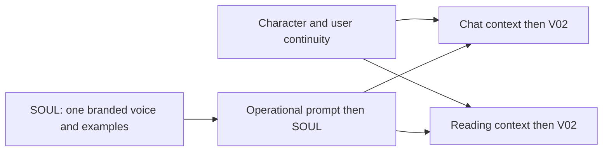

# ARCHITECTURE SNAPSHOT: Natally Conversational Intelligence & Astrological Reasoning Engine

## Authoritative customers and live payment rails — 25 October 2026

[The v3 implementation record](LIVE-PAYMENTS-2026-10-25.md) maps all concrete payment
entities, PostgreSQL records, RevenueCat authority, Firebase projection and the
card/Lightning/x402 journey. It also separates implemented code and provisioned
catalog state from outstanding runtime credentials and live settlement acceptance.

## Atelier-first layout — 25 October 2026

[AF01–AF04](ARCHITECTURE/2026-10-25-atelier-first.md) enumerate the compact entry,
scene-first layout and final responsive browser trajectory before implementation.

## Active correction: character voice, waiting recording and head silhouette

The [enumerated delta](ARCHITECTURE/2026-10-23-voice-and-cutout.md) defines VC01–VC08
before implementation. Its [continuous journey](DEMONSTRATIONS/2026-10-23-voice-and-cutout.md)
covers fresh readings, audible waiting speech and the moving character boundary.

## Active integration discovery: Zight content and media — 23 October 2026

The [authenticated MCP contract](INTEGRATIONS/ZIGHT-MCP.md) records Z01–Z05 and
all eleven live tool schemas, including the file-request upload/finalize sequence.
Natally will retain direct content/CDN references for the saved reading. A dedicated
Natally collection keeps its assets together. MCP registration and discovery are
complete; Natally runtime publishing, collection binding and archive delivery
remain implementation work alongside the billing architecture below.

## Active correction: two-response opening

[Opening architecture](ARCHITECTURE/2026-10-23-opening-sequence.md) enumerates O01–O06 before implementation; [continuous journey](DEMONSTRATIONS/2026-10-23-opening-sequence.md) covers welcome, natal reading, current overlay and billing handoff.

## Active addition: purchase-backed user access — 23 October 2026

The separate [billing specification](BILLING-SPEC.md) defines user/key records,
environment-configured allowances and RevenueCat purchase verification followed by
Netlify key creation or top-up. The [enumerated architecture delta](ARCHITECTURE/2026-10-23-billing-provisioning.md)
and [continuous journey](DEMONSTRATIONS/2026-10-23-billing-provisioning.md) precede
implementation. This explicitly adds billing/provisioning to Netlify's role alongside
the portable Swiss service. Browser inference remains direct to OpenRouter.

## Active correction: direct user-key inference — 23 October 2026

The [direct inference delta](ARCHITECTURE/2026-10-23-direct-user-inference.md)
supersedes temporary relay placement. Robin's personal key stands in for a
billing-issued user key; direct browser inference is current scope. D01–D05
enumerate implementation before coding. Netlify's role is extended by the billing
addition above; the portable Swiss service remains separately tracked.

## Earlier repair: restart, sustained voice and OpenRouter — 23 October 2026

Robin's latest scope is everything through the OpenRouter switch, using the
personal October 10 credential from `.env` or environment. Implement RP01–RP05
and DL01 in the [enumerated delta](ARCHITECTURE/2026-10-23-reading-provider-and-calculation-service.md),
then commit, push and deploy. R01–R07 extend the existing whole-codebase AST/entity
inventory before coding. The [continuous script](DEMONSTRATIONS/2026-10-23-restart-openrouter.md)
is mapped in CHECKLIST.md. The temporary relay proposal is superseded above;
restart and sustained-voice requirements remain active.

## Active review: atelier audio, idle acting and production controls — 23 October 2026

**Execution authorized by Robin: “Just get the whole thing working first.”**
The architecture -> checklist -> implementation sequence remains binding. The code baseline is
`676cab6df2bfd22804116f819aedb5a8a51e3709` on `master`, fetched from GitHub on the
active host. No cross-computer inspection forms part of this review.

The [source-grounded architecture diff](ARCHITECTURE/2026-10-23-atelier-diff.md)
defines existing and proposed entity references for this increment. Its
[Miro drawing](https://miro.com/app/board/uXjVEWFWoZA=/) is a visual review of that
diff, not a claim that the implementation exists.

The [whole tracked-codebase snapshot](ARCHITECTURE/SNAPSHOT/INDEX.md) incorporates
per-file Mermaid syntax trees and entity tables, including local bindings,
parameters, properties and reference occurrences; generated and vendored code is
included. The [semantic entity table](ARCHITECTURE/SNAPSHOT/SEMANTIC-ENTITIES.md)
adds CodeGraph names, signatures and source locations. Non-source artifacts are
fingerprinted. Large trees/tables are losslessly gzip-compressed for repository
size; application-source tables are also directly readable. Grammar limitations
are listed, with source retained in syntax error nodes; these are structural
inventories, not runtime claims. The scoped diff's proposed-entity rows extend
that baseline before coding. Every checklist task references this inventory.

Natally is in a private repository and internal development. Its own final licence
has not been decided; existing project-level licence metadata is provisional,
not an assertion that Robin has made a public release or licence grant. Upstream
dependency notices remain applicable. A standalone authenticated Swiss Ephemeris
calculation service is the agreed future boundary; its separate repository comes
after release. Neither extraction nor repository splitting is part of this repair.

## Directed reading, atelier, SOUL and About — 22 October 2026

Execution is authorized. This section supersedes historical SOUL deferral and
intermediate test/review gates for this increment. KStore's authoritative
Admin-Manual amendment is SPEC_CONVENTIONS/architecture-checklist-continuous-demonstration.md.
The requirement/task/scene mapping below is established during ARCHITECTURE ->
CHECKLIST, before implementation. The final recorded journey is
DOCS/DEMONSTRATIONS/2026-10-22-natally-complete-journey.md; DOCS/TEST_RUBRIC.md
points to that single script. No unit tests, synthetic fixtures or intermediate
review gates. Build only to run/deliver. Source publication is not acceptance.

### DR-05 performance amendment — 22 October, visible robotic acting

Robin requests stronger looping room animation and sprite-like conversation acting.
DR-05 now includes irregular pronounced flame deformation, linked warm light and
moving soft shadows on nearby shelves/objects, clearly moving sand, armillary and
clouds, retaining coordinated pause/reduced-motion/hidden-scene handling.
Natally uses articulated image/SVG layers, no runtime diffusion: head tilt,
robotic mouth closed/open shapes driven by actual voice playback and word events,
and a downward scrying head pose with hands circling/massaging the cloudy ball
through LLM and TTS preparation delays. Idle/listening must not mime speech.
A short varied waiting utterance uses the existing local voice, never another LLM
request. Prepare/reuse its audio when possible; it must not delay or overlap the
answer. Muted users get its visible equivalent without forced audio. No claim
that a cue played when the audio engine has not actually started. Cancellation,
account switch, failure, hidden scene and motion controls retain their semantics.
Voice service emits a typed `natally-voice-performance` browser event with
`{state: 'started'|'word'|'ended', charIndex?: number}` from actual playback
callbacks (including waiting utterances). Scene subscribes and removes listener;
word events retrigger articulation, playback end closes mouth. Waiting state is
owned by chat request/TTS lifecycle, not inferred from an arbitrary idle timer.
Implementation ownership: atelier worker owns scene/character/trinkets/CSS/assets;
directed-reading worker owns voice service/chat waiting lifecycle and event type.
Root owns architecture/checklist/script/integration/delivery. No tests or new
provider/dependency. The single continuous journey below remains acceptance.


### DR-06/09 amendment: living inset, playful objects and retained reading audio

Robin's next 22 October addition replaces hidden alternate panes with two live
views. Main atelier and natal chart exchange positions/scale via presentation
cues; the other stays visible as a labelled inset, animated and clickable to
bring forward. Clicking inset pins the chosen view; Follow Natally restores cue
control. Preserve one chart/chat instance, camera, speech and draft. Inset controls
must not intercept the main chart; its explicit focus button is keyboard/touch
usable. Reduced motion swaps without zoom. Narrow screens retain usable inset.
Both views remain scene-visible while inset; document visibility still suspends.

Several small trinkets (vial, crystal, hourglass and armillary) have optional
hover/focus magic, subtle light/sparkles and wobble. A pointer pass visibly nudges
the object; closely repeated passes build resonance until it can topple/break,
while one casual pass settles. Click-and-drag picks up the object for movement
and close inspection instead of instantly breaking it. Provide pointer capture,
inspect/put-back and keyboard/touch equivalents; release outside its supporting
shelf may topple it. Ordinary reading use never requires engagement or breakage. Only cosmetic props break; Natally, room and reading controls
stay usable. Dispatch `natally-atelier-mishap` with `{durationMs:1200,itemId}` on
actual shatter: voice pauses at its current playback position, mouth and word/cue
progress pause, then speech resumes without restart or commentary. Stop/mute/account
change must cancel pending resume. No distress, reprimand or required interaction.

Each broken prop stays broken this session and returns silently next session with
a distinctly clumsy repair: crooked overlapping tape, uneven seam, lifted corner.
Persist each object's history per account until explicit erasure of the entire
Natally relationship history. Chat-only clearing does not repair props; no standalone
atelier reset is available. No automatic pristine repair, no Repair button or replacement reminders.
The reader may never discover this optional ecosystem; core readings are complete
without it. Natally discusses damage only when asked, using actual room history.

Optional replacement is priced at 1 $ROCHE, intended as approximately one shared
cross-app conversational turn. No obligation and no feature restriction; keeping
the taped object indefinitely is equally valid. Only verified server settlement
may grant a purchased replacement. The present source has no live wallet/debit
integration (billing preview only); record this dependent task without inventing
balances, simulated debit or a button that claims a purchase succeeded.

Cosmetic controls remain accessible by keyboard/touch; reduced motion keeps clear
states without forced animation. Root passes accountUid to ReadingStage/AtelierScene.

Retain one or more completed real reading audio buffers as playable/downloadable
WAV in account-scoped local storage with bounded retention and explicit clearing.
No invented audio, extra hosted inference, model weights or incomplete stream
labelled as full reading. Capture all actual reading segments in their spoken
order and exclude waiting utterances. Offer retained audio beside the reading.
Where existing SPA/PDF export permits, attach the matching WAV as a companion
export (PDF itself must not imply portable embedded audio unless supported).
Record source message and voice settings; clearing/account changes prevent another
account seeing or replaying these recordings. Explain storage failure in context.
These requirements extend DR-06 (inset, interactions) and DR-09 (reading audio).
Root owns ReadingStage/App props and docs; atelier worker owns interactions;
audio-retention worker owns cache/export and coordinates voice buffers with the
voice worker. No new provider, runtime dependency, testing or intermediate gate.

### Discussed future voice fallback (not activated)

Robin asks whether an on-load device experience check can select hosted TTS while
leaving local generation in place now. Existing generationMs/audio duration and
failure events can support startup/first-utterance capability assessment plus real
playback monitoring, with result cached by device/model version. Reuse greeting
output, avoid repeated heavy probes or mistaking model-download time for sustained
synthesis speed. Automatic metrics detect latency/failure, not subjective voice
quality. Keep a manual preference and deliberate consistent alternate voice; switch
between utterances. Hosted voice must use server credentials, bounded charges and
cancel-safe existing presentation/cache lifecycle. No hosted provider was activated.
On 22 October official Groq documentation lists English Orpheus at USD22/million
characters and max200 input characters/request; OpenRouter documents /audio/speech.
Sources: https://console.groq.com/docs/text-to-speech/orpheus and
https://openrouter.ai/blog/tutorials/text-to-speech/ . Recheck before provisioning.

### Brand identity amendment

Robin requires removal of Natally-avatar upload/customization. All character
surfaces use bundled brand artwork and ignore historical saved custom avatar URLs.
Remove the upload/reset UI and click-to-upload routes; keep ordinary chat image
attachments. Do not delete the user's original image files or conversation data.
This extends DR-04/DR-09 and demonstration scenes 1,2,8,10 (configuration contains
no avatar upload, reload does not restore a custom avatar, media sharing remains).

### Architectural requirements and checklist contracts

- **DR-01 Prompted selection.** App owns canonical manual selection. Ordinary
  chat and Begin/Discuss capture selection, chart identity, current view and
  last action receipt. Natally is instructed to answer the selected subject
  using calculated placements and execute presentation actions. One planet or
  an arbitrary pair must not be mislabeled as an aspect. Selection reveals
  details immediately; Discuss triggers one hosted response. Repeated submits
  share an in-flight guard. Errors remain visible with appropriate retry/sign-in.
- **DR-02 Directed presentation.** Validated focus/clear/view/panel actions own
  React state, never arbitrary DOM code. Speech boundaries advance cues;
  muted reading uses explicit passage controls. Saved legacy chart cues replay.
  Malformed/unavailable targets cannot change the UI; cue syntax is neither
  displayed, spoken nor exported. Manual view pin overrides Follow Natally.
  Account/chart/request generations invalidate old responses and effects.
- **DR-03 Chart attention.** Canonical text references work through case,
  whitespace and emphasis markup. Chart and reply Show controls visibly reveal
  the subject even when already selected. Dim other chart material, keep glyphs
  and controls sharp, use a soft halo with one or two gentle pulses then steady
  emphasis. Repeated focus restarts emphasis; clear preserves manual selection.
  Animation values are adjustable design choices, not golden-ratio or empirical
  standards. Ensure continuity into the steady state. Reduced motion is steady.
- **DR-04 Shaded atelier.** Preserve the supplied silver robot/amber eyes/violet
  turban and cloak identity in a high-resolution, coherently shaded close-up.
  Integrate realistic wood, brass, cloth and glass with contact shadows,
  candlelight and crystal illumination; avoid enlarged low-resolution cutouts.
  Bundle scene layers and static loading/error fallback. Track asset provenance
  and actual compressed sizes (target <=6 MiB new art). Existing fal credit
  (about USD10), Hugging Face paid access and ZeroGPU are available resources;
  no top-ups or additional subscriptions. Preserve the original reference art.
- **DR-05 Living room.** Animate sand flow and changing levels, rotating gizmo,
  irregular flames, masked scrying clouds and drifting overhead constellations.
  Conversation glow reflects actual idle/listening/thinking/speaking events.
  Pause/reduced-motion/hidden scene or tab stop decorative work, not speech.
  Constellations are decorative, never represented as the calculated chart.
- **DR-06 Continuous stage.** Atelier is the conversational default; actual
  cues alternate atelier/chart/atelier. One chart and conversation remain mounted
  with camera, draft, history, scroll and active audio/request intact. Controls
  Reading room / Your chart / Follow Natally remain reachable, including narrow
  screens and a real mobile keyboard. Hidden chart resizes correctly on return.
- **DR-07 SOUL and two lore stores.** SOUL is active, required for immersion.
  A shared SOUL.md defines the robo-psychic personality: young psychic-school
  graduate, one-hour hotline career, warmth, gentle ennui, occasional fitting
  Gen-Z language and harmless oversharing. Preserve the old persona as history.
  Persist per-account fictional character facts separately from user-disclosed
  facts/shared history. Seed initial variation once; persist later developments
  rather than rerolling. Persona cannot override ephemeris facts or invent user
  biography. No guilt/dependency pressure, idle pretend speech or timbre claims.
  Use the existing account/storage boundaries, not new database infrastructure.
- **DR-08 About and source.** With no menu bar, Profile exposes the standard
  About splash and public GitHub source link. Populate actual product/build,
  copyright, licence and dependency notices from verified project records;
  resolve the existing standard via KStore rather than inventing licence facts.
  Preserve Swiss Ephemeris notices and provide corresponding source access.
  A link alone is not a claim that every xGPL obligation is fulfilled.
- **DR-09 Preservation and recovery.** Keep existing full reading, horoscope,
  synastry, calculation tools, Supertonic voice and account isolation working.
  Unknown birth times suppress houses/angles; partner/transit data cannot be
  presented as visible natal placements. Network/storage/asset failure leaves
  a usable conversation and honest recovery. No fabricated status or fixtures.
- **DR-10 Delivery and demonstration.** Complete DR-01..09, then record one
  continuous real user trajectory covering every mapped requirement, including
  source/About, real inference/audio, persistence and device transitions.
  Timecoded observations and stills support every claim. Missing requirements
  remain unfinished. Publish scoped commits, verify GitHub remote, and deliver
  through the existing authorized hosted path without changing providers.

Implementation plans: directed-reading (DR-01..03), animated-atelier (DR-04..06),
and soul-about (DR-07..09), all dated 2026-10-22 under DOCS/superpowers/plans/.
Root architect owns architecture/checklist/script; separate coding agents own
nonoverlapping implementation surfaces, coordinate interfaces, then integrate.
This separation is not an intermediate review/approval gate.

### Imported cloud scope and preserved work

Cloud commits through 1489f70 are merged (documentation only). The original
staged Tauri work remains in its checkout. NAT-20261021 commerce/sync entries
below are preserved, with historical runner/test metadata superseded by the
current global execution rule. The separate billing preview, provider setup,
currency decision and commerce release are not silently folded into this
reading/atelier increment. The script records these inherited tasks and their
unreleased prerequisites explicitly; completion of DR-01..10 must not be
reported as completion of the entire historical repository backlog.

## Launch direction supersession — Robin, 21 October 2026

Defer WooCommerce and its custom-plugin buildout. Launch first with RevenueCat
for site-centric PDF/SPA sales and Alby marketplace for per-turn readings.
Earlier statements below assigning all commerce to WooCommerce are historical
and superseded for this launch. Keep provider funding, customer receipts,
deliverable ownership and per-turn inference reservations distinct.

Develop on `codex/revenuecat-alby-preview` with a separate review entry point.
Do not merge into main, change the main app's runtime or deploy production.
Existing Supertonic stays as-is. The staged Tauri test-build work is preserved
separately; it is not evidence that the payment paths are implemented.

RevenueCat purchase confirmation must be verified server-side before granting
PDF/SPA delivery. Alby per-turn fulfillment must bind a settled invoice to one
bounded request and recover retries without double charging. Client redirects,
wallet success callbacks and browser storage are not settlement authorities.
Production payment configuration, pricing, tax/processor setup and supplier
funding remain explicit integration contracts, not invented by the prototype.

RevenueCat project selected by Robin: `projaba0bd94` (Robin's AI World). The
`Natally` offering (`ofrng352609e01b`, lookup `Natally`) was created and verified
through MCP on 21 October. It is not the current/default offering. The project
has both active `AICREDIT` (named ROCHE, with existing ecosystem grants) and
`ROCHE` (named Roche Credit) codes; clarification is pending before balance or
grant binding. Do not create another currency or assume the two balances merge.
Cross-app sharing requires the same verified ecosystem customer identity and
currency code. No products, prices, grants or live purchase were created here.

## Profile and billing design amendment — Robin, 19 October 2026

### Payment-funded Venice inference

Robin specifies Venice AI for scalable hosted LLM inference in place of reliance
on the current GLM serving arrangement. Audio remains this repository's existing
Supertonic implementation. Verify the changed design, funding and request paths;
do not expand this task into unrelated audio/device acceptance work.

Add a server-owned funding worker behind WooCommerce/custom plugin: verified
settled payment → durable customer credit entry → bounded provider allocation →
confirmed available Venice capacity → inference cost reservation → actual usage
reconciliation. Customer balances and the operator's Venice balance are distinct
ledgers. Every funding attempt is bound to a settled order and idempotency key;
persist pending/confirmed/failed/uncertain states and provider payment/transaction
IDs. Reconcile uncertain outcomes before retrying to avoid paying Venice twice.
Refunds and chargebacks must account for already consumed inference.

Venice's current documented programmatic funding route is `/api/v1/x402/top-up`,
which discovers accepted USDC settlement options on Base/Solana and returns a
provider credit receipt. This is separate from `/api/v1/api_keys`, which creates
restricted keys without adding funds. The x402-funded wallet path uses wallet
authentication for inference; do not assume it credits an unrelated bearer-key
account. A Lightning/card customer payment therefore needs an explicitly chosen
treasury/conversion bridge to the supported provider rail, or a verified funded
operator account with replenishment controls. No conversion service, wallet,
fee, custody arrangement or live transfer is selected or performed by this note.

Bound provider allocations by settled net receipts, fees and an explicit reserve
policy. Use atomic per-customer/per-order reservations, a shared global exposure
ceiling, concurrency/rate-limit queue and bounded retries. Check actual provider
balance/rate limits before dispatch. Never create a new provider allowance when
retrying or switching models. Keep management keys and treasury signing outside
browser/model context; never route wallet-send tools through the conversation.
Integrate with the actual hosted request path, not only the Express development
registry. Model/tool/streaming compatibility and capacity still need measured
verification; choosing Venice alone does not establish throughput.

Primary sources checked 19 October 2026:
- https://docs.venice.ai/api-reference/endpoint/x402/top-up
- https://docs.venice.ai/api-reference/endpoint/api_keys/create
- https://docs.venice.ai/api-reference/rate-limiting

The signed-in user's displayed name opens the Profile section. Profile contains
an account-management area with Balance and Top up actions, a Buy natal chart
action covering PDF and SPA (including the interactive conversational reading),
and a link that expands into full billing account management. WooCommerce and
the custom plugin remain the single server authority for purchased access,
credits, usage, orders, payment verification, refunds and recovery. A displayed
balance is server-derived; frontend state must never grant purchased access.
No prices, free credit allowance or recurring terms are invented by this design.

Required screen inventory: signed-in name entry, Profile/account overview,
balance/usage detail, top-up selection and quote, payment pending/success/failure
and resume, natal PDF/SPA purchase with conversational inclusion, delivery and
interactive-reading entry, and expanded billing management with orders/receipts,
purchase history and recovery/refund states. Enumerate existing screens before
creating missing ones. Preserve the existing prepaid funnel and free signup.

Design assets must belong explicitly to `rebots-online/natally-ai-studio`.
Import the requested large-character conversation/atelier/constellation work
from `rebots-online/natally-chatterbox` as attributed design material into this
repository and its OpenDesign/Stitch project. This does not import Chatterbox
voice code or change this repository's existing Supertonic runtime. OpenDesign
and Stitch inventories record actual project IDs, screen IDs, provenance and
which account-management screens exist. Imported simulations remain labelled
as design prototypes until wired to real account/billing/reading services.

## Tauri 2 coordinated test builds — 19 October 2026

Robin requests a scripted test-build matrix, not a production native release.
One invocation of `scripts/build-all-platforms.ps1` stamps once, persists an
unconditional MINOR increment even on failure, and builds Windows x64 application
EXE/NSIS/MSI, Linux amd64 AppImage/DEB, Android ARM64 APK/AAB/native-symbols ZIP,
and the web ZIP plus nginx/Apache installer. All consumers use the canonical
`version.json` identity; nested platform steps never stamp independently.
MAJOR starts at 0 for this test shell and remains an explicit operator choice.
BUILD is UTC epoch minutes modulo 100000. Android versionCode is MAJOR*100000+MINOR.
MSI numeric versions map MINOR into the second/third fields and BUILD modulo
65536 into the fourth field; display strings retain the full canonical version.
MSI upgrade ordering uses MINOR without wrapping, within its 8/8/16-bit limits.

`src-tauri/` is the repository-owned Tauri 2 shell around the existing frontend.
It introduces no privileged commands or remote capabilities. A visible full
version label is embedded in the generated web bundle and native window title.
Windows EXE/MSI/NSIS use native Windows tooling. Linux scripts enforce Ubuntu
24.04 and reuse the existing default WSL installation, Rust and Node runtimes.
No separate WSL distribution or application checkout is created. Shared Windows
tools remain external; compilation caches contain no separate application repo.

Build entities and their engaging checklist tasks:

| Entity | Responsibility | Task |
|---|---|---|
| `version.json`, `scripts/release-state.mjs` | canonical stamp, input fingerprint, derived identities, inventory and hashes | BUILD-1 |
| `scripts/build-all-platforms.ps1` | exclusive coordinated invocation, every target attempted, staged partial output, aggregate exit status | BUILD-2 |
| `scripts/build-linux.sh`, `scripts/linux-build-env.sh`, `scripts/setup-linux-build-env.sh` | Ubuntu 24.04 checks, extant tools, AppImage/DEB | BUILD-3 |
| `src-tauri/`, `scripts/native-build-env.ps1` | repository shell, Windows packages, Android release-profile test packages | BUILD-4 |
| `scripts/install-web.sh` | explicit server/destination/domain, validated nginx/Apache SPA configuration and reversible installation | BUILD-5 |
| `dist/natally-ai-studio-v<version>-*` | durable artifacts, manifests, build logs and actual validation results | BUILD-6 |

Web compilation uses disposable `dist-web/`; it must never empty root `dist/`.
Every available artifact is copied immediately to tracked `dist/`. Manifest
completion requires all requested artifacts and package checks; test-build
completion never asserts production signing, store acceptance or device runtime.
Android test packages use the local Android debug certificate with an explicit
test application identifier, not production credentials. No provider/production
deployment or store upload is part of this build. The web installer is delivered
and tested locally; running it on a production host is a separate action.

Authority: current KStore CC2/CC7/CC12/CC14/TC14, with Robin's explicit correction
that local builds are scripted and Ubuntu 24.04 is mandatory. Historical manual
environment selection and Ubuntu 22.04 probe instructions are superseded.

### Commerce interoperability amendment — 2026-10-21

WooCommerce is **not a launch dependency**. Its future Biddlr plugin should implement our versioned provider-neutral commerce contract with RevenueCat-v2-*shaped* server-side entities for customer identity, non-renewing purchases, active entitlements, refunds, and virtual-currency transactions. This is *semantic/adapter compatibility*, NOT spoofing RevenueCat's public API host, proprietary Web Billing SDK checkout, signed receipts, or private authorization flows. Do not claim drop-in RevenueCat SDK compatibility. Internal Firebase UID and our append-only idempotent ROCHE ledger remain authoritative for granting/revoking inference credits across Alby, RevenueCat and the future WooCommerce plugin. Platform-native store entitlements remain externally verified. Webhook ingestion must normalize provider IDs and deduplicate. Future WooCommerce order.completed/refunded events map to common purchase-granted/purchase-revoked events; RevenueCat webhook/API similarly maps to canonical events. Alby marketplace per-settled-turn route is the initial launch, and does not require RevenueCat or WooCommerce configuration. RevenueCat is optional for direct-store one-time PDF+SPA and ROCHE packs when Natally's own catalog exists. No work on WooCommerce needed now.


## NAT-20261021 — Exploration continuity and two-channel commerce

Metadata: project=Natally; repo=rebots-online/natally-ai-studio; branch=feature/natally-exploration-sync-commerce; owner=Robin; date=2026-10-21; blueprint-status=approved direction, release-unverified; precedence=this amendment supersedes older 15-minute/WooCommerce-only or per-turn-only statements where specified; execution=ARCHITECTURE -> CHECKLIST -> code; runner=GLM-5.3 nonthinking discrete deterministic steps; evidence=diff + tsc + browser + backend tests; deployment=prohibited until gates pass.

**Customer offer.** Approximately USD 29.99 buys durable natal PDF and interactive SPA, plus a five-minute free/included voice-paced exploration. Start timer on first accepted question, not purchase; accept one question/inference at a time and finish answers begun before expiry. Additional exploration by separately purchased ROCHE packs. USD price, ROCHE denomination/exchange, consumable mechanics and product identifiers remain pending explicit catalog configuration, not hard-coded assumptions. Do not conflate free included minutes with anonymous free usage.

**Initial distribution and marketplace.** Alby marketplace is launch channel, with *per completed turn* metering for its payment pathway rather than requiring up-front flat-chart purchase. Distinguish store product access from conversation usage. Generate per-turn quotes/invoices and independently verify settlement before expensive hosted inference; idempotent payment and consumption accounting in server ledger. Do not grant paid use from client localStorage, untrusted webhook or a wallet popup. Offer alternative on-site one-time PDF+SPA purchase without making Alby marketplace incompatible. Integrate behind a commerce adapter rather than fork chat, chart and persona. This feature branch is the integration lane; do not merge/publish until approved and tested.

**RevenueCat.** No confirmed Natally project or products; Kintsugi may be the sole project. Implement only independently configurable RevenueCat Web Billing adapter, not Kintsugi credentials nor assumed SKU. RevenueCat intended for one-time chart product and optional ROCHE packs; its receipts, refunds, pack grants and balance must be verified on server with idempotent processing. Android billing policy/Play Billing handled separately. No fake purchasable items; configure exact IDs and secrets externally.

**Synced account data.** Firebase UID is the identity. Chart birth input already syncs to users/{uid}/private/intake; derived chart can be recomputed. Lore and conversation currently only use UID-scoped localStorage. Firestore per-account document paths users/{uid}/private/lore and users/{uid}/private/conversation hold versioned snapshots; merge legacy local contents before first cloud write, by lore text and message ID. Account switches and late writes must not cross accounts; remote failure leaves local intact, with explicit visible sync state and retry. Never overwrite remote with an initial greeting. Restrictive Firestore rules for actual configured named database must be deployed and empirically verified separately.

**Persona and flip-chart.** Preserve historical NATALLY_SYSTEM_PROMPT in comments; add occasional context-fitting 'bet' / Gen Z verbal register, never repetition or stereotypes. Existing ChartCue offsets and chart focus callbacks are the flip-chart mechanism: cue a relevant calculated entity as spoken, clear focus on changing subject, don't claim visual changes unless emitted through actual cue pipeline. TTS determines normal turn pace, can be interrupted; no backend inference queued during ongoing answers. No change to Swiss Ephemeris's role as factual source.

**Delivery contract.** Docs first, task recipe second, code third. Preserve local cache; no production access or entitlements until authenticated server accounting, tests, live rules and catalog are demonstrated. Never reuse secrets from another product.


## Deferred amendment — mobile transfer cost and deployment URL, 15 October 2026

**Status: documentation only; implementation deferred by Robin.** The new
Chatterbox and potentially Qwen TTS work is operating as fully templated
repositories and may replace this checkout. Record the requirements here for
the retained application/template; do not change this application's code,
environment files, voice engine or deployment for this amendment. Replacement
of this repository or adoption of either TTS engine is not decided by this note.

This amendment takes precedence over the historical voice/deployment descriptions
below for these two concerns. It does not mark either issue as repaired.

### Repeated large transfers on reload

Robin reports that the application still reloads approximately 30 MB each time,
wasting mobile data. Treat this as an open defect. Earlier desktop cache or
offline-playback checks do not establish that the current mobile journey avoids
repeat transfers. The reported amount has not been attributed here to model
weights, the voice runtime/WASM, application assets, or a combination; this
documentation change does not diagnose the cause.

The eventual implementation must:

- Reuse unchanged, previously downloaded voice model and runtime assets across
  ordinary reloads and returning sessions. A new worker or inference session
  must not itself require another large network download.
- Give persistent assets stable, version-specific identities and verify cache
  reuse through the actual deployed origin. Ordinary releases must not invalidate
  unchanged large assets unnecessarily. Investigate cache lookup, response cache
  policy, URL/version churn and browser storage eviction before choosing a fix.
- Distinguish network transfer from reading cached bytes into memory and from
  initializing the inference engine. Progress labels and measurements must report
  those separately; loading a model into memory is not evidence of downloading it.
- Explain any genuinely required initial/replacement download and its known size
  before starting it. A missing or evicted cache must not produce an unnoticed
  loop of repeated large downloads and retries on a mobile connection.

Acceptance requires recorded network bytes for a first load, same-tab reload,
returning session and a release that leaves the large assets unchanged, plus an
offline warm start and a cache-miss/eviction case. Warm loads with the required
assets still cached must transfer no model/runtime payload again. Separate
ordinary small requests from the approximately 30 MB complaint. Verify the real
mobile browser/device journey; cached-byte counters, a desktop run, or successful
audio playback alone do not prove mobile-data reuse.

### Footer URL follows the deployed environment

Robin reports that the bottom-right URL names a different address from the site
actually deployed. The application's public URL belongs in `.env` configuration,
with an override for each deployed environment. A proposed setting is
`VITE_PUBLIC_APP_URL`; this name is a design proposal, not an existing setting
introduced by this amendment.

The footer's displayed URL and link destination must use that same configured
public URL. Production, public test and local development must each resolve to
their own effective deployment address, without a hard-coded historical domain
or a silently substituted address. Deployment verification must check the
configured address, the address actually served, the visible bottom-right text
and its link destination together. Any intended alias/redirect must be explicit.

Carry both requirements into the chosen Chatterbox/Qwen TTS template if it
replaces this checkout. No implementation or deployment is authorized in the
current repository by this documentation-only request.

---

```yaml
Metadata:
  Project: "AstroSphere 3D"
  Repository: "ai-studio-remixastrosphere-1ee57c33-6487-411a-a872-59fbf4cbfc63"
  Branch: "main"
  Version: "2.4.0-restoration"
  Date: "2026-10-09"
  SourceCommit: "HEAD"
  Scope: "Conversational intelligence, context continuity, inference resilience, astrological doctrine synthesis, and voice/mascot integration"
  ArchitecturalOwner: "Principal AI Systems & Astrological Epistemology Engineer"
  RelatedDecisions:
    - "ADR-001: Upgrade server-side Gemini model routing to gemini-3.8-flash (deprecating dead gemini-2.5-flash endpoints)"
    - "ADR-002: Eliminate silent deterministic fallback impersonation; establish structured error classification and retry mechanisms"
    - "ADR-003: Decouple persistent lore, live chart coordinates, conversational history, and epistemological scaffolding"
    - "ADR-004: Rigorous geometric aspect configuration detection (genuine Grand Trine, T-Square, Grand Cross) adhering to strict orb criteria"
    - "ADR-005: Optional on-demand evidence and provenance inspector instead of conversational boilerplate insertion"
    - "ADR-006: Restore Natally's authentic Moldavian-inspired cosmic confidante persona (witty, empathetic, depth-psychological, zero catchphrase slop)"
  Dependencies:
    - "@google/genai: ^2.4.0"
    - "express: ^5.2.1"
    - "swisseph-wasm: ^0.1.0"
    - "three: ^0.174.0"
    - "react: ^19.0.1"
  AcceptanceCriteria:
    - "100% pass on Regression Tests A through J (referential continuity, personal disclosure, sequential topics, interpretive continuity, honest ambiguity, broad synthesis, deliberate failure handling, repetition resistance, lore isolation, doctrine distinction)"
    - "Zero silent fallback masking failed inference with canned responses"
    - "Zero unprompted analytical scaffolding tags (`[Verified geometry]`, etc.) in ordinary dialogue"
    - "Accurate aspect configuration detection (no false T-squares from unlinked squares/oppositions, no false Grand Trines from single trines)"
    - "Preservation of Moldavian audio synthesis, karaoke tracking, 3D astrolabe interactions, and persistent lore archive"
  ImplementationStatus: "Complete"
```

---

## 1. Executive Summary & Root Cause Analysis

### 1.1 The Primary Breakdown
The observed catastrophic regression in Natally's conversational intelligence was caused by a combination of critical infrastructural, architectural, and prompt design defects:

1. **Dead Model Endpoint Routing (`server.ts`)**:
   `/api/chat` and `/api/readings` were invoking `model: 'gemini-2.5-flash'`. The Google Gemini API returns HTTP 404:
   `"This model models/gemini-2.5-flash is no longer available to new users. Please update your code to use models/gemini-3.8-flash..."`
   Every single conversational request to the backend resulted in an unhandled 500 server error.

2. **Silent Deterministic Impersonation (`src/services/natallyChat.ts`)**:
   Instead of reporting the API failure or triggering a retryable state, `askNatally()` silently caught the failed HTTP request and invoked `getNatallyFallbackReply()`. This generator used crude regex matching on words like `"love"`, `"career"`, `"moon"`, `"hello"`:
   - Queries mentioning `"love"` or `"lovers"` (e.g. *"Do you see my twin flame or other love interest in my stars?"* and *"Lovers first. Then career."*) invariably returned the identical hardcoded Venus paragraph containing `"no shallow games allowed!"`.
   - Elliptical follow-up questions like *"What do you mean 'no games'?"* lacked the word `"love"` and fell through to a generic `"cosmic awakening"` canned template.
   - Significant personal disclosures (e.g., trauma affecting sexuality) failed keyword matching and produced canned greetings like `"Beep-boop! Salut bestie-chan!"`.

3. **Prompt Degradation & Catchphrase Inflation (`NATALLY_SYSTEM_PROMPT`)**:
   The system prompt explicitly instructed the model to be *"Overflowing with cute robot expressions: 'Beep-boop starlight! ✨', 'Nya~ 🌟', 'Salut bestie-chan! 💖', 'UwU ✨'"* and mandated mechanical reproduction of internal workflow blocks: `[Verified natal geometry]`, `[Traditional doctrine]`, `[Stable interpretive hypotheses]`, `[Independent observation]`.

4. **Context Collapsing & History Pollution**:
   Raw chart metadata was repeatedly dumped as a prefix into every user turn message rather than being maintained in the structured system instruction or conversation state. History turns were sliced without validation of role alternation or empty content.

5. **Spurious Astrological Configuration Logic (`src/services/astrowisdom.ts`)**:
   The pattern detection logic diagnosed a *"Dynamic Cardinal T-Square"* simply if `hasOpposition && hasSquare` were true, regardless of whether the planets were linked or cardinal. It diagnosed an *"Elemental Grand Trine"* whenever a single `hasTrine` existed!

---

## 2. Target Architecture & Execution Path

```
+---------------------------------------------------------------------------------------------------+
|                                        BROWSER (CLIENT SPA)                                       |
|                                                                                                   |
|  +----------------------------+   +-----------------------------+   +--------------------------+  |
|  |     NatallyChatbot UI      |   |       Astrolabe3D / UI      |   |    ThemesAndWisdomBox    |  |
|  |  - Active conversation     |   |  - Real Swiss Ephemeris     |   |  - Life Path Engine      |  |
|  |  - Preserved unsent draft  |   |    Planetary Coordinates    |   |  - Verified Geometry     |  |
|  |  - Retry / Error banner    |   |  - Interactive Aspect Rims  |   |    Aspect Configs        |  |
|  |  - Evidence toggle / view  |   +--------------+--------------+   +-------------+------------+  |
|  +--------------+-------------+                  |                                |               |
|                 |                                v                                v               |
|                 |                   +-----------------------------------------------+             |
|                 |                   |       ephemeris.ts / astrowisdom.ts           |             |
|                 |                   |  - Rigorous Orb & Configuration Detectors     |             |
|                 |                   |  - True Grand Trine / T-Square / Grand Cross  |             |
|                 |                   +-----------------------+-----------------------+             |
|                 |                                           |                                     |
|                 v                                           v                                     |
|  +-----------------------------------------------------------------------------------------+      |
|  |                                  natallyChat.ts (Client Service)                        |      |
|  |  - Separates: System Persona, Natal Context, Persistent Lore, Clean Turn History        |      |
|  |  - Dispatches typed requests with configurable hyperparameters                          |      |
|  |  - Structured Error Classification: Quota / Auth / Network / Offline                    |      |
|  |  - Explicit Provenance & Evidence extraction (parsed from technical annotations)       |      |
|  +----------------------------------------------+------------------------------------------+      |
+-------------------------------------------------|-------------------------------------------------+
                                                  | HTTP POST /api/chat, /api/readings, /api/tts
                                                  v
+---------------------------------------------------------------------------------------------------+
|                                    EXPRESS BACKEND (server.ts)                                    |
|                                                                                                   |
|  +-----------------------+  +--------------------------------+  +-------------------------------+ |
|  |     POST /api/chat    |  |       POST /api/readings       |  |          POST /api/tts        | |
|  | - gemini-3.8-flash    |  | - gemini-3.8-flash             |  | - gemini-3.8-flash-lite-tts   | |
|  | - System Instruction  |  | - Temperature: 1.25            |  | - Voice: Kore                 | |
|  | - Alternating Turns   |  | - Comprehensive synthesis      |  | - Web Audio + Karaoke sync    | |
|  | - Thinking Level Low  |  +---------------+----------------+  +---------------+---------------+ |
|  +-----------+-----------+                  |                                   |                 |
|              +------------------------------+-----------------------------------+                 |
|                                             |                                                     |
|                                             v                                                     |
|                           +-----------------------------------+                                   |
|                           |   @google/genai TypeScript SDK    |                                   |
|                           |   process.env.GEMINI_API_KEY      |                                   |
|                           +-----------------------------------+                                   |
+---------------------------------------------------------------------------------------------------+
```

---

## 3. Epistemological & Context Assembly Architecture

### 3.1 Five-Tier Context Isolation Strategy
To prevent undifferentiated prompt pollution, context is assembled into distinct tiers:

1. **System Persona (`systemInstruction`)**:
   Defines Natally's identity as a Moldavian-inspired celestial confidante with high psychological acuity, warmth, witty candor, and philosophical depth. Defines conversational rules: listen deeply, answer specific questions directly, track pronouns, acknowledge disclosures with empathy, speak naturally without catchphrase spam or exposed analytical brackets.

2. **Verified Natal Anchor (`natalContext`)**:
   Exact mathematical coordinates computed from Swiss Ephemeris: planetary longitudes, signs, houses, dignities, exact aspects, and detected major configurations. Provided as reference grounding so Natally never hallucinates planetary coordinates.

3. **Persistent Lore Memory (`userLore`)**:
   Long-term biographical facts and preferences stored across sessions (e.g. native's background, past topics). Injected as biographical memory, clearly marked as distinct from live conversational turns.

4. **Conversational Turn History (`history`)**:
   Strictly sequenced, alternating `user` and `model` turns. Sanitized to ensure valid role ordering, non-empty text, and preservation of verbatim utterances so that follow-up questions (e.g., *"What do you mean by games?"*) resolve naturally.

5. **Evidence & Provenance Metadata**:
   When technical analysis is performed, the model can optionally provide structured evidence citations (or a designated evidence footer `---EVIDENCE---`) that the frontend parses into an on-demand expandable "Cosmic Geometry & Provenance" inspector rather than cluttering ordinary conversational speech.

---

## 4. Geometric Aspect Configuration Invariants

Aspect patterns must adhere to mathematically rigorous celestial geometry:

- **T-Square**:
  Requires an Opposition between two bodies ($180^\circ \pm 8^\circ$) where BOTH bodies simultaneously form a Square ($90^\circ \pm 7^\circ$) to a third body (the apex). Must identify the apex planet and modal quality (Cardinal, Fixed, Mutable).
- **Grand Trine**:
  Requires THREE distinct celestial bodies in mutual Trine aspects ($120^\circ \pm 8^\circ$) forming a closed triangle, typically spanning the same astrological element (Fire, Earth, Air, Water).
- **Grand Cross**:
  Requires FOUR distinct celestial bodies forming two oppositions ($180^\circ \pm 8^\circ$) and four connected squares ($90^\circ \pm 7^\circ$).

---

## 5. Verification Boundaries & Invariants

1. **No Silent Fallbacks**: The system must never present a canned keyword-matched message as a successful reading. If an API call fails, the client must surface a clear status banner with a retry trigger and retain the user's uncommitted input.
2. **Deterministic Offline Mode**: If deliberate offline simulation is requested or during complete API unavailability, the fallback must be clearly watermarked as `[Offline Calibration Mode]` and must contextualize the conversation history rather than repeating identical static strings.
3. **Voice Compatibility**: Output formatting must be speech-friendly; the speech synthesis pipeline strips structural Markdown and technical brackets, while preserving expressive punctuation.

## Atelier refinement — 22 October, observed interaction feedback

DR05: Replace identical per-word mouth pulses with approximate text-informed closed, small-open, wide-vowel, rounded and smile/spread shapes. Timing follows actual playback windows; spelling is an approximation, not phoneme alignment. Stop on pause/end/mute, including retained audio; preserve reduced motion.
DR06: Lift and tilt picked trinkets with depth/shadow; release anywhere along any visible shelf snaps their base to that shelf. Crowding nudges neighbours and can topple them. Actual break produces a brief modest material sound respecting mute, alongside the existing quiet speech pause. Persistent broken/taped history remains unchanged.
DR09: Chart must render within its labelled inset when the atelier is main, including following resize/view transitions. A frame without chart content fails this requirement.
Development inference remains GLM through the coding plan; provider migration is outside this refinement.

22 October history correction: no atelier-only reset. Ordinary chat clearing does not repair objects. Only explicit erasure of the entire Natally relationship history resets damage/placements; eventual actual replacement is separate. Demonstrate the scope/confirmation without deleting the operator's real history.

Further live feedback: switching main/inset views must never interrupt narration-driven chart highlighting; pinning selects layout only. Observe spoken focus continuing through a mid-sentence view swap and in the inset. Cloudiness must visibly drift continuously, with distinct wisps rather than a static painted ball; gentle hand cradling continues and thinking/scrying has stronger massaging motion, including the inset. Pause/reduced-motion/hidden-page controls remain respected.

## Aspect relationships and dated current sky — 22 October live correction

DR03/DR09: An aspect is a relationship: focus includes both actual endpoints and its connecting line together, for conjunction, sextile, square, trine and opposition. When two natal planets are focused, illuminate their existing calculated aspect if present; never fabricate one from the words alone. A conjunction must remain visible even where angular endpoints nearly overlap.

Add a separately styled cyan current-sky ring outside the natal chart, with explicit Now/Natal labels, observation timestamp, and refresh control. Current longitudes and transit-to-natal aspects use the existing Swiss Ephemeris calculation. Prompt inventory, display and selected details consume the same snapshot. Each current target/aspect ID includes its observation timestamp so old readings cannot silently point at new current positions. Natal target identity remains stable. Unknown birth time continues to exclude precise natal Moon/angle aspects. Failure to calculate the current sky must leave natal available and report current sky unavailable. Explicit historical tool calculations are not presented as this displayed now-layer.

Natally emits a relationship cue containing the exact calculated aspect, not a sequence of isolated planet cues. The renderer expands it to both endpoints and the line. Narration continues this focus in main or inset and through manual view swaps. A labeled relationship readout makes the pairing/type/orb legible at inset size.

Aspect delivery correction: the live relationship request exposed a 34,004-character system prompt against the existing 32,000-character hosted limit. Serialize each current position/aspect once in the presentation inventory, omit duplicate natal geometry and opaque chart fingerprints from receipts. Retain calculated facts and conversation history. Focused endpoint writing must remain crisp on an opaque dark backing with full name, natal/current identity and placement; the halo sits behind the writing.

Relationship hover must identify the exact intersecting line and its endpoints without replacing narration/manual focus; leaving clears only hover. Historical re-reading must restore passage focus from saved cues or conservative text/reference recovery, preserving observation identity rather than silently substituting the current sky.

Saved-reading observation identity: chat and modal/custom-date readings retain the exact snapshot used for inference, cue parsing and calculations. Replay displays that archived observation without replacing the conversation session chart or cancelling speech. Discuss/retry captures the displayed observation. Legacy messages without a reliable snapshot recover natal references and actual natal relationships at original text offsets, explicitly marking historical sky unavailable; never infer a requested observation from message creation time. Demonstrate replay, archived label/date and a discussed archived selection in the continuous journey.

## 22 October 2026 — upfront offer, language preference and seasonal appointments

This amendment supersedes the older purchase-first exploration wording. OFFER-1: finish birth/location intake and a final Plain English / Full Merlin question, then transition to the existing Stitch-derived purchase offer before entering the room. Purchase is explicit; Explore free first is prominent and never a hidden dismissal. Explain generation/exploration versus paid downloads upfront. No invented price, quota, recurring terms or automatic purchase.

OFFER-2: every product download (WAV, reading/chart PDF, Markdown, chart images, conversation transcript) uses one access adapter. A verified prepaid grant bypasses the offer for its exact account/resource/format. Payment UI comes from the existing RevenueCat PDF/SPA design; ROCHE top-ups and Alby turns remain distinct. Unconfigured payment/catalog is displayed honestly. Browsers already hold audio and generated text; this is a product download flow, not extraction-resistant DRM. No client flags or checkout-return query may grant access. A future authenticated API adapter must bind Firebase UID, resource and format, expiry, price/terms and checkout link; this turn does not create a provider, product, price or live grant.

STYLE-1: final onboarding choice is explicit, saved with intake, and available later as an account-scoped device preference. Plain English defines chart terms naturally while speaking; Full Merlin uses precise technical language. Both preserve calculations, uncertainty, cue targets and natal/current distinctions. Old reading/replay text stays unchanged. Missing legacy preference defaults Plain English.

NOW-1: reading-room Insta-now horoscope generates a brief real current-sky reading directly into conversation, shares voice/highlight/history paths, captures its exact fresh observation, prevents duplicate submissions and displays retryable errors. Horrorween may label it horrorscope and add playful seasonal language; never substitute a fictional sky or ominous factual predictions.

ROOM-1: reusable seasonal layer boundary separates room interactions, character and themed decoration. First opt-in layer is Horrorween (webs, pumpkin lanterns, draggable cookies with visible bites and crunch). Stable object identities and account storage persist across skins. Christmas/New Year and extracting a general cross-app package remain explicitly future work.

ROOM-2: repeated actual nudges accumulate toward toppling; ordinary stationary hover need not break anything. Shatter sound is clear with settling debris and effective mute. Natally pauses silently, glances on first break, rolls eyes on second and twitches on third; reduced motion keeps a restrained equivalent. Refresh starts a new appointment: newly broken items return to original shelves with visibly clumsy tape, while intact placements persist. Tape remains through refresh/theme changes until whole-history erasure or a future real replacement purchase.

ROOM-3: tops of bookcases accept placements. The chart inset must not make lower shelves unreachable: move away from the chosen surface and expose a manual move control, retaining chart focus and playback. All new controls support keyboard/touch and preserve ongoing conversation state.

Architecture-to-checklist rubric and continuous journey: DOCS/superpowers/plans/2026-10-22-offer-style-season.md. Each requirement above maps to its identically named checklist row and numbered journey scenes; unavailable live commerce/device scenes remain unfinished.

### LEARN-1 — prominent guide and free lessons
The reading-room header exposes Start here · Learn & payments. The guide explains use of the room, free exploration versus downloadable purchases, five free astrology lessons with stable future-LMS identifiers, and the distinct roles of RevenueCat, $ROCHE, Alby, Blink POS and x402. Live checkout and accepted assets remain unavailable until configured and verified; no currency list or balance is invented. Official source links accompany payment explanations. Legacy x402Access is not used as purchase verification.

### ROOM-4 — movable inset and cookie Foley (22 October follow-up)
The live inset is draggable by a visible handle throughout the visual stage, docks at corners or edge midpoints, supports arrow-key movement and a dock selector, and persists its position per account on this device. View swaps retain position and chart/character state. Auto-avoid only relocates a card that covers a newly placed shelf object. The cookie sound must be a real recorded/generated bite followed by uneven chewing crunches; the rejected synthesized snare-like noise is not acceptance. Fal Google connection was requested, but submission returned exhausted-credit with a different GitHub-backed account identity; no generation completed.
Continuous journey extension after scene 8: drag card to free position, dock at each edge/corner, swap views, place an object behind its location, resize and reload to show persistence and access. Bite a cookie and capture/listen to actual bite-plus-crunch audio after asset becomes available. Do not mark Foley accepted from code or silent video.

ROOM-4 Foley update: the funded robinsaiworld dashboard generated the requested biscuit bite followed by chewing crunches. Replace synthesized percussion with the bundled MP3 described in DOCS/COOKIE-FOLEY.md; decode-cache, avoid stacked rapid bites, honour room/voice mute. Continue the same cookie journey by listening to the generated bite sequence. Sound quality is not inferred from the waveform or build.


ROOM-2 refinement (22 October): the first break now triggers a 1.42-second irregular eye twitch (four times the previous 355 ms span) while looking toward the fallen prop. Second-break eye roll remains, followed by the twitch. Gaze and speech pause last 3.2 seconds (latest operator timing refinement); successive breaks restart the hold. Rehearse breakage opens isolated, in-memory fresh props with a repeatable reset; returning or refreshing restores real shelf history. Violet, green and rose crystals are all interactive breakable props.

Continuous scene 7 extension: enter rehearsal from the room, pick up the violet crystal and let it fall during actual narration; capture first-break directional twitch and 3.2-second pause/resume. Reset rehearsal and repeat with green and rose crystals; break two in succession to observe renewed hold and second-break roll. Return to real shelves, preserving existing tape/positions. Continue scene 8 refresh and scene 9 reduced-motion/device continuity. Rehearsal is not whole-history erasure.

ROOM-5 crystal pool: pointer movement stirs luminous refracted wakes inside the cloudy glass, clipped around the moving hands; bounded wakes expand, curl and dissipate while base cloud motion continues. Keyboard Enter/Space stirs the centre; reduced motion retains a steady glow. Extend scene 7 before breakage: sweep across ball, reverse direction, leave and observe settling, use keyboard, switch inset/main with cloud continuity; include motion-pause and phone touch in scene 9.

VOICE-ANGLE: expand angular notation only for synthesis (1 degree, 20 arcminutes for 1°20′), retaining original display offsets and chart cues. Extend continuous replay scene with natal Venus at 1°20′ Libra and an actual 120° aspect; listen for distinct units. Existing saved recordings retain old audio; regenerate through Replay Voice for corrected speech.

ROOM-2 tape correction: replace crossed X strips with four uneven mummy-style circumferential bands, shaded side folds, overlapping edges/wrinkles and a loose tail. In scene 8 inspect a restored crystal at normal and picked-up size; the repair must read as wrapped tape.

DR03/STYLE-1 correction: narration highlights are automatic in both layouts; remove Follow Natally button. Supplement missing authored focus cues from explicit named subjects and calculated relationship inventory, preserving dated observation identity and source offsets. Never guess old transit positions. During continuous replay scene, use a reply with missing authored commands, switch layouts and manually select another component: narration must recover its focus. Both language-depth options retain the established casual Gen-Z peer voice; prior formal replies are not stylistic exemplars. Observe a genuinely generated follow-up, not a rewritten fixture.

OFFER-3: purchase includes one year revisiting the frozen interactive atelier/conversation, with dated chart and retained voice, alongside the offer's PDF/audio files. New inference remains separate conversational credit; downloaded files do not expire. Offer copy now states this. Implementation of durable frozen snapshot hosting, purchase-linked one-year entitlement/start/end timestamps, read-only archive replay, expiry/recovery and provider verification remains open with the unconfigured commerce service. Extend purchase scene 4 with verified archive grant, revisit, original sky/room snapshot, boundary-date expiry and continued file ownership. Do not claim deployed offer copy establishes durable one-year access.

AMBIENCE-1: two bundled generated instrumental soundscapes, warm workshop and celestial chart, opt-in per appointment with remembered volume. Crossfade on main-view changes, lower music during speech, suspend on hidden page, dispose on account switch/unmount; no autoplay on refresh. Close-loop audio processing overlaps the generated tail/head. Continuous room scene: enable ambience, adjust volume, exchange main/inset during real speech and hear the mix duck/recover, let each track loop, mute, hide/return, refresh and observe silent default. Listening/touch observation must be recorded distinctly from asset generation or UI state.

FOLEY-1: replace synthesized break noise with bundled Fal-generated dry physical Foley: glass scatter for vial/hourglass, dense mineral break for crystals, brass clatter for armillary. Add weighty rocking/knocking/scraping on wood during deliberate hover impulses and shelf placement. Cache audio after an allowed gesture, throttle overlapping wobble sounds, stop wobble on break, align impact to the visible fall, preserve room/voice mute and background silence. No generation at runtime. Missing audio must not restore synthetic tones.

FOLEY-1 refinement, 23 October: operator-supplied bowlingball.mp3 replaces shelf-contact/wobble audio only for hourglass, armillary and vial; violet, green and rose crystals retain existing shelf-wobble Foley. Preserve the supplied clip at its original speed. Material-specific shattering remains unchanged. Both contact sounds share overlap suppression, fall interruption and mute behavior.

## READABILITY-1/2 — restore reading references and house bearings (23 October)

READABILITY-1: display every resolved planet, sign, house and calculated relationship mention as a clearly bordered, keyboard-operable inline control. Recovery owns source spans so formatting/prefixes cannot make the text renderer drop resolved references. Preserve original text/speech offsets. In a saved current-sky reading, explicitly natal references resolve natal, explicitly transiting references resolve that saved sky; bare planets in horoscope context resolve the saved sky. Signs remain navigable regardless of layer. Without saved sky or in partner context do not invent moving positions. Keep authored focus cues and calculated relationship endpoints.

READABILITY-2: all twelve house numbers remain bright, outlined on opaque dark badges at sector midpoints even while non-subject geometry dims. A selected house has a stronger gold badge and sector highlight. Preserve unknown-time exclusion, hit targets, camera orientation, main/inset continuity and reduced-motion behavior.

Extend the existing continuous reading journey: open the saved horoscope shown by Robin, inspect boxed natal/current/sign mentions, activate natal Saturn then current Pluto and their calculated relationship; replay and swap room/chart layouts while preserving spoken focus. Show all house numbers as orientation anchors during aspect dimming, choose House 3 and demonstrate its sector; return to reading and repeat in inset. Keep old readings without sky honest. Capture the visible boxes, full house ring and selected sector within that same sequence. Existing whole-product/device requirements remain open, not replaced by this repair scene.

## STYLE-2 — assert Natally's own spoken register (23 October 2026)

Precipitating observation: the operator still hears no Gen-Z register. Existing
SOUL directives compete with concise-question wording and restrained counsellor
examples in NATALLY_SYSTEM_PROMPT. The factual context follows the personality
instructions, while the reading prompt itself resembles a report request.

| Reference | Existing entity / proposed change | Contract |
| --- | --- | --- |
| V01 | SOUL.md, shared character document | Own the stable branded voice and spoken examples: contemporary aphorisms, opinionated reactions, rambling personal tangents; never mirror the user's register. |
| V02 | src/services/natallyChat.ts / NATALLY_SYSTEM_PROMPT | Retain operational/calculation/presentation contracts; replace competing concise/formal direction and generic counselling examples. Include V01 as the final voice direction. |
| V03 | same / askNatally, existing systemInstruction expression | Place V02 after calculated/contextual material and language-depth instructions; retain conversation history and its facts. |
| V04 | src/services/soul.ts / soul import, buildSoulPrompt | Move shared SOUL inclusion into V02; retain fictional/user continuity and lore metadata here. No second personality source. |
| V05 | src/services/readings.ts / generateAstrologicalReading, prompt, systemInstruction | Same final V02 as chat; lead with an in-character reaction rather than report metadata. Keep timestamp, geometry, cue commands and substantial quick-now length. |
| V06 | src/services/natallyChat.ts / proposed soul import | Raw import of V01; no new persistence or provider setting. |



The output must sound like Natally without a user asking for slang: recognizable
situational expressions in the opening and throughout a substantial reading,
playful opinions and at least one relevant fictional aside that returns to the
subject. This is not a quota of repeated slang. Plain-English and Full Merlin
change explanatory depth only. Sensitive disclosures keep care without switching
to a different persona. Existing saved recordings keep their original words.

Continuous delivery trajectory: in the existing live room, generate a fresh
Insta-now reading without a style reminder; follow its actual text/audio and chart
cues; ask a neutral follow-up with no slang; switch language depth through its
normal UI and ask an astrological follow-up; revisit the same conversation after
refresh. Record the generated passages and screenshots along that trajectory.
Require branded diction, expansive quick-now content, facts/cues and continuity
in both routes. Unobserved audio or depth variants remain explicit. Build/deploy
and publication alone do not close the observation task.


## 23 October 2026: Streaming text and speech

ST01–ST05 and continuous scenes S1–S5 are defined before implementation in
`DOCS/ARCHITECTURE/2026-10-23-streaming-readings.md`. Direct OpenRouter SSE feeds a
live draft and a bounded local sentence-speech queue while generation continues.
Tool continuations, cue offsets, account/key cancellation, final saved text/audio,
mobile recovery and existing paid-access contracts remain binding.

## 23 October 2026: Automatic access and mobile recovery

AR01–AR05, entities, existing obligation mapping and continuous scenes A1–A5 are
defined in `DOCS/ARCHITECTURE/2026-10-23-access-recovery.md`. Billing supplies access
automatically; Robin's temporary development grant uses his personal key held only
in the server environment and restricted to his verified account. The complete
paid provisioning specification remains binding and unfinished.

## 23 October 2026: Plain English, mobile cookies and room controls

LC01–LC06 and their exhaustive bounded-increment trajectory are defined in
`DOCS/DEMONSTRATIONS/2026-10-23-language-cookie-controls.md`. Plain English is
a durable account preference controlling every new reply and generated reading;
it changes exposition, not calculation records, chart target IDs or Natally's
independent Gen-Z character. Apply it after shared character/technical instructions
and beside the new question, after historical assistant replies. This delivery
note stays out of visible conversation and saved user disclosures.
Everyday meaning comes first; exact coordinates/orbs and placement inventories
are spoken only on request in this mode. Full Merlin retains technical depth.
Saved lore is currently bounded account-scoped text, not embedding retrieval.

Cookie touch targets must map to the visible cookie, remain individually reachable
at phone width, and distinguish taps from drags without shifting a tapped target.
Decorative caption layers cannot intercept room input. Preserve four bites,
crumbs, plate return, keyboard control and existing crunch playback.

Remove the room ellipsis and obsolete docking selector; center remaining controls
and retain direct Pause/Resume. Preserve inset pointer/keyboard movement and saved
position. Remove obsolete Moldavian copy in active UI/persona; retain legacy stored
preference identifiers for compatibility. Delivery and evidence remain separate.

## 24 October: explanatory language, passage camera and immediate voice

ED01–ED05 and pre-authored scenes E1–E5: [increment specification](ARCHITECTURE/2026-10-24-explanation-delivery.md). This supersedes the earlier metaphor-only Plain English description and conservative Auto prefetch default.

# October 24 operator refinements

## Public legal documents — 26 October 2026

User-authorized paywall legal pages are static public HTML, outside the authenticated
React journey. `public/terms.html` and `public/privacy.html` share `public/legal.css`
and are copied unchanged into `dist/` by Vite. Their canonical URLs are
`https://natally.surge.sh/terms.html` and `https://natally.surge.sh/privacy.html`.
`PurchaseAccessProvider` and `AboutDialog` link to both. README records the
RevenueCat destination mapping. Operator: Robin L. M. Cheung trading as Roche
Media Services; support/privacy contact: support@rochemediaservices.com.
Policies distinguish offered benefits from unshipped saved ateliers and local
erasure from cloud deletion. Global branding/domain direction belongs in
Admin-Manual/KStore. No paywall price, product entitlement or provider changes
are part of this legal-document task.

Fixed character voice and misleading settings removal:
[BV01–BV05](ARCHITECTURE/2026-10-24-fixed-character-voice.md).

See [memory continuity and paid access](ARCHITECTURE/2026-10-24-memory-and-paid-access.md)
and [the current model, latency and payment comparison](MODELS-LATENCY-PAYMENTS-2026-10-24.md).
These preserve immediate streaming as the delivery priority and keep cloud
memory/commerce proposals distinct from implemented behavior.

# Managed inference relay — 26 October 2026

The purchase gate emits `natally:purchase-required` with the Firebase `owner`,
`isCurrentSession`, `resolve` and `reject`. Resolving the checkout UI only triggers
a fresh server access lookup. Dismissal preserves the draft; account/chart reset
cancels the pending wait. The chatbot waits before starting reading speech.
Opening natal/now requests retain a frozen chart snapshot and durable identity
across reloads. `billing_openings` grants one of each opening per paid bundle,
separately from ten followups. Prepaid customers can fund an opening from ordinary
turn allowance without buying the bundle. Apply `202610260002_openings.sql`.

The shared CORS helper accepts the canonical HTTPS origin and the explicit Tauri
desktop origins. Additional HTTPS origins, including the former Surge host, must
be explicitly listed in `BILLING_ALLOWED_ORIGIN` or comma-separated
`BILLING_ALLOWED_ORIGINS`. Origin matching never replaces Firebase authentication.

`POST /billing/inference` verifies Firebase identity and fresh RevenueCat reading
capability, then holds the existing PostgreSQL account advisory lock through the
provider stream. `billing_inference` binds request IDs, provider continuations and
completed output to that UID. The server reserves a finite turn, validates tool
results against provider-issued IDs, and completes only after a complete provider
answer. The old browser reserve/complete/release endpoints return 410.

Access responses contain `transport: relay` and allowance metadata, never a
managed OpenRouter bearer. Key creation/recovery is server-only and also runs at
customer registration; an unfunded key remains disabled and grants no reading.
Production clients always use Firebase-authenticated SSE. Explicit direct keys
remain local-development-only. Existing managed browser credentials are removed
on access reconciliation; existing provider credentials are not rotated.

Each provider delta is forwarded to the existing progress callback for speech and
chart presentation. Tool results return to the relay, which owns the transcript,
nine-round/six-tool bounds and output-token limit. Optional paid fallback uses the
same finite key only after free-provider 429/503. Lost delivery replays stored
output without another provider call. An uncertain process termination is held
for reconciliation instead of spending again. Idle calculation continuations
expire after ten minutes. Explicitly consented session IDs connect completed
responses to the separate hosted archive; archive failure does not re-run inference.
Temporary replay payloads become eligible for scrubbing after 24 hours; the
scheduled account reconciler and next inference replace them with a tombstone,
preserving accounting without retaining prompt/answer content indefinitely.
The 52-second invocation budget and 42-second provider budget fit Netlify's
[60-second streaming limit](https://docs.netlify.com/build/functions/api/).
Clean partial prose continues in another invocation; incomplete tools never run.

Deployment requires migration `202610260001_inference.sql`, existing billing
credentials/database, the configured allowed origin and a streaming-capable
runtime. Tests use mocked provider streams, never paid provider requests. Native
runtime streaming and live paid provider acceptance remain separate release gates.
Verification: seven relay tests pass, including actual PGlite migrations, UID
isolation, cleanup, stream cancellation, replay, tool validation and bounded
continuation. Twelve existing billing tests also pass. Vite production build
passes. Full TypeScript check reports only the existing mascot test `avatarUrl`
prop mismatch at `tests/mascot.test.tsx:16`.

