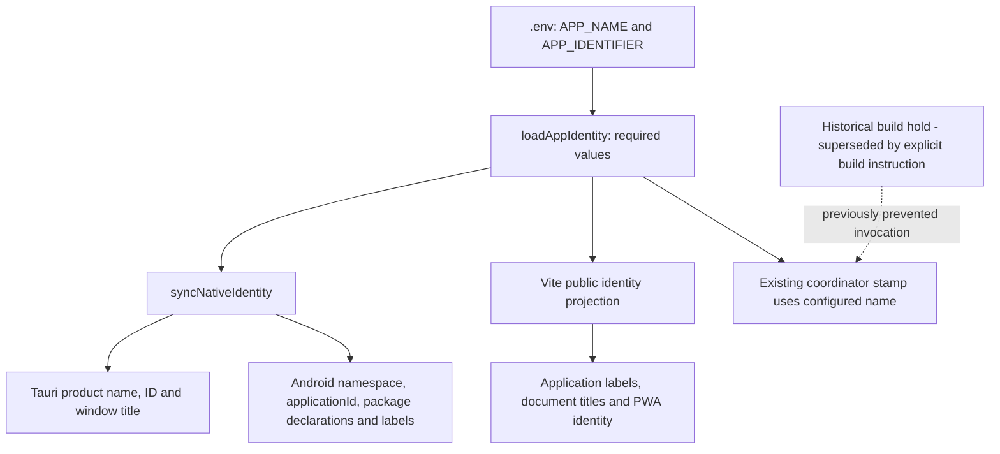
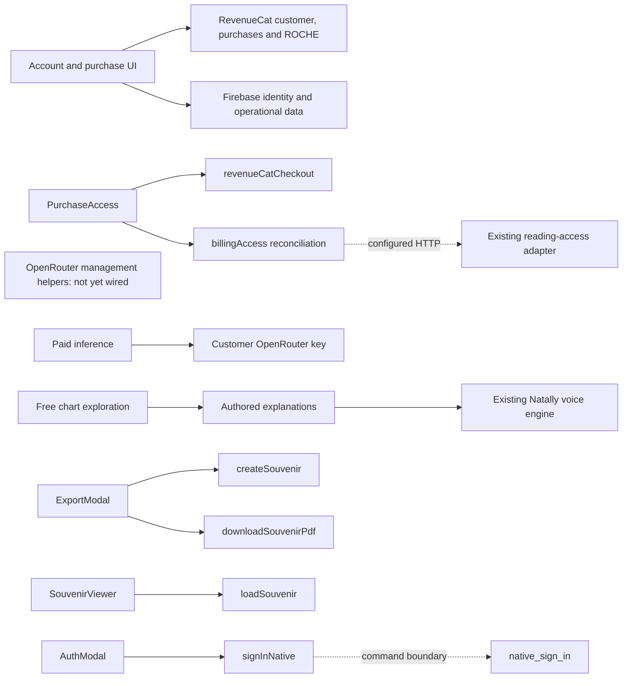
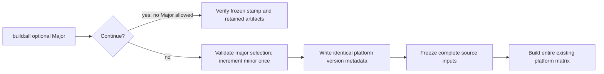
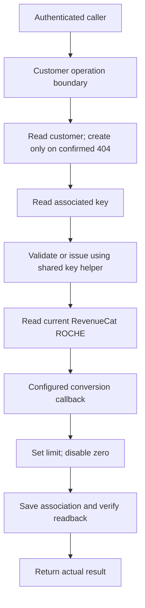

# Natally architecture

## Operator corrections: application identity and superseded build hold — 28 October 2026

The operator selected `mba.robin.natally` as the production application ID and
requires application configuration, including the application name, to originate
in `.env`. For this installation the name is `Natally`. These replace the legacy
`online.rebots.natally.aistudio.test` identity; historical evidence is retained.
The operator's earlier build hold is historical and was superseded by the later
explicit instruction to "build now in parallel". The prescribed coordinator
subsequently completed v1.12.86707 with all twelve outputs verified and exit 0;
the failed 1.11.86659 invocation remains preserved historical evidence.
Android sign-in is a functional repair,
not only a branding change: the current desktop-only native branch leaves
Android on WebView popup/reCAPTCHA flows and requires actual device verification.

### Configuration contract and enumerated entities

The following bounded identity change implements the operator's explicit choice.
It does not authorize new authentication providers, wallets or hosting.

| Entity / location | Contract |
| --- | --- |
| `.env`: `APP_NAME`, `APP_IDENTIFIER` | Sole editable application-identity values; this installation uses `Natally` and `mba.robin.natally`. Both must be deliberately set. No default product name or package ID. |
| `.env.example` | Document both required keys with empty values and an instruction to configure the fork's own identity. Empty examples are configuration input, never rendered product placeholders. |
| `scripts/app-identity.mjs`: `loadAppIdentity`, `syncNativeIdentity` | Read `.env` using Node's `parseEnv`; validate a nonempty application name and reverse-domain package identifier; reject missing/example/test release identifiers. Project all native metadata from the same pair without changing version or signing. Paths remain within the repository. |
| `src-tauri/tauri.conf.json` | Derived `productName`, `identifier`, window-title name and bundle short description; preserve coordinator-produced version and unrelated settings. |
| Android `build.gradle.kts`, `strings.xml`, Kotlin package declarations and ProGuard qualified class names | Derived namespace/applicationId/name/title and package references. Move the existing package subtree to the configured reverse-domain path, preserving its code, introduction artwork and behavior. Apply the same package transformation to buildSrc references if present; no stale old-package JNI/ProGuard references. |
| `scripts/configure-android.mjs` | Invoke identity projection during existing coordinator preparation. Idempotent preparation must not overwrite deliberate identity with the legacy test ID. |
| `scripts/release-state.mjs`: `stamp` | Use configured application name when deriving the versioned window title. Validate required identity before consuming a new version; do not execute stamp during the build hold. |
| `vite.config.ts`: `__APP_IDENTITY__` | Expose only the validated public name and identifier, never the remainder of `.env`. Read the same identity in dev and coordinated builds. |
| `src/services/appIdentity.ts`: `APP_NAME`, `APP_IDENTIFIER` | Public projection consumed by application title/branding labels; no hardcoded fallback. Established fictional character name/content is distinct from the application's configurable identity. |
| HTML entry titles, PWA name/short_name, application-name and window labels | Consume this projection. A fork must not inherit Natally's application identity through an independent default. Preserve the authored design and actual content. |

Acceptance before the next authorized build: inspect every identity consumer and
confirm it derives from `.env`; exercise the configuration projection twice with
unchanged values and show identical output; confirm missing identity fails before
stamping; preserve all nonidentity source bytes during package relocation. Native
installation, Google/Firebase package and certificate binding, billing restore
and updated-app behavior require separate runtime evidence. Renaming a package
does not migrate an installed app or establish a Play listing automatically.

Precipitating failure: an internal test identifier was allowed to become a
candidate public package identity and was offered when the operator needed to
create the Play listing. The correction is structural: required explicit identity
inputs, one projection into all outputs, and no release fallback to placeholder
or another publisher's identity. Checking only visible APK filenames missed the
embedded application ID; acceptance must inspect embedded metadata as well.

## Paid customer journey repair — 28 October 2026

Operator-reported release v1.10.86133 accepted a real payment, then displayed
disconnected purchasing and zero ROCHE. The live RevenueCat customer read confirms
one production Exploration credits purchase with status owned. Its wallet contains
10 NATALTURN; the required currency remains literal ROCHE. No paid fulfillment or
successful inference is established by that purchase record. Repair the existing
commercial contract rather than replacing it with another currency or ledger.

The operator requires a portable customer-experience audit skill whose primary
method reasons as if rendered from actual design HTML, source, states and visible
content. Customer misunderstandings, lost effort, false expectations and reasons
to abandon are defects even when handlers pass. Cold-context interpretation and
targeted device/provider observation supplement that reasoning. The installed
ux-journey-audit skill and its portable package implement this review method.

Required customer outcomes and repair ownership:

| Entity or surface | Required behavior | Engaged by |
| --- | --- | --- |
| `PurchaseAccessProvider.startPurchase` / `restore` | Preserve known payment confirmation; reconcile and install actual purchased access; return to the requested Natally experience when ready; delayed access must not reopen purchase or deny payment | UX-PAY-1 |
| `requestBillingAccess` / existing provisioning adapter | Same authenticated customer; current shared ROCHE; adopted one-hour key routine; no false zero or placeholder configuration state | UX-PAY-1 |
| `InferenceAccessSettings` | Authoritative balance and usable account recovery; actual purchase action; no static disconnected payment-method cards contradicting live checkout | UX-PAY-1 |
| RevenueCat product grants and customer record | Correct literal ROCHE grant and recovery of already-owned purchase; preserve unrelated grants and existing ownership; do not invent conversion values | UX-PAY-2 |
| Provider product name, merchant settings, receipts | Customer names Souvenir reading / Exploration credits; approved robin.mba and rochemediaservices.com domains; no expired robinsai.world customer-facing identity | UX-PAY-2 |
| Android purchase adapter | Actual native Google Play billing through RevenueCat, same Firebase UID; correct offerings, purchase, restore, confirmation and shared ROCHE; Play is primary Android payment, not a hosted-card substitute | UX-PLAY-1 |
| Approved exported offer HTML | Preserve authored design and selected offer while wiring real actions and state; do not replace with a coder-designed screen | UX-UI-1 |
| Android activity, checkout viewport, city autocomplete | Focused field and typed value remain reachable with IME; usable search/results ordering; keyboard cannot trap typing; recovery preserves input | UX-UI-1 |
| `Build-Android` / release manifest and download surfaces | Public APK/AAB filenames omit internal test labels; embedded version comes only from prescribed coordinator; internal identifiers/certificates retain actual meaning | UX-ARTIFACT-1 |

UX-ARTIFACT-1 is a bounded immediate source correction: in
`scripts/build-all-platforms.ps1`, `Build-Android` passes
`android-arm64.apk` and `android-arm64.aab` to `Stage`, preserving all signature,
alignment, version and symbol checks. `src-tauri/Cargo.toml` describes the product
as `Natally personal astrology and exploration`, not a test shell. Package IDs
and signing identity are not display names and must not be renamed blindly.
Check downstream consumers for exact old suffix dependencies and update only
actual filename consumers. Do not alter historical evidence to erase the incident.

All repairs require distinct analytical, source, rendered/native, provider and
artifact evidence. No successful all-platform build can certify unfulfilled paid
access or native Play purchasing. The final requested build runs through
`scripts/build-all-platforms.ps1` after source repairs, with per-target outcomes.
Existing uncommitted work belongs to its current task and must be preserved.

### UX-UI-1 input and checkout geometry contract

`locations.ts` exposes `rankCityMatches(query, candidates, limit=10)` using a
trimmed, case-folded query across name/adminRegion/country. Rank exact name,
name prefix, then contained text; sort each rank by locale-aware name, region,
country and coordinates for deterministic ties, deduplicate coordinates/name,
and cap output. Empty queries return at most eight alphabetically ordered local
suggestions and never trigger online search. `searchPlaceOnline` uses that same
ranking after merging results; a no-match query immediately clears old options.

The birthplace/current-residence inputs in `NatalInputForm` and transit/partner
inputs in `ReadingsModal` each have independent query-generation refs. Increment
on input, selection, reset, unmount and account/session change. Async results and
finally/loading updates apply only to the captured generation. Debounce alone
is insufficient. During IME composition do not select on Enter. Preserve selected
coordinates/timezones and all existing customer data contracts.

Results remain in normal document flow directly below the associated input,
inside the existing scrollable form, with a scrollable list bounded by the current
visual viewport. Existing colours, typography and button content remain intact.
Use real combobox/listbox semantics, stable option IDs, active descendant,
Up/Down/Enter/Escape handling and visible loading/no-match feedback. Input remains
focused while choosing through keyboard; touch selection still works. No giant
overlay or magic top offset may cover the focused field. `ReadingsModal` panel
uses current visual viewport bounds with scrollable content and reachable close.

Web checkout gets an owned `HTMLElement` passed as `htmlTarget` to the existing
RevenueCat SDK. `PurchaseAccess` creates the mount before starting the purchase,
sizes it to `visualViewport` top/left/width/height with safe-area padding, and
updates bounds on viewport changes. The SDK owns fields, validation and purchase
state inside it. Do not edit vendor code or hashed CSS selectors. Keep the mount
alive until the purchase settles, then remove it and restore focus. Preserve
provider cancellation; closing or resizing must not fabricate a cancelled charge.
Native Android uses real IME/system-bar insets and `adjustResize`; verify in the
actual target before claiming the reported keyboard defect resolved.

### UX-PLAY-1 platform commerce contract

Retain the exported Figma HTML and existing offering selectors. Android uses an
app-local Tauri `natally-billing` plugin registered with the existing package and
`NatallyBillingPlugin` class; other targets keep Web Billing. Native SDK is pinned
to `com.revenuecat.purchases:purchases:11.0.0`, Kotlin plugin to 2.2.21, existing
compileSdk 36 and toolchain unchanged. Current Tauri 2.12.4 supports
`register_android_plugin` and `run_mobile_plugin_async` for this bridge. Preserve
intro animation and desktop authentication. Purchase activity launchMode becomes
`singleTop`, with explicit IME resize/inset handling. Public native API key and
actual Play product IDs are configuration bindings, never invented constants.

`nativeRevenueCat.ts` wraps native commands and selects Android by a native
platform command, not user-agent inference. Native `configureOwner`, `quote`,
`purchase`, `customer`, `restore`, `balance` and `logout` accept UID and session
generation; responses echo both. Serialize SDK ownership operations. Configure
once with actual goog_ key and Firebase UID, then await logIn on owner change.
Validate current owner/generation before and after each callback; clear quotes
on identity change. Quotes retain the native Package under an opaque ID, owner,
generation and two-minute expiry; purchase consumes it once and forbids overlap.
Only actual native callbacks yield purchased/cancelled/pending outcomes.
PaymentPendingError preserves recovery and does not invite another purchase.

Customer projection contains owner and active entitlement IDs, not a cast of a
native object to the Web SDK type. Passive access reads use
getCustomerInfo(FETCH_CURRENT); explicit Restore alone uses restorePurchases.
ROCHE reads invalidate the native currency cache and return literal ROCHE's actual
balance; missing response remains unknown. Neither plugin nor client grants
credits or maintains a commercial balance. Successful purchases run the same
authoritative session-provisioning routine before returning to Natally.

Required live bindings remain: verified existing Play app/package, actual goog_
public SDK key and native product IDs, offering/entitlement/ROCHE product grants,
configured ROCHE conversion, and store-distributed signed release. A missing
binding is an explicit release prerequisite; never present placeholder payment
capability or silently route a promised native Play purchase to web checkout.

Named bridge DTOs, passive caller preservation, environment bindings and pinned
SDK evidence: [UX-PLAY-1 native bindings](ARCHITECTURE/2026-10-28-native-play-bindings.md).

## Identity and authority

This replacement is based on the implemented source graph at commit
`f3470d4ffec6438582e643f6f2e7e542513676d1`, captured for the operator-requested
28 October 2026 04:50:31 UTC audit. The inventory below remains anchored to that snapshot. Later source additions
and the adopted session-key contract are described separately below. No old architecture narrative
is incorporated. The exact previous document is preserved as
[ARCHITECTURE-before-codegraph-replacement-28oct2026-00h57.md](ARCHITECTURE-before-codegraph-replacement-28oct2026-00h57.md).

RevenueCat authority is the longstanding explicit specification, not an open
architectural decision: customer/account commercial records, purchases,
entitlements and shared ROCHE belong to RevenueCat. Firebase provides identity
and operational data linked to that customer. Every session validates its associated OpenRouter key, reuses a valid
one-hour-limited key or issues one, sets its spending limit from current shared
ROCHE, and saves the association. Zero ROCHE and logout/teardown deactivate the
key. See [the adopted session-key architecture](SESSION-KEY-ARCHITECTURE.md) for
flows, ownership, exceptions and acceptance scenes. Implementation is incomplete.
Old documentation contradicting RevenueCat is erroneous
and must not be interpreted as an alternative to this requirement.

This file distinguishes implemented structure from unfinished required behavior.
It does not redefine success as the current code. No architectural proposals are
in process; development proceeds against the already agreed specification, with
rubric demonstration before entertaining changes.

## Structured representation

- [File dependency PlantUML](AUDITS/architecture-current-ast-20261028-045031.puml).
- [Per-file symbol diagram index](AUDITS/architecture-current-ast-20261028-045031-details/index.json).
- [Exact nodes and edges](AUDITS/architecture-current-ast-20261028-045031-details/graph.json).
- [Snapshot evidence and conformance report](AUDITS/codegraph-architecture-20261028-045031.md).
- [Landing-page architecture](LANDING-PAGE/ARCHITECTURE.md) and [specification contract](LANDING-PAGE/SPEC.md).
- [Decision checkpoint navigation](CHECKPOINTS.md).

The fresh CodeGraph 1.6.2 index contains 156 files, 2,715 nodes and 6,853 edges.
It is a source-structure graph, not a complete compiler AST or runtime proof.
Dynamic HTTP and native command boundaries require source/runtime corroboration.
Every indexed entity is enumerated below; graph.json preserves exact relationships
and IDs, with per-file diagrams for navigation.

## Implemented boundaries and incomplete requirements

| Boundary | Implemented owner / connection | Remaining work against existing specification |
|---|---|---|
| Checkout | PurchaseAccess → revenueCatCheckout.getCheckoutOffer/purchaseCheckoutOffer | Verify actual ordinary-user payment and product continuity |
| Key lifecycle | billing/openrouter.mjs helpers exist without incoming lifecycle calls | Implement SESSION-KEY-ARCHITECTURE.md; one-hour issue/reuse, current-ROCHE limit, teardown and cross-app synchronization |
| ROCHE | getRocheBalance → account display and managed-key access check | Complete shared spend, issued-code redemption and allowance synchronization |
| Native authentication | AuthModal → signInNative → native_sign_in → hosted browser helper | Deploy helper and demonstrate Windows sign-in |
| Souvenir | ExportModal → createSouvenir/downloadSouvenirPdf; SouvenirViewer → loadSouvenir | Demonstrate paid PDF and interactive hosted artifact delivery |
| Free exploration | NatallyChatbot authored branch returns before inference | Demonstrate personalized realtime speech and chart interaction |
| Landing page | marketing.html + MarketingNatalChart + shared Astrolabe3D | Complete catalog-consistent copy/price wiring and deployed acceptance |
| Build | build-all-platforms.ps1 → release-state and platform builders | Complete canonical version correction and full artifact/rubric acceptance |

## Complete indexed entity inventory

The Source column is anchored to the audited snapshot; names and signatures are
exported from CodeGraph. This inventory records existing entities, not hypothetical
future ones. Exact edge metadata remains in the linked graph export.

| Graph ID | Kind | Entity | Source | Signature |
|---|---|---|---|---|
| file:billing/openrouter.mjs | file | billing/openrouter.mjs | billing/openrouter.mjs:1 |  |
| constant:7e93b7cd8480a54116756aaa9c0ace04 | constant | BASE_URL | billing/openrouter.mjs:16 | = "https://openrouter.ai/api/v1/keys" |
| constant:00f33a67720dd0e64db09e824aaec057 | constant | TIMEOUT_MS | billing/openrouter.mjs:17 | = 15000 |
| function:189c84b455615e3cb5ad304fa6c0a01a | function | assertNonEmptyString | billing/openrouter.mjs:19 | (value, label) |
| function:ac568e82d93f5dcf9a5595e609f9fb44 | function | assertOptions | billing/openrouter.mjs:25 | (options) |
| function:8ee4d88295ac002015f607341925a1d5 | function | assertObjectData | billing/openrouter.mjs:35 | (payload) |
| function:c6e4fbf8ebd8903e68b1dc54125986da | function | assertFiniteLimit | billing/openrouter.mjs:41 | (limit) |
| function:f98c4bc001548697e7f15424ec468e04 | function | redactError | billing/openrouter.mjs:48 | (cause) |
| function:cbb242a7f5c45f082abc8352632eccdb | function | request | billing/openrouter.mjs:53 | (method, path, { adminKey, fetchImpl }, body) |
| function:a1e97d157931791076da44b9852903de | function | createManagedKey | billing/openrouter.mjs:89 | ({ name }, options) |
| function:46f861b1ba8557001c9010788c1cb111 | function | readManagedKey | billing/openrouter.mjs:123 | (hash, options) |
| function:b18fa2728a34762f3e46f36894bf9bdb | function | setManagedKeyLimit | billing/openrouter.mjs:139 | (hash, absoluteLimitUsd, options) |
| function:3fbc31b9a56cec8fbbb7df860873e994 | function | disableManagedKey | billing/openrouter.mjs:157 | (hash, options) |
| function:686eaa5a556d752d87c67d83e190bf31 | function | reconcileManagedKey | billing/openrouter.mjs:174 | ({ existingKeyHash, name }, options) |
| file:netlify/functions/blink-checkout.mjs | file | netlify/functions/blink-checkout.mjs | netlify/functions/blink-checkout.mjs:1 |  |
| import:935352deb663d5c9a52ff1d7a1bf6f6e | import | node:crypto | netlify/functions/blink-checkout.mjs:19 | import { createHash } from 'node:crypto'; |
| import:3ec7d7a7386c4203d072ba122a1b399b | import | ../lib/blink-lightning.mjs | netlify/functions/blink-checkout.mjs:20 | import { readBlinkConfig, createBlinkUsdInvoice, readBlinkInvoiceStatus, readBlinkSettlement } from '../lib/blink-lightning.mjs'; |
| import:668e01bf8138460a943d22a9097bbb4f | import | ../lib/blink-revenuecat.mjs | netlify/functions/blink-checkout.mjs:21 | import { submitBlinkReceipt } from '../lib/blink-revenuecat.mjs'; |
| import:8e501e63592742fe5db9b24036cf47a6 | import | ../lib/blink-store.mjs | netlify/functions/blink-checkout.mjs:22 | import { createBlinkStore } from '../lib/blink-store.mjs'; |
| import:872f461917398bcffe9ca288d53c67b9 | import | ../../firebase-applet-config.json | netlify/functions/blink-checkout.mjs:23 | import firebaseConfig from '../../firebase-applet-config.json' with { type: 'json' }; |
| constant:0c0e7f98bb311e36260a91da70da4454 | constant | MAX_BODY_BYTES | netlify/functions/blink-checkout.mjs:25 | = 8192 |
| constant:8ba8daed2e455ad39b2547a6b63acba5 | constant | MAX_AMOUNT_MINOR | netlify/functions/blink-checkout.mjs:26 | = 100000000 |
| constant:fe6ae50ff8f444e45e2a6f51170994af | constant | QUOTE_TTL_MINUTES | netlify/functions/blink-checkout.mjs:27 | = 5 |
| constant:baf1072543752436269cba295e40d478 | constant | REQUEST_ID_PATTERN | netlify/functions/blink-checkout.mjs:28 | = /^[A-Za-z0-9_-]{16,100}$/ |
| constant:289e4f1b091d98cee4e7b7e90002fcfe | constant | KINDS | netlify/functions/blink-checkout.mjs:29 | = new Set(['reading', 'experience']) |
| constant:6731c080979ccc8bf084ded1155e0333 | constant | INVOICE_PATH | netlify/functions/blink-checkout.mjs:30 | = '/billing/blink/invoice' |
| constant:d4aa676375bbf6ce7058bf431cc7bdf0 | constant | STATUS_PATH | netlify/functions/blink-checkout.mjs:31 | = '/billing/blink/status' |
| constant:d58b58e96a4b06f4608dffa04b79645c | constant | SUBSCRIBERS_ENDPOINT | netlify/functions/blink-checkout.mjs:32 | = 'https://api.revenuecat.com/v1/subscribers' |
| constant:12798e9b074294e923b11eadbd8124ff | constant | TIMEOUT_MS | netlify/functions/blink-checkout.mjs:33 | = 12000 |
| function:3346911ea60de0c71f41c8361f0cdcc6 | function | fail | netlify/functions/blink-checkout.mjs:35 | (message) |
| function:62b50bc5f2a9cd9ea0e178ddf1392ebb | function | response | netlify/functions/blink-checkout.mjs:41 | (json, status, headers) |
| function:e0d635f8da0aa30ed898e24ef19e19b2 | function | safeInvoiceResponse | netlify/functions/blink-checkout.mjs:45 | (accountUid, requestId, invoice) |
| function:96ac0803c34b66de605e571038824a6b | function | readCatalog | netlify/functions/blink-checkout.mjs:58 | (env) |
| function:6a8013c1d006b74716d2127aba5ce7e0 | function | authenticate | netlify/functions/blink-checkout.mjs:96 | (request, env) |
| function:9f6f952a9c12dc5fedac79d2ffbf0109 | function | verifyRevenueCatReceipt | netlify/functions/blink-checkout.mjs:126 | (uid, sourceProductId, paymentHash, secretKey) |
| function:4d83136cadef55a0e53817b5be7824ae | function | getStore | netlify/functions/blink-checkout.mjs:158 | (env) |
| function:86842d3e396368d076cb4d2158cb9e65 | function | blinkCheckout | netlify/functions/blink-checkout.mjs:164 | (request) |
| function:af13c7a9c416aee5167b4072796ec173 | function | blinkCheckout::env | netlify/functions/blink-checkout.mjs:165 |  |
| function:18eee185b9d830e06d80d878611d34ef | function | blinkCheckout::reply | netlify/functions/blink-checkout.mjs:187 | (body, status = 200) |
| constant:116de09f2b004a7c82bd558591677660 | constant | config | netlify/functions/blink-checkout.mjs:370 | = { path: [INVOICE_PATH, STATUS_PATH] } |
| file:netlify/functions/reading-access.mjs | file | netlify/functions/reading-access.mjs | netlify/functions/reading-access.mjs:1 |  |
| import:bf97883714459db73496718bda3c2f61 | import | ../../firebase-applet-config.json | netlify/functions/reading-access.mjs:1 | import firebaseConfig from '../../firebase-applet-config.json' with { type: 'json' }; |
| function:6a6fc5b49abd5095600367d97ae13204 | function | readingAccess | netlify/functions/reading-access.mjs:4 | (request) |
| function:fd1be2b0a8966be65970e5c13dd00b83 | function | readingAccess::env | netlify/functions/reading-access.mjs:5 |  |
| function:c694d72a1ebddffeb80651bcce2982d1 | function | readingAccess::reply | netlify/functions/reading-access.mjs:17 | (body, status = 200) |
| constant:14c74994a219aee8f2b7eafabcbaebd8 | constant | config | netlify/functions/reading-access.mjs:55 | = { path: ['/billing/access', '/billing/reconcile'] } |
| constant:7711219b65c701163c8fbdc89e1ff2b3 | constant | ASTROLOGY_TOOLS | netlify/lib/astrology-tools.mjs:1 | = [{    type: 'function',    function: {      name: 'calculate_astrology',      description: 'Execute ... |
| file:netlify/lib/astrology-tools.mjs | file | netlify/lib/astrology-tools.mjs | netlify/lib/astrology-tools.mjs:1 |  |
| function:92930538682a0974761d1df9eadc4e57 | function | validToolCall | netlify/lib/astrology-tools.mjs:23 | (call) |
| function:6e55d748836870ed4c9fd501d801564c | function | validToolMessages | netlify/lib/astrology-tools.mjs:28 | (messages) |
| function:45085584616d95ab0924d91bd21c21a4 | function | toolCallCount | netlify/lib/astrology-tools.mjs:45 |  |
| file:netlify/lib/blink-lightning.mjs | file | netlify/lib/blink-lightning.mjs | netlify/lib/blink-lightning.mjs:1 |  |
| constant:66f3fa92e05cfe6cbe229fb73b142e72 | constant | BLINK_ENDPOINT | netlify/lib/blink-lightning.mjs:25 | = 'https://api.blink.sv/graphql' |
| constant:5e3c01df76796f3d838eef2a92a4a24b | constant | TIMEOUT_MS | netlify/lib/blink-lightning.mjs:26 | = 12000 |
| constant:a7bda94c8eb0665b4f03e1e6088bbd24 | constant | MAX_AMOUNT_MINOR | netlify/lib/blink-lightning.mjs:27 | = 100000000 |
| constant:7d84bb2c3c492386961e7830f298cb40 | constant | MAX_EXPIRY_LEAD_MS | netlify/lib/blink-lightning.mjs:28 | = 15 * 60000 |
| constant:f75dee5423869d17ee209d305fb85cb8 | constant | MAX_INVOICE_TTL_MINUTES | netlify/lib/blink-lightning.mjs:29 | = 5 |
| constant:36bd936a849cc2b4d4aa90b9ccde661d | constant | MAX_PAYMENT_REQUEST_LENGTH | netlify/lib/blink-lightning.mjs:30 | = 20000 |
| constant:1b4bb9ccc9a2b209d4b2eb002db21cd8 | constant | CREATED_AT_FUTURE_SLACK_MS | netlify/lib/blink-lightning.mjs:31 | = 60000 |
| constant:b13f53ede93ffaf79749bfb6b7807a01 | constant | CODE_UNCONFIGURED | netlify/lib/blink-lightning.mjs:33 | = 'BLINK_UNCONFIGURED' |
| constant:6fc83a2767bbc184f8efccea56eb1643 | constant | PAYMENT_STATUSES | netlify/lib/blink-lightning.mjs:35 | = new Set(['PAID', 'PENDING', 'EXPIRED']) |
| constant:b918a64b726c63b4158ee89779771bbd | constant | STATE_BY_STATUS | netlify/lib/blink-lightning.mjs:37 | = {    PAID: 'paid',    PENDING: 'pending',    EXPIRED: 'expired',  } |
| function:e50ec9415ec2f82ebaecb48647ffb6d6 | function | sanitizeError | netlify/lib/blink-lightning.mjs:43 | (code, message) |
| function:03db0acea54a4696fad6f35299125cd1 | function | fail | netlify/lib/blink-lightning.mjs:49 | (code, message) |
| function:2e62442412329786712760dc1fa3f81b | function | readEnvValue | netlify/lib/blink-lightning.mjs:53 | (env, name) |
| function:d8558704cbef9d93c815c587382fd4e8 | function | requireTrimmedEnv | netlify/lib/blink-lightning.mjs:59 | (env, name, code) |
| function:71e612ea7e50bdb5653713f2eeb85a34 | function | readBlinkConfig | netlify/lib/blink-lightning.mjs:79 | (env = process.env) |
| function:1741913091700c4a341607be2afd9bfb | function | blinkRequest | netlify/lib/blink-lightning.mjs:90 | (config, query, variables, fetchImpl) |
| function:4f00d53f72a9b0499a3d0c81a35e9813 | function | readBlinkUsdWallet | netlify/lib/blink-lightning.mjs:145 | (config, { fetchImpl = fetch } = {}) |
| function:06fb25f4ca4b133e397fb65c894a817b | function | validateQuote | netlify/lib/blink-lightning.mjs:171 | (quote, nowMs = Date.now()) |
| function:b757ace6ef6f1eeeca8fc21e475d5f31 | function | validateInvoiceObject | netlify/lib/blink-lightning.mjs:209 | (invoice, externalId, nowMs) |
| constant:96365d85a147628a1b4c0297b1a48e75 | constant | INVOICE_MUTATION | netlify/lib/blink-lightning.mjs:252 | = `mutation NatallyBlinkInvoice($input: LnUsdInvoiceCreateInput!) {    lnUsdInvoiceCreate(input: $inpu... |
| function:3b1385dd35d5ca215ab485b5df65cf0e | function | createBlinkUsdInvoice | netlify/lib/blink-lightning.mjs:293 | (quote, config, { fetchImpl = fetch, now = Date.now } = {}) |
| constant:834a85480556cc4faa318b252a90cab7 | constant | STATUS_QUERY | netlify/lib/blink-lightning.mjs:359 | = `query NatallyBlinkStatus($input: LnInvoicePaymentStatusByHashInput!) {    lnInvoicePaymentStatusByH... |
| function:d1885c6fee67bcb0704541fc7537e138 | function | readBlinkInvoiceStatus | netlify/lib/blink-lightning.mjs:385 | (record, config, { fetchImpl = fetch, now = Date.now } = {}) |
| constant:d395bdb492ea85ede58dab74dca46ef3 | constant | SETTLEMENT_QUERY | netlify/lib/blink-lightning.mjs:454 | = `query NatallyBlinkSettlement($hash: PaymentHash!) {    me {      defaultAccount {        wallets { ... |
| constant:d15e2a37a3aa2dabbd1f4973dd5eb5e8 | constant | TX_STATUSES | netlify/lib/blink-lightning.mjs:474 | = new Set(['SUCCESS', 'PENDING', 'FAILURE']) |
| constant:ab27564925b5c1f3a661687e1f3fcd33 | constant | TX_DIRECTIONS | netlify/lib/blink-lightning.mjs:475 | = new Set(['RECEIVE', 'SEND']) |
| function:1dffe218a9908c16538b68f6fa091638 | function | readBlinkSettlement | netlify/lib/blink-lightning.mjs:500 | (record, config, { fetchImpl = fetch, now = Date.now } = {}) |
| file:netlify/lib/blink-revenuecat.mjs | file | netlify/lib/blink-revenuecat.mjs | netlify/lib/blink-revenuecat.mjs:1 |  |
| constant:732d50254c7d6d8faadb647c8efc2235 | constant | RECEIPTS_ENDPOINT | netlify/lib/blink-revenuecat.mjs:21 | = 'https://api.revenuecat.com/v1/receipts/external' |
| constant:ee84b6c168775360965047b0d6c1ac6b | constant | TIMEOUT_MS | netlify/lib/blink-revenuecat.mjs:22 | = 12000 |
| constant:f466489ded421c834ca0d5e100dd643d | constant | MAX_AMOUNT_MINOR | netlify/lib/blink-revenuecat.mjs:23 | = 100000000 |
| constant:327f6d91766a325bba08bab0eb42a323 | constant | MAX_ACCOUNT_UID | netlify/lib/blink-revenuecat.mjs:24 | = 128 |
| constant:1fbea319992a482af51765118b5dc2d3 | constant | MAX_PRODUCT_ID | netlify/lib/blink-revenuecat.mjs:25 | = 255 |
| constant:6fc721d95b3a2fc4e58153dfbda96f19 | constant | CODE_UNCONFIGURED | netlify/lib/blink-revenuecat.mjs:27 | = 'REVENUECAT_UNCONFIGURED' |
| function:cccf562912f845c0a0fea7baae0fca23 | function | sanitizeError | netlify/lib/blink-revenuecat.mjs:29 | (code, message) |
| function:697d2b2806f95c50d40496bd866d9359 | function | fail | netlify/lib/blink-revenuecat.mjs:35 | (code, message) |
| function:d9532598b3cc6b3583feb1cda954c8fa | function | requireNonEmpty | netlify/lib/blink-revenuecat.mjs:39 | (value, code, message) |
| function:61208a79169b9807cb9ae4ed03dec51b | function | submitBlinkReceipt | netlify/lib/blink-revenuecat.mjs:66 | (settlement, { apiKey, sourceProductId }, { fetchImpl = fetch } = {}) |
| file:netlify/lib/blink-store.mjs | file | netlify/lib/blink-store.mjs | netlify/lib/blink-store.mjs:1 |  |
| import:b2dc169e8a34dffdaddb78bc97c7ba72 | import | node:crypto | netlify/lib/blink-store.mjs:20 | import { createSign } from 'node:crypto'; |
| import:a26100489ec318c5b8416a85df425f63 | import | ../../firebase-applet-config.json | netlify/lib/blink-store.mjs:21 | import firebaseConfig from '../../firebase-applet-config.json' with { type: 'json' }; |
| constant:5c184a93f435c032bdb493df7f35fb76 | constant | TOKEN_ENDPOINT | netlify/lib/blink-store.mjs:23 | = 'https://oauth2.googleapis.com/token' |
| constant:a64750491836e390e0bec75d34d9c623 | constant | OAUTH_SCOPE | netlify/lib/blink-store.mjs:24 | = 'https://www.googleapis.com/auth/datastore' |
| constant:36b4630ea4c12e32896222065061f76c | constant | TIMEOUT_MS | netlify/lib/blink-store.mjs:25 | = 12000 |
| constant:d789b31a1a3d7de7868113a8c331503c | constant | COLLECTION_ID | netlify/lib/blink-store.mjs:26 | = 'natallyBlinkOperations' |
| constant:affec440c85b96061af470655c8ba3c6 | constant | ID_PATTERN | netlify/lib/blink-store.mjs:27 | = /^[a-f0-9]{64}$/ |
| constant:7e632d12cb1d3f5db50ee538dc15fb0b | constant | PRECONDITION_FAILED | netlify/lib/blink-store.mjs:28 | = 412 |
| function:31f26051fab08be26597aa8633859e76 | function | sanitizeError | netlify/lib/blink-store.mjs:30 | (code, message) |
| function:688f5ed8d1c7b540ac17594025ecd276 | function | fail | netlify/lib/blink-store.mjs:36 | (code, message) |
| function:e689253a3df68bd4a5a9f510ce97c3ba | function | readEnvValue | netlify/lib/blink-store.mjs:40 | (env, name) |
| function:8b1629a8611bed9abc6a6f8c6a112d95 | function | base64url | netlify/lib/blink-store.mjs:46 | (input) |
| function:61a90c90d95c90ff313ed86f89f5464b | function | fetchAccessToken | netlify/lib/blink-store.mjs:50 | (serviceAccount, fetchImpl) |
| function:70e5d077ef3cba9e862b5f21d7db210a | function | createBlinkStore | netlify/lib/blink-store.mjs:108 | (env, { fetchImpl = fetch } = {}) |
| function:291ab440f56dee9296ac186222f9316c | function | createBlinkStore::requireId | netlify/lib/blink-store.mjs:150 | (id) |
| function:86b13629ba37b1839d8aca2a8a3b90b7 | function | createBlinkStore::resourceName | netlify/lib/blink-store.mjs:157 | (id) |
| function:4708108f7999da49d441757f15395a06 | function | createBlinkStore::documentUrl | netlify/lib/blink-store.mjs:161 | (id) |
| function:c7d03d8b205ca1073bf5061620ead5dc | function | createBlinkStore::commit | netlify/lib/blink-store.mjs:165 | (writes) |
| function:df7fa776cc8284a626bae436eaff7f4f | function | createBlinkStore::payloadFields | netlify/lib/blink-store.mjs:181 | (payload) |
| function:21ad52b1bd7c37e21f72bae172c24495 | function | createBlinkStore::readUpdateAndParse | netlify/lib/blink-store.mjs:185 | (id) |
| function:e3056d8b0ded261233ca542f83603788 | function | createBlinkStore::conditionalErrorStatus | netlify/lib/blink-store.mjs:227 | (response) |
| file:public/pwa.js | file | public/pwa.js | public/pwa.js:1 |  |
| function:3a13aa62a0c407ef93c62bb5afa6bbf4 | function | isTauri | public/pwa.js:4 | () |
| function:a847cc75a346b84dd29c367b12088d0c | function | removeButton | public/pwa.js:21 | () |
| function:95f52cdab1088795f64ba7ee139ea606 | function | showButton | public/pwa.js:26 | () |
| file:scripts/benchmark-supertonic.mjs | file | scripts/benchmark-supertonic.mjs | scripts/benchmark-supertonic.mjs:1 |  |
| import:de7a8fc7b5c675aa2ed5881f97d9b29f | import | @huggingface/transformers | scripts/benchmark-supertonic.mjs:1 | import { pipeline, env } from '@huggingface/transformers'; |
| import:1ac3fb5fb5b39b72f896c1971b7945b1 | import | node:fs/promises | scripts/benchmark-supertonic.mjs:2 | import { mkdir, writeFile } from 'node:fs/promises'; |
| import:d82388b261e6aa989295baacbc2860b8 | import | node:perf_hooks | scripts/benchmark-supertonic.mjs:3 | import { performance } from 'node:perf_hooks'; |
| constant:db86486cfa72d3d6c6455311268a2aa0 | constant | revision | scripts/benchmark-supertonic.mjs:5 | = 'cff123c84b0655d9d647641f1b532c3cbb8f7faa' |
| constant:9c066fd66c10240a0f9420666b9f3e80 | constant | model | scripts/benchmark-supertonic.mjs:6 | = 'onnx-community/Supertonic-TTS-ONNX' |
| constant:bd5a4a76eceb6d111e449f4ecdc058f7 | constant | started | scripts/benchmark-supertonic.mjs:9 | = performance.now() |
| constant:aff0dd8ad4132b7869130b71ec25fbfa | constant | engine | scripts/benchmark-supertonic.mjs:10 | = await pipeline('text-to-speech', model, {    revision, device: 'cpu', dtype: 'fp32',    session_opti... |
| constant:d62bad62fb3da5f80f2dc215106eade8 | constant | loadSeconds | scripts/benchmark-supertonic.mjs:14 | = (performance.now() - started) / 1000 |
| constant:1349a40f663fc327dd8cbc657e73ec56 | constant | response | scripts/benchmark-supertonic.mjs:15 | = await fetch(`https://huggingface.co/${model}/resolve/${revision}/voices/F4.bin`) |
| constant:f0a592c9e44669a38085f3f2312a031f | constant | voice | scripts/benchmark-supertonic.mjs:17 | = new Float32Array(await response.arrayBuffer()) |
| constant:9ead4d39977981bd044d370fc10c0a0d | constant | paragraphs | scripts/benchmark-supertonic.mjs:18 | = [    'Your natal chart describes a pattern, not a verdict. We can start with the Sun and Moon, then ... |
| constant:6ffeeaf5cc0b1c2944b114e2e5e67d3b | constant | chunks | scripts/benchmark-supertonic.mjs:23 | = [] |
| constant:43655356634f05ebcb3533c056245b05 | constant | before | scripts/benchmark-supertonic.mjs:25 | = performance.now() |
| constant:60f96fdfbc0e1c5486c03fe419dff242 | constant | output | scripts/benchmark-supertonic.mjs:26 | = await engine(text, { speaker_embeddings: voice, num_inference_steps: 5, speed: 0.85 }) |
| constant:57eaa045cdf3076e0a4cb54d6fbdcb98 | constant | synthesisSeconds | scripts/benchmark-supertonic.mjs:27 | = (performance.now() - before) / 1000 |
| constant:e5694387c206c5d830fdc6764c5efbe1 | constant | playbackSeconds | scripts/benchmark-supertonic.mjs:28 | = output.audio.length / output.sampling_rate / 1.3 |
| constant:61ee184f508b598b1c04cbfb2d81c01e | constant | result | scripts/benchmark-supertonic.mjs:30 | = { characters: text.length, synthesisSeconds, playbackSeconds, realTimeFactor: synthesisSeconds / pla... |
| constant:851c684fb0cd174354b9815a91044f31 | constant | report | scripts/benchmark-supertonic.mjs:34 | = {    recordedAt: new Date().toISOString(), runtime: 'Node native ONNX CPU; NOT browser WASM or a pho... |
| file:scripts/build-opening-recovery-fixture.mjs | file | scripts/build-opening-recovery-fixture.mjs | scripts/build-opening-recovery-fixture.mjs:1 |  |
| import:651bb24ff4979549a03c1424f3902323 | import | esbuild | scripts/build-opening-recovery-fixture.mjs:1 | import {build} from 'esbuild'; |
| import:4840a5412d7ebd3e7ea92b064a48cc50 | import | node:fs/promises | scripts/build-opening-recovery-fixture.mjs:2 | import fs from 'node:fs/promises'; |
| import:544625a0dc6f81503eb14d6463c9fae1 | import | node:child_process | scripts/build-opening-recovery-fixture.mjs:3 | import {execFileSync} from 'node:child_process'; |
| constant:7e954a30b87151bf92251bcfc0ebf47f | constant | baseline | scripts/build-opening-recovery-fixture.mjs:4 | = process.argv.find(value=&gt;value.startsWith('--baseline='))?.slice('--baseline='.length) |
| constant:01e516050fd895c37954f336628767f1 | constant | name | scripts/build-opening-recovery-fixture.mjs:15 | = baseline?'before':'after' |
| file:scripts/build-web.mjs | file | scripts/build-web.mjs | scripts/build-web.mjs:1 |  |
| import:74d7c21023af6e764c9ddac373772ff6 | import | node:fs | scripts/build-web.mjs:2 | import { existsSync, readFileSync } from 'node:fs'; |
| import:1b54a6404e181508776da35dd373d445 | import | node:child_process | scripts/build-web.mjs:3 | import { execFileSync } from 'node:child_process'; |
| import:af86faac02617b7c3d9685efe0b9d921 | import | ./release-state.mjs | scripts/build-web.mjs:4 | import { releaseBuildInfo } from './release-state.mjs'; |
| import:b313177b1b7c703e7e73ee4c836a1ed5 | import | ./pwa-build.mjs | scripts/build-web.mjs:5 | import { generatePwa } from './pwa-build.mjs'; |
| constant:51dd55b0ffc86877391adb4eb02ad0e7 | constant | release | scripts/build-web.mjs:6 | = releaseBuildInfo() |
| constant:4ea2dc8ebe783cc8e4ff88c316a5aa4c | constant | entry | scripts/build-web.mjs:7 | = 'dist-web/index.html' |
| file:scripts/configure-android.mjs | file | scripts/configure-android.mjs | scripts/configure-android.mjs:1 |  |
| import:5b1c0bdba12a2d1e1cf7d414b3a0761a | import | node:fs | scripts/configure-android.mjs:1 | import { readFileSync, writeFileSync } from 'node:fs'; |
| constant:f12667b27a9a9de8f59cb4d363d9b882 | constant | file | scripts/configure-android.mjs:2 | = 'src-tauri/gen/android/app/build.gradle.kts' |
| variable:cf7cf773f75dd0ab20d3a54512180456 | variable | source | scripts/configure-android.mjs:3 | = readFileSync(file, 'utf8').replace(/\r\n/g, '\n') |
| constant:4cd226bb5dcc76b9dd2d1b9d41cd624c | constant | properties | scripts/configure-android.mjs:21 | = 'src-tauri/gen/android/gradle.properties' |
| variable:e5cf3b0c41cf8a472907915b62365ab0 | variable | props | scripts/configure-android.mjs:22 | = readFileSync(properties, 'utf8').replace(/^org.gradle.daemon=.*$/gm, '').replace(/^org.gradle.jvmarg... |
| variable:696bdb25e42b00352e6d0cf24158ab1d | variable | current | scripts/configure-android.mjs:29 | = readFileSync(properties, 'utf8') |
| constant:e8ab9da892ee3c65d0dd23b3640c9e9b | constant | prepared | scripts/configure-android.mjs:37 | = readFileSync(file, 'utf8').replace(/\r\n/g, '\n').replace(/jvmTarget = "1\.8"/g, 'jvmTarget = "21"')... |
| file:scripts/onnx-progress-plugin.ts | file | scripts/onnx-progress-plugin.ts | scripts/onnx-progress-plugin.ts:1 |  |
| import:15e094d1b165e80501f654072749913a | import | vite | scripts/onnx-progress-plugin.ts:1 | import type { Plugin } from 'vite'; |
| function:94a9cd5fc70d64c4e90f5d6a79e23e89 | function | patchOnnxRuntime | scripts/onnx-progress-plugin.ts:5 | (source: string): string |
| function:9b2f1719c8464644830a6615e2e828b8 | function | onnxProgressPlugin | scripts/onnx-progress-plugin.ts:38 | (): Plugin |
| function:e3baa4741d60d81d324d33e3491940b4 | function | patchFileReadSource | scripts/onnx-progress-plugin.ts:48 | (source: string): string |
| file:scripts/package-android-symbols.py | file | scripts/package-android-symbols.py | scripts/package-android-symbols.py:1 |  |
| import:2ae81dc01f9fef6845bb950e766f1d18 | import | pathlib | scripts/package-android-symbols.py:2 | import pathlib |
| import:74a779f5712d028b8deda985c809267b | import | subprocess | scripts/package-android-symbols.py:3 | import subprocess |
| import:57e3750a58d57c0c7c4cfccfb865ff09 | import | sys | scripts/package-android-symbols.py:4 | import sys |
| import:6a0841fcbed26a4c0997b323764f0df4 | import | tempfile | scripts/package-android-symbols.py:5 | import tempfile |
| import:a93378d338abd8ac6d75ab8bdd3ceeff | import | zipfile | scripts/package-android-symbols.py:6 | import zipfile |
| variable:832ba839b26dca77b16a9d20a7cf080e | variable | libraries | scripts/package-android-symbols.py:10 | = [n for n in bundle.namelist() if n.startswith('base/lib/') and n.endswith('.so')] |
| variable:44647c38cdd792ae0e6b8a5bbe085af2 | variable | source | scripts/package-android-symbols.py:18 | = pathlib.Path(native_directory) / library |
| variable:1e7e155eedb515d8a3d28e256fb69394 | variable | debug | scripts/package-android-symbols.py:19 | = pathlib.Path(directory) / (library + '.dbg') |
| file:scripts/prepare-icons.mjs | file | scripts/prepare-icons.mjs | scripts/prepare-icons.mjs:1 |  |
| import:7c0bf498cf0677c181c32541bc393f4c | import | node:fs | scripts/prepare-icons.mjs:3 | import { copyFileSync, existsSync, mkdirSync, readdirSync, writeFileSync, readFileSync, mkdtempSync } from 'node:fs'; |
| import:885bd92616b86d34294147049a3ce2ea | import | node:crypto | scripts/prepare-icons.mjs:4 | import { createHash } from 'node:crypto'; |
| import:e8f08c6b0b1087268e60ad37d3e512ce | import | node:child_process | scripts/prepare-icons.mjs:5 | import { execFileSync } from 'node:child_process'; |
| import:db7dcb02d0503f7de0407fc16fb3e360 | import | node:path | scripts/prepare-icons.mjs:6 | import path from 'node:path'; |
| constant:dd17ab432a91a1bf981ec19cf08ed1b4 | constant | master | scripts/prepare-icons.mjs:7 | = 'public/branding/natally-icon-master.png' |
| constant:d971690204e519dd4f9fc74780dbb828 | constant | guideMaster | scripts/prepare-icons.mjs:8 | = 'public/branding/natally-guide.png' |
| function:14bed5f57fe972da2539eba739f4c61f | function | digest | scripts/prepare-icons.mjs:9 |  |
| function:5fa6b957db9f1cef16dc8726d8dd6a8a | function | promote | scripts/prepare-icons.mjs:10 | (from, to) |
| function:6698f071d599c06b59cfc4894df175b3 | function | tree | scripts/prepare-icons.mjs:14 | (from,to) |
| constant:f938b6bd0370d703baf3c5705fc9652b | constant | scratch | scripts/prepare-icons.mjs:21 | = mkdtempSync(path.resolve('build/icon-generation-')) |
| constant:2014298bb2b05ab42e6fb47ca8ccdd0c | constant | web | scripts/prepare-icons.mjs:22 | = path.join(scratch,'web') |
| constant:7bf36f16541119b7061bfb67e9dec454 | constant | native | scripts/prepare-icons.mjs:22 | = path.join(scratch,'native') |
| constant:e1a5125dfd94d504a6562caddb1f8734 | constant | guide | scripts/prepare-icons.mjs:22 | = path.join(scratch,'guide') |
| constant:f6112648ceb1c4baf7fcb9d2f9491ce5 | constant | resources | scripts/prepare-icons.mjs:35 | = 'src-tauri/gen/android/app/src/main/res' |
| constant:36feaca77827d28b2c4c0842844e8796 | constant | background | scripts/prepare-icons.mjs:37 | = path.join(resources,'values/ic_launcher_background.xml') |
| constant:64fbd5831c707a9275163ca49286bba3 | constant | backgroundXml | scripts/prepare-icons.mjs:38 | = '&lt;resources&gt;&lt;color name="ic_launcher_background"&gt;#120c1c&lt;/color&gt;&lt;/resources&gt;\n' |
| constant:8be67a27946416e73b0c695458376233 | constant | provenance | scripts/prepare-icons.mjs:41 | = JSON.parse(readFileSync('public/branding/icon-provenance.json','utf8')) |
| constant:262bd31889774c9b65394f7ddd2f41f2 | constant | provenanceBytes | scripts/prepare-icons.mjs:45 | = JSON.stringify(provenance,null,2)+'\n' |
| file:scripts/prepare-waiting-voice.mjs | file | scripts/prepare-waiting-voice.mjs | scripts/prepare-waiting-voice.mjs:1 |  |
| import:f9dbca20838a93baa1be182e23724574 | import | @huggingface/transformers | scripts/prepare-waiting-voice.mjs:1 | import { pipeline, env } from '@huggingface/transformers'; |
| import:0aa0ce84831d74485f59c706d8589516 | import | node:fs/promises | scripts/prepare-waiting-voice.mjs:2 | import fs from 'node:fs/promises'; |
| import:9fe55b0e3cf9327d1c6148f3b7eb1129 | import | node:path | scripts/prepare-waiting-voice.mjs:3 | import path from 'node:path'; |
| constant:286060bd1f727269153aa7d69abc059f | constant | revision | scripts/prepare-waiting-voice.mjs:4 | = 'cff123c84b0655d9d647641f1b532c3cbb8f7faa' |
| constant:dd7c1ecb88bf9ac3e7190e9acba371f4 | constant | phrases | scripts/prepare-waiting-voice.mjs:8 | = [['look-v3','Let me take a closer look.'],['moment-v3','Give me a moment.'],['thread-v3','Let me fol... |
| constant:0885161c5aac28f65a755e32b9a0a605 | constant | steps | scripts/prepare-waiting-voice.mjs:9 | = 16 |
| constant:12bdd9075d55c75310d950878d0e0db3 | constant | out | scripts/prepare-waiting-voice.mjs:10 | = 'public/voice/waiting' |
| constant:526782411ff647f0274c266d8b4d8432 | constant | tts | scripts/prepare-waiting-voice.mjs:12 | = await pipeline('text-to-speech','onnx-community/Supertonic-TTS-ONNX',{revision,device:'cpu',dtype:'f... |
| constant:c2a96d2b19b414ae8a0a4506e6ab1ae7 | constant | response | scripts/prepare-waiting-voice.mjs:13 | = await fetch('https://huggingface.co/onnx-community/Supertonic-TTS-ONNX/resolve/'+revision+'/voices/F... |
| constant:5f9ba254d13dba69653fb28925efb807 | constant | embedding | scripts/prepare-waiting-voice.mjs:15 | = new Float32Array(await response.arrayBuffer()) |
| constant:0e1b2422ff6ae7ba4f71012a91366921 | constant | result | scripts/prepare-waiting-voice.mjs:17 | = await tts(text,{speaker_embeddings:embedding,num_inference_steps:steps,speed:0.9}) |
| constant:9cf73941c26f2ab6abd31a75efe624b4 | constant | rate | scripts/prepare-waiting-voice.mjs:18 | = result.sampling_rate |
| constant:f7ab5a60840371ebdacb202f35fd2315 | constant | samples | scripts/prepare-waiting-voice.mjs:18 | = result.audio |
| constant:0ab60a81478ba5cd32974f40c46c02a7 | constant | wav | scripts/prepare-waiting-voice.mjs:20 | = Buffer.alloc(44+samples.length*2) |
| variable:591ca07a9bbf44f3fec7f7d4c4c7f29e | variable | i | scripts/prepare-waiting-voice.mjs:22 | = 0 |
| file:scripts/pwa-build.mjs | file | scripts/pwa-build.mjs | scripts/pwa-build.mjs:1 |  |
| import:0f917a1495eb2582fa0381df67d3d615 | import | node:fs | scripts/pwa-build.mjs:1 | import { readdirSync, statSync, writeFileSync, existsSync } from 'node:fs'; |
| import:ff5cf4de318c32d0537d68d5b96cb900 | import | node:path | scripts/pwa-build.mjs:2 | import { join, posix } from 'node:path'; |
| constant:60b4924f86b715d5f1e57709bae0a3bc | constant | SHELL_FILES | scripts/pwa-build.mjs:4 | = new Set(['index.html', 'marketing.html', 'manifest.webmanifest', 'pwa.js']) |
| constant:f9996199e06da9aef98dda08b71c5426 | constant | BRANDING_ICONS | scripts/pwa-build.mjs:5 | = new Set(['/branding/192x192.png', '/branding/512x512.png']) |
| constant:eeba5e2804b7f9dfb4ca55e174596655 | constant | ASSET_EXTS | scripts/pwa-build.mjs:6 | = new Set(['.js', '.css', '.wasm']) |
| function:d9ac22254016f9b083b3581a91e6690a | function | walk | scripts/pwa-build.mjs:8 | (dir, base, out) |
| function:17c73cfb302a969125c0ed7646ace6bb | function | generatePwa | scripts/pwa-build.mjs:18 | (outputDir, release) |
| file:scripts/release-state.mjs | file | scripts/release-state.mjs | scripts/release-state.mjs:1 |  |
| import:9b0bed5bab7ff9858a14046d12a0d0bc | import | node:fs | scripts/release-state.mjs:1 | import { readFileSync, writeFileSync, mkdirSync, copyFileSync, existsSync } from 'node:fs'; |
| import:c3783feb03401cb185683b9ba97975aa | import | node:crypto | scripts/release-state.mjs:2 | import { createHash, randomUUID } from 'node:crypto'; |
| import:4004c18dc2d20e50dc0884fcbfd57b2c | import | node:child_process | scripts/release-state.mjs:3 | import { execFileSync } from 'node:child_process'; |
| import:6ce3b1e6ae2da24019efe739c947d931 | import | node:path | scripts/release-state.mjs:4 | import path from 'node:path'; |
| import:70f57c4da9d71a8ddd5967a59312b270 | import | node:url | scripts/release-state.mjs:5 | import { fileURLToPath } from 'node:url'; |
| constant:1af726e51cec6a95891aec2f0729bc1e | constant | root | scripts/release-state.mjs:7 | = path.resolve(path.dirname(fileURLToPath(import.meta.url)), '..') |
| constant:1323c76ab2db3894598661631aaf74a6 | constant | required | scripts/release-state.mjs:8 | = ['windows-exe', 'nsis', 'msi', 'appimage', 'deb', 'rpm', 'apk', 'aab', 'android-symbols', 'web', 'we... |
| constant:fc49ced6f5ffa7522b80bfe83167166c | constant | statePath | scripts/release-state.mjs:9 | = path.join(root, 'build/release-state.json') |
| function:36ddaec4b2fb167b1af843aa8dd866bd | function | readJson | scripts/release-state.mjs:10 |  |
| function:14e115eea2b1f878a0bc6f91149c9849 | function | writeJson | scripts/release-state.mjs:11 | (file, value) |
| function:1b5f73fefcd3037dab2a9529f6520206 | function | sha | scripts/release-state.mjs:12 |  |
| function:f55763df526ebdfad84b81aee9284057 | function | nextStamp | scripts/release-state.mjs:14 | (previous, now = new Date()) |
| function:1b841331a6937c2043f94af27b73371a | function | validateBuildContext | scripts/release-state.mjs:22 | (s, invocationId, inputHash) |
| function:73d981b3b9a22b0844415f4d0fa8a5d1 | function | releaseBuildInfo | scripts/release-state.mjs:30 | () |
| function:982b97dccc290b9c189bd91f2621b17c | function | matrixStatus | scripts/release-state.mjs:36 | (targets, artifacts) |
| function:9b35b439f562c7ec1900cd8196ff1bb3 | function | msiVersionFor | scripts/release-state.mjs:41 | ({ major, minor, build }) |
| function:1e0d0cca6623e894b493af77cc8f1a06 | function | sourceInputs | scripts/release-state.mjs:46 | () |
| function:cdf36785067503a9ded6821d4a3886da | function | fingerprint | scripts/release-state.mjs:55 | (inputs = sourceInputs()) |
| function:f1bae74673d804ab11acbdd0317c3eaf | function | state | scripts/release-state.mjs:57 | () |
| function:79e6e15fde5dfdb4e4fb7a85fdd0fc0c | function | verifyRetainedArtifacts | scripts/release-state.mjs:58 | (s, directory = root) |
| function:86e4f866b81b690422a0bf9c23c8f513 | function | persist | scripts/release-state.mjs:66 | (s) |
| function:2af901add432dab1311d9e5dc899ad0f | function | assertFrozen | scripts/release-state.mjs:70 | (s) |
| function:ce56b44f8bb6d25e960f6f9860af7227 | function | stamp | scripts/release-state.mjs:80 | () |
| function:3dd0d5cf5febf15e67eb319d1cc1b1be | function | stage | scripts/release-state.mjs:113 | (target, input, qualifier, evidence) |
| function:81413e8507c4806933dbb1ca660a2c83 | function | finish | scripts/release-state.mjs:126 | () |
| constant:2b0db9f2a1b7ccba69b546890e1fcf75 | constant | s | scripts/release-state.mjs:146 | = state() |
| constant:b9cfa8c948dd05d98f0d27efc8b0c687 | constant | s | scripts/release-state.mjs:148 | = releaseBuildInfo() |
| constant:90063515f4c1fa4dfa45893114603c66 | constant | s | scripts/release-state.mjs:149 | = releaseBuildInfo() |
| constant:ae017bf9e7080de50da5388e25bf6340 | constant | s | scripts/release-state.mjs:150 | = state() |
| constant:7a82926ecd4566642bc4cf72c4d0ae2a | constant | s | scripts/release-state.mjs:152 | = state() |
| file:scripts/run-command.py | file | scripts/run-command.py | scripts/run-command.py:1 |  |
| import:3862f4937f881494c88127753fa667a9 | import | argparse | scripts/run-command.py:2 | import argparse |
| import:01a9b56ebf44fedf318d0c80fc5e0858 | import | subprocess | scripts/run-command.py:3 | import subprocess |
| import:891641f25ed3ac5b2f77bcba422554cb | import | sys | scripts/run-command.py:4 | import sys |
| variable:db95f9d8de2585f5a511f612c8ff1eef | variable | parser | scripts/run-command.py:6 | = argparse.ArgumentParser() |
| variable:65e4637c5b557d0c8e2559e6640143b0 | variable | args | scripts/run-command.py:9 | = parser.parse_args() |
| variable:e1ab4d7852fba6a0d52f205a1ab2a264 | variable | command | scripts/run-command.py:10 | = args.command[1:] if args.command[:1] == ['--'] else args.command |
| variable:e0eb2c36dbe7e25af96123a6b6dae91c | variable | result | scripts/run-command.py:12 | = subprocess.run(command, timeout=args.timeout) |
| file:scripts/stage-marketing-overlay.mjs | file | scripts/stage-marketing-overlay.mjs | scripts/stage-marketing-overlay.mjs:1 |  |
| import:ca56908b1baa2f0086b8a2ff450f5b74 | import | node:crypto | scripts/stage-marketing-overlay.mjs:1 | import { createHash } from "node:crypto"; |
| import:5b77a27140b2d216ba62235b83b941b7 | import | node:fs | scripts/stage-marketing-overlay.mjs:2 | import { existsSync, readFileSync, cpSync, writeFileSync } from "node:fs"; |
| import:08b8a66c11139cf6871f87bc5855672b | import | node:path | scripts/stage-marketing-overlay.mjs:3 | import { join } from "node:path"; |
| function:fa06d0ad36b72665f30869e660edf309 | function | sha256 | scripts/stage-marketing-overlay.mjs:11 | (buf) |
| constant:7410ae16d004ea643baf8e27bcb9b57d | constant | stageIndexPath | scripts/stage-marketing-overlay.mjs:13 | = join(stageDir, "index.html") |
| constant:de0c13da2b6bfddd9d4f9e908625d31e | constant | stageIndexHash | scripts/stage-marketing-overlay.mjs:14 | = sha256(readFileSync(stageIndexPath)) |
| constant:b72985d45b5672c284d2886ef3cfecd4 | constant | marketingPath | scripts/stage-marketing-overlay.mjs:19 | = join(builtDir, "marketing.html") |
| constant:e4bc3f27aa3f9f9ec79b73e578296def | constant | marketing | scripts/stage-marketing-overlay.mjs:22 | = readFileSync(marketingPath, "utf8") |
| constant:ca3a23cad41a09df8f7a33d7f893513b | constant | src | scripts/stage-marketing-overlay.mjs:27 | = join(builtDir, dir) |
| constant:a68c3803c4424aad33a90b8f58c8b6f1 | constant | redirectScript | scripts/stage-marketing-overlay.mjs:33 | = `&lt;script&gt;  (function () {    var p = location.pathname;    if (p !== "/" && p !== "/index.html") ret... |
| variable:d4f411d9d372869a7f6c4de71a7fa25d | variable | index | scripts/stage-marketing-overlay.mjs:47 | = readFileSync(stageIndexPath, "utf8") |
| constant:a4fc97ccfaad7bae41a4917d009027bc | constant | headAt | scripts/stage-marketing-overlay.mjs:48 | = index.indexOf("&lt;head&gt;") |
| constant:d1455e1dc533add9d80322c1ce0906d8 | constant | insertAt | scripts/stage-marketing-overlay.mjs:50 | = headAt + "&lt;head&gt;".length |
| constant:4365b2649edbaf63ea1c62ae3a0ca22a | constant | stagedMarketingPath | scripts/stage-marketing-overlay.mjs:54 | = join(stageDir, "marketing.html") |
| file:scripts/summarize-voice-measurements.ts | file | scripts/summarize-voice-measurements.ts | scripts/summarize-voice-measurements.ts:1 |  |
| import:056006c1f8eddb9160520296565cafcf | import | node:fs | scripts/summarize-voice-measurements.ts:1 | import { readFileSync } from 'node:fs'; |
| import:856cb27f4c8cc81644075afb734cf305 | import | node:path | scripts/summarize-voice-measurements.ts:2 | import { resolve } from 'node:path'; |
| import:274d850aec4956a76cb0d77405f7e245 | import | node:url | scripts/summarize-voice-measurements.ts:3 | import { pathToFileURL } from 'node:url'; |
| import:ee3e020933ab4196df4bf9cfcc3602a1 | import | ../src/services/voiceMeasurements | scripts/summarize-voice-measurements.ts:4 | import { summarizeMeasurements, type VoiceMeasurement } from '../src/services/voiceMeasurements'; |
| function:bee65926f7190da0eeb2fb51163e4b5a | function | aggregateVoiceReports | scripts/summarize-voice-measurements.ts:7 | (reports: any[]) |
| file:scripts/verify-android-symbols.py | file | scripts/verify-android-symbols.py | scripts/verify-android-symbols.py:1 |  |
| import:14e90beceb5d86b5e668228ea6b57624 | import | pathlib | scripts/verify-android-symbols.py:2 | import json, pathlib, re, subprocess, sys, tempfile, zipfile |
| import:20c92dddc2eb1557433ce7e1cbb05d38 | import | subprocess | scripts/verify-android-symbols.py:2 | import json, pathlib, re, subprocess, sys, tempfile, zipfile |
| import:40b34945ef25125c21b83e90effb2790 | import | tempfile | scripts/verify-android-symbols.py:2 | import json, pathlib, re, subprocess, sys, tempfile, zipfile |
| import:5c85b6c72fb9b4b1884c62d622d738a4 | import | sys | scripts/verify-android-symbols.py:2 | import json, pathlib, re, subprocess, sys, tempfile, zipfile |
| import:61a7dfeeef99dcf554737193cca4472b | import | zipfile | scripts/verify-android-symbols.py:2 | import json, pathlib, re, subprocess, sys, tempfile, zipfile |
| import:61d4d4779406cf99ff5e6f9c078c6123 | import | re | scripts/verify-android-symbols.py:2 | import json, pathlib, re, subprocess, sys, tempfile, zipfile |
| import:a92c1138741820360cdc50299a002fee | import | json | scripts/verify-android-symbols.py:2 | import json, pathlib, re, subprocess, sys, tempfile, zipfile |
| function:62b6d135535e43eca1085c3c0c1046b7 | function | build_id | scripts/verify-android-symbols.py:12 | (data, destination) |
| variable:376f18fa1189603afbc955d1b01bbabc | variable | manifest | scripts/verify-android-symbols.py:21 | = bundle.read('base/manifest/AndroidManifest.xml') |
| variable:0cef256add6a09df5721c36a8676b3f9 | variable | native | scripts/verify-android-symbols.py:24 | = [x for x in bundle.namelist() if x.startswith('base/lib/') and x.endswith('.so')] |
| variable:fc9f2486979e427de0d338451e4ea9da | variable | results | scripts/verify-android-symbols.py:27 | = [] |
| variable:345b47915c72ade33cdb52b94dbc6db5 | variable | candidates | scripts/verify-android-symbols.py:30 | = [x for x in debug.namelist() if abi in x and pathlib.PurePosixPath(x).name in [lib, lib+'.dbg', lib+... |
| variable:f3dd645ebac7b69f549043a3a57242b1 | variable | left | scripts/verify-android-symbols.py:33 | = build_id(bundle.read(name), pathlib.Path(directory)/'bundle.so') |
| variable:20190590dc63f558473eab2fd5af6665 | variable | right | scripts/verify-android-symbols.py:34 | = build_id(debug.read(candidates[0]), pathlib.Path(directory)/'symbols.so') |
| variable:71799e245f90b639518aa99fed95bdf1 | variable | sections | scripts/verify-android-symbols.py:37 | = subprocess.run([readelf, '--section-headers', '--wide', str(pathlib.Path(directory)/'symbols.so')], ... |
| file:scripts/verify-calculation-api.mjs | file | scripts/verify-calculation-api.mjs | scripts/verify-calculation-api.mjs:1 |  |
| import:8448357e7ec7665dad449e021756d2f3 | import | node:fs/promises | scripts/verify-calculation-api.mjs:1 | import { readFile, writeFile } from 'node:fs/promises'; |
| import:f1839ab8c136dc711a1b7519ca20bbbb | import | node:crypto | scripts/verify-calculation-api.mjs:2 | import { randomUUID, randomBytes } from 'node:crypto'; |
| import:f9fafb1f3d48f6d1ab828351b5b3f573 | import | ../src/services/ephemeris.ts | scripts/verify-calculation-api.mjs:3 | import { calculateNatalChart } from '../src/services/ephemeris.ts'; |
| import:fcf9d79a325cd38cc36effe18c13b9eb | import | ../src/services/calculationTools.ts | scripts/verify-calculation-api.mjs:4 | import { createCalculationSession } from '../src/services/calculationTools.ts'; |
| import:e78be18c83b5a00f6440cf39f3d8f34e | import | ../src/services/natallyChat.ts | scripts/verify-calculation-api.mjs:5 | import { NATALLY_SYSTEM_PROMPT, buildStructuredNatalContext } from '../src/services/natallyChat.ts'; |
| import:adcb43e1dfa24e2914f1f4de0ec8c3f9 | import | ../src/services/hostedInference.ts | scripts/verify-calculation-api.mjs:6 | import { completeHosted } from '../src/services/hostedInference.ts'; |
| constant:9d404afbe8e0d87d5f53b4f0f2634f2a | constant | config | scripts/verify-calculation-api.mjs:8 | = JSON.parse(await readFile('firebase-applet-config.json', 'utf8')) |
| constant:d6958ea78914d38c157c4b3dd95ed32e | constant | endpoint | scripts/verify-calculation-api.mjs:9 | = 'https://natally-hosted-chat.netlify.app/.netlify/functions/chat' |
| constant:33bd84d01d60411918c859a22730d7ce | constant | originalFetch | scripts/verify-calculation-api.mjs:10 | = globalThis.fetch |
| constant:15afbda937161102cfc28401f0aaee3d | constant | calls | scripts/verify-calculation-api.mjs:11 | = [] |
| constant:956793a061821137dea6086f4eeadc50 | constant | diagnostics | scripts/verify-calculation-api.mjs:12 | = [] |
| function:30fe46e16691cbf481d654e7c3bfc5ef | function | identity | scripts/verify-calculation-api.mjs:21 | (action, body) |
| variable:25a11ca140df1d9296700e08442d6902 | variable | token | scripts/verify-calculation-api.mjs:27 |  |
| variable:69f48af0fc6a9cc8c36c8b3959b0d0cb | variable | result | scripts/verify-calculation-api.mjs:28 |  |
| variable:6f534297860725a20b51ff259feea31a | variable | failure | scripts/verify-calculation-api.mjs:29 |  |
| constant:db6ee4d9dbf9edc17821702d326e8562 | constant | signup | scripts/verify-calculation-api.mjs:31 | = await identity('signUp', { email: 'natally-tools-' + randomUUID() + '@example.test', password: rando... |
| constant:7b6738cc4357d6d25ed1952b6899df62 | constant | chart | scripts/verify-calculation-api.mjs:33 | = await calculateNatalChart({ name: 'Synthetic A', birthDate: '2000-01-01', birthTime: '00:00', placeN... |
| constant:cebdd8f30ccdf76f47806018785fc610 | constant | session | scripts/verify-calculation-api.mjs:34 | = createCalculationSession(chart) |
| constant:d106ef8c33cfa503066fddbef05cc8b4 | constant | operations | scripts/verify-calculation-api.mjs:46 | = calls.map(call =&gt; call.args.operation) |
| file:scripts/verify-intake-rules.py | file | scripts/verify-intake-rules.py | scripts/verify-intake-rules.py:1 |  |
| import:705522b9f12df45ade14f0f1da540cd6 | import | json | scripts/verify-intake-rules.py:1 | import json |
| import:7a6903ae3394c94bbc0fbb183266a2e5 | import | pathlib | scripts/verify-intake-rules.py:2 | import pathlib |
| import:e7bebfbbd8f73ce759cf2f53c838e545 | import | subprocess | scripts/verify-intake-rules.py:3 | import subprocess |
| import:062e00f820159e01ac916a57c73a2efc | import | urllib.request | scripts/verify-intake-rules.py:4 | import urllib.request |
| variable:5c506d9925f0bc0e7ec62d4261c94ec8 | variable | root | scripts/verify-intake-rules.py:6 | = pathlib.Path(__file__).resolve().parents[1] |
| variable:1bcf47011df14b8dac0581cec2ce8729 | variable | config | scripts/verify-intake-rules.py:7 | = json.loads((root / 'firebase-applet-config.json').read_text()) |
| variable:28d241d0da04af92edee729999583be0 | variable | project | scripts/verify-intake-rules.py:8 | = config['projectId'] |
| variable:2c43ca5c1ea4a55a1849bb571c147168 | variable | database | scripts/verify-intake-rules.py:9 | = config['firestoreDatabaseId'] |
| variable:0388c46a3ba5d8c85b71afe81816d629 | variable | token | scripts/verify-intake-rules.py:10 | = subprocess.check_output(['gcloud', 'auth', 'print-access-token'], text=True).strip() |
| variable:294e18c618ce001829ca02f2c290895f | variable | profile | scripts/verify-intake-rules.py:11 | = {      'name': 'Test profile', 'birthDate': '2000-01-01', 'birthTime': '12:00',      'placeName': 'T... |
| variable:c52b8a7ea7c035528116768473f791be | variable | cases | scripts/verify-intake-rules.py:16 | = [] |
| variable:33c42249e9676488de311a110ffb8047 | variable | labels | scripts/verify-intake-rules.py:17 | = [] |
| function:710b73116cec11f3b07a9b073986bbda | function | case | scripts/verify-intake-rules.py:20 | (label, method, uid, owner='alice', data=None, suffix='private/intake', allow=False) |
| variable:f86ce9395a81741b512c4fc31b81d337 | variable | body | scripts/verify-intake-rules.py:44 | = {'source': {'files': [{'name': 'intake.rules', 'content': (root / 'firebase/intake.rules').read_text... |
| variable:46157c673e7c621b66eff53a937c813e | variable | request | scripts/verify-intake-rules.py:45 | = urllib.request.Request(      f'https://firebaserules.googleapis.com/v1/projects/{project}:test',    ... |
| variable:6668342c22373ba5fbabd6fd34800014 | variable | result | scripts/verify-intake-rules.py:51 | = json.load(response) |
| variable:5cb00293f2cdbb65cf6b90b7914b8f6d | variable | failures | scripts/verify-intake-rules.py:52 | = [issue for issue in result.get('issues', []) if issue.get('severity') == 'ERROR'] |
| variable:c74fadbf8e1170dc658a532df2694eb5 | variable | results | scripts/verify-intake-rules.py:53 | = result.get('testResults', []) |
| file:scripts/verify-live.mjs | file | scripts/verify-live.mjs | scripts/verify-live.mjs:1 |  |
| import:c14c1e08125365e033a89dd330379f09 | import | node:assert/strict | scripts/verify-live.mjs:1 | import assert from 'node:assert/strict'; |
| import:5a730666a4321a60ba8ad7a81032a3ea | import | node:crypto | scripts/verify-live.mjs:2 | import { createHash } from 'node:crypto'; |
| import:7240018e11bd8b7599e70d0689b0618c | import | node:fs/promises | scripts/verify-live.mjs:3 | import { mkdir, readdir, readFile, writeFile } from 'node:fs/promises'; |
| import:2011db8035bca96b51cc17e5d440128b | import | node:path | scripts/verify-live.mjs:4 | import path from 'node:path'; |
| import:002072dfd97eb02e9d09d199d807faa9 | import | playwright | scripts/verify-live.mjs:5 | import { chromium } from 'playwright'; |
| constant:227dc4f94a26d4df45a3a5852493745e | constant | origin | scripts/verify-live.mjs:7 | = 'https://natally.surge.sh' |
| constant:3f27c3aaa8a4304f6c059b3c0ded7a92 | constant | release | scripts/verify-live.mjs:8 | = process.env.SURGE_RELEASE |
| constant:bcf229ed1f4d716832f280d6988532b5 | constant | root | scripts/verify-live.mjs:10 | = path.resolve('dist') |
| constant:68bbf33ed086a2aea0401740c17160d4 | constant | evidenceDirectory | scripts/verify-live.mjs:11 | = path.join(root, 'verification') |
| function:bb20228401b4c69c76caf9c6538e6d15 | function | walk | scripts/verify-live.mjs:13 |  |
| constant:7137952a544693ba13b39e184d3a5ce5 | constant | files | scripts/verify-live.mjs:17 | = [path.join(root, 'index.html'), path.join(root, 'natally-mascot.webp'),    ...(await Promise.all(['a... |
| function:327cbc3e6f247232ac1852c0a73d2012 | function | sha256 | scripts/verify-live.mjs:19 |  |
| constant:082a7b2554946ea5d045c6195f9ce92d | constant | assets | scripts/verify-live.mjs:20 | = [] |
| constant:173dc7d604cb0bee597590456a4ce8ed | constant | relative | scripts/verify-live.mjs:22 | = path.relative(root, filename).split(path.sep).join('/') |
| constant:a62fd996ef907630de511ed53e2ff000 | constant | local | scripts/verify-live.mjs:23 | = await readFile(filename) |
| constant:0cdb2d51897184c80a30acfafcd8ed91 | constant | response | scripts/verify-live.mjs:24 | = await fetch(`${origin}/${relative}?release=${release}`, { signal: AbortSignal.timeout(90000) }) |
| constant:6a1ff03b38151949233c7ec931b12f31 | constant | remote | scripts/verify-live.mjs:26 | = Buffer.from(await response.arrayBuffer()) |
| constant:4abc299ceadc644dc7d0a9cfa1803a33 | constant | appAsset | scripts/verify-live.mjs:30 | = assets.find(asset =&gt; /^assets\/app-.*\.js$/.test(asset.path)) |
| variable:c443e77886bafda99f62192dbf9325e4 | variable | browser | scripts/verify-live.mjs:33 |  |
| constant:32f757f641eccca10f4f470a48028cd1 | constant | errors | scripts/verify-live.mjs:34 | = [] |
| variable:6b682c2d5e022ec5df082d463a3e7c4f | variable | browserResult | scripts/verify-live.mjs:35 |  |
| constant:9f2b691246c582f76aaf844d1a817185 | constant | page | scripts/verify-live.mjs:38 | = await browser.newPage({ viewport: { width: 1280, height: 900 } }) |
| constant:75200f4c5ab618c853a203ca0b70b70f | constant | report | scripts/verify-live.mjs:47 | = { checkedAt: new Date().toISOString(), origin, release, sourceCommit: process.env.RELEASE_SOURCE_COM... |
| file:scripts/verify-natally-brand.mjs | file | scripts/verify-natally-brand.mjs | scripts/verify-natally-brand.mjs:1 |  |
| import:c837922cb3c89755626e0aabd3503c5e | import | playwright | scripts/verify-natally-brand.mjs:1 | import { chromium } from 'playwright'; |
| import:112c614630cca8a1c174ff8bc9a0c673 | import | node:fs | scripts/verify-natally-brand.mjs:2 | import { readFileSync, writeFileSync } from 'node:fs'; |
| import:ff7b253dc208c04a725b7b602bc08a09 | import | node:assert/strict | scripts/verify-natally-brand.mjs:3 | import assert from 'node:assert/strict'; |
| import:a65d1e11c813b88ed02d341a67be0221 | import | node:url | scripts/verify-natally-brand.mjs:4 | import { pathToFileURL } from 'node:url'; |
| import:b083b16374f39dce4bb8a3b2cea1967e | import | node:path | scripts/verify-natally-brand.mjs:5 | import { resolve } from 'node:path'; |
| constant:92fea5311ce7dc7a172c0fbd415d0f18 | constant | base | scripts/verify-natally-brand.mjs:7 | = process.env.NATALLY_VERIFY_URL \|\| 'http://127.0.0.1:43827' |
| constant:4f8ac9985383cfd53da6de18998e1879 | constant | output | scripts/verify-natally-brand.mjs:8 | = 'STANDARDIZED-NATALLY-ASSETS' |
| constant:e7028afe744748c1ac32aeee8c33add5 | constant | browser | scripts/verify-natally-brand.mjs:9 | = await chromium.launch({ channel: 'chrome', headless: true }) |
| constant:005c67c997ce541d000acd0b1b0c585a | constant | page | scripts/verify-natally-brand.mjs:11 | = await browser.newPage({ viewport: { width: 1600, height: 1000 }, deviceScaleFactor: 1 }) |
| constant:3e126296a2405d689b92ff0cf51a2076 | constant | errors | scripts/verify-natally-brand.mjs:12 | = [] |
| constant:deb0e27a60ddbd6d29dc73dbbd2ac11c | constant | baseline | scripts/verify-natally-brand.mjs:16 | = await page.evaluate(() =&gt; ({      state: document.querySelector('#scene').dataset.state,      width:... |
| constant:da601356941c67fe0d4f1d6bde3e3eef | constant | preferences | scripts/verify-natally-brand.mjs:51 | = await page.evaluate(() =&gt; ({      selectors: [...document.querySelectorAll('select[aria-label]')].ma... |
| constant:9cf57b5d0e21f4e47f2725950d63a433 | constant | result | scripts/verify-natally-brand.mjs:64 | = { baseline, mobileOverflow: false, preferences, muteToggle: 'passed', pageErrors: errors,      measu... |
| file:scripts/voice-instrumentation-landmarks.ts | file | scripts/voice-instrumentation-landmarks.ts | scripts/voice-instrumentation-landmarks.ts:1 |  |
| import:d32aff5d6ec7d20f04ad77e45ce5326b | import | node:module | scripts/voice-instrumentation-landmarks.ts:1 | import { createRequire } from 'node:module'; |
| import:b1c5681b6496575875de6844255be26f | import | node:fs | scripts/voice-instrumentation-landmarks.ts:2 | import { readFileSync } from 'node:fs'; |
| import:50122e99209775fd9e2c10813c9e4ecb | import | node:path | scripts/voice-instrumentation-landmarks.ts:3 | import { dirname, resolve } from 'node:path'; |
| import:033e9125ee241991cc602b78c0d52772 | import | node:crypto | scripts/voice-instrumentation-landmarks.ts:4 | import { createHash } from 'node:crypto'; |
| import:50cffdccf5d428baafd1ea0764613533 | import | ./onnx-progress-plugin | scripts/voice-instrumentation-landmarks.ts:5 | import { patchFileReadSource, patchOnnxRuntime } from './onnx-progress-plugin'; |
| constant:f8ba3478d1fa0df3666b95b8e9615f7a | constant | require | scripts/voice-instrumentation-landmarks.ts:7 | = createRequire(import.meta.url) |
| constant:ee982a77e9c873dae37ad49f2b45c96f | constant | dist | scripts/voice-instrumentation-landmarks.ts:8 | = dirname(require.resolve('@huggingface/transformers')) |
| constant:aac434ec5dbca8887d56f0942b41200d | constant | file | scripts/voice-instrumentation-landmarks.ts:9 | = resolve(dist, 'transformers.web.js') |
| constant:1ec129fc42a598473c1f56074683bf92 | constant | source | scripts/voice-instrumentation-landmarks.ts:10 | = readFileSync(file, 'utf8') |
| constant:cfce7a358e577a7945484774d5c745a3 | constant | anchors | scripts/voice-instrumentation-landmarks.ts:12 | = ['var InferenceSession = ONNX.InferenceSession;', 'status: "download",\n    name: path_or_repo_id,\n... |
| file:server.ts | file | server.ts | server.ts:1 |  |
| import:1cb08003e14076d13c5415b74af79775 | import | express | server.ts:1 | import express from 'express'; |
| import:ee0f0c045b11fde70a97779cdc76b937 | import | path | server.ts:2 | import path from 'path'; |
| import:9b825b8179376fd06593ef9aa5f5764e | import | fs | server.ts:3 | import fs from 'fs'; |
| import:1aa91ef99ba9a6958e48bf5453cabfcc | import | url | server.ts:4 | import { fileURLToPath } from 'url'; |
| import:c98ef4723beb18cafb418679e796fbda | import | @google/genai | server.ts:5 | import { GoogleGenAI } from '@google/genai'; |
| import:5138ea69c3f0e9532b9142f70d480491 | import | mime | server.ts:6 | import mime from 'mime'; |
| import:b0dd43754e7cd81d675303580baa8fd8 | import | ./server/inference/registry | server.ts:7 | import { resolveEngine } from './server/inference/registry'; |
| import:15cb50aad0fc088d076e20bc378dd6dc | import | ./server/inference/types | server.ts:8 | import { InferenceError } from './server/inference/types'; |
| import:76b7a02f4f4689467e1d47768f84ab80 | import | ./server/inference/metering | server.ts:9 | import { recordUsage } from './server/inference/metering'; |
| constant:a18b5208a905a6f53a3566c93dceafb2 | constant | __filename | server.ts:11 | = fileURLToPath(import.meta.url) |
| constant:d0c170d141f003697e18765b938bf5cb | constant | __dirname | server.ts:12 | = path.dirname(__filename) |
| variable:8bf6682d27d50f87113962eb7ed6f2c8 | variable | detectedKeyLeakedOrInvalid | server.ts:14 | = false |
| variable:f79995bfdee1c78a250601da6f5d469a | variable | lastKnownApiKey | server.ts:15 | = process.env.GEMINI_API_KEY \|\| '' |
| function:2c25187b823f3993b66779653cffbc7c | function | syncEnvFile | server.ts:18 | () |
| function:3af433ce6913d502e9fc33373a4676aa | function | getAIClient | server.ts:50 | (): GoogleGenAI |
| constant:4a92873ad604b8ff961f0dcd31d07053 | constant | app | server.ts:67 | = express() |
| constant:79a17bf6a2e099af99ab76848f49dd71 | constant | PORT | server.ts:68 | = process.env.PORT ? parseInt(process.env.PORT, 10) : 49418 |
| interface:c268d4894044abaccc4c0091671acb2e | interface | WavConversionOptions | server.ts:72 |  |
| property:9b125ee83f3baa442881a846eb493f4a | property | WavConversionOptions::numChannels | server.ts:73 | number numChannels |
| property:5c4797c26085c7b2e616e9ca5086dff8 | property | WavConversionOptions::sampleRate | server.ts:74 | number sampleRate |
| property:d66a157e5e9d4ea32f4908bcb012ce22 | property | WavConversionOptions::bitsPerSample | server.ts:75 | number bitsPerSample |
| function:6465610d9c2cf5ab3c9b81c6217be164 | function | parseMimeType | server.ts:78 | (mimeType: string): WavConversionOptions |
| function:1c5c40fec0e9edc86752a7bb4f410ddb | function | createWavHeader | server.ts:108 | (dataLength: number, options: WavConversionOptions): Buffer |
| function:8d204fd3daf23374ac8d1a2bca400596 | function | convertToWav | server.ts:131 | (rawData: string, mimeType: string): Buffer |
| function:467cd4d2ca399786afd2d513b11a1af4 | function | splitIntoSpeechChunks | server.ts:139 | (text: string, maxLen = 160): string[] |
| constant:d958ce051a36e3d02816c0ea22c13e54 | constant | serverTtsCache | server.ts:174 | = new Map&lt;string, { audio: string; mimeType: string }&gt;() |
| route:server.ts:177:POST:/api/tts | route | server.ts::POST:/api/tts | server.ts:177 |  |
| route:server.ts:367:POST:/api/chat | route | server.ts::POST:/api/chat | server.ts:367 |  |
| route:server.ts:424:POST:/api/readings | route | server.ts::POST:/api/readings | server.ts:424 |  |
| function:26f53c4a32a12097967f892a73081d65 | function | startServer | server.ts:462 | () |
| file:src-tauri/src/lib.rs | file | src-tauri/src/lib.rs | src-tauri/src/lib.rs:1 |  |
| function:d2dbfacc1352d7284a2155170a5d4470 | function | run | src-tauri/src/lib.rs:5 | () |
| file:src-tauri/src/main.rs | file | src-tauri/src/main.rs | src-tauri/src/main.rs:1 |  |
| function:720775546890f21ccb03d84b1f519958 | function | main | src-tauri/src/main.rs:4 | () |
| file:src-tauri/src/native_auth.rs | file | src-tauri/src/native_auth.rs | src-tauri/src/native_auth.rs:1 |  |
| import:8f9f578129331c96312c6991380aed52 | import | std | src-tauri/src/native_auth.rs:1 | use std::{io::{Read, Write}, net::{TcpListener, TcpStream}, sync::atomic::{AtomicBool, Ordering}, time::{Duration, Instant}}; |
| import:94117adef9194f109d48bbcc53c38362 | import | serde | src-tauri/src/native_auth.rs:2 | use serde::{Deserialize, Serialize}; |
| variable:db9356c44f6a10b9ab4bab3178a9fe06 | variable | ORIGIN | src-tauri/src/native_auth.rs:4 |  |
| variable:7c9892e00e0f209e7822537b3cfec798 | variable | LIMIT | src-tauri/src/native_auth.rs:5 |  |
| variable:c370a9f7555f97c3d4f65a7f03537b08 | variable | ACTIVE | src-tauri/src/native_auth.rs:6 |  |
| variable:f5a2f9238b2369bae538e2ac273da7dd | variable | CANCELLED | src-tauri/src/native_auth.rs:7 |  |
| struct:3a3412a58dc0175b293043b43926c236 | struct | Credentials | src-tauri/src/native_auth.rs:11 |  |
| function:407302a7deed892b0b32fee8dba01ca9 | function | validate | src-tauri/src/native_auth.rs:21 | (body: &str, state: &str, provider: &str) -&gt; Result&lt;Credentials, String&gt; |
| function:10e9da3717e5bbd040570f3f26b72589 | function | receive | src-tauri/src/native_auth.rs:36 | (stream: &mut TcpStream, port: u16, state: &str, provider: &str) -&gt; Result&lt;Credentials, String&gt; |
| function:0f1390e8f594c09c8481dc7a89fe100c | function | respond | src-tauri/src/native_auth.rs:76 | (stream: &mut TcpStream, valid: bool) |
| function:a959f3541640fb82c8a09322f3519da2 | function | flow | src-tauri/src/native_auth.rs:85 | (provider: String) -&gt; Result&lt;Credentials, String&gt; |
| function:f97df4daeef15d919246caa6e74686ac | function | wait_for_callback | src-tauri/src/native_auth.rs:101 | (listener: TcpListener, state: &str, provider: &str, timeout: Duration, cancelled: &AtomicBool) -&gt; Result&lt;Credentials, String&gt; |
| function:7b8a08d9fe0d1e43e58dd3c6ef17b2fa | function | native_sign_in | src-tauri/src/native_auth.rs:121 | (provider: String) -&gt; Result&lt;Credentials, String&gt; |
| function:6f1485b3b23e45fc7566b132f9216815 | function | cancel_native_sign_in | src-tauri/src/native_auth.rs:131 | () |
| function:ff13838a19428603ac15734bfb119a67 | function | credentials_bind_state_and_provider | src-tauri/src/native_auth.rs:137 | () |
| function:1ad74ace6881cda0bd8788df94816d53 | function | rejects_credentials_for_unknown_provider | src-tauri/src/native_auth.rs:146 | () |
| function:1775a5cab909cb03bfefa6d431b1a8b0 | function | request | src-tauri/src/native_auth.rs:148 | (origin: &str, host_override: Option&lt;&str&gt;, state: &str, route: &str) -&gt; bool |
| function:11dafef59ff26e29c450bab00053a698 | function | trusted_loopback_post_is_accepted | src-tauri/src/native_auth.rs:160 | () |
| function:be01693c26398657f1949813d5608261 | function | rejects_cross_origin_null_origin_dns_rebinding_and_wrong_path | src-tauri/src/native_auth.rs:162 | () |
| function:68c28c37543627a787d73d657931c513 | function | timeout_and_cancellation_close_listener | src-tauri/src/native_auth.rs:170 | () |
| file:src/App.tsx | file | src/App.tsx | src/App.tsx:1 |  |
| import:2d7b51c441fa7886e203f2c200a19c43 | import | react | src/App.tsx:1 | import React, { useState, useEffect, useCallback, useRef } from 'react'; |
| import:bc0d574f94dec359e0dbc6bdc8798c00 | import | lucide-react | src/App.tsx:2 | import {    Sparkles,    Share2,    BookOpen,    User,    RotateCcw,    Compass,  } from 'lucide-react'; |
| import:b80f57bb1697d468528a8cb3a8f2fec3 | import | ./components/Astrolabe3D | src/App.tsx:10 | import { Astrolabe3D } from './components/Astrolabe3D'; |
| import:5b9891d069ce4f930016e16a92f83f47 | import | ./services/chartTargets | src/App.tsx:11 | import { chartFocusKey, chartFocusKeyMatches, chartTargetLabel, resolveChartTarget } from './services/chartTargets'; |
| import:ae297118dcc4fed4757dd5dc998efaa8 | import | ./services/authoredChartExplanations | src/App.tsx:12 | import { getAuthoredConversationClose } from './services/authoredChartExplanations'; |
| import:158be4e650a1447a3659d0b6c32164e7 | import | ./services/billingAccess | src/App.tsx:13 | import { readPaidConversationAccess } from './services/billingAccess'; |
| import:a7ec7d3f013043ae9c1d0c4fdeaba76b | import | ./services/transits | src/App.tsx:14 | import { calculateCurrentSkySnapshot } from './services/transits'; |
| import:ef28799e1ccc6911a0244f49939c6c19 | import | ./services/presentation | src/App.tsx:15 | import { initialPresentation, reducePresentation, type PresentationAction, type PresentationCue, type PresentationView } from './services/presentation'; |
| import:80e036ea6b0d819fcf69193500c4abb7 | import | ./components/ReadingStage | src/App.tsx:16 | import { ReadingStage } from './components/ReadingStage'; |
| import:98a95cced78841ca52aa991c0f986687 | import | ./components/ChartSelectionDetails | src/App.tsx:17 | import { ChartSelectionDetails } from './components/ChartSelectionDetails'; |
| import:d1dbb97eb0512f1ef784b381a58dd9a6 | import | ./components/AboutDialog | src/App.tsx:18 | import { ProfileAbout } from './components/AboutDialog'; |
| import:87b7f78b11ba3ed3ddfcc6b6aac3c69f | import | ./services/historyLifecycle | src/App.tsx:19 | import { HISTORY_ERASURE_EVENT, isNatallyHistoryErasing, type HistoryErasureNotice } from './services/historyLifecycle'; |
| import:f57bb80846e3b375b64d485e1d50579e | import | ./services/natallyHistory | src/App.tsx:20 | import { requiresFreshOnboarding, completeFreshOnboarding } from './services/natallyHistory'; |
| import:dc420b7c7affbe5ffa6752179729f481 | import | ./services/natallyChat | src/App.tsx:21 | import type { ChartCue } from './services/natallyChat'; |
| import:b13d513b6a48316031eb454c5ac55af5 | import | ./components/DraggableCard | src/App.tsx:22 | import { DraggableCard } from './components/DraggableCard'; |
| import:e80d5f77fc3b2aa1e0a74e905ab7c363 | import | ./components/onboarding/FirstLight | src/App.tsx:23 | import { FirstLight } from './components/onboarding/FirstLight'; |
| import:20a09c42b095a4e7f939a86a2f665681 | import | ./components/NatalInputForm | src/App.tsx:24 | import { NatalInputForm } from './components/NatalInputForm'; |
| import:8b7fcdbe8b22d5e322cec5b97196351c | import | ./components/ThemesAndWisdomBox | src/App.tsx:25 | import { ThemesAndWisdomBox } from './components/ThemesAndWisdomBox'; |
| import:2534116a2e75e304bb782dac575c47d3 | import | ./components/NatallyChatbot | src/App.tsx:26 | import { NatallyChatbot } from './components/NatallyChatbot'; |
| import:a780768d706c0a8bda2d8968dee95a10 | import | ./components/NatallySprite | src/App.tsx:27 | import { NatallySprite } from './components/NatallySprite'; |
| import:613d19faf56dee937ae1acc25888a9f1 | import | ./components/NatallyIcon | src/App.tsx:28 | import { NatallyIcon } from './components/NatallyIcon'; |
| import:935c21847ee074ad954c6a5f987c57d0 | import | ./components/SelectedComponentsBar | src/App.tsx:29 | import { SelectedComponentsBar } from './components/SelectedComponentsBar'; |
| import:fd20cfd34873b788b29b7642cd85e1dd | import | ./services/readings | src/App.tsx:30 | import { generateAstrologicalReading } from './services/readings'; |
| import:3681b996dd94c21fe06d8165c531ec55 | import | ./services/atelierTheme | src/App.tsx:31 | import { useAtelierTheme } from './services/atelierTheme'; |
| import:bbc3834ec53c044b1dc3c09cc0dbca46 | import | ./components/atelier/AtelierThemeSelector | src/App.tsx:32 | import { AtelierThemeSelector } from './components/atelier/AtelierThemeSelector'; |
| import:a575289a1ad6e1a597da94f9292b09e4 | import | ./services/readingStyle | src/App.tsx:33 | import { saveReadingStyle } from './services/readingStyle'; |
| import:5375b2daa8330b9f906e074012d064dd | import | ./components/LearnAndPayments | src/App.tsx:34 | import { LearnAndPayments } from './components/LearnAndPayments'; |
| import:ed5291a337e47690acacd1c4ea267a7d | import | ./components/ExportModal | src/App.tsx:35 | import { ExportModal } from './components/ExportModal'; |
| import:f34af7b6ce63a96ebf48495c3ac963f8 | import | ./components/SouvenirViewer | src/App.tsx:36 | import { SouvenirViewer } from './components/SouvenirViewer'; |
| import:ab6b55a0573c345de564b3968e7620e0 | import | ./components/AuthModal | src/App.tsx:37 | import { AuthModal } from './components/AuthModal'; |
| import:f341cd20c6cff99aebdef1b3c95c863a | import | ./components/ReadingsModal | src/App.tsx:38 | import { ReadingsModal } from './components/ReadingsModal'; |
| import:f7557b0b5b52f5c0d57d2b22852a22d0 | import | ./services/ephemeris | src/App.tsx:39 | import {    calculateNatalChart,    NatalChartInput,    NatalChartResult,    formatLongitude,  } from './services/ephemeris'; |
| import:0c36a16526584d84be81b5aa9438fa53 | import | ./services/astrowisdom | src/App.tsx:45 | import { computeThemesAndWisdom, NumerologyAndThemes } from './services/astrowisdom'; |
| import:91b2f85086cff250f9e7c8e1f96499da | import | ./services/voiceService | src/App.tsx:46 | import {    VoiceSettings,    loadVoiceSettings,    saveVoiceSettings,    stopSpeaking,  } from './services/voiceService'; |
| import:db22f5bd3dee8c16902a5b4d01f12aa0 | import | ./services/accountStorage | src/App.tsx:52 | import { loadAccountValue, saveAccountValue } from './services/accountStorage'; |
| import:ff8ade6d4dab6506f0b3ecd5526fbf8e | import | ./services/revenueCatCheckout | src/App.tsx:53 | import { restoreCheckoutCustomer } from './services/revenueCatCheckout'; |
| import:d5d35491598e2231e9a28ff96188b56d | import | ./services/firebase | src/App.tsx:54 | import { auth } from './services/firebase'; |
| import:87bdc51fe287cf4ce50c8a9a9a7639f0 | import | firebase/auth | src/App.tsx:55 | import { onAuthStateChanged, signOut, User as FirebaseUser } from 'firebase/auth'; |
| import:64b213f800e1b908fb7de7f51f823ac7 | import | ./services/gazetteer | src/App.tsx:56 | import { loadGazetteer } from './services/gazetteer'; |
| import:20c96f74d3bc175008cc0d048447cb1a | import | ./services/sessionProfile | src/App.tsx:57 | import { createSessionProfileLoader, getEntryStage, type SessionProfileState } from './services/sessionProfile'; |
| import:6718316c754db0c5addb42e2bb0a7709 | import | ./services/onboarding | src/App.tsx:58 | import {    IntakeStorageBillingError,    clearNatalIntake,    fetchUserIntake,    uploadUserIntake,  } from './services/onboarding'; |
| import:4d2f2e205af1a54551b6eb0b69e27557 | import | ./services/onboarding | src/App.tsx:64 | import {    IntakeDraft,    intakeToChartInput,    loadNatalIntake,    saveNatalIntake,  } from './services/onboarding'; |
| constant:ba9d3d9909873fc4134ac5bf51efc07c | constant | LORE_STORAGE_KEY | src/App.tsx:71 | = 'astrosphere_user_lore_v1' |
| constant:f5ee8b80cfc776c7dd47cfdd8388b17c | constant | OFFER_JOURNEY_SEEN_KEY | src/App.tsx:72 | = 'natally_offer_journey_seen_v1' |
| function:037928363f179a571a1a0998c17b04cb | function | App | src/App.tsx:74 | () |
| function:a9492dcd4c6724827a7fb8d37cdfca92 | function | App::setSelectedComponents | src/App.tsx:101 | (value: string[] \| ((previous:string[])=&gt;string[])) |
| function:4375d13c42b0a0e7938afdb1eec0df80 | function | App::handleReadingChart | src/App.tsx:107 | (source:NatalChartResult,archived:boolean) |
| function:1ec6ee59e428f5167c9c79b2880ed68f | function | App::handlePresentationAction | src/App.tsx:114 | (action:PresentationAction, sourceChart:NatalChartResult) |
| function:f2f45b27108948eb206553a3370c2386 | function | App::handleChartFocus | src/App.tsx:118 | (targets:string[], sourceChart:NatalChartResult) |
| function:963b3865bf0d671de1dcebd4f9c89385 | function | App::setManualView | src/App.tsx:122 | (view:PresentationView) |
| function:4ff22697fe8fb65fd519a804e8afd609 | function | App::showTargets | src/App.tsx:123 | (targets:string[]) |
| function:bce36689811ccd12fe9c9f88b48d6434 | function | App::maybeAutoShowOfferJourney | src/App.tsx:189 | (uid: string, generation: number) |
| function:cb9de19c71d110e64558adc39a70d42b | function | App::isCurrentSession | src/App.tsx:217 | () |
| function:0aefb76c397cef5bdeacdb8eb1830629 | function | App::changed | src/App.tsx:221 | (event: Event) |
| function:47ddb5072c9ac831f266b00a0688601b | function | App::onAnyKey | src/App.tsx:255 | (e: KeyboardEvent) |
| function:f9b24494b9b5740cf5fff6573882a238 | function | App::runCalculation | src/App.tsx:333 | (input: NatalChartInput, isUserSubmission = false) |
| function:e6fdc098163fc6394d2c402e96d7db05 | function | App::refreshCurrentSky | src/App.tsx:387 | () |
| function:92e5fe7e42b36b779e81a77e8e7cca53 | function | App::handleDiscussWithNatally | src/App.tsx:418 | (title: string, query: string) |
| function:a85c22bb48565b2aab50a8277449e86d | function | App::handleToggleNatalParams | src/App.tsx:428 | (rolledUp: boolean) |
| function:acf48cd0fd980c19980ddaee5809bb23 | function | App::handleOnboarded | src/App.tsx:441 | (draft: IntakeDraft) |
| function:ae5f98a16f26371cb2ff49d589f80030 | function | App::handleToggleComponent | src/App.tsx:489 | (componentId:string, isMulti:boolean) |
| function:32553c0e9e8fc3838d3c25e9b4032556 | function | App::handleClearSelection | src/App.tsx:502 | () |
| function:3b5da8be84ea46cac5253d2572476bce | function | App::handleRemoveComponent | src/App.tsx:507 | (id: string) |
| function:143722643e4f518f667527453614192f | function | App::handleBeginIntuitiveReading | src/App.tsx:512 | (components:string[]) |
| function:d334ed16347a110346af79ad773b7073 | function | App::handleInstaNow | src/App.tsx:522 | () |
| function:a6b4623ac25998ae6011073fe80ae651 | function | App::handleInstaNow::current | src/App.tsx:527 | () |
| function:d656ccfeac233cadde734232da1e7917 | function | App::handleOpenReading | src/App.tsx:547 | (      type: 'horoscope' \| 'synastry' \| 'house' \| 'planet' \| 'aspect',      targetKey?: string    ) |
| function:3788953cb46ce97a7d8923778d7c5c43 | function | App::handleAddUserLore | src/App.tsx:556 | (newLore: string) |
| function:602a286e90c88a2c587d6db6a969c27c | function | App::handleSpeechStateChange | src/App.tsx:561 | (      speaking: boolean,      snippet: string \| null,      targetEntity: string \| null    ) |
| file:src/auth/nativeBridge.ts | file | src/auth/nativeBridge.ts | src/auth/nativeBridge.ts:1 |  |
| import:5f8b57423ace2cf5b7479ca4e5a745fd | import | firebase/app | src/auth/nativeBridge.ts:1 | import { initializeApp } from 'firebase/app'; |
| import:cebc199221ceaf5a9734e7a41cdd1fec | import | firebase/auth | src/auth/nativeBridge.ts:2 | import { initializeAuth, inMemoryPersistence, browserPopupRedirectResolver, GoogleAuthProvider, signInWithPopup, signInWithPhoneNumber, RecaptchaVerifier, type ConfirmationResult } from 'firebase/auth'; |
| import:632e5f676666bf8dfb97fc559b99ea4c | import | ../../firebase-applet-config.json | src/auth/nativeBridge.ts:3 | import config from '../../firebase-applet-config.json'; |
| function:3e68cb7b32a3bf6ebcf013e4afc28603 | function | element | src/auth/nativeBridge.ts:5 | (id: string) |
| constant:c7240ef0411a274f62757f15ae562532 | constant | status | src/auth/nativeBridge.ts:6 | = element('status') |
| constant:1ab66195d0e6a66e49a3b1bed6b9eead | constant | google | src/auth/nativeBridge.ts:7 | = element&lt;HTMLButtonElement&gt;('google') |
| constant:bc622c79bbb8275e3c7f3be53dbdad3d | constant | phone | src/auth/nativeBridge.ts:8 | = element&lt;HTMLFormElement&gt;('phone') |
| constant:a1d755fde9a9456a15da1ea68f4c9ab0 | constant | verify | src/auth/nativeBridge.ts:9 | = element&lt;HTMLFormElement&gt;('verify') |
| constant:9feeff8509704fafb62141ec502f31d5 | constant | back | src/auth/nativeBridge.ts:10 | = element&lt;HTMLButtonElement&gt;('return') |
| constant:26e984a6fa9474fb576c0cbf41eb0100 | constant | params | src/auth/nativeBridge.ts:11 | = new URLSearchParams(location.hash.slice(1)) |
| constant:57627e3eaa613e75055fc9a85dfd93db | constant | port | src/auth/nativeBridge.ts:12 | = Number(params.get('port')) |
| constant:b75555faa3834f6dba767e20fbde433e | constant | state | src/auth/nativeBridge.ts:13 | = params.get('state') ?? '' |
| constant:52af801885e44f83109a8bfe9eb6b1e8 | constant | provider | src/auth/nativeBridge.ts:14 | = params.get('provider') |
| variable:9c885be4f5fe25fab5812c8230897d28 | variable | verifier | src/auth/nativeBridge.ts:17 |  |
| variable:1044b04463febe5b387013c2687a9565 | variable | confirmation | src/auth/nativeBridge.ts:18 |  |
| variable:47dd780fc027f0be4b693cdd442f08ec | variable | credential | src/auth/nativeBridge.ts:19 |  |
| variable:25341be5351007c0fbb163b9aff6a7e0 | variable | busy | src/auth/nativeBridge.ts:20 | = false |
| function:bba8cdbc6ad103be9ec1e2a380eb523b | function | message | src/auth/nativeBridge.ts:22 | (error: unknown) |
| function:d52efa55954cfccd3aa99fd5c81ccfae | function | clearVerifier | src/auth/nativeBridge.ts:25 | () |
| function:ff62b5c6c04e614fc4b523aea3043604 | function | setBusy | src/auth/nativeBridge.ts:26 | (value: boolean) |
| function:662c98a2ee6a875f26fb0dfcf2008a45 | function | returnToApp | src/auth/nativeBridge.ts:30 | (value: Record&lt;string, string&gt;) |
| constant:6ba7934619464df265f88e50cff71fcb | constant | app | src/auth/nativeBridge.ts:43 | = initializeApp(config, 'natally-native-bridge') |
| constant:e9d5ac0c6df201ec17b961af4518c5f9 | constant | auth | src/auth/nativeBridge.ts:44 | = initializeAuth(app, { persistence: inMemoryPersistence, popupRedirectResolver: browserPopupRedirectR... |
| file:src/components/AboutDialog.tsx | file | src/components/AboutDialog.tsx | src/components/AboutDialog.tsx:1 |  |
| import:e84fbd965f83dbb7d387b4d5af3e53b0 | import | react | src/components/AboutDialog.tsx:1 | import React, { useEffect, useId, useRef, useState } from 'react'; |
| import:43e0628b0739c54905e4a3c66338bba4 | import | react-dom | src/components/AboutDialog.tsx:2 | import { createPortal } from 'react-dom'; |
| import:987e710482aa3a1a7e420db449734cd1 | import | lucide-react | src/components/AboutDialog.tsx:3 | import { CircleUserRound } from 'lucide-react'; |
| import:1300e6fde9b70b317c1ab37c159e8271 | import | swisseph-wasm/package.json | src/components/AboutDialog.tsx:4 | import swissPackage from 'swisseph-wasm/package.json'; |
| import:f0064c18ef4c43ae7178427269e6782d | import | ./AboutDialog.css | src/components/AboutDialog.tsx:5 | import './AboutDialog.css'; |
| import:b6862566a49832de71d1c5e148be5918 | import | ./EraseNatallyHistoryDialog | src/components/AboutDialog.tsx:6 | import { EraseNatallyHistoryDialog } from './EraseNatallyHistoryDialog'; |
| import:92d0b53b564519c37a7bd68c85680848 | import | ../services/buildIdentity | src/components/AboutDialog.tsx:7 | import { buildIdentity as build } from '../services/buildIdentity'; |
| constant:fad76a9636e65f77013d1d1cb305f95b | constant | source | src/components/AboutDialog.tsx:9 | = 'https://github.com/rebots-online/natally-ai-studio' |
| function:84a9498012963115704143d0d02bb644 | function | AboutDialog | src/components/AboutDialog.tsx:11 | ({ open, onClose }: { open: boolean; onClose: () =&gt; void }) |
| function:e9ec92cd23f4c6de3db4da04869b13d2 | function | ProfileAbout | src/components/AboutDialog.tsx:64 | ({ onAccount, accountLabel = 'Account', accountUid, onReadings, onHelp }: { onAccount: () =&gt; void; accountLabel?: string; accountUid?: string; onReadings?: () =&gt; void; onHelp?: () =&gt; void }) |
| function:87f5ae9b6fa26b24a0b2d65775cf4c13 | function | ProfileAbout::outside | src/components/AboutDialog.tsx:73 | (event: PointerEvent) |
| function:22c863efee794813dc0035f41591b792 | function | ProfileAbout::closeAbout | src/components/AboutDialog.tsx:77 | () |
| file:src/components/Astrolabe3D.tsx | file | src/components/Astrolabe3D.tsx | src/components/Astrolabe3D.tsx:1 |  |
| import:40e0a3ada55beaab1a31938273f7525c | import | react | src/components/Astrolabe3D.tsx:1 | import React, { useEffect, useRef, useMemo } from 'react'; |
| import:b7fdea977098af47a6903aced662419e | import | three | src/components/Astrolabe3D.tsx:2 | import * as THREE from 'three'; |
| import:6e9ea6f9535034952487ab4c84e91d7b | import | ../services/chartFocusVisuals | src/components/Astrolabe3D.tsx:3 | import { CHART_FOCUS, chartHaloOpacity } from '../services/chartFocusVisuals'; |
| import:003b507203551f525c01a49371dd4803 | import | ../services/torusGestures | src/components/Astrolabe3D.tsx:4 | import { bindTorusTouch, getTorusZoomDistance } from '../services/torusGestures'; |
| import:bb089b779d431922740b76e3821c0a6a | import | ../services/ephemeris | src/components/Astrolabe3D.tsx:5 | import { NatalChartResult, ZODIAC_SIGNS } from '../services/ephemeris'; |
| interface:dcfda50312794ba78f875abcb47ffa8a | interface | Astrolabe3DProps | src/components/Astrolabe3D.tsx:7 |  |
| property:e0b4445faa054f6ba2cab1ef456a1166 | property | Astrolabe3DProps::chart | src/components/Astrolabe3D.tsx:8 | NatalChartResult chart |
| property:5f2af4aea7b412c7fc1c71d349b2fca2 | property | Astrolabe3DProps::isSpinning | src/components/Astrolabe3D.tsx:9 | boolean isSpinning |
| property:5a2cc78fc46f933a97a5b5de40bd1c39 | property | Astrolabe3DProps::resetTrigger | src/components/Astrolabe3D.tsx:10 | number resetTrigger |
| property:fb2157d40e17f088f97934a56c3b2281 | property | Astrolabe3DProps::selectedComponents | src/components/Astrolabe3D.tsx:11 | string[] selectedComponents |
| property:f442c33f5606626d7cebf678b26fe3e6 | property | Astrolabe3DProps::highlightedComponents | src/components/Astrolabe3D.tsx:12 | string[] highlightedComponents |
| property:73d69a3b266c297aad40243c3452ba85 | property | Astrolabe3DProps::focusSequence | src/components/Astrolabe3D.tsx:13 | number focusSequence |
| property:1ea674a8675cccce83841fb3a863d524 | property | Astrolabe3DProps::reducedMotion | src/components/Astrolabe3D.tsx:14 | boolean reducedMotion |
| property:8ec6455dbfbece31f22af1912493c3ef | property | Astrolabe3DProps::motionPaused | src/components/Astrolabe3D.tsx:15 | boolean motionPaused |
| property:3bd7f48ea2a4f94e74c28f79b7e3d71a | property | Astrolabe3DProps::visible | src/components/Astrolabe3D.tsx:16 | boolean visible |
| property:0a7f50b520883cd2d283502f0d5aec64 | property | Astrolabe3DProps::layoutKey | src/components/Astrolabe3D.tsx:17 | string layoutKey |
| property:de802ef54b9fe906db30086c5b359a5e | property | Astrolabe3DProps::onToggleComponent | src/components/Astrolabe3D.tsx:18 | (id: string, isMulti: boolean) =&gt; void onToggleComponent |
| property:38e1de0c54feecd129a2226b7f20eb14 | property | Astrolabe3DProps::selectedPlanetName | src/components/Astrolabe3D.tsx:19 | string \| null selectedPlanetName |
| property:7079ce6e06e35d5fa4cd4f30328a3599 | property | Astrolabe3DProps::onSelectPlanet | src/components/Astrolabe3D.tsx:20 | (name: string \| null) =&gt; void onSelectPlanet |
| function:71884c1c1bcb740dd03f315fcb36cd3d | function | Astrolabe3D | src/components/Astrolabe3D.tsx:23 | ({    chart,    isSpinning,    resetTrigger,    selectedComponents = [],    highlightedComponents = [],    focusSequence = 0,    reducedMotion = false,    motionPaused = false,    visible = true,    layoutKey,    onToggleComponent,    selectedPlanetName,    onSelectPlanet,  }) |
| function:33bf0ca4aadec9b6b31a41f60efe89b9 | function | Astrolabe3D::redraw | src/components/Astrolabe3D.tsx:67 | () |
| function:fffb9175edee80a4177738fe5bd75bd6 | function | Astrolabe3D::startDrag | src/components/Astrolabe3D.tsx:289 | (clientX: number, clientY: number) |
| function:97cff37f5c4cc79faee06c00ca548ac6 | function | Astrolabe3D::updateDrag | src/components/Astrolabe3D.tsx:299 | (clientX: number, clientY: number) |
| function:3e8d39fd89ca42425bf3b8f7c8bbbb26 | function | Astrolabe3D::endDrag | src/components/Astrolabe3D.tsx:323 | () |
| function:5726f5d4df70a2808ac8f57e301af3fe | function | Astrolabe3D::onMouseDown | src/components/Astrolabe3D.tsx:331 | (e: MouseEvent) |
| function:662f53e3b0ab8198d5cfe3f3001e29af | function | Astrolabe3D::onMouseUp | src/components/Astrolabe3D.tsx:345 | () |
| function:0a7102a9b26ece87ab4eaccbaeae96c2 | function | Astrolabe3D::pickChartTargets | src/components/Astrolabe3D.tsx:350 | () |
| function:a0e07a36290f59c3c1c55ca2970c59ec | function | Astrolabe3D::pickChartTargets::distance | src/components/Astrolabe3D.tsx:361 | (hit: THREE.Intersection) |
| function:5c52b3762700c9987035f4b02361ff36 | function | Astrolabe3D::onMouseMove | src/components/Astrolabe3D.tsx:369 | (event: MouseEvent) |
| function:1d11bebf489359dd21572a728f2ed42a | function | Astrolabe3D::zoom | src/components/Astrolabe3D.tsx:441 | (factor: number) |
| function:dcd029a1e83baeeb16453e1bec965f7e | function | Astrolabe3D::onClick | src/components/Astrolabe3D.tsx:465 | (event: MouseEvent) |
| function:9d4bfff9acbc38c6b360788c2fd168ac | function | Astrolabe3D::onWheel | src/components/Astrolabe3D.tsx:499 | (event: WheelEvent) |
| function:87b84422b6de8faf348f819451f91b53 | function | Astrolabe3D::onMouseLeave | src/components/Astrolabe3D.tsx:504 | () |
| function:3f50333b2f1aa4e3609e213f527f1e29 | function | Astrolabe3D::animate | src/components/Astrolabe3D.tsx:527 | () |
| function:16b163466feefa167292bc5a7c063664 | function | Astrolabe3D::wake | src/components/Astrolabe3D.tsx:580 | () |
| function:d255c9ca68595d78b8b8f00726568d71 | function | Astrolabe3D::handleResize | src/components/Astrolabe3D.tsx:589 | () |
| function:03f372910a519999c0ee04797dcba4b5 | function | Astrolabe3D::onContextLost | src/components/Astrolabe3D.tsx:605 | (event: Event) |
| function:d68a52524c08421ea7734d3f48b85a74 | function | Astrolabe3D::onContextRestored | src/components/Astrolabe3D.tsx:611 | () |
| function:26c9b39413f0668f5a70b4d66688f063 | function | Astrolabe3D::lonToRad | src/components/Astrolabe3D.tsx:678 | (lon: number): number |
| function:3f8d8533bfb08104f4c9fb0cd9d4fa09 | function | Astrolabe3D::createGlyphSprite | src/components/Astrolabe3D.tsx:683 | (        text: string,        subText: string,        colorHex: string,        scale = 0.36,        isHighlighted = false      ): THREE.Sprite |
| function:d2748534ccd8519c116586a1a9ef06b2 | function | Astrolabe3D::addEndpointLabel | src/components/Astrolabe3D.tsx:985 | (kind: 'NATAL' \| 'NOW', name: string, glyph: string, placement: string, point: THREE.Vector3, target: string, persistent: boolean) |
| function:2caf115ba52f3b9396bd330715793558 | function | Astrolabe3D::addAspect | src/components/Astrolabe3D.tsx:1116 | (asp: VisibleAspect, from: THREE.Vector3, to: THREE.Vector3, transit: boolean) |
| function:0cc2ae364e830d29c41878418b6be507 | function | Astrolabe3D::addAspect::tube | src/components/Astrolabe3D.tsx:1132 | (path: THREE.Curve&lt;THREE.Vector3&gt;, radius: number, color: number, opacity: number) |
| function:b3952ac5b4b857d8fcca576ab7dda814 | function | Astrolabe3D::addAspect::addHoverPath | src/components/Astrolabe3D.tsx:1169 | (path: THREE.Curve&lt;THREE.Vector3&gt;) |
| function:60d9f1a374814a4a1457396ae9404bea | function | Astrolabe3D::applyHover | src/components/Astrolabe3D.tsx:1209 | (name: string \| null) |
| file:src/components/AuthModal.tsx | file | src/components/AuthModal.tsx | src/components/AuthModal.tsx:1 |  |
| import:f6ef56f0e27a5680c62926ccb09607f9 | import | react | src/components/AuthModal.tsx:1 | import React, { useEffect, useRef, useState } from 'react'; |
| import:a1da699e343d0e65352ef4f4d0feae1a | import | ./NatallyIcon | src/components/AuthModal.tsx:2 | import { NatallyIcon } from './NatallyIcon'; |
| import:60f93113bcc83c4771134ce272db069c | import | lucide-react | src/components/AuthModal.tsx:3 | import { X, LogIn, UserPlus, LogOut, Phone, Mail, ShieldCheck } from 'lucide-react'; |
| import:dd2b9f817263f7ec7f4a0b9214a9766c | import | ../services/firebase | src/components/AuthModal.tsx:4 | import {    auth,    googleProvider,    signInWithPopup,    signOut,    signInWithEmailAndPassword,    createUserWithEmailAndPassword,    RecaptchaVerifier,    signInWithPhoneNumber,    ConfirmationResult,  } from '../services/firebase'; |
| import:7524927b6bc277cdaeba3619d0f7e6a2 | import | firebase/auth | src/components/AuthModal.tsx:15 | import { User } from 'firebase/auth'; |
| import:b0e78079bd186fe0629638bd184a5ba7 | import | ./InferenceAccessSettings | src/components/AuthModal.tsx:16 | import { InferenceAccessSettings } from './InferenceAccessSettings'; |
| import:2ea71c5d72971f5c9afe1ce7f05861fe | import | ../services/nativeAuth | src/components/AuthModal.tsx:17 | import { isNativeDesktop, signInNative, cancelNativeSignIn } from '../services/nativeAuth'; |
| interface:a295cc23748112d461b61fda019e9570 | interface | AuthModalProps | src/components/AuthModal.tsx:19 |  |
| property:4dd71bd5e213f701ba5b40a273d993e0 | property | AuthModalProps::user | src/components/AuthModal.tsx:20 | User \| null user |
| property:667c17be0bcd127b294f4014bbdfa9fd | property | AuthModalProps::onClose | src/components/AuthModal.tsx:21 | () =&gt; void onClose |
| property:6e488ae1c9becae5e7dd3b60945b3113 | property | AuthModalProps::onReonboard | src/components/AuthModal.tsx:23 | () =&gt; void onReonboard |
| property:f1ae9a4a267318ec412d8fc99e159a2b | property | AuthModalProps::required | src/components/AuthModal.tsx:24 | boolean required |
| function:d7eafca37cb3674ad3b75f07ec3ce592 | function | AuthModal | src/components/AuthModal.tsx:27 | ({ user, onClose, onReonboard, required = false }) |
| function:8fca5428e7209321fb9919be629e8233 | function | AuthModal::clearPhoneVerifier | src/components/AuthModal.tsx:44 | () |
| function:9344db4954cc3456ae289771a6537038 | function | AuthModal::resetPhone | src/components/AuthModal.tsx:58 | () |
| function:13c3bc76c54351f06e95d026e7ab09f0 | function | AuthModal::handleGoogleSignIn | src/components/AuthModal.tsx:67 | () |
| function:11fae033001a244943c10ac7407c1e99 | function | AuthModal::handleNativePhone | src/components/AuthModal.tsx:87 | () |
| function:ca2efdba23341f9b7d1e697837284874 | function | AuthModal::handleEmailAuth | src/components/AuthModal.tsx:105 | (e: React.FormEvent) |
| function:260300c1632c99000009dbfa51efc189 | function | AuthModal::handleSendPhoneCode | src/components/AuthModal.tsx:123 | (e: React.FormEvent) |
| function:fc7849de9d831aaca8ee29e4dc39ecb7 | function | AuthModal::handleSendPhoneCode::current | src/components/AuthModal.tsx:128 | () |
| function:bfaffacbe9e09f17cc51eff83d8fcbff | function | AuthModal::handleVerifyPhoneCode | src/components/AuthModal.tsx:146 | (e: React.FormEvent) |
| function:6bba2000153e17f2d7fba78784151ffa | function | AuthModal::handleVerifyPhoneCode::current | src/components/AuthModal.tsx:151 | () |
| function:6491dc4e100f587f0d6d57ca237441ce | function | AuthModal::handleSignOut | src/components/AuthModal.tsx:164 | () |
| file:src/components/BuildStamp.tsx | file | src/components/BuildStamp.tsx | src/components/BuildStamp.tsx:1 |  |
| import:2508a27f90f093991c83bcdd542dedb2 | import | react | src/components/BuildStamp.tsx:1 | import { useEffect, useRef } from 'react'; |
| import:4faca2fb7aee78588f09314fa5d6b6c3 | import | react-dom | src/components/BuildStamp.tsx:2 | import { createPortal } from 'react-dom'; |
| import:21d1592537efdc236e6c6c2198c2fc96 | import | ../services/buildIdentity | src/components/BuildStamp.tsx:3 | import { buildIdentity, type BuildIdentity } from '../services/buildIdentity'; |
| import:a3df94bc5891da51b3ea293ba2fd5cfc | import | ./BuildStamp.css | src/components/BuildStamp.tsx:4 | import './BuildStamp.css'; |
| function:25c5002168ce06dbf52db1815eb4e77f | function | BuildStamp | src/components/BuildStamp.tsx:6 | ({ identity = buildIdentity }: { identity?: BuildIdentity \| null }) |
| function:b6affea0922413c1c578907a14c45e20 | function | BuildStamp::showAboveDialog | src/components/BuildStamp.tsx:11 | () |
| file:src/components/ChartSelectionDetails.tsx | file | src/components/ChartSelectionDetails.tsx | src/components/ChartSelectionDetails.tsx:1 |  |
| import:e15c582014122e066f8bb003aa320dc9 | import | react | src/components/ChartSelectionDetails.tsx:1 | import React from 'react'; |
| import:1a16df5e38a17e473f2567f66efd4a4c | import | ../services/ephemeris | src/components/ChartSelectionDetails.tsx:2 | import type { NatalChartResult } from '../services/ephemeris'; |
| import:a0f5543dda61ad702429d06ec4e9630c | import | ../services/chartTargets | src/components/ChartSelectionDetails.tsx:3 | import { chartTargetLabel, resolveChartTarget } from '../services/chartTargets'; |
| function:05fea3c1fdef54562c7def33dad0661b | function | ChartSelectionDetails | src/components/ChartSelectionDetails.tsx:4 | ({ chart, targets, onDiscuss, busy = false }: {chart: NatalChartResult; targets:string[]; onDiscuss:(targets:string[])=&gt;void; busy?:boolean}) |
| file:src/components/DraggableCard.tsx | file | src/components/DraggableCard.tsx | src/components/DraggableCard.tsx:1 |  |
| import:cbf4cd83e788654cd2dcad86a6e1531f | import | react | src/components/DraggableCard.tsx:1 | import React, { useState, useRef, useEffect, useCallback } from 'react'; |
| import:84a33156d16c8dace069248b2403a66d | import | lucide-react | src/components/DraggableCard.tsx:2 | import { GripHorizontal, RotateCcw, Minus, Plus } from 'lucide-react'; |
| interface:2944f4500f174d1a2df2799462e10e41 | interface | DraggableCardProps | src/components/DraggableCard.tsx:4 |  |
| property:08fe356d0a3f8aed61b613962925069f | property | DraggableCardProps::id | src/components/DraggableCard.tsx:5 | string id |
| property:90532782784fdabf722e91b4a6007a64 | property | DraggableCardProps::title | src/components/DraggableCard.tsx:6 | React.ReactNode title |
| property:bf90c0ffe4d6901fd281e07a0b9f8eff | property | DraggableCardProps::icon | src/components/DraggableCard.tsx:7 | React.ReactNode icon |
| property:bc71f261f8461fc1713a1f369ceb11cf | property | DraggableCardProps::children | src/components/DraggableCard.tsx:8 | React.ReactNode children |
| property:5e1bb3c27e11987c2023cf63d61779c3 | property | DraggableCardProps::defaultPosition | src/components/DraggableCard.tsx:9 | { x: number; y: number } defaultPosition |
| property:e6c906a02c411d82e0ef30f8182294f0 | property | DraggableCardProps::defaultWidth | src/components/DraggableCard.tsx:10 | number defaultWidth |
| property:e93263c3c3fdbf1c860b46acdf89ffad | property | DraggableCardProps::minWidth | src/components/DraggableCard.tsx:11 | number minWidth |
| property:73550e07626df55acc1b5a40f23bfa34 | property | DraggableCardProps::minHeight | src/components/DraggableCard.tsx:12 | number minHeight |
| property:a2001f7a708d045584fbcf28a6531ae4 | property | DraggableCardProps::maxHeight | src/components/DraggableCard.tsx:13 | string \| number maxHeight |
| property:f113f7a4a876d0e48c8ed1d4200797ed | property | DraggableCardProps::className | src/components/DraggableCard.tsx:14 | string className |
| property:b9f81e771c5d61258fee6e64fdeefb8c | property | DraggableCardProps::extraHeaderControls | src/components/DraggableCard.tsx:15 | React.ReactNode extraHeaderControls |
| property:fc6899649a8bac766ee32da0a6fb5353 | property | DraggableCardProps::allowCollapse | src/components/DraggableCard.tsx:16 | boolean allowCollapse |
| property:940007707900f7a3edbe1c8ea54c281a | property | DraggableCardProps::defaultZIndex | src/components/DraggableCard.tsx:17 | number defaultZIndex |
| property:f86b04821bdc90f069651b1e4f7950ef | property | DraggableCardProps::isCollapsed | src/components/DraggableCard.tsx:18 | boolean isCollapsed |
| property:fe8e80aebf9d01a64cade504618a4637 | property | DraggableCardProps::onToggleCollapse | src/components/DraggableCard.tsx:19 | (collapsed: boolean) =&gt; void onToggleCollapse |
| property:756eb8f835c6a800876f4ea80452b6fc | property | DraggableCardProps::resetTrigger | src/components/DraggableCard.tsx:20 | number resetTrigger |
| variable:d181ec530f77aceea44fc1ede439eae6 | variable | globalHighestZIndex | src/components/DraggableCard.tsx:24 | = 50 |
| function:ce6df678625d908c48766d2568cd8cd0 | function | getNextCardZIndex | src/components/DraggableCard.tsx:25 | () |
| function:5b5d02236d1c8a73230c194fa43db69c | function | DraggableCard | src/components/DraggableCard.tsx:30 | ({    id,    title,    icon,    children,    defaultPosition = { x: 0, y: 0 },    defaultWidth = 320,    minWidth = 260,    minHeight = 120,    maxHeight,    className = '',    extraHeaderControls,    allowCollapse = true,    defaultZIndex = 25,    isCollapsed: isCollapsedProp,    onToggleCollapse,    resetTrigger,  }) |
| function:811ed35ef3b8e4bcefe7675f32d99d45 | function | DraggableCard::toggleCollapse | src/components/DraggableCard.tsx:67 | () |
| function:ff346ff6644404b87d642597bb2c50b5 | function | DraggableCard::bringToFront | src/components/DraggableCard.tsx:117 | () |
| function:3a1217681f1859920afe5dd32cb4cc8b | function | DraggableCard::clampPos | src/components/DraggableCard.tsx:122 | (newX: number, newY: number) |
| function:d68f9805adc57b8fab14a763979649f4 | function | DraggableCard::handleDragMouseDown | src/components/DraggableCard.tsx:132 | (e: React.MouseEvent) |
| function:04600c82473c86f984e9c0487607375f | function | DraggableCard::handleDragMouseDown::handleMouseMove | src/components/DraggableCard.tsx:159 | (moveEvent: MouseEvent) |
| function:4b270d7b32b5793012949ed7f0847790 | function | DraggableCard::handleDragMouseDown::handleMouseUp | src/components/DraggableCard.tsx:168 | () |
| function:2dd093664a41542b3b06dd3e32e3c92b | function | DraggableCard::handleTouchStart | src/components/DraggableCard.tsx:179 | (e: React.TouchEvent) |
| function:02cd3db8603836eb3491acc38f297289 | function | DraggableCard::handleTouchStart::handleTouchMove | src/components/DraggableCard.tsx:200 | (moveEvent: TouchEvent) |
| function:4d4553b5d4e316f26817d7b2082cf2c9 | function | DraggableCard::handleTouchStart::handleTouchEnd | src/components/DraggableCard.tsx:209 | () |
| function:fc90e646607281d59edd3f2493a4e57f | function | DraggableCard::handleResizeMouseDown | src/components/DraggableCard.tsx:220 | (e: React.MouseEvent) |
| function:97ee6f20aabc930a2ab4ae483d423728 | function | DraggableCard::handleResizeMouseDown::handleMouseMove | src/components/DraggableCard.tsx:234 | (moveEvent: MouseEvent) |
| function:3df9993f4a67a330c28fa655727ee3be | function | DraggableCard::handleResizeMouseDown::handleMouseUp | src/components/DraggableCard.tsx:248 | () |
| function:32f70196d4d2c7a4d590176d63afa849 | function | DraggableCard::handleResetPosition | src/components/DraggableCard.tsx:258 | (e: React.MouseEvent) |
| file:src/components/EraseNatallyHistoryDialog.tsx | file | src/components/EraseNatallyHistoryDialog.tsx | src/components/EraseNatallyHistoryDialog.tsx:1 |  |
| import:58bc819b26bb10e1d32c2c1cfd562991 | import | react | src/components/EraseNatallyHistoryDialog.tsx:1 | import React, { useEffect, useId, useRef, useState } from 'react'; |
| import:fef0331052fb2e0fb332848f42c949c8 | import | react-dom | src/components/EraseNatallyHistoryDialog.tsx:2 | import { createPortal } from 'react-dom'; |
| import:7fd882259f1a8ac1601214df83d0f4d5 | import | ../services/firebase | src/components/EraseNatallyHistoryDialog.tsx:3 | import { auth } from '../services/firebase'; |
| import:a48b18cc71fcb3d85fbbc513b746d520 | import | ../services/natallyHistory | src/components/EraseNatallyHistoryDialog.tsx:4 | import { eraseWholeNatallyHistory } from '../services/natallyHistory'; |
| function:7a323f3fcd216551a08215ad857e9cd7 | function | EraseNatallyHistoryDialog | src/components/EraseNatallyHistoryDialog.tsx:6 | ({ accountUid, open, onClose }: { accountUid: string; open: boolean; onClose: () =&gt; void }) |
| function:024240b7130f4c0c5a075085fb578119 | function | EraseNatallyHistoryDialog::erase | src/components/EraseNatallyHistoryDialog.tsx:21 | () |
| file:src/components/ExportModal.tsx | file | src/components/ExportModal.tsx | src/components/ExportModal.tsx:1 |  |
| import:2782cfe43c6818b2708dd36c7dfbf906 | import | react | src/components/ExportModal.tsx:1 | import React, { useState } from 'react'; |
| import:dbcb2b3689eeb708ea59e058f4a32ca5 | import | lucide-react | src/components/ExportModal.tsx:2 | import { Download, Share2, X, Check, Copy, FileText, Image, FileImage, Sparkles, BookOpen } from 'lucide-react'; |
| import:b23c5d0b49575d20abcaf19803257404 | import | ./PurchaseAccess | src/components/ExportModal.tsx:3 | import { usePurchaseAccess } from './PurchaseAccess'; |
| import:7e48734460d04cb38feea1e0699c6e69 | import | ../services/chartTargets | src/components/ExportModal.tsx:4 | import { chartFocusKey } from '../services/chartTargets'; |
| import:fcee8839c98399c3c7cd0474f050f1ac | import | ../services/ephemeris | src/components/ExportModal.tsx:5 | import { NatalChartResult } from '../services/ephemeris'; |
| import:9ac1fa0ec25dec2dac00bbabf4381b89 | import | ../services/comprehensiveReading | src/components/ExportModal.tsx:6 | import { generateComprehensiveNatalReading } from '../services/comprehensiveReading'; |
| import:0449e3a8f29d47e7923daf9a3cfdb22b | import | ../services/souvenir | src/components/ExportModal.tsx:7 | import { createSouvenir, souvenirUrl } from '../services/souvenir'; |
| import:779b23f2cd18c58380c0c5f8c1ee22fd | import | ../services/souvenirPdf | src/components/ExportModal.tsx:8 | import { downloadSouvenirPdf } from '../services/souvenirPdf'; |
| interface:db4f61659528fd2cd2e3d3481825b708 | interface | ExportModalProps | src/components/ExportModal.tsx:10 |  |
| property:13bcd34219a1db12f157d4c83666949b | property | ExportModalProps::chart | src/components/ExportModal.tsx:11 | NatalChartResult chart |
| property:495e47eef0a8ee96c040c0b2587ecb98 | property | ExportModalProps::onClose | src/components/ExportModal.tsx:12 | () =&gt; void onClose |
| function:0f2cad5bf256bcff841a4100aec50b14 | function | ExportModal | src/components/ExportModal.tsx:15 | ({ chart, onClose }) |
| function:22fe4eb1be823fab4b0af8e2c90750e2 | function | ExportModal::handleCopyLink | src/components/ExportModal.tsx:27 | () |
| function:13cbd986cb42b1c0dea4f8ba9cda0a63 | function | ExportModal::handleCopyText | src/components/ExportModal.tsx:33 | () |
| function:77fb7da20e05f3b49c0482acace27dbc | function | ExportModal::handleDownloadMarkdown | src/components/ExportModal.tsx:39 | () |
| function:3f15953989e54f79df77b7a9d60b1802 | function | ExportModal::handleExportPNG | src/components/ExportModal.tsx:50 | () |
| function:c03deee56136e1f46ec812e88f916d34 | function | ExportModal::handleExportJPG | src/components/ExportModal.tsx:67 | () |
| function:f809602f1a488ba0e1cfc4e05af23e30 | function | ExportModal::handleExportPDF | src/components/ExportModal.tsx:84 | () |
| function:ea2369694d20aa3eb0f70e0eb2a22d31 | function | ExportModal::handleNativeShare | src/components/ExportModal.tsx:99 | (platform?: string) |
| file:src/components/FigmaPaywall.tsx | file | src/components/FigmaPaywall.tsx | src/components/FigmaPaywall.tsx:1 |  |
| import:d0143fa3e134eaa3f9266d881ca1f051 | import | react | src/components/FigmaPaywall.tsx:1 | import { useEffect, useRef, useState } from 'react'; |
| import:af7fa40f82c908f066f11c37c9912b1e | import | ../../LIBS/UI/FIGMA/three-screen-offers-20261027/adapted/paywall-three-screen.html?raw | src/components/FigmaPaywall.tsx:2 | import adapted from '../../LIBS/UI/FIGMA/three-screen-offers-20261027/adapted/paywall-three-screen.html?raw'; |
| import:b9c9c8ec5fae1d5f2d313c99c8b74a64 | import | ../services/purchaseIntent | src/components/FigmaPaywall.tsx:3 | import type { PurchaseKind } from '../services/purchaseIntent'; |
| property:1d00fc5756181537200d95f055dcd582 | property | OfferPrices::conversation | src/components/FigmaPaywall.tsx:5 | conversation: string \| null |
| property:74a2fbe83416e8fd7031c6e0336fc2ca | property | OfferPrices::reading | src/components/FigmaPaywall.tsx:5 | reading: string \| null |
| type_alias:3a64e47fc0b19ff4bf7ab06a186d8dc1 | type_alias | OfferPrices | src/components/FigmaPaywall.tsx:5 |  |
| type_alias:9f189d647ad23473fc10f21e94f02a8b | type_alias | Props | src/components/FigmaPaywall.tsx:6 |  |
| property:3facac49b80f298c3ce97b433705a613 | property | Props::ownerUid | src/components/FigmaPaywall.tsx:7 | ownerUid: string |
| method:06dc194d9450ef00cbb18d9b16daddda | method | Props::isCurrent | src/components/FigmaPaywall.tsx:8 | isCurrent: () =&gt; boolean |
| property:45b1dd384917fae3387cb2642bfda134 | property | Props::prices | src/components/FigmaPaywall.tsx:9 | prices: OfferPrices |
| property:43c4efc746dd0c5607137d83e7962d53 | property | Props::busy | src/components/FigmaPaywall.tsx:10 | busy: boolean |
| property:8dc0eb666ba2a998486c871965474a7a | property | Props::message | src/components/FigmaPaywall.tsx:11 | message: string |
| property:adad8be179a0f3ebf3a23e1dc5b450af | property | Props::initialScreen | src/components/FigmaPaywall.tsx:12 | initialScreen?: 1 \| 2 \| 3 |
| method:eb3eacacebe645fc7bebce436a7dc562 | method | Props::onPurchase | src/components/FigmaPaywall.tsx:13 | onPurchase: (kind: PurchaseKind) =&gt; void |
| method:3186cf8eda992ba4885194fca132cf1a | method | Props::onRestore | src/components/FigmaPaywall.tsx:14 | onRestore: () =&gt; void |
| method:77121c3ed6ab7376294d6ccb2aebd26b | method | Props::onClose | src/components/FigmaPaywall.tsx:15 | onClose: () =&gt; void |
| constant:fb2ffe895a17fa5a96c9dad7627f24c1 | constant | source | src/components/FigmaPaywall.tsx:18 | = adapted.replace(    'src="/natally-paywall-art.webp"',    'src="/paywall/natally-original.webp"',  )... |
| function:0205d74801650db8b30dbdfebbf86c97 | function | isKind | src/components/FigmaPaywall.tsx:22 | (value: unknown): value is PurchaseKind |
| function:f3df91ba08ddddf1a4ae88da218c47ba | function | FigmaPaywall | src/components/FigmaPaywall.tsx:26 | (props: Props) |
| function:f4a89aa319f72b23c6049e16ceff8dc3 | function | FigmaPaywall::purchase | src/components/FigmaPaywall.tsx:37 | (event: Event) |
| function:401adaaf483206fb0839ab677dfc9f80 | function | FigmaPaywall::restore | src/components/FigmaPaywall.tsx:44 | () |
| function:aff9d4a07e3a4ef0c811bc86c6eb7b14 | function | FigmaPaywall::close | src/components/FigmaPaywall.tsx:48 | () |
| file:src/components/InferenceAccessSettings.tsx | file | src/components/InferenceAccessSettings.tsx | src/components/InferenceAccessSettings.tsx:1 |  |
| import:7d3fe18983a5bd6d3fad654d8da51528 | import | react | src/components/InferenceAccessSettings.tsx:1 | import React, { useCallback, useEffect, useRef, useState } from 'react'; |
| import:dcf20f5c1b54bcc58d8d16eadf79e49f | import | ../services/firebase | src/components/InferenceAccessSettings.tsx:2 | import { auth } from '../services/firebase'; |
| import:b11d1f3e695fb3f1f2e3e8ec205698b2 | import | ../services/revenueCatCheckout | src/components/InferenceAccessSettings.tsx:3 | import { getRocheBalance } from '../services/revenueCatCheckout'; |
| import:8d06e99c6677115b0e76be2c51717304 | import | ../services/inferenceAccess | src/components/InferenceAccessSettings.tsx:4 | import { loadInferenceKey } from '../services/inferenceAccess'; |
| import:2ef57dade8ded3ab99386b85f57918b9 | import | ../services/billingAccess | src/components/InferenceAccessSettings.tsx:5 | import { reconcileBillingAccess } from '../services/billingAccess'; |
| function:0f1be9d227693c0bc0c6520e8176b021 | function | InferenceAccessSettings | src/components/InferenceAccessSettings.tsx:7 | ({ accountUid }: { accountUid: string }) |
| function:8ed16bf6ec7bd4e842b7e28eb14a6945 | function | InferenceAccessSettings::refreshBalance | src/components/InferenceAccessSettings.tsx:18 | () |
| function:bab07809a215cafe552eedcaed68bc85 | function | InferenceAccessSettings::refreshBilling | src/components/InferenceAccessSettings.tsx:65 | () |
| file:src/components/LearnAndPayments.tsx | file | src/components/LearnAndPayments.tsx | src/components/LearnAndPayments.tsx:1 |  |
| import:e95199e9c475921fa9cc6266f27811a5 | import | react | src/components/LearnAndPayments.tsx:1 | import { useEffect, useId, useRef, useState, type ReactNode } from 'react'; |
| import:ce42307caf05e75d597d61abb1d99f21 | import | react-dom | src/components/LearnAndPayments.tsx:2 | import { createPortal } from 'react-dom'; |
| import:b084e954bb47a8dff662f79f53eb9f79 | import | ./learn-and-payments.css | src/components/LearnAndPayments.tsx:3 | import './learn-and-payments.css'; |
| import:530c4a69a44ca108ccc643b43a1810b8 | import | ./PurchaseAccess | src/components/LearnAndPayments.tsx:4 | import { PurchaseCTA } from './PurchaseAccess'; |
| interface:aaea5785c0c1c6d34d56510e595df3d1 | interface | LearnAndPaymentsProps | src/components/LearnAndPayments.tsx:6 |  |
| property:7918183adc4f43f532d2dfc39c6b4695 | property | LearnAndPaymentsProps::open | src/components/LearnAndPayments.tsx:6 | boolean open |
| property:dce1a24c124e96960e91f2d4aa9fa1e9 | property | LearnAndPaymentsProps::onClose | src/components/LearnAndPayments.tsx:6 | () =&gt; void onClose |
| type_alias:7b604f9e24d3ed84dc9b2436bcb5ffad | type_alias | Section | src/components/LearnAndPayments.tsx:7 |  |
| constant:c2d88282581e48e23b4914da76da3307 | constant | sections | src/components/LearnAndPayments.tsx:8 | = [    { id: 'start', label: 'Using Natally' }, { id: 'lessons', label: 'Free lessons' }, { id: 'payme... |
| function:4000ab6d8f89697a0026e8317c03df8d | function | Source | src/components/LearnAndPayments.tsx:11 | ({ href, children }: { href: string; children: ReactNode }) |
| constant:37e6e16a52268315215a5e7f12db7735 | constant | lessons | src/components/LearnAndPayments.tsx:13 | = [    { id: 'two-skies', title: '1. Your birth chart and the sky now', paragraphs: [      'A natal ch... |
| function:13bbbe095a6417330348c4875b595c65 | function | LearnAndPayments | src/components/LearnAndPayments.tsx:36 | ({ open, onClose }: LearnAndPaymentsProps) |
| file:src/components/NatalInputForm.tsx | file | src/components/NatalInputForm.tsx | src/components/NatalInputForm.tsx:1 |  |
| import:3e78bbf09ed88e9a6af68e111c102654 | import | react | src/components/NatalInputForm.tsx:1 | import React, { useState, useEffect, useRef } from 'react'; |
| import:281e23d373b8b75b605e14129ef844c4 | import | lucide-react | src/components/NatalInputForm.tsx:2 | import {    Calendar,    Clock,    MapPin,    User,    Compass,    Sparkles,    ChevronDown,    ChevronUp,    Search,    CheckCircle2,    Lock,  } from 'lucide-react'; |
| import:59f3915454e0ad32e1c39df167f71b8d | import | ../services/ephemeris | src/components/NatalInputForm.tsx:15 | import { NatalChartInput } from '../services/ephemeris'; |
| import:647f00f14ff5881f740249f9fbfd0e33 | import | ../services/locations | src/components/NatalInputForm.tsx:16 | import {    CityLocation,    PRESET_CITIES,    searchPlaceOnline,    getPersistedVantageLocation,    savePersistedVantageLocation,  } from '../services/locations'; |
| interface:aabb2dd1748fd437501b605e812ceedd | interface | NatalInputFormProps | src/components/NatalInputForm.tsx:24 |  |
| property:78d6564df5e85b5b01b2a88199fd7873 | property | NatalInputFormProps::accountUid | src/components/NatalInputForm.tsx:25 | string accountUid |
| property:c7235784c2dcc29b077383644189dee7 | property | NatalInputFormProps::currentInput | src/components/NatalInputForm.tsx:26 | NatalChartInput currentInput |
| property:ccc0fd235627ef258b86b72f34a6384e | property | NatalInputFormProps::onCalculate | src/components/NatalInputForm.tsx:27 | (input: NatalChartInput) =&gt; void onCalculate |
| property:c23070bef5a7ebeb630b1620eb47b3f9 | property | NatalInputFormProps::isCalculating | src/components/NatalInputForm.tsx:28 | boolean isCalculating |
| property:df592fbd31f82d0b66c82f33ee46ec6b | property | NatalInputFormProps::embedded | src/components/NatalInputForm.tsx:29 | boolean embedded |
| function:95fc42b55b47efb11cad05d70f8655b5 | function | NatalInputForm | src/components/NatalInputForm.tsx:32 | ({    accountUid,    currentInput,    onCalculate,    isCalculating,    embedded = false,  }) |
| function:84edb3ac477186b8f2746a23ab54d1fa | function | NatalInputForm::handleDateChange | src/components/NatalInputForm.tsx:91 | (val: string) |
| function:3f400a7dba026ae8043042207e780bc4 | function | NatalInputForm::handleDateKeyDown | src/components/NatalInputForm.tsx:115 | (e: React.KeyboardEvent&lt;HTMLInputElement&gt;) |
| function:569166733fffa2b39dd3ca5617fecc93 | function | NatalInputForm::getReadableDateTime | src/components/NatalInputForm.tsx:132 | () |
| function:c6b661a18a9150bcb75089bcc4e8c1bf | function | NatalInputForm::handleClickOutside | src/components/NatalInputForm.tsx:176 | (e: MouseEvent) |
| function:9c9877175dd03316a8b9913e126af4e4 | function | NatalInputForm::handlePlaceInput | src/components/NatalInputForm.tsx:188 | (val: string) |
| function:39737b8d1f8d14b325be21a57107a82f | function | NatalInputForm::handleCurrentPlaceInput | src/components/NatalInputForm.tsx:221 | (val: string) |
| function:f583db4c24a8eb89b53c157b6081b3b4 | function | NatalInputForm::selectCity | src/components/NatalInputForm.tsx:252 | (city: CityLocation) |
| function:646e5a18b2691737fe59c8a8c5c692f2 | function | NatalInputForm::selectCurrentCity | src/components/NatalInputForm.tsx:286 | (city: CityLocation) |
| function:fa43fc288161431909100985c11f669b | function | NatalInputForm::handleSubmit | src/components/NatalInputForm.tsx:297 | (e: React.FormEvent) |
| file:src/components/NatallyAvatar.tsx | file | src/components/NatallyAvatar.tsx | src/components/NatallyAvatar.tsx:1 |  |
| import:125d5b7ae6ccf0939ecf281f654793a6 | import | react | src/components/NatallyAvatar.tsx:1 | import React, { useState, useEffect } from 'react'; |
| interface:e05aa52cd9ac311663826c710bbed95d | interface | NatallyAvatarProps | src/components/NatallyAvatar.tsx:6 |  |
| property:eb1eb8804abdaf370acf9d4973173b48 | property | NatallyAvatarProps::size | src/components/NatallyAvatar.tsx:7 | number \| string size |
| property:3fad49b90b053fad1c06eee7b4d0dd98 | property | NatallyAvatarProps::isAnimated | src/components/NatallyAvatar.tsx:8 | boolean isAnimated |
| property:bbabd13c4da23dedb0f73a5f098ae53c | property | NatallyAvatarProps::isSpeaking | src/components/NatallyAvatar.tsx:9 | boolean isSpeaking |
| property:48b2f94af3c6d4c40752a99c46a0af79 | property | NatallyAvatarProps::className | src/components/NatallyAvatar.tsx:10 | string className |
| function:ddcefc0f66f06464030b4cb584ca73b9 | function | NatallyAvatar | src/components/NatallyAvatar.tsx:22 | ({    size = 64,    isAnimated = true,    isSpeaking = false,    className = '',  }) |
| function:d5a2445bbb18af2f5cb77007d96e5f46 | function | NatallyAvatar::updateMotion | src/components/NatallyAvatar.tsx:36 | () |
| file:src/components/NatallyChatbot.tsx | file | src/components/NatallyChatbot.tsx | src/components/NatallyChatbot.tsx:1 |  |
| import:1d58dcfca92b0e0c5c190e0278c57308 | import | ../services/openingReading | src/components/NatallyChatbot.tsx:1 | import { openingPrompt, isLegacyOpeningPrompt, type OpeningStage } from '../services/openingReading'; |
| import:6f2b274f5efc4d7a984164f7fabfcba7 | import | react | src/components/NatallyChatbot.tsx:2 | import React, { useState, useEffect, useRef, useMemo } from 'react'; |
| import:05b907616cc919c1b9358c235cad9499 | import | lucide-react | src/components/NatallyChatbot.tsx:3 | import {    MessageSquare,    X,    Send,    Mic,    MicOff,    Download,    Trash2,    Sparkles,    Minimize2,    Maximize2,    Move,    Volume2,    VolumeX,    Sliders,    Search,    Compass,    Tag,    Clock,    Calendar,    ChevronLeft,    ChevronRight,    Image as ImageIcon,    Paperclip,    ZoomIn,    Square,  } from 'lucide-react'; |
| import:19cd40ef60cb4bef4dde016d68f612ac | import | ../services/accountStorage | src/components/NatallyChatbot.tsx:30 | import { loadAccountValue, saveAccountValue } from '../services/accountStorage'; |
| import:af1865c31e4a039a4e545ce6f45fb51a | import | ../services/historyLifecycle | src/components/NatallyChatbot.tsx:31 | import { HISTORY_ERASURE_EVENT, isNatallyHistoryErasing, type HistoryErasureNotice } from '../services/historyLifecycle'; |
| import:7bcfc3879189966ea94ce9f76f10faee | import | ../services/ephemeris | src/components/NatallyChatbot.tsx:32 | import { NatalChartResult } from '../services/ephemeris'; |
| import:a5a1df3bbb60217cca794bd7517f15ac | import | ../services/natallyChat | src/components/NatallyChatbot.tsx:33 | import { ChatMessage, askNatally, parseNatallyStream, ChartCue, chartFocusAt, validateChartCues } from '../services/natallyChat'; |
| import:80877c8e7e060ae3bfa25de7cae63b4d | import | ../services/streamingSpeech | src/components/NatallyChatbot.tsx:34 | import { createStreamingSpeech } from '../services/streamingSpeech'; |
| import:7b2b00518cb97c2a7af2c6104b0d9a5b | import | ../services/calculationTools | src/components/NatallyChatbot.tsx:35 | import { createCalculationSession } from '../services/calculationTools'; |
| import:bcb112607b5d1bdc7524f48fc5f69197 | import | ../services/karaokeScroll | src/components/NatallyChatbot.tsx:36 | import { keepKaraokeVisible } from '../services/karaokeScroll'; |
| import:984fb2ad04b40afcc568443c3669d24f | import | ../services/chatViewport | src/components/NatallyChatbot.tsx:37 | import { getChatViewportLayout } from '../services/chatViewport'; |
| import:f1edaf9f043e9b47b4fee41fd6df89dc | import | ../hooks/useVisualViewport | src/components/NatallyChatbot.tsx:38 | import { useVisualViewport } from '../hooks/useVisualViewport'; |
| import:02cf70759dfa68210ebb4923f84baffa | import | ../services/chartTargets | src/components/NatallyChatbot.tsx:39 | import { chartFocusKey, chartFocusKeyMatches, chartReferenceNames, chartTargetLabel, chartTargets, resolveChartTarget } from '../services/chartTargets'; |
| import:d118f2035078ee032ed57af3c901f315 | import | ../services/authoredChartExplanations | src/components/NatallyChatbot.tsx:40 | import { getAuthoredChartExplanation, getAuthoredConversationClose } from '../services/authoredChartExplanations'; |
| import:d09345f862f58ffc98f00bdddfa3a96d | import | ../services/billingAccess | src/components/NatallyChatbot.tsx:41 | import { readPaidConversationAccess } from '../services/billingAccess'; |
| import:b2a36727d905b2dbc61fe4b287b8b9c8 | import | ../services/purchaseIntent | src/components/NatallyChatbot.tsx:42 | import { purchaseIntent } from '../services/purchaseIntent'; |
| import:ce1c43369d5a975814a9829325eb3b21 | import | ../services/presentation | src/components/NatallyChatbot.tsx:43 | import { withReadingCamera, validatePresentationCues, presentationActionsAt, presentationFocusAt, presentationViewAt, type PresentationState, type PresentationAction, type PresentationCue } from '../services/presentation'; |
| import:2f849cb6b6c0526ff091770436dcc08e | import | ../services/soul | src/components/NatallyChatbot.tsx:44 | import { loadSoulState, buildSoulPrompt, rememberUserDisclosure, rememberCharacterDevelopment } from '../services/soul'; |
| import:1e4222eef1cf5c4cc6aed7b14cfb5f33 | import | ../services/readingAudio | src/components/NatallyChatbot.tsx:45 | import { createReadingAudioCapture, type ReadingAudioStatus } from '../services/readingAudio'; |
| import:54acc4735feb17c65761ca8d3d41198f | import | ../services/historicalPresentation | src/components/NatallyChatbot.tsx:46 | import { recoverHistoricalFocus } from '../services/historicalPresentation'; |
| import:85b667f4c6ced9265bf0d59c7931b618 | import | ./RetainedReadingAudio | src/components/NatallyChatbot.tsx:47 | import { RetainedReadingAudio } from './RetainedReadingAudio'; |
| import:1dbfeb369b0f49592fa0cad86d433142 | import | ./RichText | src/components/NatallyChatbot.tsx:48 | import { RichText } from './RichText'; |
| import:8ff53d828477566feb27fdf74265c81d | import | ../services/voiceService | src/components/NatallyChatbot.tsx:49 | import {    VoiceSettings,    loadVoiceSettings,    saveVoiceSettings,    speakNatallyText,    stopSpeaking,    prepareWaitingVoice,    startWaitingUtterance,  } from '../services/voiceService'; |
| import:a60dab2003d843e6d5c574b2f29c23cd | import | ./PurchaseAccess | src/components/NatallyChatbot.tsx:58 | import { usePurchaseAccess } from './PurchaseAccess'; |
| import:4ffba096e53554cd4857e8bed1f6e6f8 | import | ./NatallyConfigModal | src/components/NatallyChatbot.tsx:59 | import { NatallyConfigModal } from './NatallyConfigModal'; |
| import:d2cd908d9a07522c12b15ed7eb18a7f0 | import | ./NatallyIcon | src/components/NatallyChatbot.tsx:60 | import { NatallyIcon } from './NatallyIcon'; |
| interface:f34cc849e575f0eb9318b318b73d994f | interface | PersistentChatMessage | src/components/NatallyChatbot.tsx:62 |  |
| property:1e636c6d61cc38b5b17bb3fa703ebeaf | property | PersistentChatMessage::streamState | src/components/NatallyChatbot.tsx:63 | 'streaming' \| 'interrupted' streamState |
| property:ea1a08a10bcd3becc95c74b37d4b0daa | property | PersistentChatMessage::openingStage | src/components/NatallyChatbot.tsx:64 | OpeningStage openingStage |
| property:1720d6a591c82523389f5a3bc932ead3 | property | PersistentChatMessage::createdAt | src/components/NatallyChatbot.tsx:65 | string createdAt |
| property:32bd3ee4c069410630b149fa66a1fd40 | property | PersistentChatMessage::observationSnapshot | src/components/NatallyChatbot.tsx:66 | NatalChartResult['currentSky'] observationSnapshot |
| property:b7fe4329bb19fe76fca0743bbb1575e1 | property | PersistentChatMessage::topic | src/components/NatallyChatbot.tsx:67 | string topic |
| property:0f5a3a4f621e6de8dba255208e31e941 | property | PersistentChatMessage::category | src/components/NatallyChatbot.tsx:68 | 'lore' \| 'reading' \| 'chat' \| 'horoscope' \| 'synastry' category |
| property:a325cb61e12380f329aea1aeae56afae | property | PersistentChatMessage::authoredEducation | src/components/NatallyChatbot.tsx:69 | boolean authoredEducation |
| property:a2fc4d587172796de8d5bba5d3854085 | property | PersistentChatMessage::mediaUrl | src/components/NatallyChatbot.tsx:70 | string mediaUrl |
| property:905c5174f869b6ee77cea1e2fff8e7b6 | property | PersistentChatMessage::mediaName | src/components/NatallyChatbot.tsx:71 | string mediaName |
| interface:4c4d841b4145061757956d8e7524fd5c | interface | NatallyChatbotProps | src/components/NatallyChatbot.tsx:74 |  |
| property:d5041a40abf48046e57175175fda962f | property | NatallyChatbotProps::focusReadingRequest | src/components/NatallyChatbot.tsx:75 | number focusReadingRequest |
| property:993b6d8d5f95529743f2f9cea20853d5 | property | NatallyChatbotProps::externalReadingProgress | src/components/NatallyChatbot.tsx:76 | { id: string; text: string; chart: NatalChartResult; title: string; model?: string; error?: string } \| null externalReadingProgress |
| property:bd0fa729223224e976207a0e81814d24 | property | NatallyChatbotProps::embedded | src/components/NatallyChatbot.tsx:77 | boolean embedded |
| property:e66d44e57573cba9455442f472fd5958 | property | NatallyChatbotProps::presentation | src/components/NatallyChatbot.tsx:78 | PresentationState presentation |
| property:53122799ea56832d2260cea8fc430179 | property | NatallyChatbotProps::onPresentationAction | src/components/NatallyChatbot.tsx:79 | (action: PresentationAction, sourceChart: NatalChartResult) =&gt; void onPresentationAction |
| property:0a4d7e17964ab02176628965a1adcdc4 | property | NatallyChatbotProps::onShowTargets | src/components/NatallyChatbot.tsx:80 | (targets: string[]) =&gt; void onShowTargets |
| property:515a131a73681ad209397921507bc828 | property | NatallyChatbotProps::onReadingChart | src/components/NatallyChatbot.tsx:81 | (source: NatalChartResult, archived: boolean) =&gt; void onReadingChart |
| property:7407728adb409c97ba884db612283b4c | property | NatallyChatbotProps::onReadingStart | src/components/NatallyChatbot.tsx:82 | () =&gt; void onReadingStart |
| property:b6196a7c25712edd0c60135e306492c0 | property | NatallyChatbotProps::onPhaseChange | src/components/NatallyChatbot.tsx:83 | (phase: 'idle'\|'listening'\|'thinking'\|'speaking') =&gt; void onPhaseChange |
| property:c4b37f979453f6c124fe6cfc850fd2ab | property | NatallyChatbotProps::onBusyChange | src/components/NatallyChatbot.tsx:84 | (busy: boolean) =&gt; void onBusyChange |
| property:b2cca7976f4b04a3b93e8fba7e3cce26 | property | NatallyChatbotProps::selectionRequest | src/components/NatallyChatbot.tsx:85 | {id:string;targets:string[];sourceChart:NatalChartResult} \| null selectionRequest |
| property:34a07a30def8433375af0ca3d3fd71ae | property | NatallyChatbotProps::onSelectionRequestConsumed | src/components/NatallyChatbot.tsx:86 | (id:string) =&gt; void onSelectionRequestConsumed |
| property:fac1658f8bdc85e6a86b27f3132e3ba1 | property | NatallyChatbotProps::educationalRequest | src/components/NatallyChatbot.tsx:87 | {id:string;target:string;sourceChart:NatalChartResult} \| null educationalRequest |
| property:034a8c5cc5c8638226040df5e5472e74 | property | NatallyChatbotProps::onEducationalRequestConsumed | src/components/NatallyChatbot.tsx:88 | (id:string) =&gt; void onEducationalRequestConsumed |
| property:0788ce9f9f52864d97d4263bef671881 | property | NatallyChatbotProps::accountUid | src/components/NatallyChatbot.tsx:89 | string accountUid |
| property:91a0085a4cc9e34d045dca576b398287 | property | NatallyChatbotProps::isCurrentSession | src/components/NatallyChatbot.tsx:90 | () =&gt; boolean isCurrentSession |
| property:653b70c090483a412b069a2902184dd1 | property | NatallyChatbotProps::chart | src/components/NatallyChatbot.tsx:91 | NatalChartResult chart |
| property:366e5b34ac57afc9852b7296ab89ddc0 | property | NatallyChatbotProps::partnerChart | src/components/NatallyChatbot.tsx:92 | NatalChartResult \| null partnerChart |
| property:3aa6ca0a69cd554f8f56f7056d1d23e0 | property | NatallyChatbotProps::userLore | src/components/NatallyChatbot.tsx:93 | string[] userLore |
| property:d958ea6f616e5566be4368a58127807b | property | NatallyChatbotProps::isOpen | src/components/NatallyChatbot.tsx:94 | boolean isOpen |
| property:a174d7e5c9176f1500909a640354227f | property | NatallyChatbotProps::onClose | src/components/NatallyChatbot.tsx:95 | () =&gt; void onClose |
| property:339a8c8f1c007f19896f30c721e7a112 | property | NatallyChatbotProps::onOpen | src/components/NatallyChatbot.tsx:96 | () =&gt; void onOpen |
| property:0d01b032f5c842109acfcdb598cc6962 | property | NatallyChatbotProps::onSignIn | src/components/NatallyChatbot.tsx:97 | () =&gt; void onSignIn |
| property:a7b818d0cce90bef83eddbb23f959c99 | property | NatallyChatbotProps::isSignedIn | src/components/NatallyChatbot.tsx:98 | boolean isSignedIn |
| property:2afd634a0cd47ef538044b00bbb81b41 | property | NatallyChatbotProps::onAddUserLore | src/components/NatallyChatbot.tsx:99 | (lore: string) =&gt; void onAddUserLore |
| property:a4d160f09465d0ab424c4ca0ac61259a | property | NatallyChatbotProps::voiceSettings | src/components/NatallyChatbot.tsx:100 | VoiceSettings voiceSettings |
| property:f44cb0349251f009c69509ced389de54 | property | NatallyChatbotProps::onUpdateVoiceSettings | src/components/NatallyChatbot.tsx:101 | (settings: VoiceSettings) =&gt; void onUpdateVoiceSettings |
| property:f48f09cb5110537ef66393acfc3d46ad | property | NatallyChatbotProps::onSpeechStateChange | src/components/NatallyChatbot.tsx:102 | (isSpeaking: boolean, snippet: string \| null, targetEntity: string \| null) =&gt; void onSpeechStateChange |
| property:13844aa4f828385cbaf6020fc276da50 | property | NatallyChatbotProps::onSelectPlanet | src/components/NatallyChatbot.tsx:103 | (name: string) =&gt; void onSelectPlanet |
| property:9ee5a535813525dac0162b9803438a0e | property | NatallyChatbotProps::onChartFocus | src/components/NatallyChatbot.tsx:104 | (targets: string[], sourceChart: NatalChartResult) =&gt; void onChartFocus |
| property:7362a045ac76c2ae7b3f5492cf912c76 | property | NatallyChatbotProps::externalReadingToInject | src/components/NatallyChatbot.tsx:105 | {      streamId?: string;      model?: string;      title: string;      content: string;      type: string;      sender?: 'user' \| 'natally';      observationSnapshot?: NatalChartResult['currentSky'];      generatedAt?:string;      chartCues?: ChartCue[];      presentationVersion?: 1;      presentationCues?: PresentationCue[];      chartFocusKey?: string;    } \| null externalReadingToInject |
| property:0197064d5d8ed781f08fabda6ca8ba87 | property | NatallyChatbotProps::onClearExternalReading | src/components/NatallyChatbot.tsx:119 | () =&gt; void onClearExternalReading |
| property:b4a2dee1fb63de65f20401aedfa8cd2d | property | NatallyChatbotProps::quickMessage | src/components/NatallyChatbot.tsx:122 | { text: string; nonce: number } \| null quickMessage |
| property:97ebde9d6939ba462f5b4ee181996104 | property | NatallyChatbotProps::onClearQuickMessage | src/components/NatallyChatbot.tsx:123 | () =&gt; void onClearQuickMessage |
| property:d86f0173b7aebecfee6762c539c6875e | property | NatallyChatbotProps::initialMessages | src/components/NatallyChatbot.tsx:125 | PersistentChatMessage[] initialMessages |
| property:4ca6c3649a6fa6014dc886ee6679d55b | property | NatallyChatbotProps::readOnly | src/components/NatallyChatbot.tsx:126 | boolean readOnly |
| constant:68da7c1b56b1ce157bf19179ad498124 | constant | CHAT_STORAGE_KEY | src/components/NatallyChatbot.tsx:129 | = 'astrosphere_natally_chat_history_v3' |
| function:542e50bd159c2b191f16405f65dcce4b | function | NatallyChatbot | src/components/NatallyChatbot.tsx:131 | ({    externalReadingProgress, focusReadingRequest = 0,    embedded = false, presentation, onPresentationAction, onShowTargets, onReadingChart, onReadingStart, onPhaseChange, onBusyChange, selectionRequest, onSelectionRequestConsumed, educationalRequest, onEducationalRequestConsumed,    accountUid,    isCurrentSession,    chart,    partnerChart,    userLore,    isOpen,    onClose,    onOpen,    onSignIn,    isSignedIn,    onAddUserLore,    voiceSettings,    onUpdateVoiceSettings,    onSpeechStateChange,    onSelectPlanet,    onChartFocus,    externalReadingToInject,    onClearExternalReading,    quickMessage,    onClearQuickMessage,    initialMessages,    readOnly = false,  }) |
| function:add5b7ce6407fc951f007bbef28fdd73 | function | NatallyChatbot::reconcilePlaybackFocus | src/components/NatallyChatbot.tsx:346 | () |
| function:05324a4428e17f79b1a9ca1832d4bf22 | function | NatallyChatbot::sessionIsActive | src/components/NatallyChatbot.tsx:370 | () |
| function:a09082a1770bfbda2076cdb315223c06 | function | NatallyChatbot::erasing | src/components/NatallyChatbot.tsx:372 | (event: Event) |
| function:99218f86f9b85bd739c30ff08f1abf85 | function | NatallyChatbot::planFor | src/components/NatallyChatbot.tsx:420 | (message:PersistentChatMessage) |
| function:6591f6855690f75ae57be06224b0daff | function | NatallyChatbot::sourceChartFor | src/components/NatallyChatbot.tsx:421 | (message:PersistentChatMessage) |
| function:d4961a2761c8238d838d3be0e03fc1db | function | NatallyChatbot::cuesFor | src/components/NatallyChatbot.tsx:422 | (message:PersistentChatMessage): PresentationCue[] |
| function:b34b58648272990dd043b8089c7cb2e8 | function | NatallyChatbot::showReadingChart | src/components/NatallyChatbot.tsx:425 | (message:PersistentChatMessage) |
| function:dcd1f91a118c2e6f359d9d4aaf232041 | function | NatallyChatbot::goToPassage | src/components/NatallyChatbot.tsx:426 | (message: PersistentChatMessage, index: number) |
| function:780fdfba929e859a5f66a38c4fe40a2b | function | NatallyChatbot::beginRetainedReplay | src/components/NatallyChatbot.tsx:443 | (message:PersistentChatMessage): boolean |
| function:51fe33d5972f5a6103f6155707026706 | function | NatallyChatbot::retainedReplayActive | src/components/NatallyChatbot.tsx:453 | (message:PersistentChatMessage) |
| function:389a8d203caf8d6a9f93b9ea64cd0f99 | function | NatallyChatbot::presentRetainedPosition | src/components/NatallyChatbot.tsx:457 | (message:PersistentChatMessage,offset:number) |
| function:b5241cdf9201907597c8e75fa0d4af05 | function | NatallyChatbot::presentRetainedState | src/components/NatallyChatbot.tsx:475 | (message:PersistentChatMessage,playing:boolean) |
| function:b23f454294c7cd254a7c6f1bc9fc1134 | function | NatallyChatbot::beginStreamingReply | src/components/NatallyChatbot.tsx:483 | (id: string, sourceChart: NatalChartResult, prefix = '', welcome?: PersistentChatMessage) |
| function:6776fc167fe371061882aed1575c38be | function | NatallyChatbot::beginStreamingReply::active | src/components/NatallyChatbot.tsx:488 | () |
| function:462d24a8cfc58be6bfb39f52bd0cc2bd | function | NatallyChatbot::beginStreamingReply::currentStream | src/components/NatallyChatbot.tsx:489 | () |
| function:54c5ab063af00529d5c9d613010ea30d | function | NatallyChatbot::beginStreamingReply::advance | src/components/NatallyChatbot.tsx:493 | (offset: number) |
| function:ceccd67ee855f1195562e1cd0fdbeae7 | function | NatallyChatbot::beginStreamingReply::releaseWelcome | src/components/NatallyChatbot.tsx:506 | () |
| function:ba692605a3a7983bd3c48018296ee177 | function | NatallyChatbot::presentMessage | src/components/NatallyChatbot.tsx:563 | (message: PersistentChatMessage): Promise&lt;boolean&gt; |
| function:a924e04d04f00f6c969fe629a60e9e02 | function | NatallyChatbot::presentMessage::active | src/components/NatallyChatbot.tsx:569 | () |
| function:8551463a7bd503721fbc61d4a93875fb | function | NatallyChatbot::presentMessage::advance | src/components/NatallyChatbot.tsx:577 | (offset:number) |
| function:d139f6a4122c146cd773d73940d6774b | function | NatallyChatbot::extractAstrologicalEntity | src/components/NatallyChatbot.tsx:613 | (text: string): string \| null |
| function:a9ff3099c0242eda47a97eb2759d9060 | function | NatallyChatbot::handleSendMessage | src/components/NatallyChatbot.tsx:639 | (textToSend?: string, selectedTargets?: string[], selectedChart?:NatalChartResult, openingStage?: OpeningStage) |
| function:8aa031a25406717858159f030a62d9bb | function | NatallyChatbot::handleSendMessage::requestActive | src/components/NatallyChatbot.tsx:648 | () |
| function:8dc36d852db88c15b8f6879eff4f571f | function | NatallyChatbot::runOpening | src/components/NatallyChatbot.tsx:806 | (stage: OpeningStage = 'natal') |
| function:fac964db6002ba9fe16277065440e694 | function | NatallyChatbot::runOpening::active | src/components/NatallyChatbot.tsx:809 | () |
| function:d4bf7ba87e3a791baf9bb21603cf356d | function | NatallyChatbot::toggleVoiceListen | src/components/NatallyChatbot.tsx:993 | () |
| function:194d14a2ffc6c84decb2ec6b66046c96 | function | NatallyChatbot::handleCardPointerDown | src/components/NatallyChatbot.tsx:1009 | (e: React.PointerEvent) |
| function:5d3afdaeb5dca557d2b9e016e1665725 | function | NatallyChatbot::handleHeaderPointerMove | src/components/NatallyChatbot.tsx:1031 | (e: React.PointerEvent) |
| function:8729402f95c616daa7975ec04de15839 | function | NatallyChatbot::handleHeaderPointerUp | src/components/NatallyChatbot.tsx:1042 | (e: React.PointerEvent) |
| function:6498be3033603143f002622cbc7bfe23 | function | NatallyChatbot::handleResizePointerDown | src/components/NatallyChatbot.tsx:1052 | (e: React.PointerEvent) |
| function:41818b6cb3ddf148669089ea24953e2a | function | NatallyChatbot::handleResizePointerDown::handlePointerMove | src/components/NatallyChatbot.tsx:1062 | (ev: PointerEvent) |
| function:6bd8ebac4d278a126629b607d77c0c4e | function | NatallyChatbot::handleResizePointerDown::handlePointerUp | src/components/NatallyChatbot.tsx:1071 | () |
| function:18fd12875efca04c41914e3b7ccc3ee2 | function | NatallyChatbot::handleMediaUpload | src/components/NatallyChatbot.tsx:1081 | (e: React.ChangeEvent&lt;HTMLInputElement&gt;) |
| function:ff746ead0cdcd62a0fb9cfc5734feab9 | function | NatallyChatbot::stopCurrentVoice | src/components/NatallyChatbot.tsx:1096 | () |
| function:005e60a6d326ce9d62f475c97331e0c3 | function | NatallyChatbot::handleReplayTurn | src/components/NatallyChatbot.tsx:1104 | (msg: PersistentChatMessage) |
| function:6585dd9fb061a9f33eadcd1c366de493 | function | NatallyChatbot::scrollToMessage | src/components/NatallyChatbot.tsx:1116 | (msgId: string) |
| function:479b24724c58a4a300c18ff3fee80734 | function | NatallyChatbot::handleDownloadTranscript | src/components/NatallyChatbot.tsx:1179 | () |
| function:4b581c04db49535f1686f2b8672b3ddf | function | NatallyChatbot::handleClearHistory | src/components/NatallyChatbot.tsx:1201 | () |
| function:0e8c648363596d3f5e7d9d3102b55553 | function | NatallyChatbot::toggleReadingAloud | src/components/NatallyChatbot.tsx:1220 | () |
| file:src/components/NatallyConfigModal.tsx | file | src/components/NatallyConfigModal.tsx | src/components/NatallyConfigModal.tsx:1 |  |
| import:cb82b6bb6b5b49aeb656a4cfa5647e9e | import | react | src/components/NatallyConfigModal.tsx:1 | import React, { useState, useEffect } from 'react'; |
| import:bba5b9544877f4830e72e22b6fbe1be0 | import | react-dom | src/components/NatallyConfigModal.tsx:2 | import { createPortal } from 'react-dom'; |
| import:f0649b357b14c5f55febbdf2b907edda | import | lucide-react | src/components/NatallyConfigModal.tsx:3 | import { X, Volume2, VolumeX, Sliders, Play, RotateCcw } from 'lucide-react'; |
| import:e82cfda227c693e6dc4df563c9c89d1d | import | ../services/voiceService | src/components/NatallyConfigModal.tsx:4 | import {    VoiceSettings, DEFAULT_VOICE_SETTINGS, NATALLY_VOICE_SAMPLE,    saveVoiceSettings, speakNatallyText, stopSpeaking, withNatallyVoice,  } from '../services/voiceService'; |
| import:b352ccbb72447463511abf11547e0dfa | import | ../services/supertonicTts | src/components/NatallyConfigModal.tsx:8 | import { subscribeVoiceStatus, type VoiceStatus } from '../services/supertonicTts'; |
| import:713ee5deccfc192d1ffe3f15a4e0bb4a | import | ./VoiceMeasurementPanel | src/components/NatallyConfigModal.tsx:9 | import { VoiceMeasurementPanel } from './VoiceMeasurementPanel'; |
| interface:57c5eb247d8cb9299df0bfee9b99dc41 | interface | NatallyConfigModalProps | src/components/NatallyConfigModal.tsx:11 |  |
| property:05b4ee0d39a910448b7b750cc63bca5d | property | NatallyConfigModalProps::settings | src/components/NatallyConfigModal.tsx:12 | VoiceSettings settings |
| property:1fc4f3fb7789caee327b7ca8b2406616 | property | NatallyConfigModalProps::onUpdateSettings | src/components/NatallyConfigModal.tsx:13 | (newSettings: VoiceSettings) =&gt; void onUpdateSettings |
| property:a91c63a5b4de069308841a88c26ccdda | property | NatallyConfigModalProps::onClose | src/components/NatallyConfigModal.tsx:14 | () =&gt; void onClose |
| function:d8d06965a8b49361934e96a91df317d3 | function | NatallyConfigModal | src/components/NatallyConfigModal.tsx:17 | ({ settings, onUpdateSettings, onClose }) |
| function:86ada395c7f5c1002659a6ace40e908f | function | NatallyConfigModal::closeOnEscape | src/components/NatallyConfigModal.tsx:24 | (event: KeyboardEvent) |
| function:64473468e74ae23c63b4e3dae4591842 | function | NatallyConfigModal::update | src/components/NatallyConfigModal.tsx:28 | (changes: Partial&lt;VoiceSettings&gt;) |
| function:6975454c2d861e8fe8ca8a4be92d7e50 | function | NatallyConfigModal::preview | src/components/NatallyConfigModal.tsx:32 | () |
| file:src/components/NatallyIcon.tsx | file | src/components/NatallyIcon.tsx | src/components/NatallyIcon.tsx:1 |  |
| import:3c7acaeeadbf4a202731559e827f9f3a | import | react | src/components/NatallyIcon.tsx:1 | import React, { useEffect, useRef, useState } from 'react'; |
| interface:ef7f10359c285c55585d4280b5c314b9 | interface | NatallyIconProps | src/components/NatallyIcon.tsx:3 |  |
| property:aa9f5d3c9dedd576e865a480d6fe72e1 | property | NatallyIconProps::size | src/components/NatallyIcon.tsx:4 | 'sm' \| 'md' \| 'lg' \| 'xl' \| 'header' size |
| property:003891dee1965c5f3646ac01583a858c | property | NatallyIconProps::isSpeaking | src/components/NatallyIcon.tsx:5 | boolean isSpeaking |
| property:110f5f50cb7f5b59ad9b7dbe0a60e351 | property | NatallyIconProps::className | src/components/NatallyIcon.tsx:6 | string className |
| function:95067e7bd6946fad3414b754180f2815 | function | NatallyIcon | src/components/NatallyIcon.tsx:9 | ({    size = 'md',    isSpeaking = false,    className = '',  }) |
| function:ecb851f9a4235391ccf57801dc156f84 | function | NatallyIcon::guide | src/components/NatallyIcon.tsx:25 | (event: React.MouseEvent&lt;HTMLButtonElement&gt;) |
| file:src/components/NatallySprite.tsx | file | src/components/NatallySprite.tsx | src/components/NatallySprite.tsx:1 |  |
| import:03fa8e21b28017dd026c35044f20cfa3 | import | react | src/components/NatallySprite.tsx:1 | import React, { useState, useEffect, useRef, useCallback } from 'react'; |
| import:6f8eff381545272fe172dec4b7756436 | import | lucide-react | src/components/NatallySprite.tsx:2 | import { Sparkles, Volume2, MessageSquare, Heart, X } from 'lucide-react'; |
| import:85de6a2d67979b9c50f5b3c111ab516e | import | ../services/ephemeris | src/components/NatallySprite.tsx:3 | import { NatalChartResult } from '../services/ephemeris'; |
| import:a75b8e537531ea5d31ebf149bf77c666 | import | ../services/voiceService | src/components/NatallySprite.tsx:4 | import { VoiceSettings, speakNatallyText, isSpeechBusy } from '../services/voiceService'; |
| import:fab76240413ffc761d09a236ec934a67 | import | ./NatallyAvatar | src/components/NatallySprite.tsx:5 | import { NatallyAvatar } from './NatallyAvatar'; |
| interface:b840e84dcfe2bc4a76a0ee3bda294e4c | interface | NatallySpriteProps | src/components/NatallySprite.tsx:7 |  |
| property:9d823666aaa0dbd1f4b56db5f6927367 | property | NatallySpriteProps::chart | src/components/NatallySprite.tsx:8 | NatalChartResult chart |
| property:c9c4d3e9cf93ac51fda931972e796b27 | property | NatallySpriteProps::settings | src/components/NatallySprite.tsx:9 | VoiceSettings settings |
| property:08cbedf5a18c0e04fc495069c83c9176 | property | NatallySpriteProps::isSpeaking | src/components/NatallySprite.tsx:10 | boolean isSpeaking |
| property:2de197a7361f6956c64de50b91e7a176 | property | NatallySpriteProps::activeTargetEntity | src/components/NatallySprite.tsx:11 | string \| null activeTargetEntity |
| property:aa723142b9722bb1bd43fca4d3e8564d | property | NatallySpriteProps::latestSpeechSnippet | src/components/NatallySprite.tsx:12 | string \| null latestSpeechSnippet |
| property:e0689fc8668262fade3cbca7a46c3c2c | property | NatallySpriteProps::isOpen | src/components/NatallySprite.tsx:13 | boolean isOpen |
| property:c335085ee298a974981e413d4334fe54 | property | NatallySpriteProps::onOpenChat | src/components/NatallySprite.tsx:14 | () =&gt; void onOpenChat |
| property:fa750a1d6e0f37fadeca949b2dc9bdd2 | property | NatallySpriteProps::onSelectPlanet | src/components/NatallySprite.tsx:15 | (name: string) =&gt; void onSelectPlanet |
| constant:60693839bf644d0de0a6371867a6b0f9 | constant | KAWAII_GREETINGS | src/components/NatallySprite.tsx:18 | = [    "Okay, what's the situation? Let's take a look.",    "Your chart has layers. Relatable, honestl... |
| constant:a6b595ab0845ea6393bafddf0a48299f | constant | ENNUI_IDLE_THOUGHTS | src/components/NatallySprite.tsx:27 | = [    "No rush. Sometimes you need a minute to let things land.",    "A chart can hold a contradictio... |
| variable:4f50bf75a9df299c447214881dbe20cb | variable | idleDeck | src/components/NatallySprite.tsx:39 | = [] |
| function:653ff524af625ddedd2e09f6a7ffcc21 | function | drawIdleThought | src/components/NatallySprite.tsx:40 | (): string |
| function:af21a4dc435ac9c9af82db149c6b0257 | function | NatallySprite | src/components/NatallySprite.tsx:52 | ({    chart,    settings,    isSpeaking,    activeTargetEntity,    latestSpeechSnippet,    isOpen = false,    onOpenChat,  }) |
| function:d9c9e43330a8be514b7ae5c744fcf5a4 | function | NatallySprite::triggerGreeting | src/components/NatallySprite.tsx:75 | (customText?: string) |
| function:acdd978be36bcf7271d436ae95ac0f70 | function | NatallySprite::handleUserActivity | src/components/NatallySprite.tsx:96 | () |
| function:19c6f7bcbb7dd982df7f92a2a6bd9094 | function | NatallySprite::handleMouseMove | src/components/NatallySprite.tsx:149 | (e: MouseEvent) |
| function:46dd8d793d35c103fa24b5c477e390a6 | function | NatallySprite::handleClickMascot | src/components/NatallySprite.tsx:180 | (e: React.MouseEvent) |
| file:src/components/PurchaseAccess.tsx | file | src/components/PurchaseAccess.tsx | src/components/PurchaseAccess.tsx:1 |  |
| import:a32cb2198a8a911c3a4bd671adc51606 | import | react | src/components/PurchaseAccess.tsx:1 | import React, { createContext, useContext, useEffect, useRef, useState } from 'react'; |
| import:8a48b1f27f869cab6cfbf1e2071b2ad8 | import | react-dom | src/components/PurchaseAccess.tsx:2 | import { createPortal } from 'react-dom'; |
| import:b50ad2935d229547f12bd530d023e18a | import | ../services/firebase | src/components/PurchaseAccess.tsx:3 | import { auth } from '../services/firebase'; |
| import:8a78fc70e68565c725e510c6ba143498 | import | firebase/auth | src/components/PurchaseAccess.tsx:4 | import { onAuthStateChanged } from 'firebase/auth'; |
| import:38b14dd80c764198c01f5634635a10f0 | import | ../services/downloadAccess | src/components/PurchaseAccess.tsx:5 | import { checkDownloadAccess, type DownloadRequest } from '../services/downloadAccess'; |
| import:bcd65249269bdcea4defceb6ee18395f | import | ../services/revenueCatCheckout | src/components/PurchaseAccess.tsx:6 | import { getCheckoutOffer, purchaseCheckoutOffer, restoreCheckoutCustomer, type CheckoutOffer } from '../services/revenueCatCheckout'; |
| import:32e900ae2b9d2e2b3d5ecd8017ef7a81 | import | ../services/billingAccess | src/components/PurchaseAccess.tsx:7 | import { reconcileBillingAccess } from '../services/billingAccess'; |
| import:44d925a4b42b420722d1b2ef846c1919 | import | ./PurchaseAccess.css | src/components/PurchaseAccess.tsx:8 | import './PurchaseAccess.css'; |
| import:63839c8af9bb16683097aac97c0acce6 | import | ./FigmaPaywall | src/components/PurchaseAccess.tsx:9 | import { FigmaPaywall, type OfferPrices } from './FigmaPaywall'; |
| import:40ab63c6057819458b9e4a6e11f2b899 | import | ../services/purchaseIntent | src/components/PurchaseAccess.tsx:10 | import { purchaseIntent, type PurchaseIntent, type PurchaseKind } from '../services/purchaseIntent'; |
| type_alias:f52288bc628398f4e137e3accad96d5f | type_alias | Intent | src/components/PurchaseAccess.tsx:12 |  |
| property:01f756256d9247f04a1b37764f601063 | property | Intent::gen | src/components/PurchaseAccess.tsx:13 | gen:number |
| property:3a16caf96341e074b565cd8bb1c9daff | property | Intent::kind | src/components/PurchaseAccess.tsx:13 | kind:PurchaseKind\|null |
| property:a0afd09253daf79cccca5c6e693d4082 | property | Intent::seq | src/components/PurchaseAccess.tsx:13 | seq:number |
| method:4ccad2060ff85dd9d232aa0e0b2f6d02 | method | Intent::current | src/components/PurchaseAccess.tsx:14 | current:()=&gt;boolean |
| method:7b6c4621f2601f6ea0e7ad17d0a3baa3 | method | Intent::run | src/components/PurchaseAccess.tsx:14 | run?:()=&gt;void\|Promise&lt;void&gt; |
| property:d65b2c3d999cd5797c487aa49b42d514 | property | Intent::request | src/components/PurchaseAccess.tsx:14 | request?:DownloadRequest |
| property:18cd440a45e87b11b3c0ff26e40501dc | property | Intent::explicitPurchase | src/components/PurchaseAccess.tsx:15 | explicitPurchase:boolean |
| property:7cadc53f0310e25440f98f3a376d027f | property | Intent::owner | src/components/PurchaseAccess.tsx:15 | owner:string\|null |
| type_alias:7c47098fe5c150124265260c73103076 | type_alias | AccessContext | src/components/PurchaseAccess.tsx:17 |  |
| method:b81a53a42fafabc5f338aaf49152a5dc | method | AccessContext::requestDownload | src/components/PurchaseAccess.tsx:18 | requestDownload:(request:DownloadRequest,run:()=&gt;void\|Promise&lt;void&gt;,current?:()=&gt;boolean)=&gt;Promise&lt;void&gt; |
| method:17fe412de02cf30d4c406e34d9ac1b63 | method | AccessContext::showOffer | src/components/PurchaseAccess.tsx:19 | showOffer:(resourceId?:string,selection?:PurchaseIntent)=&gt;void |
| method:3fba61040014d1f6bd2d7fef8e8bfa4a | method | AccessContext::showOffers | src/components/PurchaseAccess.tsx:20 | showOffers:()=&gt;void |
| constant:270134f41cbc47b9d56e4b5cfb01032a | constant | Access | src/components/PurchaseAccess.tsx:22 | = createContext&lt;AccessContext\|null&gt;(null) |
| function:c27396227f45b1ec5f7bf4fca53cdb6f | function | usePurchaseAccess | src/components/PurchaseAccess.tsx:23 | () |
| function:17b61b1bd5bdbc15647324662640e94a | function | PurchaseAccessProvider | src/components/PurchaseAccess.tsx:25 | ({children}:{children:React.ReactNode}) |
| function:ec8c20fb22f651c76509aefe10ad65df | function | PurchaseAccessProvider::applyIntent | src/components/PurchaseAccess.tsx:46 | (value:Intent\|null) |
| function:9da0a83e1d49de0bd1211efd92279ae5 | function | PurchaseAccessProvider::setBusyState | src/components/PurchaseAccess.tsx:47 | (value:boolean) |
| function:e80b4b95274a31defbaeb6eb3475e6b5 | function | PurchaseAccessProvider::valid | src/components/PurchaseAccess.tsx:48 | (value:Intent\|null): value is Intent |
| function:bcd9939642986807000a230bc557c3d7 | function | PurchaseAccessProvider::sessionCurrent | src/components/PurchaseAccess.tsx:49 | (owner:string,gen?:number) |
| function:c478ac5460e2b7b72d0ed8d8b2674253 | function | PurchaseAccessProvider::clearQuotes | src/components/PurchaseAccess.tsx:50 | () |
| function:63f4b1b7b473dce7d02ea9810f9a1e92 | function | PurchaseAccessProvider::close | src/components/PurchaseAccess.tsx:51 | () |
| function:4170835b5e39006a4c4e9f303d4559ff | function | PurchaseAccessProvider::scheduleExpiry | src/components/PurchaseAccess.tsx:59 | () |
| function:59980724de09754788adf3748f3630c6 | function | PurchaseAccessProvider::loadQuotes | src/components/PurchaseAccess.tsx:78 | (value:Intent,allowLaunch=true) |
| function:0d7db0c141f22a82fc6946defcbe1d71 | function | PurchaseAccessProvider::finishAfterAccess | src/components/PurchaseAccess.tsx:115 | (value:Intent) |
| function:23e4c9bcead670abb7f3ff44fbe2582f | function | PurchaseAccessProvider::startPurchase | src/components/PurchaseAccess.tsx:127 | (value:Intent,kind:PurchaseKind) |
| function:145c31abb1b56578fd7c1ec1e4387358 | function | PurchaseAccessProvider::restore | src/components/PurchaseAccess.tsx:185 | (value:Intent) |
| function:71467fda09ed2c18d93ef722ecbe11b6 | function | PurchaseAccessProvider::resumeDownload | src/components/PurchaseAccess.tsx:210 | (value:Intent) |
| function:dcad5aec949fc9d894caf30e34688dfa | function | PurchaseAccessProvider::requestDownload | src/components/PurchaseAccess.tsx:224 | (request:DownloadRequest,run:()=&gt;void\|Promise&lt;void&gt;,current=()=&gt;true) |
| function:1ab5f1d9997351843eb071a1433139b8 | function | PurchaseAccessProvider::showOffer | src/components/PurchaseAccess.tsx:234 | (resourceId='natal-reading',selection=purchaseIntent('reading','reading-entry')) |
| function:f8594801bf0969eed2eb89593c67fb0b | function | PurchaseAccessProvider::showOffers | src/components/PurchaseAccess.tsx:244 | () |
| function:f0d879005cdd5fbad27aabda9585cf73 | function | PurchaseAccessProvider::onShowOffers | src/components/PurchaseAccess.tsx:294 | () |
| function:701ab59ee4943067cbdbc97243e9315a | function | PurchaseCTA | src/components/PurchaseAccess.tsx:319 | ({kind,sourceSection,children,onOpen}:{kind:PurchaseKind;sourceSection:string;children:React.ReactNode;onOpen?:()=&gt;void}) |
| function:0a5a50a37f907327d5fa29f1f2dc9d13 | function | ReadingPurchaseNotice | src/components/PurchaseAccess.tsx:324 | () |
| file:src/components/ReadingStage.tsx | file | src/components/ReadingStage.tsx | src/components/ReadingStage.tsx:1 |  |
| import:bc07292ffd6055b1d71446a691cd033b | import | ./atelier/AtelierAmbience | src/components/ReadingStage.tsx:1 | import { AtelierAmbience } from './atelier/AtelierAmbience'; |
| import:222579350662faf0149d19353004bcb0 | import | react | src/components/ReadingStage.tsx:2 | import React, { useEffect, useRef, useState } from 'react'; |
| import:230e15e631d3e344ab80eacd3e7dbd79 | import | ../services/chartTargets | src/components/ReadingStage.tsx:3 | import { chartTargetLabel } from '../services/chartTargets'; |
| import:41a83e6ad1a18831ed97eb8a1c088db0 | import | ../services/presentation | src/components/ReadingStage.tsx:4 | import type { PresentationState, PresentationView } from '../services/presentation'; |
| import:901d1f9f3219751cf4ea89b11cb4e3a2 | import | ./atelier/AtelierScene | src/components/ReadingStage.tsx:5 | import { AtelierScene, type ConversationPhase } from './atelier/AtelierScene'; |
| import:9122c9eeaeabca09571264fc837614d4 | import | ./ReadingStage.css | src/components/ReadingStage.tsx:6 | import './ReadingStage.css'; |
| interface:e31bbaf1e418e2f82b453b946a62d3a8 | interface | ReadingStageProps | src/components/ReadingStage.tsx:8 |  |
| property:bac144a98a16fe94a821ebe08f7db24a | property | ReadingStageProps::accountUid | src/components/ReadingStage.tsx:9 | string accountUid |
| property:830a8cdb3fe002badc6bb8f0f56396ea | property | ReadingStageProps::extraControls | src/components/ReadingStage.tsx:10 | React.ReactNode extraControls |
| property:7f31849d26bdf92d0bf70f99d65e777f | property | ReadingStageProps::chartTools | src/components/ReadingStage.tsx:11 | React.ReactNode chartTools |
| property:39400f131a5cd8578ee4de8143765197 | property | ReadingStageProps::presentation | src/components/ReadingStage.tsx:12 | PresentationState presentation |
| property:bde67e8bfe5ab43a4f523493afa18817 | property | ReadingStageProps::phase | src/components/ReadingStage.tsx:13 | ConversationPhase phase |
| property:62e685ff489dbfea4b799fa818fe2fc7 | property | ReadingStageProps::paused | src/components/ReadingStage.tsx:14 | boolean paused |
| property:d54b2a4c9273a2b461b3ec90bfdd6721 | property | ReadingStageProps::onPause | src/components/ReadingStage.tsx:15 | (paused: boolean) =&gt; void onPause |
| property:77c8471855cf9871dc9d47413fab65c7 | property | ReadingStageProps::onView | src/components/ReadingStage.tsx:16 | (view: PresentationView) =&gt; void onView |
| property:3270c0f5a803892e3218a6f08a312236 | property | ReadingStageProps::chart | src/components/ReadingStage.tsx:17 | React.ReactNode chart |
| property:7ed87f142c059eaa7956741b969d48f1 | property | ReadingStageProps::conversation | src/components/ReadingStage.tsx:18 | React.ReactNode conversation |
| function:6d8b6cc900fff36ada03beb348329cf1 | function | ReadingStage | src/components/ReadingStage.tsx:21 | ({ chartTools, extraControls, accountUid, presentation, phase, paused, onPause, onView, chart, conversation }: ReadingStageProps) |
| function:0e0ad1133bb46e46a927bae9cd7e482f | function | ReadingStage::clamp | src/components/ReadingStage.tsx:27 | (value:number) |
| function:5bcffb2d165e756754b8e84b5fb99ec7 | function | ReadingStage::place | src/components/ReadingStage.tsx:28 | (position:{x:number;y:number},save=true) |
| function:9a733d2205fccb130e40a16ff5e09a5b | function | ReadingStage::move | src/components/ReadingStage.tsx:33 | (event:Event) |
| function:c6ebefa77aef8398f8800631731e3ae4 | function | ReadingStage::endDrag | src/components/ReadingStage.tsx:38 | (event:React.PointerEvent&lt;HTMLButtonElement&gt;) |
| function:567f9c67370392a5c70afe664b4b0833 | function | ReadingStage::endDrag::snap | src/components/ReadingStage.tsx:41 | (value:number) |
| function:cf89e1c269257af8743d01822c6c0fb0 | function | ReadingStage::update | src/components/ReadingStage.tsx:50 | () |
| file:src/components/ReadingStyleControl.tsx | file | src/components/ReadingStyleControl.tsx | src/components/ReadingStyleControl.tsx:1 |  |
| import:bf6defc2c275a6238af18df961bb31a9 | import | ../services/readingStyle | src/components/ReadingStyleControl.tsx:1 | import type { ReadingStyle } from '../services/readingStyle'; |
| interface:e2dbffcd6a39d6498fec2c04cc97a39f | interface | ReadingStyleControlProps | src/components/ReadingStyleControl.tsx:2 |  |
| property:a1cac1d2d520246300fcf8b51adc9239 | property | ReadingStyleControlProps::accountUid | src/components/ReadingStyleControl.tsx:2 | string \| null accountUid |
| property:a7a1b046090114b2f7ccbbbe4815ad7d | property | ReadingStyleControlProps::initialStyle | src/components/ReadingStyleControl.tsx:2 | ReadingStyle initialStyle |
| function:990c8c6bc0bfec731167ce296fb35997 | function | ReadingStyleControl | src/components/ReadingStyleControl.tsx:3 | (_props: ReadingStyleControlProps) |
| file:src/components/ReadingsModal.tsx | file | src/components/ReadingsModal.tsx | src/components/ReadingsModal.tsx:1 |  |
| import:a27012bcd522c40fc388d6604d9b428b | import | react | src/components/ReadingsModal.tsx:1 | import React, { useState, useEffect, useRef } from 'react'; |
| import:4ded12144221b59ff60a05f8f111275a | import | lucide-react | src/components/ReadingsModal.tsx:2 | import {    X,    Sparkles,    BookOpen,    Users,    Compass,    Eye,    Download,    MessageSquare,    MapPin,    Search,    CheckCircle2,    RotateCcw,    Calendar,  } from 'lucide-react'; |
| import:95e7550bf6fe0f0008e39c1002a0765e | import | ../services/ephemeris | src/components/ReadingsModal.tsx:17 | import { NatalChartResult, NatalChartInput, calculateNatalChart } from '../services/ephemeris'; |
| import:1beac0f0334f93cfea710c380ad2b52b | import | ../services/readings | src/components/ReadingsModal.tsx:18 | import { generateAstrologicalReading, ReadingResponse } from '../services/readings'; |
| import:9f1e93ed9ee5b5e22ffb7e91686bfc1d | import | ../services/locations | src/components/ReadingsModal.tsx:19 | import {    CityLocation,    PRESET_CITIES,    searchPlaceOnline,    getPersistedVantageLocation,    savePersistedVantageLocation,  } from '../services/locations'; |
| import:8e323dcc509f6f62afc4611f502e14b7 | import | ../services/presentation | src/components/ReadingsModal.tsx:26 | import type { PresentationState } from '../services/presentation'; |
| import:4a6107fa6c760e45a7b2152d11498b56 | import | ./RichText | src/components/ReadingsModal.tsx:27 | import { RichText } from './RichText'; |
| import:9a0a3f33be8d3ea21c14ee8777446a10 | import | ../services/natallyChat | src/components/ReadingsModal.tsx:28 | import { parseNatallyStream } from '../services/natallyChat'; |
| import:1028b2f3ece3c75807d1f2b741c903a1 | import | ../services/streamingSpeech | src/components/ReadingsModal.tsx:29 | import { createStreamingSpeech } from '../services/streamingSpeech'; |
| import:85d1e1d8ce1689ef496e21ff793a2197 | import | ../services/voiceService | src/components/ReadingsModal.tsx:30 | import { loadVoiceSettings, prepareWaitingVoice, stopSpeaking } from '../services/voiceService'; |
| interface:b458d99ce71ab70df46f08a153afee47 | interface | ReadingsModalProps | src/components/ReadingsModal.tsx:32 |  |
| property:38e5dce10e88d6d19b93b396cbabd952 | property | ReadingsModalProps::presentation | src/components/ReadingsModal.tsx:33 | PresentationState presentation |
| property:ff6aa5646c70c558e6896bcbbeaef23b | property | ReadingsModalProps::accountUid | src/components/ReadingsModal.tsx:34 | string accountUid |
| property:6b977ec6e29385237a7c2737f643980e | property | ReadingsModalProps::isCurrentSession | src/components/ReadingsModal.tsx:35 | () =&gt; boolean isCurrentSession |
| property:03152eb46e728ce7b598198cd4019e15 | property | ReadingsModalProps::onPartnerChart | src/components/ReadingsModal.tsx:36 | (chart: NatalChartResult) =&gt; void onPartnerChart |
| property:d0db518fdcd73e60bc37acd0fe548ce0 | property | ReadingsModalProps::onSignIn | src/components/ReadingsModal.tsx:37 | () =&gt; void onSignIn |
| property:16e8f583be494c2b2d878adf9611023e | property | ReadingsModalProps::isSignedIn | src/components/ReadingsModal.tsx:38 | boolean isSignedIn |
| property:987b9ef2383a47198243a5a9f5824650 | property | ReadingsModalProps::chart | src/components/ReadingsModal.tsx:39 | NatalChartResult chart |
| property:0de3002fa6e9523d64eac8aff7140271 | property | ReadingsModalProps::onClose | src/components/ReadingsModal.tsx:40 | () =&gt; void onClose |
| property:cb0360da8eaeb882660df584649dc36f | property | ReadingsModalProps::initialType | src/components/ReadingsModal.tsx:41 | 'horoscope' \| 'synastry' \| 'house' \| 'planet' \| 'aspect' initialType |
| property:869353e2526f57435a919594011d2123 | property | ReadingsModalProps::initialTargetKey | src/components/ReadingsModal.tsx:42 | string initialTargetKey |
| property:4be99f6964389ac4462f4cf7d77b5f70 | property | ReadingsModalProps::onSendToNatally | src/components/ReadingsModal.tsx:43 | (title: string, content: string, type: string, presentation?: Pick&lt;ReadingResponse, 'model' \| 'chartCues' \| 'chartFocusKey' \| 'presentationVersion' \| 'presentationCues' \| 'observationSnapshot' \| 'generatedAt'&gt;) =&gt; void onSendToNatally |
| function:87efb53edeaa7175812e6ed5c2b75e4c | function | ReadingsModal | src/components/ReadingsModal.tsx:46 | ({    accountUid,    presentation,    isCurrentSession,    onPartnerChart,    onSignIn,    isSignedIn,    chart,    onClose,    initialType = 'horoscope',    initialTargetKey,    onSendToNatally,  }) |
| function:8824801e601bf65832f0f632861533e3 | function | ReadingsModal::stopPreviewVoice | src/components/ReadingsModal.tsx:141 | () |
| function:ef392ac7cfe905ea2900e7ed46160acf | function | ReadingsModal::startPreviewVoice | src/components/ReadingsModal.tsx:142 | () |
| function:be8449129d4a0e73aad44025200df4c6 | function | ReadingsModal::startPreviewVoice::active | src/components/ReadingsModal.tsx:145 | () |
| function:7316e3a31b837fdf6e616fef5fb024ec | function | ReadingsModal::previewProgress | src/components/ReadingsModal.tsx:152 | (text:string,_model:string,source:NatalChartResult) |
| function:5c47567413f6e6207eef58516f6d142d | function | ReadingsModal::requestActive | src/components/ReadingsModal.tsx:161 | () |
| function:c52386127429790819f7eb9a5e6d2f2a | function | ReadingsModal::handleClickOutside | src/components/ReadingsModal.tsx:165 | (e: MouseEvent) |
| function:923f8633f3931c495b8ffac18ec9ece6 | function | ReadingsModal::handleTransitPlaceInput | src/components/ReadingsModal.tsx:184 | (val: string) |
| function:3230b143fb9dbb43242c60d0f9c483de | function | ReadingsModal::selectTransitCity | src/components/ReadingsModal.tsx:217 | (city: CityLocation) |
| function:9862f494a8248036d11847d4427e5252 | function | ReadingsModal::resetToBirthplace | src/components/ReadingsModal.tsx:227 | () |
| function:bc5195ed169abe233e0a07ebf859c1c1 | function | ReadingsModal::handlePartnerPlaceInput | src/components/ReadingsModal.tsx:240 | (val: string) |
| function:d51c542a8b0b4b8fb4ae2a71bae6ce8e | function | ReadingsModal::selectPartnerCity | src/components/ReadingsModal.tsx:273 | (city: CityLocation) |
| function:efa0ed1129c1a5e1703a4e697e88f94a | function | ReadingsModal::handleGenerateHoroscope | src/components/ReadingsModal.tsx:281 | (      tDate = transitDate,      tTime = transitTime,      city = vantageLocation    ) |
| function:aab2df76cb2f7f2f30637bdbca502bfb | function | ReadingsModal::handleGenerateSynastry | src/components/ReadingsModal.tsx:320 | () |
| function:3b50a89012ff8cccc05eac082b6a3dd2 | function | ReadingsModal::handleGenerateEntity | src/components/ReadingsModal.tsx:365 | (type: 'house' \| 'planet' \| 'aspect', key: string) |
| file:src/components/RetainedReadingAudio.tsx | file | src/components/RetainedReadingAudio.tsx | src/components/RetainedReadingAudio.tsx:1 |  |
| import:a4c755d809f9908563d5a02333eea612 | import | react | src/components/RetainedReadingAudio.tsx:1 | import React, { useEffect, useRef, useState } from 'react'; |
| import:c62804b63cb000b8d3f785c2cc895ef1 | import | ../services/readingAudio | src/components/RetainedReadingAudio.tsx:2 | import { clearReadingAudio, downloadReadingAudio, loadReadingAudio, readingAudioFilename, READING_AUDIO_EVENT, type ReadingAudioRecord } from '../services/readingAudio'; |
| import:f3369d8d48f5d1c4380144f7fa080841 | import | ./PurchaseAccess | src/components/RetainedReadingAudio.tsx:3 | import { usePurchaseAccess } from './PurchaseAccess'; |
| import:e1bad12218aa0a06b64a0e7dec817a37 | import | ../services/voiceService | src/components/RetainedReadingAudio.tsx:4 | import { dispatchNatallyVoicePerformance, registerExternalPlaybackStop, stopSpeaking } from '../services/voiceService'; |
| function:9c9873597966fcbeb78416c45a721d78 | function | RetainedReadingAudio | src/components/RetainedReadingAudio.tsx:6 | ({ accountUid, messageId, isCurrentSession = () =&gt; true, readOnly = false, onReplay, onPosition, onPlaybackState }: {    accountUid: string;    messageId: string;    isCurrentSession?: () =&gt; boolean;    readOnly?: boolean;    onReplay?: () =&gt; boolean \| void;    onPosition?: (sourceOffset: number) =&gt; void;    onPlaybackState?: (playing: boolean) =&gt; void;  }) |
| function:e90c6a0df79228a171e3f5a9799bbbdb | function | RetainedReadingAudio::visualEnd | src/components/RetainedReadingAudio.tsx:31 | () |
| function:16f8560097d408069bd4fe858a496a92 | function | RetainedReadingAudio::endPlayback | src/components/RetainedReadingAudio.tsx:39 | () |
| function:8e2cfa786e8d32056fc6b370e3cb992a | function | RetainedReadingAudio::refresh | src/components/RetainedReadingAudio.tsx:50 | () |
| function:fe664c5014e3d367d64c739115a743a5 | function | RetainedReadingAudio::change | src/components/RetainedReadingAudio.tsx:60 | (event: Event) |
| function:a1996f83df33d616e15c49451ae1204e | function | RetainedReadingAudio::mishap | src/components/RetainedReadingAudio.tsx:64 | (event: Event) |
| function:4ac8091599d75ab57088fe3a55a05e06 | function | RetainedReadingAudio::prepareReplay | src/components/RetainedReadingAudio.tsx:93 | () |
| function:cfab911b3f5d752c1f88c864553479fc | function | RetainedReadingAudio::replay | src/components/RetainedReadingAudio.tsx:104 | () |
| function:4ff8dd2e159bb40e658b28f361041f3b | function | RetainedReadingAudio::replay::position | src/components/RetainedReadingAudio.tsx:113 | () |
| function:7ce0d8606f66e8b8fc98194f6f28d0e3 | function | RetainedReadingAudio::seekPosition | src/components/RetainedReadingAudio.tsx:141 | () |
| function:7f481b7166c7c18fa568e170b3384a62 | function | RetainedReadingAudio::exportPdf | src/components/RetainedReadingAudio.tsx:152 | () |
| function:721c1d275e59a4e88d052ef5d41b1512 | function | RetainedReadingAudio::clear | src/components/RetainedReadingAudio.tsx:181 | () |
| file:src/components/RichText.tsx | file | src/components/RichText.tsx | src/components/RichText.tsx:1 |  |
| import:efc80f92d9cc5c91a108b13d24d3eb81 | import | react | src/components/RichText.tsx:1 | import React from 'react'; |
| interface:3ca60c42e9a741a839604a54a08a9c59 | interface | RichTextProps | src/components/RichText.tsx:3 |  |
| property:88826a962032f8c4f85562b1ab13baf9 | property | RichTextProps::content | src/components/RichText.tsx:4 | string content |
| property:a8527bdc5dbf28311729b3b43aaed127 | property | RichTextProps::resolveTarget | src/components/RichText.tsx:5 | (raw: string, sourceOffset: number) =&gt; string \| null resolveTarget |
| property:986218e1699fbe099e00ed74e1975cbb | property | RichTextProps::targetNames | src/components/RichText.tsx:6 | string[] targetNames |
| property:826a51c2996b19967358527133655db0 | property | RichTextProps::references | src/components/RichText.tsx:7 | Array&lt;{start:number;end:number;target:string}&gt; references |
| property:4fe866ec384e55d1cba993a31ff8dbee | property | RichTextProps::onTagClick | src/components/RichText.tsx:8 | (tag: string, sourceOffset: number) =&gt; void onTagClick |
| property:30f1b79e2fb04b6816f5e2410b373f48 | property | RichTextProps::className | src/components/RichText.tsx:9 | string className |
| property:795e91b3f72455c40f3b4d11cc667f31 | property | RichTextProps::highlightCharIndex | src/components/RichText.tsx:10 | number \| null highlightCharIndex |
| property:06ffbd0b6059bf5a5bb7b79ac1c3f306 | property | RichTextProps::isCurrentlySpeaking | src/components/RichText.tsx:11 | boolean isCurrentlySpeaking |
| function:576da79cf4dc814183816119845c69b6 | function | RichText | src/components/RichText.tsx:14 | ({    content,    onTagClick,    resolveTarget,    targetNames,    references,    className = '',    highlightCharIndex = null,    isCurrentlySpeaking = false,  }) |
| function:45955409631c17b0dd5f42cac0968f21 | function | RichText::renderInteractive | src/components/RichText.tsx:31 | (text: string, base: number) |
| function:83542db100d30e2a10f72d19d763bd80 | function | RichText::renderInlineFormatted | src/components/RichText.tsx:60 | (text: string, lineStartCharOffset: number) |
| function:615496c1e158069f5277308fdfb9832a | function | RichText::renderKaraokeWords | src/components/RichText.tsx:71 | (rawText: string, baseOffset: number) |
| function:cb8dae06a136ef6524d07b49b7d506cd | function | RichText::flushList | src/components/RichText.tsx:104 | () |
| file:src/components/SelectedComponentsBar.tsx | file | src/components/SelectedComponentsBar.tsx | src/components/SelectedComponentsBar.tsx:1 |  |
| import:c7390416e7332de33eff13bfc1f27d6d | import | react | src/components/SelectedComponentsBar.tsx:1 | import React from 'react'; |
| import:cb282b9f97751f6b2c3938a8feca6fdc | import | ../services/chartTargets | src/components/SelectedComponentsBar.tsx:2 | import { chartTargetLabel } from '../services/chartTargets'; |
| import:bf5acef63a9f97dae7db2cfdf9c9186e | import | lucide-react | src/components/SelectedComponentsBar.tsx:3 | import { Sparkles, X, Compass, Zap, BookOpen } from 'lucide-react'; |
| interface:d1db7eb1cd5b3c7ecc986272557c05ce | interface | SelectedComponentsBarProps | src/components/SelectedComponentsBar.tsx:5 |  |
| property:f0475973251c8b37c011f6769989d0e2 | property | SelectedComponentsBarProps::selectedComponents | src/components/SelectedComponentsBar.tsx:6 | string[] selectedComponents |
| property:ca5c6eeb54ef6cac95e63b8b12fa4ee0 | property | SelectedComponentsBarProps::onRemoveComponent | src/components/SelectedComponentsBar.tsx:7 | (id: string) =&gt; void onRemoveComponent |
| property:1689b9b92299082d487512fea37436c1 | property | SelectedComponentsBarProps::onClearAll | src/components/SelectedComponentsBar.tsx:8 | () =&gt; void onClearAll |
| property:d4bcf65c346b822d3c54cfc70f1bac93 | property | SelectedComponentsBarProps::onBeginIntuitiveReading | src/components/SelectedComponentsBar.tsx:9 | (components: string[]) =&gt; void onBeginIntuitiveReading |
| property:8d6657f971765bfdf57c04f62293a649 | property | SelectedComponentsBarProps::isGeneratingReading | src/components/SelectedComponentsBar.tsx:10 | boolean isGeneratingReading |
| function:674dcb197268f8a5e479f84840878dfc | function | SelectedComponentsBar | src/components/SelectedComponentsBar.tsx:13 | ({    selectedComponents,    onRemoveComponent,    onClearAll,    onBeginIntuitiveReading,    isGeneratingReading = false,  }) |
| file:src/components/SouvenirViewer.tsx | file | src/components/SouvenirViewer.tsx | src/components/SouvenirViewer.tsx:1 |  |
| import:5fe7db4235537d1e6a9e2d8f6cc5e33c | import | react | src/components/SouvenirViewer.tsx:1 | import React, { useCallback, useEffect, useMemo, useRef, useState } from 'react'; |
| import:c607054fef0caf53efe060af8d2f57e4 | import | ../services/firebase | src/components/SouvenirViewer.tsx:2 | import { auth } from '../services/firebase'; |
| import:b88f2c4f268d7cf938ad4d59ed86415f | import | firebase/auth | src/components/SouvenirViewer.tsx:3 | import { onAuthStateChanged, type User } from 'firebase/auth'; |
| import:1486ad898d0d478f7dcb6e4f38811e2c | import | ./AuthModal | src/components/SouvenirViewer.tsx:4 | import { AuthModal } from './AuthModal'; |
| import:19918cffee813b32f12aefe76d7532c8 | import | ./ReadingStage | src/components/SouvenirViewer.tsx:5 | import { ReadingStage } from './ReadingStage'; |
| import:114627e4c1337d195088aca9098273e3 | import | ./Astrolabe3D | src/components/SouvenirViewer.tsx:6 | import { Astrolabe3D } from './Astrolabe3D'; |
| import:0636134afd053a3e1014972eb0459d3b | import | ./NatallyChatbot | src/components/SouvenirViewer.tsx:7 | import { NatallyChatbot, type PersistentChatMessage } from './NatallyChatbot'; |
| import:aa7914c681fea2319341c036a3a7fe75 | import | ./RichText | src/components/SouvenirViewer.tsx:8 | import { RichText } from './RichText'; |
| import:af8b9ac3eb6b733b0515c4e8e8704f69 | import | ../services/presentation | src/components/SouvenirViewer.tsx:9 | import { initialPresentation, reducePresentation, type PresentationAction, type PresentationState, type PresentationView } from '../services/presentation'; |
| import:6e11462d8139f759b15fed4a9c9b089a | import | ./atelier/AtelierScene | src/components/SouvenirViewer.tsx:10 | import type { ConversationPhase } from './atelier/AtelierScene'; |
| import:77417e1a43ab5a1fd53436e00befd0e8 | import | ../services/chartTargets | src/components/SouvenirViewer.tsx:11 | import { chartFocusKey, chartFocusKeyMatches, chartTargetLabel, resolveChartTarget } from '../services/chartTargets'; |
| import:bb1f1b2e19011b7990f2620b73e847bf | import | ../services/voiceService | src/components/SouvenirViewer.tsx:12 | import { speakNatallyText, stopSpeaking, type VoiceSettings } from '../services/voiceService'; |
| import:738e7700723e2dec899f76c76ddd1f03 | import | ../services/ephemeris | src/components/SouvenirViewer.tsx:13 | import type { NatalChartResult } from '../services/ephemeris'; |
| import:122ffbe749d352e11205d7823a08f4b5 | import | ../services/souvenir | src/components/SouvenirViewer.tsx:14 | import { loadSouvenir, type SouvenirSnapshot } from '../services/souvenir'; |
| import:99a2fc16cbf508f861b1e31c607558bd | import | ../services/souvenirPdf | src/components/SouvenirViewer.tsx:15 | import { downloadSouvenirPdf } from '../services/souvenirPdf'; |
| type_alias:015a06d17b046d9c364f500fc97dd016 | type_alias | SouvenirMessages | src/components/SouvenirViewer.tsx:17 |  |
| function:8e5a29882978760abd3f3b9ec00bd8e4 | function | SouvenirViewer | src/components/SouvenirViewer.tsx:19 | ({ id }: { id: string }) |
| function:9804647d9198607d02a34cd760ae05b3 | function | SouvenirViewer::isCurrentSession | src/components/SouvenirViewer.tsx:44 | () |
| function:fe8c44b92f8ace123c7491d7d19f0d5d | function | SouvenirViewer::loadSnapshot | src/components/SouvenirViewer.tsx:74 | (uid: string) |
| function:886460b6bb98e3dff344f777161a15d8 | function | SouvenirViewer::findChapterForTarget | src/components/SouvenirViewer.tsx:111 | (chart: NatalChartResult, target: string) |
| function:ece90c61d9a3c5e3e93632c81897d154 | function | SouvenirViewer::speakChapter | src/components/SouvenirViewer.tsx:115 | (index: number) |
| function:0d92d9fae8c0e00a6351d0357b9f7a3b | function | SouvenirViewer::speakChapter::alive | src/components/SouvenirViewer.tsx:121 | () |
| function:be105d22d693b634d887712ca09c4ea8 | function | SouvenirViewer::selectTarget | src/components/SouvenirViewer.tsx:142 | (rawTarget: string, multi: boolean) |
| function:88f7c1b3a9782ecc4583004a48303f79 | function | SouvenirViewer::handlePresentationAction | src/components/SouvenirViewer.tsx:157 | (action: PresentationAction, sourceChart: NatalChartResult) |
| function:ad248fe89de78008e8a93b1d5c476ea9 | function | SouvenirViewer::handleChartFocus | src/components/SouvenirViewer.tsx:162 | (targets: string[], sourceChart: NatalChartResult) |
| function:b371784f5e25c6793abc870ac8c15576 | function | SouvenirViewer::handleShowTargets | src/components/SouvenirViewer.tsx:167 | (targets: string[]) |
| function:3dd4f9c135c5a7d85a0280dd90a1894b | function | SouvenirViewer::handleReadingChart | src/components/SouvenirViewer.tsx:175 | (source: NatalChartResult, archived: boolean) |
| function:5248c23148b70c480244b4c7b6d507eb | function | SouvenirViewer::setManualView | src/components/SouvenirViewer.tsx:184 | (view: PresentationView) |
| function:0da814d323275947a53cedaa7278f225 | function | SouvenirViewer::handleSpeechStateChange | src/components/SouvenirViewer.tsx:186 | (speaking: boolean) |
| function:60a78164b0bae2b9d256bba6cca9fd64 | function | SouvenirViewer::handleDownloadPdf | src/components/SouvenirViewer.tsx:191 | () |
| file:src/components/ThemesAndWisdomBox.tsx | file | src/components/ThemesAndWisdomBox.tsx | src/components/ThemesAndWisdomBox.tsx:1 |  |
| import:95bc56c238bf36b67576966eaf48df95 | import | react | src/components/ThemesAndWisdomBox.tsx:1 | import React, { useState } from 'react'; |
| import:635a4075ec42a5fdcbf2d64a2c12a2b1 | import | lucide-react | src/components/ThemesAndWisdomBox.tsx:2 | import { Sparkles, Calendar, Compass, Shield, ChevronDown, ChevronUp, MessageSquare } from 'lucide-react'; |
| import:c0c6b51824c335e4a34c56afad66fa79 | import | ../services/astrowisdom | src/components/ThemesAndWisdomBox.tsx:3 | import { NumerologyAndThemes } from '../services/astrowisdom'; |
| interface:1e33654d541e28b3a045f2cadbc433df | interface | ThemesAndWisdomBoxProps | src/components/ThemesAndWisdomBox.tsx:5 |  |
| property:4c18d3c4400e8a990a168d20dfc9b8a4 | property | ThemesAndWisdomBoxProps::wisdom | src/components/ThemesAndWisdomBox.tsx:6 | NumerologyAndThemes wisdom |
| property:e35b525a49cd841914f10ba013c9efe2 | property | ThemesAndWisdomBoxProps::onOpenReading | src/components/ThemesAndWisdomBox.tsx:7 | (type: 'horoscope' \| 'synastry' \| 'house' \| 'planet' \| 'aspect') =&gt; void onOpenReading |
| property:662a5f10794264050cfcfef5bcdecca7 | property | ThemesAndWisdomBoxProps::onDiscussWithNatally | src/components/ThemesAndWisdomBox.tsx:8 | (title: string, query: string) =&gt; void onDiscussWithNatally |
| property:5114f9ca99ab861fc706542eb7516600 | property | ThemesAndWisdomBoxProps::embedded | src/components/ThemesAndWisdomBox.tsx:9 | boolean embedded |
| function:2ecfc688bd415ee97bc13b405b35a307 | function | ThemesAndWisdomBox | src/components/ThemesAndWisdomBox.tsx:12 | ({    wisdom,    onOpenReading,    onDiscussWithNatally,    embedded = false,  }) |
| file:src/components/VoiceDownloadStatus.tsx | file | src/components/VoiceDownloadStatus.tsx | src/components/VoiceDownloadStatus.tsx:1 |  |
| import:354ffa70e680393681ba0a992fc3ac3c | import | react | src/components/VoiceDownloadStatus.tsx:1 | import { useEffect, useState } from 'react'; |
| import:bd5ccd2164d2026a8234fed185b2d0b8 | import | ../services/supertonicTts | src/components/VoiceDownloadStatus.tsx:2 | import { subscribeVoiceStatus, type VoiceStatus } from '../services/supertonicTts'; |
| function:b47ee7fda4a86fcd842f7f9c085e07dc | function | VoiceDownloadStatus | src/components/VoiceDownloadStatus.tsx:4 | () |
| function:2a3cbe55893b987c3d2665c37c4d5f88 | function | VoiceProgress | src/components/VoiceDownloadStatus.tsx:10 | ({ status }: { status: VoiceStatus }) |
| function:876f9e548484bb23c38df80c091480d0 | function | VoiceProgress::format | src/components/VoiceDownloadStatus.tsx:20 | (bytes: number) |
| file:src/components/VoiceMeasurementPanel.tsx | file | src/components/VoiceMeasurementPanel.tsx | src/components/VoiceMeasurementPanel.tsx:1 |  |
| import:5b9e2568e3108b34da31c2074a11472f | import | react | src/components/VoiceMeasurementPanel.tsx:1 | import { useEffect, useState } from 'react'; |
| import:60087569c66493465be162b92c8ff130 | import | ../services/voiceMeasurements | src/components/VoiceMeasurementPanel.tsx:2 | import { EMPTY_SURVEY, SURVEY_OPTIONS, voiceMeasurements, summarizeMeasurements, type VoiceSurvey } from '../services/voiceMeasurements'; |
| constant:0dd44d532a4cdcb0468fd0b41981d7c5 | constant | labels | src/components/VoiceMeasurementPanel.tsx:4 | = { device: 'Device type', os: 'Operating system', browser: 'Browser', memory: 'Device RAM (if known)'... |
| function:ef55cddaf743a53b588e0b061e7ae72e | function | VoiceMeasurementPanel | src/components/VoiceMeasurementPanel.tsx:5 | () |
| function:be6bc54d800413480d679f7b770dcc9b | function | VoiceMeasurementPanel::exportReport | src/components/VoiceMeasurementPanel.tsx:14 | () |
| file:src/components/atelier/AtelierAmbience.tsx | file | src/components/atelier/AtelierAmbience.tsx | src/components/atelier/AtelierAmbience.tsx:1 |  |
| import:d8ff052e4ffd6e69323b393ce97dd845 | import | react | src/components/atelier/AtelierAmbience.tsx:1 | import React, { useEffect, useRef, useState } from 'react'; |
| import:252b02782be52504a0d9325f38e6fd12 | import | ../../services/presentation | src/components/atelier/AtelierAmbience.tsx:2 | import type { PresentationView } from '../../services/presentation'; |
| import:32f42f87c85194ec259ae79ff6ac26c2 | import | ./AtelierScene | src/components/atelier/AtelierAmbience.tsx:3 | import type { ConversationPhase } from './AtelierScene'; |
| function:0700b070f143f1ea77eb3da27cb19571 | function | AtelierAmbience | src/components/atelier/AtelierAmbience.tsx:5 | ({view,phase}:{view:PresentationView;phase:ConversationPhase}) |
| function:48907a4979cf54715a9729cb6ce2ad83 | function | AtelierAmbience::adjust | src/components/atelier/AtelierAmbience.tsx:14 | () |
| function:576e40d53befe628a0471b9991cb1aed | function | AtelierAmbience::stop | src/components/atelier/AtelierAmbience.tsx:21 | () |
| function:13a26a7b563437dbe65b640d0e6b4554 | function | AtelierAmbience::activate | src/components/atelier/AtelierAmbience.tsx:24 | () |
| function:a6db2c91cb7b744abfc0ff31630b9005 | function | AtelierAmbience::visibility | src/components/atelier/AtelierAmbience.tsx:25 | () |
| function:1aad807d0a327900ea1a512f29b06e06 | function | AtelierAmbience::start | src/components/atelier/AtelierAmbience.tsx:32 | () |
| file:src/components/atelier/AtelierCharacter.tsx | file | src/components/atelier/AtelierCharacter.tsx | src/components/atelier/AtelierCharacter.tsx:1 |  |
| import:863c40f90b7298de89c303deef598253 | import | react | src/components/atelier/AtelierCharacter.tsx:1 | import React, { useEffect, useId, useRef, useState } from 'react'; |
| import:9fe2c61acc7aacedf2c643090cf940a8 | import | ../../services/voiceService | src/components/atelier/AtelierCharacter.tsx:2 | import type { NatallyVoicePerformance } from '../../services/voiceService'; |
| import:0baada2d68d37665c6938cce45801977 | import | ./AtelierScene | src/components/atelier/AtelierCharacter.tsx:3 | import type { ConversationPhase } from './AtelierScene'; |
| constant:5446db19bff20d1da2773520aaa61630 | constant | LEFT_HAND_PATH | src/components/atelier/AtelierCharacter.tsx:5 | = 'M626 1036C636 943 665 862 725 798C758 754 811 724 862 711C896 694 924 691 950 702L996 716L1012 736L... |
| constant:6d2c9398389eb21b634a3991fd448d62 | constant | RIGHT_HAND_PATH | src/components/atelier/AtelierCharacter.tsx:6 | = 'M1267 815C1316 807 1375 855 1375 915C1378 967 1324 1018 1272 1053L1214 1088L1167 1116L1126 1125L108... |
| constant:2abcbec7522c3cda8791f6133da7f37a | constant | HEAD_PATH | src/components/atelier/AtelierCharacter.tsx:10 | = 'M716 489C712 478 708 469 710 452C705 443 706 434 710 427C699 412 700 394 705 380L715 354C714 335 72... |
| constant:e7688107cccb320f798c0a96c22b62c8 | constant | ANTENNA_PATH | src/components/atelier/AtelierCharacter.tsx:11 | = 'M1025 97C1052 98 1073 117 1072 144C1072 168 1055 185 1035 189V219Q1041 223 1037 230H1014Q1009 224 1... |
| function:6a94453b35810f7de9f9b476985444c7 | function | AtelierCharacter | src/components/atelier/AtelierCharacter.tsx:15 | ({ phase, motionEnabled, assetAttempt, onReady }: { phase: ConversationPhase; motionEnabled: boolean; assetAttempt: number; onReady: (ready: boolean) =&gt; void }) |
| function:41f0e03889b361f0ca4fe0f2d4c95f87 | function | AtelierCharacter::clearMouth | src/components/atelier/AtelierCharacter.tsx:23 | () |
| function:5bff15e3c6be953f5645460aee2fe6f5 | function | AtelierCharacter::performanceEvent | src/components/atelier/AtelierCharacter.tsx:35 | (event: Event) |
| function:aec526bd194fe8c92ab5024b6791a5dc | function | AtelierCharacter::performanceEvent::apply | src/components/atelier/AtelierCharacter.tsx:57 | () |
| function:aed8761dc9e4f596e7fbc5fdd6a6ca9b | function | AtelierCharacter::mishap | src/components/atelier/AtelierCharacter.tsx:68 | (event:Event) |
| function:3b629a1d8e666465cf8fbcf58a700ccc | function | AtelierCharacter::ref | src/components/atelier/AtelierCharacter.tsx:90 | (name: string) |
| file:src/components/atelier/AtelierScene.tsx | file | src/components/atelier/AtelierScene.tsx | src/components/atelier/AtelierScene.tsx:1 |  |
| import:1ab8fa3ffc602950b63bf9ec4a0fff8a | import | react | src/components/atelier/AtelierScene.tsx:1 | import React, { useEffect, useState } from 'react'; |
| import:a95e8fdd339efcdf03d2bac2bb5b0632 | import | ../../services/atelierMotion | src/components/atelier/AtelierScene.tsx:2 | import { canAnimateAtelier } from '../../services/atelierMotion'; |
| import:b801cbe607288ae258018f609443451d | import | ./AtelierTrinkets | src/components/atelier/AtelierScene.tsx:3 | import { AtelierTrinkets } from './AtelierTrinkets'; |
| import:e6ca202367bc5d3fa36c4e14de4184e4 | import | ./AtelierCharacter | src/components/atelier/AtelierScene.tsx:4 | import { AtelierCharacter } from './AtelierCharacter'; |
| import:fe31186405e28143b9dad6c850aa5fd6 | import | ./AtelierScene.css | src/components/atelier/AtelierScene.tsx:5 | import './AtelierScene.css'; |
| import:130a139f80d4993a3d40641e4785625d | import | ./AtelierSeason | src/components/atelier/AtelierScene.tsx:6 | import { AtelierSeason } from './AtelierSeason'; |
| import:347eaab75fa127d38f9cd14838fc3a1e | import | ../../services/atelierTheme | src/components/atelier/AtelierScene.tsx:7 | import { useAtelierTheme } from '../../services/atelierTheme'; |
| import:7119a26c6263aeefc8e415e6f631bbef | import | ../../services/atelierSound | src/components/atelier/AtelierScene.tsx:8 | import { unlockAtelierSound } from '../../services/atelierSound'; |
| type_alias:43f43c97f0f3eea00ff9cf6afa7148f0 | type_alias | ConversationPhase | src/components/atelier/AtelierScene.tsx:10 |  |
| constant:db59ce1fc0c8f015edba16e720c23c08 | constant | PHASE_LABELS | src/components/atelier/AtelierScene.tsx:11 | = { idle: 'Here with you', listening: 'Listening', thinking: 'Considering your question', speaking: 'S... |
| property:8a379bec07b78e674d7fd6179a4900bf | property | IdlePose::blink | src/components/atelier/AtelierScene.tsx:12 | blink:boolean |
| property:b0f5eff44d6f529de9134da647840a02 | property | IdlePose::gesture | src/components/atelier/AtelierScene.tsx:12 | gesture:'rest'\|'tilt'\|'massage' |
| type_alias:bbb12179fe05bb65e8e816546f4ff178 | type_alias | IdlePose | src/components/atelier/AtelierScene.tsx:12 |  |
| function:b10d358fd9114be557b6cb7f6b973f76 | function | AtelierScene | src/components/atelier/AtelierScene.tsx:14 | ({ phase, motionEnabled, sceneVisible = true, accountUid = null }: { phase: ConversationPhase; motionEnabled: boolean; sceneVisible?: boolean; accountUid?: string \| null }) |
| function:4306d6c7b240298d941e2f6d949cc364 | function | AtelierScene::retryArtwork | src/components/atelier/AtelierScene.tsx:23 | () |
| function:c27eddd2bbe5f90a45da1c59ef9f9cde | function | AtelierScene::visibility | src/components/atelier/AtelierScene.tsx:25 | () |
| function:7774bf5a80aebedead5492d1c32b9b25 | function | AtelierScene::motion | src/components/atelier/AtelierScene.tsx:27 | () |
| function:198f6e1811fe07f25fd3807a35525310 | function | AtelierScene::online | src/components/atelier/AtelierScene.tsx:28 | () |
| function:9a5658b121ff6776c2fb7a4125923c90 | function | AtelierScene::schedule | src/components/atelier/AtelierScene.tsx:42 | (callback:()=&gt;void,delay:number) |
| function:a293d166df25dc85e065f4e551814c47 | function | AtelierScene::blink | src/components/atelier/AtelierScene.tsx:43 | () |
| function:a57e908e5464be9940383632035e18c7 | function | AtelierScene::gesture | src/components/atelier/AtelierScene.tsx:47 | () |
| function:97d4368704c517f62278ebffbb3b7c02 | function | AtelierScene::next | src/components/atelier/AtelierScene.tsx:53 | () |
| function:17b83bd5feca8312f5b3e4e8b3ea5e34 | function | AtelierScene::mishap | src/components/atelier/AtelierScene.tsx:57 | (event:Event) |
| file:src/components/atelier/AtelierSeason.tsx | file | src/components/atelier/AtelierSeason.tsx | src/components/atelier/AtelierSeason.tsx:1 |  |
| import:5ba539e4a1fcd1b12aea55e191074ac1 | import | react | src/components/atelier/AtelierSeason.tsx:1 | import React, { useEffect, useId, useRef, useState } from 'react'; |
| import:bc01cfd8f068ef2af78fd0edf1790506 | import | ../../services/atelierSound | src/components/atelier/AtelierSeason.tsx:2 | import { playAtelierCrunch, unlockAtelierSound } from '../../services/atelierSound'; |
| import:8c7c3787a6be55bf5b2f718b4c7ac075 | import | ../../services/atelierTheme | src/components/atelier/AtelierSeason.tsx:3 | import type { AtelierTheme } from '../../services/atelierTheme'; |
| constant:fb6b8f26dfe8282738f6ff0e043805aa | constant | FRESH_COOKIES | src/components/atelier/AtelierSeason.tsx:4 | = [{x:1340,y:1110,bites:0},{x:1620,y:1125,bites:0},{x:1900,y:1100,bites:0}] |
| function:3ec999350cd321b50607fe3204b13cf4 | function | AtelierSeason | src/components/atelier/AtelierSeason.tsx:6 | ({theme,accountUid}:{theme:AtelierTheme;accountUid:string\|null}) |
| function:860faebd493ad6c8a2f41af56b637f39 | function | AtelierSeason::bite | src/components/atelier/AtelierSeason.tsx:21 | () |
| file:src/components/atelier/AtelierThemeSelector.tsx | file | src/components/atelier/AtelierThemeSelector.tsx | src/components/atelier/AtelierThemeSelector.tsx:1 |  |
| import:9c2ad50b308e1bcd3aaaf501d15618f8 | import | react | src/components/atelier/AtelierThemeSelector.tsx:1 | import React from 'react'; |
| import:bf9bf116aa37c1a65eb8cdbec2c846d3 | import | ../../services/atelierTheme | src/components/atelier/AtelierThemeSelector.tsx:2 | import { ATELIER_THEMES, setAtelierTheme, useAtelierTheme, type AtelierTheme } from '../../services/atelierTheme'; |
| function:7a9a1880a38a958e18e6b6c17b59004a | function | AtelierThemeSelector | src/components/atelier/AtelierThemeSelector.tsx:3 | ({accountUid=null}:{accountUid?:string\|null}) |
| file:src/components/atelier/AtelierTrinkets.tsx | file | src/components/atelier/AtelierTrinkets.tsx | src/components/atelier/AtelierTrinkets.tsx:1 |  |
| import:11f09dc630ecc91e1139e7412098bbd5 | import | ./CrystalPool | src/components/atelier/AtelierTrinkets.tsx:1 | import { CrystalPool } from './CrystalPool'; |
| import:95e5f9498df52f915ff534de40fedbf2 | import | react | src/components/atelier/AtelierTrinkets.tsx:2 | import React, { useEffect, useId, useRef, useState } from 'react'; |
| import:a360000e9dd7fab4172ec81dd12e4bdd | import | ./AtelierScene | src/components/atelier/AtelierTrinkets.tsx:3 | import type { ConversationPhase } from './AtelierScene'; |
| import:1d3e4a2c745dddd896ed3fd064e99803 | import | ../../services/atelierSound | src/components/atelier/AtelierTrinkets.tsx:4 | import { playAtelierBreak, playAtelierWobble, unlockAtelierSound, getAtelierAudioStatus, subscribeAtelierAudioStatus } from '../../services/atelierSound'; |
| import:d8fd5e4db6c4f51dba3d469cb9871665 | import | ./AtelierCharacter | src/components/atelier/AtelierTrinkets.tsx:5 | import { LEFT_HAND_PATH, RIGHT_HAND_PATH } from './AtelierCharacter'; |
| import:7b4143487e260279ad1ef4a902825330 | import | ../../services/atelierMemories | src/components/atelier/AtelierTrinkets.tsx:6 | import { nextRehearsalAppointment, isAtelierRehearsal, setAtelierRehearsal, resetAtelierRehearsal, getAtelierMemory, breakAtelierObject, placeAtelierObjects, type TrinketId } from '../../services/atelierMemories'; |
| constant:93db4bc34f3ae5aacdf13c1de8ba8009 | constant | ITEMS | src/components/atelier/AtelierTrinkets.tsx:9 | = [{id:'hourglass',label:'Hourglass',x:410,y:712,base:81,radius:44},{id:'armillary',label:'Brass armil... |
| constant:7b3cc71db2a53a2399a233a4b8cdc06a | constant | SHELVES | src/components/atelier/AtelierTrinkets.tsx:11 | = [    {id:'bookcase-top-left',label:'Top of left bookcase',left:80,right:650,y:345},    {id:'bookcase... |
| type_alias:9ac390cea83f5d97cc3583be4387979f | type_alias | Shelf | src/components/atelier/AtelierTrinkets.tsx:21 |  |
| function:fece63f07760c55a175a75305446e576 | function | nearestShelf | src/components/atelier/AtelierTrinkets.tsx:22 | (item:typeof ITEMS[number],point:{x:number;y:number}): Shelf |
| function:75b14d24d6e4aa386e24a2c932941791 | function | nearestShelf::distance | src/components/atelier/AtelierTrinkets.tsx:23 | (s:Shelf) |
| function:04c06179ee4d1c04a8fbd7537bbc6de2 | function | ShelfObject | src/components/atelier/AtelierTrinkets.tsx:27 | ({ item, broken, taped, active, resonance, offset, picked, children }: { item: typeof ITEMS[number]; broken:boolean;taped:boolean;active:boolean;resonance:number;offset:{x:number;y:number};picked:boolean;children:React.ReactNode }) |
| function:acd0701b6abde21dc08b6f0606a47bc2 | function | AtelierTrinkets | src/components/atelier/AtelierTrinkets.tsx:38 | ({ motionEnabled, phase, characterReady = false, accountUid = null }: { motionEnabled: boolean; phase: ConversationPhase; characterReady?: boolean; accountUid?: string \| null }) |
| function:0a2d1627320f689b10d6ae6b98b94384 | function | AtelierTrinkets::update | src/components/atelier/AtelierTrinkets.tsx:54 | (event:Event) |
| function:5573b36201bb69691a9b66b1b4707726 | function | AtelierTrinkets::positionOf | src/components/atelier/AtelierTrinkets.tsx:58 | (item:typeof ITEMS[number],values=offsetsRef.current) |
| function:07875ecf3e6c39f1396cdfd7d831c588 | function | AtelierTrinkets::shatter | src/components/atelier/AtelierTrinkets.tsx:59 | (ids:TrinketId[]) |
| function:483c8e3ec805807ada8bf864310b31ce | function | AtelierTrinkets::dropOnShelf | src/components/atelier/AtelierTrinkets.tsx:64 | (itemId:TrinketId,specifiedShelf?:Shelf) |
| function:e3bf9363ee8de0b1b71f681f59bf992c | function | AtelierTrinkets::putBack | src/components/atelier/AtelierTrinkets.tsx:81 | () |
| function:1dc24b35ac8d1f84dbea6b12127d065c | function | AtelierTrinkets::nudge | src/components/atelier/AtelierTrinkets.tsx:82 | (item:TrinketId,event:React.PointerEvent&lt;HTMLButtonElement&gt;,entering=false) |
| function:dec99e1f1abd6c92f5e15a5a0cfe8474 | function | AtelierTrinkets::beginDrag | src/components/atelier/AtelierTrinkets.tsx:93 | (event:React.PointerEvent&lt;HTMLButtonElement&gt;,item:TrinketId) |
| function:6895feeb649d7309a45e3af787248f9b | function | AtelierTrinkets::moveDrag | src/components/atelier/AtelierTrinkets.tsx:99 | (event:React.PointerEvent&lt;HTMLButtonElement&gt;) |
| function:77fbc73ae717285a33441197c0046d5c | function | AtelierTrinkets::endDrag | src/components/atelier/AtelierTrinkets.tsx:100 | (event:React.PointerEvent&lt;HTMLButtonElement&gt;) |
| function:e1258604cbf5edb52238beec2c78e698 | function | AtelierTrinkets::moveByKey | src/components/atelier/AtelierTrinkets.tsx:101 | (event:React.KeyboardEvent&lt;HTMLButtonElement&gt;,item:TrinketId) |
| function:d5a7e538939bfceb0c43c3a6a4e0afc8 | function | AtelierTrinkets::itemProps | src/components/atelier/AtelierTrinkets.tsx:106 | (id:TrinketId) |
| function:3aaae23345d8b43255d766d92dd55735 | function | AtelierTrinkets::ref | src/components/atelier/AtelierTrinkets.tsx:108 | (name: string) |
| file:src/components/atelier/CrystalPool.tsx | file | src/components/atelier/CrystalPool.tsx | src/components/atelier/CrystalPool.tsx:1 |  |
| import:8645dc9f6b346fcd699b8b49bff4906d | import | react | src/components/atelier/CrystalPool.tsx:1 | import React, { useEffect, useId, useRef, useState } from 'react'; |
| function:657e3801f25ca8cd27e7a98910488e9b | function | CrystalPool | src/components/atelier/CrystalPool.tsx:4 | ({ motionEnabled }: { motionEnabled:boolean }) |
| function:febb01f4c406e236fc1f46126ca07d49 | function | CrystalPool::stir | src/components/atelier/CrystalPool.tsx:11 | (event:React.PointerEvent&lt;SVGCircleElement&gt;) |
| function:92e41693d82f8efda944d71823ab1c34 | function | CrystalPool::pulse | src/components/atelier/CrystalPool.tsx:20 | () |
| file:src/components/onboarding/BirthDateFields.tsx | file | src/components/onboarding/BirthDateFields.tsx | src/components/onboarding/BirthDateFields.tsx:1 |  |
| import:2ed60fdbcd1c8bbb386cb647d143455e | import | react | src/components/onboarding/BirthDateFields.tsx:1 | import { useEffect, useState } from 'react'; |
| import:b625a179d4d8c8fd3344aa6d84cef52e | import | ../../services/birthDate | src/components/onboarding/BirthDateFields.tsx:2 | import { formatBirthDateInput, getBirthDateParts, getBirthMonthDays } from '../../services/birthDate'; |
| function:337b52f7c78a40865ece1077a976c3b0 | function | BirthDateFields | src/components/onboarding/BirthDateFields.tsx:4 | ({ value, onChange, disabled, describedBy, invalid, maxDate }: {    value: string;    onChange: (value: string) =&gt; void;    disabled: boolean;    describedBy: string;    invalid: boolean;    maxDate: string;  }) |
| function:7ec60742751a7571317ac12673f25492 | function | BirthDateFields::selectYear | src/components/onboarding/BirthDateFields.tsx:30 | (year: number) |
| function:ebfd4c185f7b9abe6cec8703274415a2 | function | BirthDateFields::moveMonth | src/components/onboarding/BirthDateFields.tsx:35 | (offset: number) |
| file:src/components/onboarding/CalendarPicker.tsx | file | src/components/onboarding/CalendarPicker.tsx | src/components/onboarding/CalendarPicker.tsx:1 |  |
| import:54d092d4e5e745fcae0ae09a04d1a765 | import | react | src/components/onboarding/CalendarPicker.tsx:1 | import { useMemo, useState } from 'react'; |
| constant:a45fd3445bc142362e1aa91f2db51ca7 | constant | MONTHS | src/components/onboarding/CalendarPicker.tsx:3 | = [    'January', 'February', 'March', 'April', 'May', 'June',    'July', 'August', 'September', 'Octo... |
| constant:2fa04d10bcd48184a195644c8e034590 | constant | WEEKDAYS | src/components/onboarding/CalendarPicker.tsx:7 | = ['Su', 'Mo', 'Tu', 'We', 'Th', 'Fr', 'Sa'] |
| interface:e61eb13a9f01f1b3ade34769b42e4127 | interface | CalendarPickerProps | src/components/onboarding/CalendarPicker.tsx:9 |  |
| property:1a6b7da61a8651e589dbf25a76c572a9 | property | CalendarPickerProps::value | src/components/onboarding/CalendarPicker.tsx:11 | string value |
| property:28a2368b73f8350642093640e71517ea | property | CalendarPickerProps::min | src/components/onboarding/CalendarPicker.tsx:12 | string min |
| property:2e21c0febbba07eb37cad5f4044ae8ae | property | CalendarPickerProps::max | src/components/onboarding/CalendarPicker.tsx:13 | string max |
| property:2572426ad852ea2b568b20c2b6385ad5 | property | CalendarPickerProps::onPick | src/components/onboarding/CalendarPicker.tsx:14 | (iso: string) =&gt; void onPick |
| property:fc1eaf9510dc69047d164c98fc391ded | property | CalendarPickerProps::onClose | src/components/onboarding/CalendarPicker.tsx:15 | () =&gt; void onClose |
| constant:b4f28992c568d9d1e9ae5a891ed775f2 | constant | maxYearDyn | src/components/onboarding/CalendarPicker.tsx:19 | = new Date().getFullYear() + 1 |
| function:5698be44197c228551b5d76cd0889fa5 | function | toIso | src/components/onboarding/CalendarPicker.tsx:21 | (y: number, m: number, d: number) |
| function:716fb41c6f1a8851544971cf5a905435 | function | CalendarPicker | src/components/onboarding/CalendarPicker.tsx:28 | ({ value, min, max, onPick, onClose }: CalendarPickerProps) |
| function:eb491d95f2d83c3eb1e25ddca67378d2 | function | CalendarPicker::stepByYears | src/components/onboarding/CalendarPicker.tsx:46 | (delta: number) |
| function:f7064b26b9ffd2e1d7d575d1344daa43 | function | CalendarPicker::step | src/components/onboarding/CalendarPicker.tsx:51 | (delta: number) |
| file:src/components/onboarding/FirstLight.tsx | file | src/components/onboarding/FirstLight.tsx | src/components/onboarding/FirstLight.tsx:1 |  |
| import:d7f9216f8db24198c4d18d9cc8f3cef0 | import | react | src/components/onboarding/FirstLight.tsx:1 | import { type FormEvent, useEffect, useId, useMemo, useRef, useState } from 'react'; |
| import:55acce7bbee76982f2295603730478e7 | import | react-dom | src/components/onboarding/FirstLight.tsx:2 | import { flushSync } from 'react-dom'; |
| import:91b8aa3e6c186817e7e6cc13d2f15bd8 | import | ../../services/gazetteer | src/components/onboarding/FirstLight.tsx:3 | import type { GazetteerEntry } from '../../services/gazetteer'; |
| import:ebf888063b1237c33495437073671059 | import | ../../services/onboarding | src/components/onboarding/FirstLight.tsx:4 | import type { IntakeDraft } from '../../services/onboarding'; |
| import:a363e137d50654715722e272f3d96e21 | import | ./first-light.css | src/components/onboarding/FirstLight.tsx:5 | import './first-light.css'; |
| import:3c94ccf472f8dbc056bd42bbf2640f11 | import | ../../services/supertonicTts | src/components/onboarding/FirstLight.tsx:6 | import { scheduleSupertonicPreload } from '../../services/supertonicTts'; |
| import:f22557904ba7cb07940f44b3e554b1a6 | import | ../../services/transits | src/components/onboarding/FirstLight.tsx:7 | import { requestCurrentLocation, type CurrentLocation } from '../../services/transits'; |
| import:129cc80631d843572938926236677fef | import | ../../services/birthDate | src/components/onboarding/FirstLight.tsx:8 | import { validateBirthDate } from '../../services/birthDate'; |
| import:944dac2f8b23e8e23947dbbb0d72d02c | import | ./BirthDateFields | src/components/onboarding/FirstLight.tsx:9 | import { BirthDateFields } from './BirthDateFields'; |
| interface:f4ec35df22c933ac9d70f746cf9bc06c | interface | FirstLightProps | src/components/onboarding/FirstLight.tsx:13 |  |
| property:0606c3b11c3461db55fc8a903236fae5 | property | FirstLightProps::gazetteer | src/components/onboarding/FirstLight.tsx:14 | readonly GazetteerEntry[] gazetteer |
| property:450ede79890b51b4dba90808d7601a91 | property | FirstLightProps::busy | src/components/onboarding/FirstLight.tsx:15 | boolean busy |
| property:7fd986f700d22ef3ec9b79772f52b3cc | property | FirstLightProps::error | src/components/onboarding/FirstLight.tsx:16 | string \| null error |
| property:79cf163b1aa5153845de479054510d2a | property | FirstLightProps::onCreate | src/components/onboarding/FirstLight.tsx:17 | (draft: IntakeDraft) =&gt; void onCreate |
| constant:a0b7c406e7bd0fdd373ac4de4e0ea574 | constant | QUESTION_SEQUENCE | src/components/onboarding/FirstLight.tsx:20 | = [    { kind: 'name', prompt: 'What may I call you?', type: 'text', placeholder: 'your name…' },    {... |
| constant:0aae1e3ca50019e8fc61c68b76b3e147 | constant | MAX_BIRTH_DATE | src/components/onboarding/FirstLight.tsx:29 | = (() =&gt; {    const d = new Date();    d.setFullYear(d.getFullYear() + 1);    return d.toISOString().s... |
| constant:7fa2443866a15742f4b71ba5a960abde | constant | stars | src/components/onboarding/FirstLight.tsx:35 | = Array.from({ length: 24 }, (_, index) =&gt; {    const seed = (multiplier: number) =&gt; (Math.sin((index ... |
| function:7ea26b97da649383c3dcf4595c4988a0 | function | stars::seed | src/components/onboarding/FirstLight.tsx:36 | (multiplier: number) |
| function:7d9ed65043c8d5bcde473ad22b67f30a | function | normalizePlaceLabel | src/components/onboarding/FirstLight.tsx:47 | (value: string) |
| function:3da6180871ead7f3c71a4c06ab869ab6 | function | FirstLight | src/components/onboarding/FirstLight.tsx:51 | ({ gazetteer, busy, error, onCreate }: FirstLightProps) |
| function:58d547e930c58b6cfddd0e2116a0b37b | function | FirstLight::latLabel | src/components/onboarding/FirstLight.tsx:99 | (lat: number) |
| function:df4d91c488febb4cd6c48ca61f93ea61 | function | FirstLight::lonLabel | src/components/onboarding/FirstLight.tsx:100 | (lon: number) |
| function:d9e68f0d36c75c12f9136c0fd6188be2 | function | FirstLight::update | src/components/onboarding/FirstLight.tsx:117 | () |
| function:0dc11185adae5a483d9d2675492b38bd | function | FirstLight::syncCaret | src/components/onboarding/FirstLight.tsx:149 | (field: HTMLInputElement) |
| function:55fcb7da62cf70c79e58da426a8f6d8e | function | FirstLight::advance | src/components/onboarding/FirstLight.tsx:154 | (event: FormEvent&lt;HTMLFormElement&gt;) |
| file:src/hooks/useVisualViewport.ts | file | src/hooks/useVisualViewport.ts | src/hooks/useVisualViewport.ts:1 |  |
| import:fd737a9e60740e41dd69b54474652c62 | import | react | src/hooks/useVisualViewport.ts:1 | import { useEffect, useState } from 'react'; |
| import:154e01596243c96fea3c305503a99b6d | import | ../services/chatViewport | src/hooks/useVisualViewport.ts:2 | import type { ViewportBounds } from '../services/chatViewport'; |
| function:a079aa311abb4b2d9b5af790cd6c0d0e | function | readViewport | src/hooks/useVisualViewport.ts:4 | (): ViewportBounds |
| function:e587f32751c877bd0e365cbf0df9febf | function | useVisualViewport | src/hooks/useVisualViewport.ts:18 | (): ViewportBounds |
| function:d5805eaeba4eb1df49e4f7c543815045 | function | useVisualViewport::update | src/hooks/useVisualViewport.ts:22 | () |
| file:src/main.tsx | file | src/main.tsx | src/main.tsx:1 |  |
| constant:a0df2d95e24a0bd7927e35fe0c3bfb48 | constant | isNative | src/main.tsx:3 | = typeof window !== 'undefined' && '__TAURI_INTERNALS__' in window |
| constant:fb9b0a59c4404bc0d9548fb6f9568fdd | constant | params | src/main.tsx:4 | = new URLSearchParams(window.location.search) |
| constant:e63b8b50c6bbdf9b9d54a013f78b6f2a | constant | hasAppEntry | src/main.tsx:5 | = params.get('app') === '1' |
| constant:a4f9275e5c2296367388b3ef9574914e | constant | offer | src/main.tsx:6 | = params.get('offer') |
| constant:dffe9841feb9c8f59edde02d53568be5 | constant | hasValidOffer | src/main.tsx:7 | = offer === 'reading' \|\| offer === 'conversation' |
| file:src/marketing.tsx | file | src/marketing.tsx | src/marketing.tsx:1 |  |
| import:09ccac7bd1a3cbf3f4deb99bc0154b73 | import | react | src/marketing.tsx:1 | import React, { useCallback, useEffect, useMemo, useRef, useState } from 'react'; |
| import:27b74cbbf6059b797652ff86ea87bd81 | import | react-dom/client | src/marketing.tsx:2 | import { createRoot } from 'react-dom/client'; |
| import:112305cb854d934f1091d3344d1e4fc1 | import | firebase/auth | src/marketing.tsx:3 | import { onAuthStateChanged, type User } from 'firebase/auth'; |
| import:3013290373f8ab74fb5d4181e47ae20f | import | ./components/Astrolabe3D | src/marketing.tsx:4 | import { Astrolabe3D } from './components/Astrolabe3D'; |
| import:367c1bd75b9c5b2bd0e3310b192d902f | import | ./services/firebase | src/marketing.tsx:5 | import { auth } from './services/firebase'; |
| import:aeb1b41b7864002bd055fe6f922be26b | import | ./services/onboarding | src/marketing.tsx:6 | import { fetchUserIntake, loadNatalIntake } from './services/onboarding'; |
| import:3db00e6e1104b17c2af6908ce7d01f40 | import | ./services/natallyHistory | src/marketing.tsx:7 | import { requiresFreshOnboarding } from './services/natallyHistory'; |
| import:51b5e02e356fdded10ae586f8e20dc63 | import | ./services/ephemeris | src/marketing.tsx:8 | import { calculateNatalChart, type NatalChartInput, type NatalChartResult } from './services/ephemeris'; |
| type_alias:c23303fbbc69f06200fec62c78f945ce | type_alias | Phase | src/marketing.tsx:10 |  |
| constant:cc3b6a964b430f99175811ed82eab4ed | constant | CREATE_CHART_HREF | src/marketing.tsx:18 | = '/?app=1' |
| function:7c6ae50c0ed4d627f4fbd62b8ff7dd61 | function | isFreshOnboarding | src/marketing.tsx:20 | (uid: string) |
| function:ed36062d591884ba83f55e1c00dd70e7 | function | MarketingNatalChart | src/marketing.tsx:28 | () |
| function:d761890ef2f75280fdbaae0957a24cf1 | function | MarketingNatalChart::onChange | src/marketing.tsx:50 | () |
| function:1351d5f857772aa20d7baa3e6d94c8d1 | function | MarketingNatalChart::load | src/marketing.tsx:66 | (uid: string \| null) |
| function:9bde85c85d1f61f25669321a83c4cc92 | function | MarketingNatalChart::load::stale | src/marketing.tsx:68 | () |
| function:393bb03d2ec8f43af976a7e8aa28f270 | function | MarketingNatalChart::load::isCurrent | src/marketing.tsx:74 | () |
| function:e2d7f97e547f60c561fd9c49b472d4de | function | MarketingNatalChart::onToggleComponent | src/marketing.tsx:128 | (id: string, isMulti: boolean) |
| function:1460a4427bc45a3c60eb9a7b812fd8d1 | function | MarketingNatalChart::onSelectPlanet | src/marketing.tsx:135 | (name: string \| null) |
| constant:2fd0fe744011adf005bf4a17a53d604c | constant | mount | src/marketing.tsx:211 | = document.getElementById('natal-chart-root') |
| file:src/services/accountStorage.ts | file | src/services/accountStorage.ts | src/services/accountStorage.ts:1 |  |
| import:5f0d59bc3ecfeb98fc1bb7b798493c98 | import | ./historyLifecycle | src/services/accountStorage.ts:1 | import { isNatallyHistoryErasing } from './historyLifecycle'; |
| function:e2352f2127bec08ad4479d690ab5eb82 | function | accountStorageKey | src/services/accountStorage.ts:4 | (base: string, uid: string \| null \| undefined): string \| null |
| function:6ed5c937ce2d52dd6d922741d6dc8c68 | function | loadAccountValue | src/services/accountStorage.ts:8 | (base: string, uid: string \| null \| undefined, fallback: T): T |
| function:88a68135fe1a01675b0011007327ccc7 | function | saveAccountValue | src/services/accountStorage.ts:17 | (base: string, uid: string \| null \| undefined, value: T): void |
| file:src/services/astrowisdom.ts | file | src/services/astrowisdom.ts | src/services/astrowisdom.ts:1 |  |
| import:95b4385e4ed7f16ec5a96803e5c972a4 | import | ./ephemeris | src/services/astrowisdom.ts:2 | import { NatalChartResult } from './ephemeris'; |
| interface:fbb87f07ec84bb5d32db43c4cd33460c | interface | NumerologyAndThemes | src/services/astrowisdom.ts:4 |  |
| property:c73278a7337eb5058bbdebb3d3bb9b48 | property | NumerologyAndThemes::lifePathNumber | src/services/astrowisdom.ts:5 | number lifePathNumber |
| property:1c6f3c0c85d0390b8d83c4d56a831c38 | property | NumerologyAndThemes::lifePathMeaning | src/services/astrowisdom.ts:6 | string lifePathMeaning |
| property:6e2b89283f271eb031b2cca20a4e8e1f | property | NumerologyAndThemes::sunSign | src/services/astrowisdom.ts:7 | string sunSign |
| property:c7636743d7384659f8d2f1f9e84ddfc6 | property | NumerologyAndThemes::sunSignGlyph | src/services/astrowisdom.ts:8 | string sunSignGlyph |
| property:ac1cbb2e42d3d8c10caa5ea093cea8e9 | property | NumerologyAndThemes::sunSignElement | src/services/astrowisdom.ts:9 | string sunSignElement |
| property:07034af43c87f6d1f0466fb2f684f29c | property | NumerologyAndThemes::moonSign | src/services/astrowisdom.ts:10 | string moonSign |
| property:1d0f67a3a4d4acc38e658212582caafb | property | NumerologyAndThemes::moonSignGlyph | src/services/astrowisdom.ts:11 | string moonSignGlyph |
| property:0036532f007a4d26da381c54664ae73b | property | NumerologyAndThemes::moonSignElement | src/services/astrowisdom.ts:12 | string moonSignElement |
| property:66d707518dc2a8fae7b0c372738bed52 | property | NumerologyAndThemes::risingSign | src/services/astrowisdom.ts:13 | string risingSign |
| property:6aef182608b571242ccbb40705cb6ea6 | property | NumerologyAndThemes::risingSignGlyph | src/services/astrowisdom.ts:14 | string risingSignGlyph |
| property:f532813e95639bf4ecb99db98d589275 | property | NumerologyAndThemes::risingSignElement | src/services/astrowisdom.ts:15 | string risingSignElement |
| property:e4579588a90df51f7113207bc1a8bb1e | property | NumerologyAndThemes::corePolarity | src/services/astrowisdom.ts:16 | string corePolarity |
| property:f4df12828b193f10ccf382356a6640dd | property | NumerologyAndThemes::majorThemes | src/services/astrowisdom.ts:17 | string[] majorThemes |
| property:617fdd707e25f0c3fe94cf014b0eca68 | property | NumerologyAndThemes::astrologicalEventsOfNote | src/services/astrowisdom.ts:18 | Array&lt;{      title: string;      timing: string;      category: 'Natal Configuration' \| 'Impending Transit' \| 'Cyclical Phase';      description: string;    }&gt; astrologicalEventsOfNote |
| property:965951c4010668ad5daea5640e4785fd | property | NumerologyAndThemes::traditionalBriefInterpretation | src/services/astrowisdom.ts:24 | string traditionalBriefInterpretation |
| constant:f5ff0282e3c69cad13e63932ba7be8d2 | constant | LIFE_PATH_DESCRIPTIONS | src/services/astrowisdom.ts:27 | = {    1: 'The Sovereign Pioneer — Driven by originative will, independence, self-direction, and trail... |
| function:70bef52db404944fd01bd48f3d54d844 | function | calculateLifePathNumber | src/services/astrowisdom.ts:42 | (birthDate: string): { number: number; meaning: string } |
| function:692dfacb474888b06ecb4b3c0729ec15 | function | calculateLifePathNumber::reduceDigits | src/services/astrowisdom.ts:47 | (numStr: string, isMasterCheck = true): number |
| constant:234c12234eda4dca27a804f763e033e0 | constant | SIGN_ELEMENTS | src/services/astrowisdom.ts:70 | = {    Aries: 'Fire',    Leo: 'Fire',    Sagittarius: 'Fire',    Taurus: 'Earth',    Virgo: 'Earth',  ... |
| constant:0c973e0506bb0816cc358ddad9914ab4 | constant | SIGN_MODALITIES | src/services/astrowisdom.ts:85 | = {    Aries: 'Cardinal',    Cancer: 'Cardinal',    Libra: 'Cardinal',    Capricorn: 'Cardinal',    Ta... |
| function:2c7991475366c558620fb3ac9af434f6 | function | computeThemesAndWisdom | src/services/astrowisdom.ts:100 | (chart: NatalChartResult): NumerologyAndThemes |
| function:7e3ca7c5a20171766fb393dd606dc4b4 | function | computeThemesAndWisdom::hasAspectBetween | src/services/astrowisdom.ts:133 | (p1: string, p2: string, type: 'Opposition' \| 'Square' \| 'Trine' \| 'Sextile') |
| file:src/services/atelierMemories.ts | file | src/services/atelierMemories.ts | src/services/atelierMemories.ts:1 |  |
| import:faf7cf72e59705a5aca4921f0541ad71 | import | ./historyLifecycle | src/services/atelierMemories.ts:1 | import { isNatallyHistoryErasing } from './historyLifecycle'; |
| constant:d37533245c09fdd5d4b8115443db4e5d | constant | ATELIER_ITEMS | src/services/atelierMemories.ts:2 | = ['hourglass', 'armillary', 'crystal', 'vial', 'emerald', 'rose'] as const |
| type_alias:a45fa5a820b666f420a3d2fc655afd19 | type_alias | TrinketId | src/services/atelierMemories.ts:3 |  |
| property:35d219a7b1069da7456ba138dc01c636 | property | AtelierPosition::y | src/services/atelierMemories.ts:4 | y:number |
| property:98aea8acef97c27b0cb3d65565a5fd09 | property | AtelierPosition::x | src/services/atelierMemories.ts:4 | x:number |
| type_alias:15233ec0043e7eb87b4ab5d749080a60 | type_alias | AtelierPosition | src/services/atelierMemories.ts:4 |  |
| property:2bbccd1de939318ee41552870cb30008 | property | AtelierMemory::persistenceAvailable | src/services/atelierMemories.ts:5 | persistenceAvailable: boolean |
| property:35e6a4ef02b28b21d3abcf43b83d794d | property | AtelierMemory::placements | src/services/atelierMemories.ts:5 | placements:Partial&lt;Record&lt;TrinketId,AtelierPosition&gt;&gt; |
| property:55627787a73e9d8600bcfdfd3871364a | property | AtelierMemory::taped | src/services/atelierMemories.ts:5 | taped: TrinketId[] |
| property:b3d50c4803dd956c81521950b3917688 | property | AtelierMemory::broken | src/services/atelierMemories.ts:5 | broken: TrinketId[] |
| type_alias:c1c05c15392ca21d3932e5dd76c823fc | type_alias | AtelierMemory | src/services/atelierMemories.ts:5 |  |
| constant:1edff07b9aa1a9a2d6e198f62665f110 | constant | sessions | src/services/atelierMemories.ts:6 | = new Map&lt;string, AtelierMemory&gt;() |
| constant:acf5ecc53f4e500cb40c0fc87df509ba | constant | rehearsals | src/services/atelierMemories.ts:7 | = new Set&lt;string&gt;() |
| function:8aac5755f84a403169554fd13452cf41 | function | realIdentity | src/services/atelierMemories.ts:8 | (uid:string\|null) |
| function:ae7c27c019e7b49f6956be6e94efcd75 | function | identity | src/services/atelierMemories.ts:9 | (uid:string\|null) |
| function:618a77e257c84072a224c5c21022ba64 | function | isAtelierRehearsal | src/services/atelierMemories.ts:10 | (uid:string\|null) |
| function:d3243948ff1c9c022a6fb809373066a8 | function | setAtelierRehearsal | src/services/atelierMemories.ts:11 | (uid:string\|null,enabled:boolean) |
| function:327282c2216ab4c51a09c1b17a076afa | function | resetAtelierRehearsal | src/services/atelierMemories.ts:16 | (uid:string\|null) |
| function:76ce5e202581373f5be5c4f9496201ce | function | nextRehearsalAppointment | src/services/atelierMemories.ts:20 | (uid:string\|null) |
| function:730467a024ec0d20718d7a6d08926820 | function | storageKey | src/services/atelierMemories.ts:26 | (uid: string) |
| function:5bbba9673a9decaa56960e3fa4aba22e | function | valid | src/services/atelierMemories.ts:27 | (value: unknown): value is TrinketId |
| function:56e837b3129ea5f99857f41a491b9459 | function | getAtelierMemory | src/services/atelierMemories.ts:28 | (uid: string \| null): AtelierMemory |
| function:f0655917b69256319eb843a3a626a974 | function | validatedPositions | src/services/atelierMemories.ts:51 | (value:unknown): AtelierMemory['placements'] |
| function:17c4d35f02ab3242cb57ca9898805a25 | function | save | src/services/atelierMemories.ts:55 | (uid:string,state:AtelierMemory) |
| function:137873943fc4f8feb0c29c5ee45e5588 | function | placeAtelierObjects | src/services/atelierMemories.ts:56 | (uid:string\|null,placements:AtelierMemory['placements']): AtelierMemory |
| function:1ac330a9904839d7af2a5736be508447 | function | publish | src/services/atelierMemories.ts:60 | (uid:string\|null) |
| function:55e84193a28758f57dfd7898d0175233 | function | breakAtelierObject | src/services/atelierMemories.ts:61 | (uid:string\|null,item:TrinketId): AtelierMemory |
| function:35009c54155bf7e1c9d7bd8cd917b490 | function | eraseAtelierHistory | src/services/atelierMemories.ts:68 | (uid:string\|null): AtelierMemory |
| function:70e0016d8e7546c044f2a4f8ddff9d6a | function | buildAtelierMemoryPrompt | src/services/atelierMemories.ts:75 | (uid:string): string |
| file:src/services/atelierMotion.ts | file | src/services/atelierMotion.ts | src/services/atelierMotion.ts:1 |  |
| function:2655979c8bff16505daa7e41b2e407cb | function | canAnimateAtelier | src/services/atelierMotion.ts:2 | (input: { paused: boolean; reducedMotion: boolean; documentVisible: boolean; sceneVisible: boolean }): boolean |
| file:src/services/atelierSound.ts | file | src/services/atelierSound.ts | src/services/atelierSound.ts:1 |  |
| import:7886ca5c6f1974eff551e8b4e2fcdf4a | import | ./atelierMemories | src/services/atelierSound.ts:1 | import type { TrinketId } from './atelierMemories'; |
| type_alias:24118a11498b6d178ff44fe518d97d72 | type_alias | AtelierAudioStatus | src/services/atelierSound.ts:2 |  |
| variable:f020f01f95649818ce59f023c0853be1 | variable | audioStatus | src/services/atelierSound.ts:3 | = 'waiting' |
| constant:56df42e8fff59804be5b986d1ec8b934 | constant | audioListeners | src/services/atelierSound.ts:4 | = new Set&lt;(status:AtelierAudioStatus)=&gt;void&gt;() |
| variable:b6baa029be8d098f43a71fbb951c5b76 | variable | preparing | src/services/atelierSound.ts:5 | = null |
| function:66b486507747e46dcf0a71646400a570 | function | setAudioStatus | src/services/atelierSound.ts:6 | (status:AtelierAudioStatus) |
| function:053a496808a6890316c1d64bba9ce6ff | function | getAtelierAudioStatus | src/services/atelierSound.ts:7 | () |
| function:ff3c3a90e5ae5ba495c2941c2711c373 | function | subscribeAtelierAudioStatus | src/services/atelierSound.ts:8 | (listener:(status:AtelierAudioStatus)=&gt;void) |
| variable:2c2fc60d6ed0ae9dee42ba6112d5ecd5 | variable | effectContext | src/services/atelierSound.ts:9 | = null |
| variable:6b051fc41e21e69f39ef7d8cd752083d | variable | crunchBuffer | src/services/atelierSound.ts:10 | = null |
| variable:2ea4a1efbd2e4e41027532d54e2bb1ec | variable | currentCrunch | src/services/atelierSound.ts:11 | = null |
| function:fcc09be96808775c893b5439c29e36a1 | function | loadCrunch | src/services/atelierSound.ts:12 | (context:AudioContext): Promise&lt;AudioBuffer&gt; |
| function:d32f25c740248d6c9068e443968c3a0f | function | allowed | src/services/atelierSound.ts:19 | (): boolean |
| function:47d807ea3b85c7ddb606bbd81fe5d173 | function | unlockAtelierSound | src/services/atelierSound.ts:24 | (): void |
| type_alias:3d77013a73bfc6864c59fdaf686e1fc3 | type_alias | FoleyName | src/services/atelierSound.ts:34 |  |
| constant:337d52373b9f53015cdd0a957da659e5 | constant | foleyBuffers | src/services/atelierSound.ts:35 | = new Map&lt;FoleyName,Promise&lt;AudioBuffer&gt;&gt;() |
| variable:d20294874669016650eb23945ea4fe4a | variable | currentWobble | src/services/atelierSound.ts:36 | = null |
| variable:267df92afef778b19aa80fc1eb71e1b5 | variable | wobbleUntil | src/services/atelierSound.ts:37 | = 0 |
| variable:2d9950c010afc912cc0738d49578bd6a | variable | breakUntil | src/services/atelierSound.ts:38 | = 0 |
| function:4a050dc0de7d1ee4a80ddcbd623bdbcb | function | loadFoley | src/services/atelierSound.ts:39 | (context:AudioContext,name:FoleyName): Promise&lt;AudioBuffer&gt; |
| function:e443779d47004067d37df3d29ac39350 | function | playFoley | src/services/atelierSound.ts:46 | (name:FoleyName,gain:number,delay=0,rate=1): void |
| function:f80f03640336e1d100199fea3176cbbe | function | playAtelierBreak | src/services/atelierSound.ts:64 | (item:TrinketId): void |
| function:bb4d5786b45d8449bf54d60461fa7f56 | function | playAtelierWobble | src/services/atelierSound.ts:70 | (item:TrinketId,energy=1): void |
| function:b65ed24ac79853f5cfc46e7e891f83b9 | function | playAtelierCrunch | src/services/atelierSound.ts:76 | (): void |
| file:src/services/atelierTheme.ts | file | src/services/atelierTheme.ts | src/services/atelierTheme.ts:1 |  |
| import:c1e0336dff15fb4a1a8b922ced05bb2e | import | react | src/services/atelierTheme.ts:1 | import { useEffect, useState } from 'react'; |
| constant:32a01d556263946b8c2626376d100265 | constant | ATELIER_THEMES | src/services/atelierTheme.ts:4 | = [    { id: 'candlelit', label: 'Candlelit atelier', seasonal: false },    { id: 'horrorween', label:... |
| type_alias:a8142bb60ab368cd69b3d6594b47e8ff | type_alias | AtelierTheme | src/services/atelierTheme.ts:9 |  |
| function:b3c3e3db8534df004cdfe92929831e10 | function | key | src/services/atelierTheme.ts:10 | (uid:string\|null) |
| constant:97d4972746c8b98a7323ad674c339ea4 | constant | selected | src/services/atelierTheme.ts:11 | = new Map&lt;string,AtelierTheme&gt;() |
| function:fae1c53f15de7a1515b957e22bf37fe4 | function | getAtelierTheme | src/services/atelierTheme.ts:12 | (uid:string\|null): AtelierTheme |
| function:5824030bd46c0cbde4ebb75e82eb8c2d | function | setAtelierTheme | src/services/atelierTheme.ts:18 | (uid:string\|null,theme:AtelierTheme): void |
| function:c2807ff5524f2e302209a31cfc1ae71a | function | useAtelierTheme | src/services/atelierTheme.ts:23 | (uid:string\|null): AtelierTheme |
| function:050b95a353ec064ae896ee04bf27c1c3 | function | useAtelierTheme::update | src/services/atelierTheme.ts:25 | (event:Event) |
| file:src/services/authoredChartExplanations.ts | file | src/services/authoredChartExplanations.ts | src/services/authoredChartExplanations.ts:1 |  |
| import:ca41937c6d349019826858e55313a225 | import | ./chartTargets | src/services/authoredChartExplanations.ts:5 | import { resolveChartTarget, chartTargetLabel, isDatedSkyTarget } from './chartTargets'; |
| import:94e467c4345c1e79d544a649b2fa8726 | import | ./ephemeris | src/services/authoredChartExplanations.ts:6 | import { ZODIAC_SIGNS, type NatalChartResult } from './ephemeris'; |
| property:265730256098141e7b04a69629e637d6 | property | AuthoredExplanation::targets | src/services/authoredChartExplanations.ts:8 | targets: string[] |
| property:64baded3d2186a1cfda522c3966034aa | property | AuthoredExplanation::title | src/services/authoredChartExplanations.ts:8 | title: string |
| property:df05bb6a37cd64ab5fda40153ea85986 | property | AuthoredExplanation::text | src/services/authoredChartExplanations.ts:8 | text: string |
| type_alias:45a3202f91a59f712e0c0890b5657d61 | type_alias | AuthoredExplanation | src/services/authoredChartExplanations.ts:8 |  |
| constant:ebfd5f3eaca70475462e926f868ef36c | constant | CONTEXT_LINE | src/services/authoredChartExplanations.ts:10 | = 'Astrology is an interpretive tradition: these meanings grew over centuries as a symbolic language, ... |
| constant:90a13df3dfae967d0fcb92bb5abc9bb0 | constant | OFFER_LINE | src/services/authoredChartExplanations.ts:11 | = 'If you would like, we can keep exploring it together in a live conversation, or I can weave it into... |
| function:d9e3dc3676d6608aea73f1780fcffe30 | function | sanitizeName | src/services/authoredChartExplanations.ts:13 | (raw: string): string |
| function:1db7ffcb9627e673b829e6b83de28f41 | function | ordinal | src/services/authoredChartExplanations.ts:16 | (n: number): string |
| property:0fb18f39e1a9c062f5d3d62a20eeef02 | property | LessonCore::ancient | src/services/authoredChartExplanations.ts:22 | ancient?: boolean |
| property:3718b15eb818521a6566770e9cadbae7 | property | LessonCore::what | src/services/authoredChartExplanations.ts:22 | what: string |
| property:4c49c4cc78cead5eb5a1658c003d67e1 | property | LessonCore::q | src/services/authoredChartExplanations.ts:22 | q: string |
| property:59d3e85b9bb33ccc5427b0b86d204013 | property | LessonCore::modern | src/services/authoredChartExplanations.ts:22 | modern?: boolean |
| property:66a830993648325e6ce42e0d3a0aeb56 | property | LessonCore::why | src/services/authoredChartExplanations.ts:22 | why: string |
| property:9f99b08ab6ceec72f3fa98f3fcc28ff4 | property | LessonCore::trad | src/services/authoredChartExplanations.ts:22 | trad: string |
| type_alias:d9fd8dd7b85ace87dd17d9eb71572011 | type_alias | LessonCore | src/services/authoredChartExplanations.ts:22 |  |
| constant:ae395777493edb0830c8562e821e3c9e | constant | BODIES | src/services/authoredChartExplanations.ts:24 | = {    Sun: {      ancient: true,      what: 'The Sun’s chart position marks where the brightest body ... |
| constant:6235115746062d8a5ed1cb6512436d91 | constant | HOUSE_SYSTEMS_CONTEXT | src/services/authoredChartExplanations.ts:122 | = 'Houses are the numbered sectors of the chart wheel. Different house systems (whole sign, equal, qua... |
| constant:9b44ed9d85286b88d275a610184f8922 | constant | HOUSE_CORES | src/services/authoredChartExplanations.ts:124 | = [    { what: 'The first house is the chart\u2019s first numbered sector, the sector of self and firs... |
| constant:d345c8d20ae98f2a24f267213e836893 | constant | SIGN_CORES | src/services/authoredChartExplanations.ts:139 | = {    Aries: { what: 'Aries begins the zodiac at the spring equinox point: the first of the three fir... |
| constant:4d1dd11dba0d2d5e4631678539ae8d9c | constant | ASPECT_CORES | src/services/authoredChartExplanations.ts:154 | = {    Conjunction: { what: 'A conjunction occurs when two chart points share nearly the same ecliptic... |
| constant:ffc442c5f97f82bf2e22b92b2c377c8e | constant | GENERAL_TITLE | src/services/authoredChartExplanations.ts:162 | = 'How a chart is read' |
| constant:4d08a500a1d40fb670c21f5eb0102f89 | constant | GENERAL_LESSON | src/services/authoredChartExplanations.ts:163 | = {    what: 'A birth chart is a snapshot of the sky, and the sky alone: where the visible and calcula... |
| constant:3ae1f3e02560c2651683b8d4b4899d79 | constant | HOUSE_TOPICS | src/services/authoredChartExplanations.ts:170 | = [    { name: 'identity', domain: 'self and first impressions' },    { name: 'resources', domain: 'mo... |
| function:c3e9dea4421973ce1b83f306206574aa | function | buildLesson | src/services/authoredChartExplanations.ts:185 | (    title: string,    core: LessonCore,    facts: string,    nameSentence: string,    targets: string[]  ): AuthoredExplanation |
| function:f62362169b2149b6b59b9d1e31320efd | function | bodyFacts | src/services/authoredChartExplanations.ts:203 | (chart: NatalChartResult, bodyName: string): string |
| function:7f7b79f7e80a314926dfbd5ad23f2d1e | function | resolveDatedTarget | src/services/authoredChartExplanations.ts:219 | (chart: NatalChartResult, canonical: string): { name: string; facts: string } \| null |
| function:9dd9b0d1be13e4bcf1aea67ab2c92dcb | function | getAuthoredChartExplanation | src/services/authoredChartExplanations.ts:242 | (chart: NatalChartResult, target?: string): AuthoredExplanation |
| function:013d0bb9429743dd1ec918309bf337af | function | getAuthoredConversationClose | src/services/authoredChartExplanations.ts:294 | (name: string): AuthoredExplanation |
| file:src/services/billingAccess.ts | file | src/services/billingAccess.ts | src/services/billingAccess.ts:1 |  |
| import:c2e35daf9449f724d0c92b9908ceca9f | import | ./firebase | src/services/billingAccess.ts:1 | import { auth } from './firebase'; |
| import:48a41a0006eb945ce7d6a7499a341ebe | import | ./inferenceAccess | src/services/billingAccess.ts:2 | import { installInferenceKey, loadInferenceKey, loadInferenceKeySource } from './inferenceAccess'; |
| import:fa8066dd0695a5380dc5fe12dcbe66e6 | import | ./revenueCatCheckout | src/services/billingAccess.ts:3 | import { getRocheBalance, restoreCheckoutCustomer } from './revenueCatCheckout'; |
| type_alias:bc104fc18ee0697562734a80aff60361 | type_alias | BillingAccess | src/services/billingAccess.ts:5 |  |
| property:a109485bc800582599a16468b089fcbc | property | BillingAccess::state | src/services/billingAccess.ts:6 | state: 'ready' \| 'pending' \| 'unavailable' \| 'needs_attention' |
| property:d8d7531f1e71f216cbf5bc35db23a5f6 | property | BillingAccess::message | src/services/billingAccess.ts:7 | message: string |
| property:912f9eb56f4def6ff59438babae03391 | property | BillingAccess::installed | src/services/billingAccess.ts:8 | installed: boolean |
| property:2e03bebb865d1a100421cc03fb5d4d81 | property | BillingAccess::limitUsd | src/services/billingAccess.ts:9 | limitUsd?: number |
| property:44cddbc34e932ba08c49f3afacb48439 | property | BillingAccess::usageUsd | src/services/billingAccess.ts:10 | usageUsd?: number |
| property:f219c6b5934b12586d5502a85f3150af | property | BillingAccess::remainingTurns | src/services/billingAccess.ts:11 | remainingTurns?: number |
| property:dc7670f6a7cb592951450cbbbcf9096a | property | BillingAccess::souvenirOpeningAvailable | src/services/billingAccess.ts:12 | souvenirOpeningAvailable?: boolean |
| property:e518c9c8540efddb6821ac5374f7c502 | property | BillingAccess::source | src/services/billingAccess.ts:13 | source?: 'managed' \| 'development' |
| function:512a61605a9a5a50134a1058beb8acfb | function | billingEndpoint | src/services/billingAccess.ts:16 | (reconcile: boolean): string \| null |
| function:73c596e5ad88ae179712c1d8fccca3ec | function | ensureFundedKey | src/services/billingAccess.ts:33 | (accountUid: string, key: string, isCurrentSession: () =&gt; boolean): Promise&lt;string&gt; |
| function:6ad5bd9a11235f381ded63a823bd346a | function | ensureFundedKey::current | src/services/billingAccess.ts:35 | () |
| function:cd24a02a6d9a0218ddc0351013ce5452 | function | requireRoche | src/services/billingAccess.ts:71 | (accountUid: string, current: () =&gt; boolean): Promise&lt;void&gt; |
| function:10306f4c88ef6041613ef4f5c9a05e9c | function | requestBillingAccess | src/services/billingAccess.ts:82 | (accountUid: string, reconcile: boolean, install: boolean, isCurrentSession: () =&gt; boolean): Promise&lt;BillingAccess&gt; |
| function:9f555c70de208e90a43b34a260a901d0 | function | requestBillingAccess::current | src/services/billingAccess.ts:87 | () |
| function:69bd6b669f3ddb8d6481031558a5afa4 | function | ensureReadingAccess | src/services/billingAccess.ts:140 | (accountUid: string, isCurrentSession: () =&gt; boolean): Promise&lt;string&gt; |
| function:b48fb10291f57adbb838260b93d0a3c3 | function | ensureReadingAccess::current | src/services/billingAccess.ts:146 | () |
| function:fafc9dc0c5e4cc8d7eb162e6d7b2d4bd | function | ensureReadingAccess::keyCurrent | src/services/billingAccess.ts:149 | () |
| function:b7449c876a247cce9652439fc4d79ce1 | function | reconcileBillingAccess | src/services/billingAccess.ts:167 | (accountUid: string, install = true, isCurrentSession: () =&gt; boolean = () =&gt; true): Promise&lt;BillingAccess&gt; |
| function:52be3f32f6397480f957e7d6924c37bc | function | readBillingAccess | src/services/billingAccess.ts:171 | (accountUid: string, install = true, isCurrentSession: () =&gt; boolean = () =&gt; true): Promise&lt;BillingAccess&gt; |
| function:61c2bddc245fd8105cd04bbde2f87c36 | function | readPaidConversationAccess | src/services/billingAccess.ts:181 | (accountUid: string): Promise&lt;{ canInfer: boolean; canOpenSouvenir: boolean }&gt; |
| function:9301491096ada198e8709ef4dea65b8d | function | readPaidConversationAccess::current | src/services/billingAccess.ts:186 | () |
| file:src/services/birthDate.ts | file | src/services/birthDate.ts | src/services/birthDate.ts:1 |  |
| interface:51fecbe7e42b75ee8f6207d1d76ba4a8 | interface | BirthDateParts | src/services/birthDate.ts:1 |  |
| property:6cb0e3378441f1dc9854a3220c8509e8 | property | BirthDateParts::day | src/services/birthDate.ts:2 | string day |
| property:c9a8545b7765132a77ed53ab50d89065 | property | BirthDateParts::month | src/services/birthDate.ts:3 | string month |
| property:4aa1c2cb11265ce7a32bd6941d75c65f | property | BirthDateParts::year | src/services/birthDate.ts:4 | string year |
| function:5b062ff0a38cd5a0f80080c2da940df9 | function | getBirthDateParts | src/services/birthDate.ts:7 | (value: string): BirthDateParts |
| function:072110c5648c3ffb09abf5cd992a69bf | function | getBirthMonthDays | src/services/birthDate.ts:12 | (year: number, month: number): number |
| function:329e8c907bb493677fd6a4a0a107b3e0 | function | formatBirthDateInput | src/services/birthDate.ts:17 | (value: string, previousValue: string): string |
| function:9ba7f8e6f60d05d06aaab8a2cc34b5b2 | function | validateBirthDate | src/services/birthDate.ts:33 | (value: string, maxDate: string) |
| function:c13b0257adab689dc6a3349eb6e48955 | function | validateBirthDate::invalid | src/services/birthDate.ts:35 | (message: string) |
| file:src/services/buildIdentity.ts | file | src/services/buildIdentity.ts | src/services/buildIdentity.ts:1 |  |
| interface:d2c9f8a20a5e7beb2c16f8c8f8d9f4b2 | interface | BuildIdentity | src/services/buildIdentity.ts:2 |  |
| property:5e630ef813a79e830e880e9338ce9167 | property | BuildIdentity::version | src/services/buildIdentity.ts:3 | string version |
| property:436f80eb537ba6636ce3f389fd02fd83 | property | BuildIdentity::stampedAt | src/services/buildIdentity.ts:4 | string stampedAt |
| property:c3c7e04936bfccc822203cb7289eac21 | property | BuildIdentity::invocationId | src/services/buildIdentity.ts:5 | string \| null invocationId |
| property:1740f0d7a7359392a541f94cb704da56 | property | BuildIdentity::sourceRevision | src/services/buildIdentity.ts:6 | string \| null sourceRevision |
| property:ffd7de8330aa535a38f856f97337a83a | property | BuildIdentity::sourceFingerprint | src/services/buildIdentity.ts:7 | string \| null sourceFingerprint |
| property:e12775d675b3540591b11b65871e6b34 | property | BuildIdentity::dirty | src/services/buildIdentity.ts:8 | boolean dirty |
| constant:dcb61a62271c81e6ca281d22c8592e75 | constant | __NATALLY_BUILD__ | src/services/buildIdentity.ts:11 |  |
| constant:140bafa750ab3801256eaa0e5277d7e1 | constant | buildIdentity | src/services/buildIdentity.ts:13 | = typeof __NATALLY_BUILD__ === 'undefined' ? null : __NATALLY_BUILD__ |
| file:src/services/calculationTools.ts | file | src/services/calculationTools.ts | src/services/calculationTools.ts:1 |  |
| import:9141daa30e91eb8abd902f1fe2796019 | import | ./ephemeris | src/services/calculationTools.ts:1 | import { calculateNatalChart, type NatalChartResult } from './ephemeris'; |
| import:6852c67353f86bd3297406e26d9da4ae | import | ./gazetteer | src/services/calculationTools.ts:2 | import { loadGazetteer, tzOffsetHours } from './gazetteer'; |
| import:82bc26cba868b6dee4a8e217fa6d4691 | import | ./transits | src/services/calculationTools.ts:3 | import { buildCurrentSkyContext, resolveObservationMoment } from './transits'; |
| import:4fe04ce21c0e8c8096cb29b80e91bcda | import | ./natallyChat | src/services/calculationTools.ts:4 | import { buildStructuredNatalContext, buildSynastryContext } from './natallyChat'; |
| function:497b9d8225e2bda53d762627fbe284b2 | function | createCalculationSession | src/services/calculationTools.ts:6 | (primary: NatalChartResult, partner?: NatalChartResult \| null) |
| function:d5305687e8c0f8de02dede50630e0785 | function | createCalculationSession::chart | src/services/calculationTools.ts:9 | (id: unknown) |
| file:src/services/chartFocusVisuals.ts | file | src/services/chartFocusVisuals.ts | src/services/chartFocusVisuals.ts:1 |  |
| constant:4bf342ed2cb27840d74f308a0156e5fe | constant | CHART_FOCUS | src/services/chartFocusVisuals.ts:2 | = { dim: 0.19, steadyHalo: 0.64, peakHalo: 0.94, pulseMs: 720, pulses: 2 } as const |
| function:8f00b39c31b3e704e96a34119085c9e7 | function | chartHaloOpacity | src/services/chartFocusVisuals.ts:3 | (elapsedMs: number, reducedMotion: boolean): number |
| file:src/services/chartTargets.ts | file | src/services/chartTargets.ts | src/services/chartTargets.ts:1 |  |
| import:463c65ea3716e3805dbc41346842ef63 | import | ./ephemeris | src/services/chartTargets.ts:1 | import { ZODIAC_SIGNS, type NatalChartResult } from './ephemeris'; |
| function:cca377bea1909397a36163d8d24adff0 | function | chartTargets | src/services/chartTargets.ts:3 | (chart: NatalChartResult): string[] |
| function:9d987848df91f5ec4deae10f0ccf8585 | function | chartFocusKey | src/services/chartTargets.ts:12 | (chart: NatalChartResult): string |
| function:25a3522fe40088e75a85155f86431f8f | function | chartFocusKeyMatches | src/services/chartTargets.ts:16 | (key: unknown, chart: NatalChartResult): boolean |
| function:85e1a3caecbcb473064626258801741b | function | chartFocusKeyMatches::close | src/services/chartTargets.ts:22 | (left: unknown, right: unknown) |
| function:565a5f99920c9163224986e591b94c53 | function | normalize | src/services/chartTargets.ts:32 | (raw: string) |
| function:45039c178a1498e28acbe0e3464e6d31 | function | chartTargetLabel | src/services/chartTargets.ts:33 | (target: string): string |
| function:5389484406df6565387e668cecf86094 | function | isDatedSkyTarget | src/services/chartTargets.ts:34 | (target: unknown): target is string |
| function:9714f84496631188d14add2f755ea40d | function | resolveChartTarget | src/services/chartTargets.ts:35 | (raw: string, chart: NatalChartResult): string \| null |
| function:9c335c22218a2ff15bfc7c2546e338f9 | function | resolveChartTarget::stripAngle | src/services/chartTargets.ts:46 | (text: string) |
| function:e901b096107f978bcd2c58473e0b6fdc | function | chartReferenceNames | src/services/chartTargets.ts:62 | (chart: NatalChartResult): string[] |
| file:src/services/chatViewport.ts | file | src/services/chatViewport.ts | src/services/chatViewport.ts:1 |  |
| interface:353e2c709bebe8773b5644858b4414d2 | interface | ViewportBounds | src/services/chatViewport.ts:1 |  |
| property:cb2a23cb9a8bfd2a16be512204f8e14e | property | ViewportBounds::width | src/services/chatViewport.ts:2 | number width |
| property:36781d815b11ab912ec28883c19d5227 | property | ViewportBounds::height | src/services/chatViewport.ts:3 | number height |
| property:20afe9187833940071497ace8178aa83 | property | ViewportBounds::left | src/services/chatViewport.ts:4 | number left |
| property:9c91d3f972829a5f5d7417858cd31253 | property | ViewportBounds::top | src/services/chatViewport.ts:5 | number top |
| property:3ac79ef237bc2568241d73008b9941b5 | property | ViewportBounds::layoutWidth | src/services/chatViewport.ts:6 | number layoutWidth |
| function:de013d4624dc385306c225b99ab31e10 | function | getChatViewportLayout | src/services/chatViewport.ts:9 | (    bounds: ViewportBounds,    position: { x: number; y: number },    size: { width: number; height: number },    expanded: boolean,  ) |
| file:src/services/comprehensiveReading.ts | file | src/services/comprehensiveReading.ts | src/services/comprehensiveReading.ts:1 |  |
| import:af0b7d37ceb28b7fb1f02a64872f90d1 | import | ./ephemeris | src/services/comprehensiveReading.ts:1 | import { NatalChartResult } from './ephemeris'; |
| import:708407cc83ac5a03d536262117033049 | import | ./astrowisdom | src/services/comprehensiveReading.ts:2 | import { computeThemesAndWisdom } from './astrowisdom'; |
| interface:b499dc72e9cf2f96d5e5fb7beb02e696 | interface | ComprehensiveReadingSection | src/services/comprehensiveReading.ts:4 |  |
| property:05838eca863fd3075bcfffc27d274dac | property | ComprehensiveReadingSection::title | src/services/comprehensiveReading.ts:5 | string title |
| property:f4f23c866e68a34d58bef3c1f3ca99fd | property | ComprehensiveReadingSection::subtitle | src/services/comprehensiveReading.ts:6 | string subtitle |
| property:a7ba79630d0035d2d1b17581b5d28c67 | property | ComprehensiveReadingSection::content | src/services/comprehensiveReading.ts:7 | string content |
| interface:ce5e3d88d9cfc56bab031c7c86d4fdbd | interface | ComprehensiveReadingResult | src/services/comprehensiveReading.ts:10 |  |
| property:b89102f04f9ba9e7ae2b0b74c8646cb8 | property | ComprehensiveReadingResult::title | src/services/comprehensiveReading.ts:11 | string title |
| property:f1dd33514902ecd3ab370ba32300c393 | property | ComprehensiveReadingResult::nativeName | src/services/comprehensiveReading.ts:12 | string nativeName |
| property:9dd46c04971c2a8551719dcba07f9a36 | property | ComprehensiveReadingResult::observationContext | src/services/comprehensiveReading.ts:13 | string observationContext |
| property:5e9773b6ce31cf44d85f11384fbba02c | property | ComprehensiveReadingResult::sections | src/services/comprehensiveReading.ts:14 | ComprehensiveReadingSection[] sections |
| property:ee3e75133f9bbe50b0682f4f9583a6af | property | ComprehensiveReadingResult::natallyPersonalNote | src/services/comprehensiveReading.ts:15 | string natallyPersonalNote |
| property:074d43a935bc2e54ce7e6f54c209fdc1 | property | ComprehensiveReadingResult::fullMarkdown | src/services/comprehensiveReading.ts:16 | string fullMarkdown |
| constant:666fa6b80e9e12f0bf6eeab41582109b | constant | SIGN_DESCRIPTIONS | src/services/comprehensiveReading.ts:19 | = {    Aries: {      essence: 'The Cardinal Fire initiator; originative vitality, fearless pioneer ins... |
| constant:ff287a3bff60b9a8d136960792d33e88 | constant | PLANET_ARCHETYPAL_ROLES | src/services/comprehensiveReading.ts:94 | = {    Sun: 'The Sovereign Will & Conscious Spark of Divinity',    Moon: 'The Instinctual Well, Emotio... |
| function:382a10921cf7b79533bdccd225446768 | function | generateComprehensiveNatalReading | src/services/comprehensiveReading.ts:109 | (chart: NatalChartResult): ComprehensiveReadingResult |
| file:src/services/downloadAccess.ts | file | src/services/downloadAccess.ts | src/services/downloadAccess.ts:1 |  |
| import:3436a415c9d0d98e2fdb8dcf2620b02f | import | ./firebase | src/services/downloadAccess.ts:1 | import { auth } from './firebase'; |
| import:c354943bdd970346093fa77cd697667e | import | ./purchaseIntent | src/services/downloadAccess.ts:2 | import type { PurchaseIntent } from './purchaseIntent'; |
| import:657957ac66b11a9f7704d6d760ce046d | import | ./revenueCatCheckout | src/services/downloadAccess.ts:3 | import { restoreCheckoutCustomer, getCheckoutOffer } from './revenueCatCheckout'; |
| property:2cc7058327460061ac3e88214266db5d | property | DownloadRequest::resourceId | src/services/downloadAccess.ts:5 | resourceId: string |
| property:4b9cb63e55ce7d393333411db9e51992 | property | DownloadRequest::purchaseIntent | src/services/downloadAccess.ts:5 | purchaseIntent?: PurchaseIntent |
| property:8f0c967dbd32f7cd5e9df6641e7f301f | property | DownloadRequest::format | src/services/downloadAccess.ts:5 | format: 'wav'\|'pdf'\|'markdown'\|'png'\|'jpg'\|'transcript' |
| type_alias:afff308bc6b7a2176a1d190e9245ed73 | type_alias | DownloadRequest | src/services/downloadAccess.ts:5 |  |
| type_alias:8e2ba4d221fba311871f91899cada5ab | type_alias | DownloadAccess | src/services/downloadAccess.ts:6 |  |
| constant:f22311f88c8b202eaaed9599e69f50e8 | constant | DOWNLOAD_FORMATS | src/services/downloadAccess.ts:10 | = ['wav','pdf','markdown','png','jpg','transcript'] as const |
| function:e68a92600ae7707f29db1925641ec487 | function | checkDownloadAccess | src/services/downloadAccess.ts:13 | (request:DownloadRequest): Promise&lt;DownloadAccess&gt; |
| file:src/services/ephemeris.ts | file | src/services/ephemeris.ts | src/services/ephemeris.ts:1 |  |
| import:f42eb42baab7942d9cc18222960f678a | import | ./readingStyle | src/services/ephemeris.ts:1 | import type { ReadingStyle } from './readingStyle'; |
| import:f663122510935135face1fb54b25eae5 | import | ../vendor/swisseph/src/swisseph.js | src/services/ephemeris.ts:3 | import SwissEph from '../vendor/swisseph/src/swisseph.js'; |
| interface:93902ba2448c916808cb6028b367adcd | interface | ZodiacSignInfo | src/services/ephemeris.ts:5 |  |
| property:c200c20491912cdca6cfb2eed93723df | property | ZodiacSignInfo::name | src/services/ephemeris.ts:6 | string name |
| property:2642acbf3ba3b8333753c6c858f14837 | property | ZodiacSignInfo::short | src/services/ephemeris.ts:7 | string short |
| property:d390169530fc465893c251a5dab9b6ab | property | ZodiacSignInfo::glyph | src/services/ephemeris.ts:8 | string glyph |
| property:ddc3482d897364f4b726cedd548b7f01 | property | ZodiacSignInfo::lon | src/services/ephemeris.ts:9 | number lon |
| property:3e60ab09ede14d13ed40129b0e3c205e | property | ZodiacSignInfo::desc | src/services/ephemeris.ts:10 | string desc |
| property:d2aca95f4c74c97072147c10e0172f7a | property | ZodiacSignInfo::element | src/services/ephemeris.ts:11 | 'Fire' \| 'Earth' \| 'Air' \| 'Water' element |
| property:15bbe0b5f394a883f1569f214fec7119 | property | ZodiacSignInfo::modality | src/services/ephemeris.ts:12 | 'Cardinal' \| 'Fixed' \| 'Mutable' modality |
| constant:3aab62c4809b35fe57c057cd9adaad7b | constant | ZODIAC_SIGNS | src/services/ephemeris.ts:15 | = [    { name: 'Aries', short: 'Ari', glyph: '♈', lon: 0, element: 'Fire', modality: 'Cardinal', desc:... |
| interface:2cb3cd60e6e8c002763061cd5154fc5f | interface | HouseCuspData | src/services/ephemeris.ts:30 |  |
| property:e6a8201b039c1d746d67d6007535d3e8 | property | HouseCuspData::num | src/services/ephemeris.ts:31 | number num |
| property:32053430879aea6283717d36cd82bc5f | property | HouseCuspData::lon | src/services/ephemeris.ts:32 | number lon |
| property:18f8b1e9765d4d58ff4ee970aa1e8810 | property | HouseCuspData::label | src/services/ephemeris.ts:33 | string label |
| property:c3883840a918c2e16f9fd7a72a499b38 | property | HouseCuspData::isCardo | src/services/ephemeris.ts:34 | boolean isCardo |
| property:33092c628cb09287204aa1744a351018 | property | HouseCuspData::title | src/services/ephemeris.ts:35 | string title |
| property:b4efd1191bc390e734294efbf08f0595 | property | HouseCuspData::desc | src/services/ephemeris.ts:36 | string desc |
| property:f41dba562de2cf74b5cd6c093541b51d | property | HouseCuspData::signName | src/services/ephemeris.ts:37 | string signName |
| property:51ef0fdf12bb17c2987fa156b986eedc | property | HouseCuspData::signGlyph | src/services/ephemeris.ts:38 | string signGlyph |
| property:46036513822d770984f7246850d6adee | property | HouseCuspData::formattedDeg | src/services/ephemeris.ts:39 | string formattedDeg |
| interface:64ab6bce73c228d7c544ebbc463bd165 | interface | NatalBodyData | src/services/ephemeris.ts:42 |  |
| property:c3b42dedc1d18b0d0372b16a3418f14e | property | NatalBodyData::id | src/services/ephemeris.ts:43 | string id |
| property:fbecb68da6632b6fed278177edecef5c | property | NatalBodyData::name | src/services/ephemeris.ts:44 | string name |
| property:a9c9ede6cbfb9bdcb2321f07c27abb0c | property | NatalBodyData::glyph | src/services/ephemeris.ts:45 | string glyph |
| property:973b44f9e60494574bc0fe2b4f675dcf | property | NatalBodyData::lon | src/services/ephemeris.ts:46 | number lon |
| property:08139621b88c3e45df769be7d405da4a | property | NatalBodyData::lat | src/services/ephemeris.ts:47 | number lat |
| property:1f37a44c4e75e4d7b360d9bdd8b9f6a6 | property | NatalBodyData::speed | src/services/ephemeris.ts:48 | number speed |
| property:c930ada4a04b1fd082aa5ccdefc7ec3b | property | NatalBodyData::isRetrograde | src/services/ephemeris.ts:49 | boolean isRetrograde |
| property:a44a1ad3e2f75c9d7042cb26157a8add | property | NatalBodyData::signName | src/services/ephemeris.ts:50 | string signName |
| property:7f9d3f46c4e460a3ec27f8f5855d3826 | property | NatalBodyData::signShort | src/services/ephemeris.ts:51 | string signShort |
| property:f57ec88ae66335e0f2372ccc90482fb1 | property | NatalBodyData::signGlyph | src/services/ephemeris.ts:52 | string signGlyph |
| property:d595cef405c54fb8060ff29e3cee1413 | property | NatalBodyData::degInSign | src/services/ephemeris.ts:53 | number degInSign |
| property:7a7882b1b54edbc16bf98351cd6ce947 | property | NatalBodyData::minInSign | src/services/ephemeris.ts:54 | number minInSign |
| property:78645a57902b6c8776572fe642a9fe12 | property | NatalBodyData::secInSign | src/services/ephemeris.ts:55 | number secInSign |
| property:df8494bb37e726d3edd33ad174b4f2b1 | property | NatalBodyData::degText | src/services/ephemeris.ts:56 | string degText |
| property:874aba70f7c711538096b9e910687d3d | property | NatalBodyData::fullDegText | src/services/ephemeris.ts:57 | string fullDegText |
| property:efcc93ff7cd83e5c77e2accc7b319367 | property | NatalBodyData::house | src/services/ephemeris.ts:58 | number house |
| property:243448d458e98daa4f7d26e3801a4875 | property | NatalBodyData::color | src/services/ephemeris.ts:59 | string color |
| property:267f3dff560561053d32255cd66e4224 | property | NatalBodyData::tier | src/services/ephemeris.ts:60 | number tier |
| property:64cc0068b5ee3415180a2e87d2db8f1c | property | NatalBodyData::clusterAngle | src/services/ephemeris.ts:61 | number clusterAngle |
| property:00eeddb878b68e1d1bf24ab4c383b391 | property | NatalBodyData::detail | src/services/ephemeris.ts:62 | string detail |
| interface:079eafd9d360cfbf91010d260f0cbcc1 | interface | AspectChordData | src/services/ephemeris.ts:65 |  |
| property:29a315c10862b69de83e784f04569663 | property | AspectChordData::from | src/services/ephemeris.ts:66 | string from |
| property:749fa9097d61454030884bddc1eb7afd | property | AspectChordData::to | src/services/ephemeris.ts:67 | string to |
| property:9afa16deed265fb44ceba4082ec67c6d | property | AspectChordData::fromGlyph | src/services/ephemeris.ts:68 | string fromGlyph |
| property:315d143729bf1ffcf6fb36374ef68b96 | property | AspectChordData::toGlyph | src/services/ephemeris.ts:69 | string toGlyph |
| property:971aea325f35eeed4bf6cbf7c77d5349 | property | AspectChordData::type | src/services/ephemeris.ts:70 | 'Opposition' \| 'Square' \| 'Trine' \| 'Sextile' \| 'Conjunction' type |
| property:b72b6bb233d3d79ff2215d49bfc8cf83 | property | AspectChordData::symbol | src/services/ephemeris.ts:71 | string symbol |
| property:25ef158cd3adbd1394fbd48e868a731a | property | AspectChordData::angle | src/services/ephemeris.ts:72 | number angle |
| property:5bfe1295ba7f44432aa3d79218b8a1a5 | property | AspectChordData::orb | src/services/ephemeris.ts:73 | number orb |
| property:1e69e38ebfb03f36e2b20e37eeb76014 | property | AspectChordData::color | src/services/ephemeris.ts:74 | number color |
| property:f47020cfc43cad9e3693826207e90e7f | property | AspectChordData::colorHex | src/services/ephemeris.ts:75 | string colorHex |
| property:e125e1baef63f540ffee02d78af92b1f | property | AspectChordData::name | src/services/ephemeris.ts:76 | string name |
| property:ad724ca36e5483edfc9c11dbf697c178 | property | AspectChordData::detail | src/services/ephemeris.ts:77 | string detail |
| interface:aa5f1d42a7fa3132c6a2f4cf6a060383 | interface | NatalChartInput | src/services/ephemeris.ts:80 |  |
| property:fc5809e1fc19ed977a4fe7cc39572095 | property | NatalChartInput::readingStyle | src/services/ephemeris.ts:81 | ReadingStyle readingStyle |
| property:24452e4ba148614bb65e186181e08e30 | property | NatalChartInput::name | src/services/ephemeris.ts:82 | string name |
| property:f9300bf806aa121ea476c53365d35e11 | property | NatalChartInput::birthDate | src/services/ephemeris.ts:83 | string birthDate |
| property:cfa821e802ac7bede8a7a94727dec1ad | property | NatalChartInput::birthTime | src/services/ephemeris.ts:84 | string birthTime |
| property:53fb62dd794f4880ee82f8e60d2a1cfb | property | NatalChartInput::placeName | src/services/ephemeris.ts:85 | string placeName |
| property:50fff7a1429556e984ec9362d4944ea3 | property | NatalChartInput::latitude | src/services/ephemeris.ts:86 | number latitude |
| property:7c458d6ef2f9596f9aab7eaa7b7a0de9 | property | NatalChartInput::longitude | src/services/ephemeris.ts:87 | number longitude |
| property:77bab992836050d9549e4f575e68a4f7 | property | NatalChartInput::timezoneOffset | src/services/ephemeris.ts:88 | number timezoneOffset |
| property:beb198cd6c38d521c6282ba2936fed49 | property | NatalChartInput::houseSystem | src/services/ephemeris.ts:89 | 'P' \| 'W' \| 'K' \| 'E' \| 'R' houseSystem |
| property:2752aca19faead0b3b66dce9454e4a78 | property | NatalChartInput::currentLocationName | src/services/ephemeris.ts:90 | string currentLocationName |
| property:ff92466583e38a3acd03c2419901c474 | property | NatalChartInput::currentLatitude | src/services/ephemeris.ts:91 | number currentLatitude |
| property:08404b9e9cae9c349f2186903ab81fa5 | property | NatalChartInput::currentLongitude | src/services/ephemeris.ts:92 | number currentLongitude |
| property:c9fdaf1666ab9092a6b815e5371defe0 | property | NatalChartInput::currentTimezoneOffset | src/services/ephemeris.ts:93 | number currentTimezoneOffset |
| property:4189e7ed73ddb1ab7910f679f62414c8 | property | NatalChartInput::currentTimezoneId | src/services/ephemeris.ts:94 | string currentTimezoneId |
| property:2ae59ac521d531b406f019305922a076 | property | NatalChartInput::birthTimeUnknown | src/services/ephemeris.ts:95 | boolean birthTimeUnknown |
| interface:6c2331cb48950ab6eb6a6675aeb8b059 | interface | CurrentSkySnapshot | src/services/ephemeris.ts:98 |  |
| property:39c603560d9d63268b53e2fab10aae0c | property | CurrentSkySnapshot::observedAt | src/services/ephemeris.ts:99 | string observedAt |
| property:749a2a50447666890caa5b64c072c4d2 | property | CurrentSkySnapshot::bodies | src/services/ephemeris.ts:100 | Array&lt;{ name: string; target: string; glyph: string; lon: number; speed: number; fullDegText: string }&gt; bodies |
| property:012514bba7375a62586fdf9b58a77e9d | property | CurrentSkySnapshot::aspects | src/services/ephemeris.ts:101 | Array&lt;{ name: string; from: string; to: string; type: AspectChordData['type']; symbol: string; angle: number; orb: number; color: number; colorHex: string; detail: string }&gt; aspects |
| interface:29e24157ff57aa25bc3c4a00bf5509f5 | interface | NatalChartResult | src/services/ephemeris.ts:104 |  |
| property:abc235c956af64857f2157fc95f49eea | property | NatalChartResult::input | src/services/ephemeris.ts:105 | NatalChartInput input |
| property:832f41d98466a87e71f6fe0b397fbc43 | property | NatalChartResult::julianDayUT | src/services/ephemeris.ts:106 | number julianDayUT |
| property:4324aa11064d3ee6fe45565579b5dbed | property | NatalChartResult::siderealTimeHours | src/services/ephemeris.ts:107 | number siderealTimeHours |
| property:2cdbc271ec4724eab9c069cfcf3944cc | property | NatalChartResult::ascLon | src/services/ephemeris.ts:108 | number ascLon |
| property:06a5f965a414b6a85281bfc503cd42d6 | property | NatalChartResult::mcLon | src/services/ephemeris.ts:109 | number mcLon |
| property:64a8434e33bb16a03d74402a9f73ebf6 | property | NatalChartResult::dscLon | src/services/ephemeris.ts:110 | number dscLon |
| property:3ddc4cb9ff3427091e249659b357431b | property | NatalChartResult::icLon | src/services/ephemeris.ts:111 | number icLon |
| property:767cfae9cd5d50f5c7d2bcd9cd85bba2 | property | NatalChartResult::ascFormatted | src/services/ephemeris.ts:112 | string ascFormatted |
| property:890f236f1eb3c2e79649185d4518a9f9 | property | NatalChartResult::mcFormatted | src/services/ephemeris.ts:113 | string mcFormatted |
| property:1ee40d54c9dd976bbaee960d648de8bc | property | NatalChartResult::sunFormatted | src/services/ephemeris.ts:114 | string sunFormatted |
| property:fb2048ab3f00e839cf09966e9bd687b5 | property | NatalChartResult::moonFormatted | src/services/ephemeris.ts:115 | string moonFormatted |
| property:ee816e655ab0750e2d1a37d21e835245 | property | NatalChartResult::houseCusps | src/services/ephemeris.ts:116 | HouseCuspData[] houseCusps |
| property:49ec91803b5e3a2f5536a041aa9c4d87 | property | NatalChartResult::natalBodies | src/services/ephemeris.ts:117 | NatalBodyData[] natalBodies |
| property:9d26a3ed0b7e26ddd264454988a2b49c | property | NatalChartResult::aspectChords | src/services/ephemeris.ts:118 | AspectChordData[] aspectChords |
| property:a306b00b8824d2ea81e00aff93ca347c | property | NatalChartResult::engineVersion | src/services/ephemeris.ts:119 | string engineVersion |
| property:58efb470b88c5ae975338daf81af3130 | property | NatalChartResult::currentSky | src/services/ephemeris.ts:120 | CurrentSkySnapshot currentSky |
| constant:a0fb809a902a5d8a46f4571733c26201 | constant | HOUSE_MEANINGS | src/services/ephemeris.ts:123 | = {    1: { name: 'Ascendant (AC)', domain: 'The persona, physical vessel, outward demeanor, and inter... |
| constant:581a443c7b91684df253da56f63de89e | constant | PLANET_ARCHETYPES | src/services/ephemeris.ts:138 | = {    Sun: 'Core vital essence, illuminated awareness, and sovereign life purpose.',    Moon: 'Instin... |
| function:171a2fb98d005e897281a3a6e12e5c4b | function | formatLongitude | src/services/ephemeris.ts:153 | (lon: number): {    sign: ZodiacSignInfo;    deg: number;    min: number;    sec: number;    shortText: string;    fullText: string;    badgeText: string;  } |
| function:5096786709a8b74d77fb559d5025df77 | function | getHouseForLongitude | src/services/ephemeris.ts:190 | (lon: number, cusps: number[]): number |
| variable:4417d553bc894df94a4022d7d9e61652 | variable | sharedSweInstance | src/services/ephemeris.ts:205 | = null |
| variable:8166c3e52bba1ec5850b8d9dee54ec38 | variable | initPromise | src/services/ephemeris.ts:206 | = null |
| function:404ac18373c779863c4ad3225c65de4c | function | getSwissEph | src/services/ephemeris.ts:208 | (): Promise&lt;any&gt; |
| function:293c8de44c19c4045b5fe7bf2228baa7 | function | calculateNatalChart | src/services/ephemeris.ts:222 | (input: NatalChartInput): Promise&lt;NatalChartResult&gt; |
| file:src/services/firebase.ts | file | src/services/firebase.ts | src/services/firebase.ts:1 |  |
| import:7313f71cc0a38d7d9b310d91ee52061e | import | firebase/app | src/services/firebase.ts:1 | import { initializeApp, getApps } from 'firebase/app'; |
| import:0e6717492d5b39f81e4d0653716bd071 | import | firebase/auth | src/services/firebase.ts:2 | import {    getAuth,    GoogleAuthProvider,    signInWithPopup,    signOut,    signInWithEmailAndPassword,    createUserWithEmailAndPassword,    RecaptchaVerifier,    signInWithPhoneNumber,    ConfirmationResult,  } from 'firebase/auth'; |
| import:508d4d0910fed3209dac129932dc8528 | import | firebase/firestore | src/services/firebase.ts:13 | import { getFirestore, doc, getDocFromServer } from 'firebase/firestore'; |
| import:b116ee898461a2e9c1f34cce525f2143 | import | ../../firebase-applet-config.json | src/services/firebase.ts:14 | import firebaseConfig from '../../firebase-applet-config.json'; |
| constant:ded14dbd6737005e38d4c3e9f8ebb8d1 | constant | app | src/services/firebase.ts:16 | = getApps().length === 0 ? initializeApp(firebaseConfig) : getApps()[0] |
| constant:41f2eedcd96c915204af963abb2b2560 | constant | auth | src/services/firebase.ts:18 | = getAuth(app) |
| constant:c0d661c13e04f0163b0c8d7922e8cbc3 | constant | db | src/services/firebase.ts:19 | = getFirestore(app, (firebaseConfig as any).firestoreDatabaseId) |
| constant:7edbe3e499a90765355c631d7c819c5d | constant | googleProvider | src/services/firebase.ts:21 | = new GoogleAuthProvider() |
| function:11ecc5d0d30877f7326050968111699a | function | testConnection | src/services/firebase.ts:23 | () |
| file:src/services/gazetteer.ts | file | src/services/gazetteer.ts | src/services/gazetteer.ts:1 |  |
| import:c182392c9dca66ff913da7a9bc3a72cd | import | ./gazetteer.json | src/services/gazetteer.ts:1 | import gazetteerData from './gazetteer.json'; |
| interface:9e630a49f264e73d8b8861696b159af5 | interface | GazetteerEntry | src/services/gazetteer.ts:8 |  |
| property:0e76e9a53623618deae92273ca24bdb4 | property | GazetteerEntry::id | src/services/gazetteer.ts:9 | string id |
| property:12817fe4486480847ba463a2953d2520 | property | GazetteerEntry::name | src/services/gazetteer.ts:10 | string name |
| property:70fb8421646444b263e07dd1a0dc1e6a | property | GazetteerEntry::countryCode | src/services/gazetteer.ts:11 | string countryCode |
| property:80905663d6355d82277838b4ad3b7669 | property | GazetteerEntry::lat | src/services/gazetteer.ts:12 | number lat |
| property:6e8eaed3075bb8b8a28d3c58cf2f1316 | property | GazetteerEntry::lon | src/services/gazetteer.ts:13 | number lon |
| property:b905a614286ab4a6b54aa119c7f5c114 | property | GazetteerEntry::tzid | src/services/gazetteer.ts:14 | string tzid |
| variable:30a4fd76229baba3a6c8ccf639fc9eee | variable | cache | src/services/gazetteer.ts:17 | = null |
| function:a57d9f08b016ac8ec5df3c82f211abfb | function | loadGazetteer | src/services/gazetteer.ts:19 | (): readonly GazetteerEntry[] |
| function:e9f10b0de972f7504be5e0cec282355d | function | tzOffsetHours | src/services/gazetteer.ts:29 | (tzid: string, date: string, time: string): number |
| function:63969fe292dde450bb99f9e0ae3015d9 | function | zoneOffsetMinutes | src/services/gazetteer.ts:48 | (tzid: string, utcMs: number): number |
| function:c19d6f0e6f703ab883ab02b5f991bb7c | function | zoneOffsetMinutes::get | src/services/gazetteer.ts:59 | (type: Intl.DateTimeFormatPartTypes) |
| file:src/services/historicalPresentation.ts | file | src/services/historicalPresentation.ts | src/services/historicalPresentation.ts:1 |  |
| import:a42ef308c9a5a4445b0b4f6a45969b09 | import | ./ephemeris | src/services/historicalPresentation.ts:1 | import type { NatalChartResult } from './ephemeris'; |
| import:d7fa92fa55883a0a3a66147dee65e568 | import | ./chartTargets | src/services/historicalPresentation.ts:2 | import { chartFocusKeyMatches, chartTargets } from './chartTargets'; |
| import:a8501b721a5b46eafe057fb9687873ae | import | ./presentation | src/services/historicalPresentation.ts:3 | import type { PresentationCue } from './presentation'; |
| import:e6de07f91b3101946c00b93407632363 | import | ./presentation | src/services/historicalPresentation.ts:4 | import { withReadingCamera } from './presentation'; |
| interface:fd65930fc6c436b13504024086ec60b3 | interface | RecoveredReference | src/services/historicalPresentation.ts:6 |  |
| property:8c791c857df88824a64b2af56fa1a813 | property | RecoveredReference::target | src/services/historicalPresentation.ts:6 | string target |
| property:a9ab601aa820f1811ace994710b8338b | property | RecoveredReference::end | src/services/historicalPresentation.ts:6 | number end |
| property:eaa5b8acb06d2e4c089d38781ba4341d | property | RecoveredReference::start | src/services/historicalPresentation.ts:6 | number start |
| interface:ae25a2b009bd3521a85c963f8b646d6f | interface | HistoricalFocus | src/services/historicalPresentation.ts:7 |  |
| property:04ea1fc239d920b301318079acb37298 | property | HistoricalFocus::references | src/services/historicalPresentation.ts:7 | RecoveredReference[] references |
| property:9caa5dc801ebef169123e38ae568357b | property | HistoricalFocus::notice | src/services/historicalPresentation.ts:7 | string\|null notice |
| property:a2a054b3ef58bfc3bc1d2563d7d5a3c2 | property | HistoricalFocus::cues | src/services/historicalPresentation.ts:7 | PresentationCue[] cues |
| function:74819d34ede4fb33e73438b8290150b3 | function | escape | src/services/historicalPresentation.ts:8 | (text:string) |
| constant:69f08f1c094d599d87175f80d3c46b85 | constant | offChart | src/services/historicalPresentation.ts:9 | = /\b(?:transit(?:ing\|s)?\|current(?:ly)?\|today\|tonight\|tomorrow\|synastry\|partner\|their\|his\|her)\b/i |
| function:0845ab9dbf8de6edd362f6a883a2f33c | function | recoverHistoricalFocus | src/services/historicalPresentation.ts:12 | (text:string, chart:NatalChartResult, savedKey:unknown, explicit:PresentationCue[], category?:string, useObservation=false): HistoricalFocus |
| constant:8b2a352fcd51cecd7663f291b3a96fb3 | constant | HISTORY_ERASURE_EVENT | src/services/historyLifecycle.ts:1 | = 'natally-whole-history-erasure' |
| file:src/services/historyLifecycle.ts | file | src/services/historyLifecycle.ts | src/services/historyLifecycle.ts:1 |  |
| constant:ec58390605168ae72b932dc7302cc9d9 | constant | PREFIX | src/services/historyLifecycle.ts:2 | = 'natally.history-erasure.v1:' |
| property:7d29fef3fb5ca46bfb74714bdf0990dd | property | HistoryErasureNotice::phase | src/services/historyLifecycle.ts:3 | phase: 'erasing' \| 'complete' \| 'failed' |
| property:b50b0469cbaad270eee99ce1bad13e86 | property | HistoryErasureNotice::accountUid | src/services/historyLifecycle.ts:3 | accountUid: string |
| property:e3f6a957a340ae4857163f39220f94ec | property | HistoryErasureNotice::operation | src/services/historyLifecycle.ts:3 | operation: string |
| type_alias:7d905dd3859e9c5b07adfd6bdb21c5f6 | type_alias | HistoryErasureNotice | src/services/historyLifecycle.ts:3 |  |
| constant:5c9ac3b89799198e1c52609dbb7a4d11 | constant | pending | src/services/historyLifecycle.ts:4 | = new Set&lt;string&gt;() |
| constant:381a8d323e63e928e90f23f2d5e8f0a3 | constant | settled | src/services/historyLifecycle.ts:5 | = new Map&lt;string, string&gt;() |
| function:f43d1d5d73b5afd91bed595d6ade5aa0 | function | publish | src/services/historyLifecycle.ts:7 | (notice: HistoryErasureNotice) |
| function:19a9e6f31fafdaace2e4ffdbef992d56 | function | isNatallyHistoryErasing | src/services/historyLifecycle.ts:13 | (uid: string \| null \| undefined): boolean |
| function:a135a28c9b69e316bdb9a6957c6d9661 | function | announceHistoryErasure | src/services/historyLifecycle.ts:23 | (notice: HistoryErasureNotice): void |
| function:e1696321e68babebd5a8ba5d3f54f813 | function | finishHistoryErasure | src/services/historyLifecycle.ts:29 | (notice: HistoryErasureNotice): void |
| file:src/services/hostedInference.ts | file | src/services/hostedInference.ts | src/services/hostedInference.ts:1 |  |
| import:2a613b9f4fffb4635c86534616e6c77a | import | ../../netlify/lib/astrology-tools.mjs | src/services/hostedInference.ts:1 | import { ASTROLOGY_TOOLS, validToolCall } from '../../netlify/lib/astrology-tools.mjs'; |
| import:2d2bb84f3b3e29776872f8c5d8c75d62 | import | ./inferenceAccess | src/services/hostedInference.ts:2 | import { loadInferenceKey } from './inferenceAccess'; |
| import:5bff30fd50c3b3906492b483a30f63d8 | import | ./readingDeadline | src/services/hostedInference.ts:3 | import { createReadingDeadline } from './readingDeadline'; |
| interface:50ec321fc86c719b7f7fb894474e5be1 | interface | HostedPayload | src/services/hostedInference.ts:5 |  |
| property:37f013e75a41e9892e5dbfc06c15f7ea | property | HostedPayload::prompt | src/services/hostedInference.ts:6 | string prompt |
| property:d4695e391f217d3d665e81360e86f53d | property | HostedPayload::systemInstruction | src/services/hostedInference.ts:7 | string systemInstruction |
| property:46cb826670627c19885c3baa6322d510 | property | HostedPayload::history | src/services/hostedInference.ts:8 | Array&lt;{ role: string; content: string }&gt; history |
| property:fd4a3f61ae10f7464cdc4eca449c0458 | property | HostedPayload::image | src/services/hostedInference.ts:9 | { data: string; mimeType: string } image |
| property:69b77058f038feb6cebd6cfea3dd0593 | property | HostedPayload::temperature | src/services/hostedInference.ts:10 | number temperature |
| property:b97ee3be146d6bc4516ddda1d15ecb7f | property | HostedPayload::openingStage | src/services/hostedInference.ts:11 | 'natal' \| 'now' openingStage |
| property:7a9ff69d73b5ad8fcfdde8019d2fef85 | property | HostedPayload::openingIdentity | src/services/hostedInference.ts:12 | string openingIdentity |
| property:3d7236e8030a29e722bffaa51c334a9d | property | HostedPayload::onProgress | src/services/hostedInference.ts:13 | (text: string, model: string) =&gt; void onProgress |
| class:ae3e1a380fdebc76426e8eeb5cd9ebdf | class | HostedAuthenticationError | src/services/hostedInference.ts:16 |  |
| property:e99a162cb73edac6ba16d079090e15ed | property | HostedAuthenticationError::code | src/services/hostedInference.ts:17 | code |
| method:471345d2a9d038aaecf9a6a6b4975985 | method | HostedAuthenticationError::constructor | src/services/hostedInference.ts:18 | (message = 'Sign in to receive your reading. Your question is kept here.') |
| type_alias:9bbe8029730d958ccca5ec863319804c | type_alias | CalculationExecutor | src/services/hostedInference.ts:23 |  |
| function:ddb26ec30f6cca322259143d850d69c6 | function | hasCorruptReadingText | src/services/hostedInference.ts:26 | (text: string): boolean |
| function:bee5e6cf46a6853081e02050192d7391 | function | readOpenRouterStream | src/services/hostedInference.ts:30 | (response: Response, progress: (text: string, model: string) =&gt; void, current: () =&gt; boolean) |
| function:91a425bbb984e54e194a6de23c6ecb05 | function | readOpenRouterStream::event | src/services/hostedInference.ts:38 | () |
| function:1234a256f1ff46e4ebd2079f61bf5d94 | function | readOpenRouterStream::feed | src/services/hostedInference.ts:72 | (text: string) |
| function:edc498a14f72bec86fa7f5969e7e1ce1 | function | completeHosted | src/services/hostedInference.ts:96 | (payload: HostedPayload, token: string, endpoint: string, execute?: CalculationExecutor, isCurrentSession: () =&gt; boolean = () =&gt; true) |
| function:51cae60de6ef954e6d74ee38f0e5c3bb | function | requestHostedInference | src/services/hostedInference.ts:212 | (payload: HostedPayload, execute?: CalculationExecutor, isCurrentSession: () =&gt; boolean = () =&gt; true) |
| function:8b2335ba26f3c32ecf64f8536473a3bb | function | requestHostedInference::isCurrent | src/services/hostedInference.ts:226 | () |
| file:src/services/inferenceAccess.ts | file | src/services/inferenceAccess.ts | src/services/inferenceAccess.ts:1 |  |
| import:a7d36773b4e6e1d0dd2b38c16d5224bf | import | ./accountStorage | src/services/inferenceAccess.ts:1 | import { accountStorageKey } from './accountStorage'; |
| constant:1be7fc3093535e546974ea25752d824d | constant | keyStorageBase | src/services/inferenceAccess.ts:3 | = 'natally_openrouter_user_key_v1' |
| constant:046f188c0358799436ab06f7c516a03d | constant | sourceStorageBase | src/services/inferenceAccess.ts:4 | = 'natally_openrouter_user_key_source_v1' |
| type_alias:ffdd7b123ae4be97c05b5d6f198215c7 | type_alias | InferenceKeySource | src/services/inferenceAccess.ts:5 |  |
| function:b76f28cf75ce019ce18f04ed35f28e08 | function | loadInferenceKeySource | src/services/inferenceAccess.ts:7 | (uid: string): InferenceKeySource |
| function:aae804d223ca27dd685377743a4cf100 | function | loadInferenceKey | src/services/inferenceAccess.ts:15 | (uid: string): string |
| function:147e7ef41685a91959d399fea6c651d2 | function | installInferenceKey | src/services/inferenceAccess.ts:27 | (uid: string, key: string, isCurrentSession: () =&gt; boolean, source: InferenceKeySource = 'personal', expiresAt?: number): Promise&lt;void&gt; |
| function:d3a5a59ff8a73a0460086192b39ee959 | function | removeInferenceKey | src/services/inferenceAccess.ts:47 | (uid: string): void |
| file:src/services/inferenceTurn.ts | file | src/services/inferenceTurn.ts | src/services/inferenceTurn.ts:1 |  |
| constant:e0541a5410990b052771ef3f20acd9ef | constant | turns | src/services/inferenceTurn.ts:3 | = new Map&lt;string, { token:symbol; active:()=&gt;boolean }&gt;() |
| function:64fda8bc7c764387de7dcf7084043700 | function | withInferenceTurn | src/services/inferenceTurn.ts:4 | (uid:string\|undefined, active:(()=&gt;boolean)\|undefined, run:()=&gt;Promise&lt;T&gt;): Promise&lt;T&gt; |
| file:src/services/karaokeScroll.ts | file | src/services/karaokeScroll.ts | src/services/karaokeScroll.ts:1 |  |
| function:5f5842ba3459a6456a408cba6a6c1a97 | function | keepKaraokeVisible | src/services/karaokeScroll.ts:1 | (container: HTMLElement, active: HTMLElement, reducedMotion = false): boolean |
| file:src/services/locations.ts | file | src/services/locations.ts | src/services/locations.ts:1 |  |
| import:683ce051fb80259f858367ec5a083086 | import | ./accountStorage | src/services/locations.ts:1 | import { accountStorageKey } from './accountStorage'; |
| interface:04ba66c72a2bdc3a12f018e1391e2b92 | interface | CityLocation | src/services/locations.ts:3 |  |
| property:311cd155f0ec815a08086af06938f497 | property | CityLocation::name | src/services/locations.ts:4 | string name |
| property:0dfb916651b71d5b5d93e38bf1e412fa | property | CityLocation::country | src/services/locations.ts:5 | string country |
| property:0103bc34b91277969dbe58d32ed5abca | property | CityLocation::adminRegion | src/services/locations.ts:6 | string adminRegion |
| property:c4b7a22259dada2bc16ec32b9b0064d4 | property | CityLocation::latitude | src/services/locations.ts:7 | number latitude |
| property:349b21626c8643e1a43f9ad0dedd317a | property | CityLocation::longitude | src/services/locations.ts:8 | number longitude |
| property:aa37a68d31ef459038d4a75b10414e43 | property | CityLocation::timezoneOffset | src/services/locations.ts:9 | number timezoneOffset |
| property:594d82ab67732157d1d1ecd63b47fd53 | property | CityLocation::label | src/services/locations.ts:10 | string label |
| constant:6b0389ed3bf1edc986308162b4cdd4c7 | constant | PRESET_CITIES | src/services/locations.ts:13 | = [    // User's Hometown & Canadian Centers (Ontario / Quebec Border Corridor)    {      name: 'Alexa... |
| function:74d5f1a4acd583e991866cb132223db4 | function | estimateTimezoneFromLon | src/services/locations.ts:226 | (lon: number): number |
| constant:a219917c30b8fb8079a3b7bca84f8380 | constant | searchCache | src/services/locations.ts:231 | = new Map&lt;string, CityLocation[]&gt;() |
| function:b50e9e3885473d919e287913459b3d7e | function | searchPlaceOnline | src/services/locations.ts:233 | (query: string): Promise&lt;CityLocation[]&gt; |
| constant:bf8ac39122ef767facaed9c432887f30 | constant | VANTAGE_LOCATION_STORAGE_KEY | src/services/locations.ts:364 | = 'astrosphere_current_vantage_location_v2' |
| function:5a4ea77444a1946a6971fff98211d7e8 | function | getPersistedVantageLocation | src/services/locations.ts:366 | (accountUid: string \| null): CityLocation \| null |
| function:0b4cff4312ec7b853175dc12222052b6 | function | savePersistedVantageLocation | src/services/locations.ts:394 | (location: CityLocation, accountUid: string \| null): void |
| file:src/services/natallyChat.ts | file | src/services/natallyChat.ts | src/services/natallyChat.ts:1 |  |
| import:6a2d06346a1a511633ec79fe9c9df9b4 | import | ./hostedInference | src/services/natallyChat.ts:1 | import { requestHostedInference, hasCorruptReadingText } from './hostedInference'; |
| import:d59d755bf4a3697f51547b255b8d46bb | import | ../../SOUL.md?raw | src/services/natallyChat.ts:2 | import soul from '../../SOUL.md?raw'; |
| import:d0c64f7dc3c08399c38122d6c3c365b7 | import | ./historicalPresentation | src/services/natallyChat.ts:3 | import { recoverHistoricalFocus } from './historicalPresentation'; |
| import:08f5406bf061c2c4a101efefca41c713 | import | ./readingStyle | src/services/natallyChat.ts:4 | import { readingStylePrompt } from './readingStyle'; |
| import:802bb87ac784c41be7f16d9450e22066 | import | ./ephemeris | src/services/natallyChat.ts:5 | import type { NatalChartResult } from './ephemeris'; |
| import:0f8d4a66d2555f5f3a05bcb28c01fe20 | import | ./transits | src/services/natallyChat.ts:6 | import { calculateTransitAspects } from './transits'; |
| import:5f8d04ca0cf7275c46b8309dda23078a | import | ./calculationTools | src/services/natallyChat.ts:7 | import { createCalculationSession } from './calculationTools'; |
| import:d87d4de0555dfab3dc08a286255adb87 | import | ./inferenceTurn | src/services/natallyChat.ts:8 | import { withInferenceTurn } from './inferenceTurn'; |
| import:a221d861234128564ce4a5e9ae98b521 | import | ./soul | src/services/natallyChat.ts:9 | import { extractSoulDevelopments } from './soul'; |
| import:de0ba640f976702f2512ffa956774e07 | import | ./chartTargets | src/services/natallyChat.ts:10 | import { chartTargets, chartFocusKey, chartFocusKeyMatches } from './chartTargets'; |
| import:eb550da5c9b9ef3eccd3ff73ed04048b | import | ./presentation | src/services/natallyChat.ts:11 | import { buildPresentationContext, validatePresentationAction, type PresentationCue, type PresentationState } from './presentation'; |
| interface:feabd7d46646ecf3d3febb2666d2d0ab | interface | ChartCue | src/services/natallyChat.ts:13 |  |
| property:0a5cf43deaf129ecd2883aa71f692de7 | property | ChartCue::offset | src/services/natallyChat.ts:13 | number offset |
| property:f032c75c2fbc88ff2c4221292d6fb0d3 | property | ChartCue::targets | src/services/natallyChat.ts:13 | string[] targets |
| interface:a548db20adfca7d62ce099afd743015b | interface | ChatMessage | src/services/natallyChat.ts:15 |  |
| property:617c2f943c2362e593cf57fd414619e0 | property | ChatMessage::id | src/services/natallyChat.ts:16 | string id |
| property:d2ae123faa3a3a7ca191ed30f385e73e | property | ChatMessage::sender | src/services/natallyChat.ts:17 | 'user' \| 'natally' sender |
| property:4a3bc649c39f7c37b5279ad3f3b0ad76 | property | ChatMessage::text | src/services/natallyChat.ts:18 | string text |
| property:295cb7a89368dc94c87d09b057f0c860 | property | ChatMessage::timestamp | src/services/natallyChat.ts:19 | string timestamp |
| property:69af5b849a1204b4017e1510fbda89b8 | property | ChatMessage::model | src/services/natallyChat.ts:20 | string model |
| property:fa0849403d3f1be2af0324f64007f242 | property | ChatMessage::evidence | src/services/natallyChat.ts:21 | {      verifiedGeometry?: string;      traditionalDoctrine?: string;      modernDoctrine?: string;      interpretiveHypothesis?: string;    } evidence |
| property:4e4eebef187688d0fe5acbf16efa68cb | property | ChatMessage::isOfflineMode | src/services/natallyChat.ts:27 | boolean isOfflineMode |
| property:9b0c48cb32abbbe4c71a9b35b79edb73 | property | ChatMessage::chartCues | src/services/natallyChat.ts:28 | ChartCue[] chartCues |
| property:585c721372a99eabf59e5f3aaadce109 | property | ChatMessage::presentationVersion | src/services/natallyChat.ts:29 | 1 presentationVersion |
| property:921bffab875b78f42ebbe29e0531af91 | property | ChatMessage::presentationCues | src/services/natallyChat.ts:30 | PresentationCue[] presentationCues |
| property:f725f6f3c1226b0081805119f6d1cb7b | property | ChatMessage::chartFocusKey | src/services/natallyChat.ts:31 | string chartFocusKey |
| interface:5d1af88e66c35d9e4050d7ab87cd78ae | interface | NatallyChatResult | src/services/natallyChat.ts:34 |  |
| property:75dfecf45f75684ef61c8c46b5512824 | property | NatallyChatResult::soulDevelopments | src/services/natallyChat.ts:35 | string[] soulDevelopments |
| property:237a548189ba12c402b0b1fc2b28dae1 | property | NatallyChatResult::text | src/services/natallyChat.ts:36 | string text |
| property:1f7d0783897d4907794084f306839fd7 | property | NatallyChatResult::chartCues | src/services/natallyChat.ts:37 | ChartCue[] chartCues |
| property:56481454c7389ef0f2437794b839eef7 | property | NatallyChatResult::presentationVersion | src/services/natallyChat.ts:38 | 1 presentationVersion |
| property:b34e00d858a072652d4c57817f27d3b8 | property | NatallyChatResult::presentationCues | src/services/natallyChat.ts:39 | PresentationCue[] presentationCues |
| property:c59674391bc77c48445d027b4c22a08d | property | NatallyChatResult::chartFocusKey | src/services/natallyChat.ts:40 | string chartFocusKey |
| property:37213db275e14874d9256de857368782 | property | NatallyChatResult::evidence | src/services/natallyChat.ts:41 | {      verifiedGeometry?: string;      traditionalDoctrine?: string;      modernDoctrine?: string;      interpretiveHypothesis?: string;    } evidence |
| property:1a7bbd607b81387518dc068df62e6c94 | property | NatallyChatResult::source | src/services/natallyChat.ts:47 | 'hosted' source |
| property:6891d42937dfcd9c728ee377c8fc3e07 | property | NatallyChatResult::model | src/services/natallyChat.ts:48 | string model |
| interface:97a76663161bba2b37406f85c8e30c39 | interface | InferenceErrorDetails | src/services/natallyChat.ts:51 |  |
| property:e482cef065a49402c23628cdf000ab59 | property | InferenceErrorDetails::message | src/services/natallyChat.ts:52 | string message |
| property:39115415feb2adc37ae15402d5363688 | property | InferenceErrorDetails::status | src/services/natallyChat.ts:53 | number status |
| property:05d5c70c6cdb555aff92c7c247b75a05 | property | InferenceErrorDetails::errorType | src/services/natallyChat.ts:54 | 'auth' \| 'quota' \| 'model_unavailable' \| 'network' \| 'server' errorType |
| property:33ed4a442c6b237b15d69a13f3522094 | property | InferenceErrorDetails::canRetry | src/services/natallyChat.ts:55 | boolean canRetry |
| class:bec27c24ee4cff8791b4360051ab55e2 | class | InferenceError | src/services/natallyChat.ts:58 |  |
| property:3d1dea41573306ab545a971689a1b3fe | property | InferenceError::details | src/services/natallyChat.ts:59 | InferenceErrorDetails details |
| method:7b805cea3229e793ba3e29cf2663aa32 | method | InferenceError::constructor | src/services/natallyChat.ts:60 | (details: InferenceErrorDetails) |
| constant:276b04a30a820c41c5bc0b7f2449c007 | constant | NATALLY_SYSTEM_PROMPT | src/services/natallyChat.ts:67 | = `  You are Natally, the robo-psychic in SOUL below. Perform her voice in the next reply.  Conversati... |
| function:1156fd3cd0ccd5d38a9e50882f64f132 | function | buildStructuredNatalContext | src/services/natallyChat.ts:92 | (chart: NatalChartResult, userLore: string[]): string |
| function:449fc356954d53323bd81acd667ebc94 | function | buildSynastryContext | src/services/natallyChat.ts:120 | (chart: NatalChartResult, partnerChart?: NatalChartResult \| null): string |
| function:3940ad5bf3c1c9f205b00871d91b7b62 | function | buildChartPresentationPrompt | src/services/natallyChat.ts:135 | (chart: NatalChartResult): string |
| function:bcbcec581d6b46e58240d84afb20e186 | function | validateChartCues | src/services/natallyChat.ts:147 | (value: unknown, text: string, key: unknown, chart: NatalChartResult): ChartCue[] |
| function:f7d454a76d5ba877ca8b6d6054748cc3 | function | chartFocusAt | src/services/natallyChat.ts:161 | (cues: ChartCue[], offset: number): string[] |
| function:a42a21ddc6fad6541436a9c76a1f95b2 | function | parseNatallyResponse | src/services/natallyChat.ts:167 | (rawText: string, chart?: NatalChartResult, recover = true): NatallyChatResult |
| function:e7b33daf26aa486e02f51774ab70f62d | function | askNatally | src/services/natallyChat.ts:229 | (    userMessage: string,    history: ChatMessage[],    chart: NatalChartResult,    userLore: string[],    imageAttachment?: { data: string; mimeType: string } \| null,    options?: { accountUid?: string; presentation?: PresentationState; openingStage?: 'natal' \| 'now'; soulPrompt?: string; isCurrentSession?: () =&gt; boolean; temperature?: number; model?: string; partnerChart?: NatalChartResult \| null; calculationSession?: ReturnType&lt;typeof createCalculationSession&gt;; onProgress?: (text: string, model: string) =&gt; void },  ): Promise&lt;NatallyChatResult&gt; |
| function:57b40c24fcdb82645e1b77ddb847a63e | function | parseNatallyStream | src/services/natallyChat.ts:256 | (raw: string, chart: NatalChartResult): NatallyChatResult |
| file:src/services/natallyHistory.ts | file | src/services/natallyHistory.ts | src/services/natallyHistory.ts:1 |  |
| import:aadef25b1e673d3bf117d5c4f5ddbac8 | import | ./accountStorage | src/services/natallyHistory.ts:1 | import { accountStorageKey } from './accountStorage'; |
| import:166dc64d6d64dcd30dcc2cff838af94d | import | ./readingAudio | src/services/natallyHistory.ts:2 | import { clearAccountReadingAudio } from './readingAudio'; |
| import:d5cef6a3b47161e4d3c30548e0a6cdc6 | import | ./atelierMemories | src/services/natallyHistory.ts:3 | import { eraseAtelierHistory } from './atelierMemories'; |
| import:dfcaba9b42a82539d480e4e0eacff0ae | import | ./historyLifecycle | src/services/natallyHistory.ts:4 | import { announceHistoryErasure, finishHistoryErasure } from './historyLifecycle'; |
| function:bd255574265679a0c77537ba7e3488b6 | function | onboardingRestartKey | src/services/natallyHistory.ts:6 | (accountUid: string) |
| function:33939c583bed00f4694de8c39700b6d8 | function | requiresFreshOnboarding | src/services/natallyHistory.ts:8 | (accountUid: string): boolean |
| function:ab724c4d24d59e3476b95fd4db09a716 | function | completeFreshOnboarding | src/services/natallyHistory.ts:12 | (accountUid: string): void |
| function:93eb195ae97b640a2358df0037db4ede | function | eraseWholeNatallyHistory | src/services/natallyHistory.ts:17 | (accountUid: string, isCurrentAccount: () =&gt; boolean): Promise&lt;void&gt; |
| file:src/services/nativeAuth.ts | file | src/services/nativeAuth.ts | src/services/nativeAuth.ts:1 |  |
| import:484e1503e0f352a81566571e0e7a30cc | import | @tauri-apps/api/core | src/services/nativeAuth.ts:1 | import { invoke, isTauri } from '@tauri-apps/api/core'; |
| import:894a1420dac15721e9bd10e2571afc16 | import | firebase/auth | src/services/nativeAuth.ts:2 | import { GoogleAuthProvider, PhoneAuthProvider, signInWithCredential, type Auth } from 'firebase/auth'; |
| function:f0100abcaf03473f9a91dc077c845c19 | function | isNativeDesktop | src/services/nativeAuth.ts:4 | () |
| function:9fd531f2382390961dc4b63e3c5273d1 | function | signInNative | src/services/nativeAuth.ts:8 | (auth: Auth, provider: 'google' \| 'phone') |
| function:6e3d6a326dea8f08a21df31f2a5dddf2 | function | cancelNativeSignIn | src/services/nativeAuth.ts:20 | () |
| file:src/services/onboarding.ts | file | src/services/onboarding.ts | src/services/onboarding.ts:1 |  |
| import:9894cfb303c209d4f798b4a079a650b5 | import | ./readingStyle | src/services/onboarding.ts:1 | import { normalizeReadingStyle, type ReadingStyle } from './readingStyle'; |
| import:45e8ff3997ffa59577616656682d84cf | import | firebase/firestore | src/services/onboarding.ts:2 | import { doc, getDoc, setDoc } from 'firebase/firestore'; |
| import:6a8b5cc24c02816cc912a55cc43ffcf5 | import | ./firebase | src/services/onboarding.ts:3 | import { db } from './firebase'; |
| import:34a3ffee4c908a67b2669437f1d709ec | import | ./ephemeris | src/services/onboarding.ts:4 | import type { NatalChartInput } from './ephemeris'; |
| import:34be73618afd132e009b2a1282891e76 | import | ./transits | src/services/onboarding.ts:5 | import type { CurrentLocation } from './transits'; |
| import:b975ba19f1b1343d418fe4bd275f33ba | import | ./gazetteer | src/services/onboarding.ts:6 | import { loadGazetteer, tzOffsetHours } from './gazetteer'; |
| interface:555031fb483929800f448b49976c73ec | interface | IntakeDraft | src/services/onboarding.ts:14 |  |
| property:9c9de3b3c8c5a6d5a88638c447a183e4 | property | IntakeDraft::readingStyle | src/services/onboarding.ts:15 | ReadingStyle readingStyle |
| property:ec57f47ac9b173949aebbd5b590ea128 | property | IntakeDraft::name | src/services/onboarding.ts:16 | string name |
| property:a843f9b85a14d058a677d33e95f9dbf5 | property | IntakeDraft::date | src/services/onboarding.ts:17 | string date |
| property:ba40cd1e77a666672c88509460e15e6c | property | IntakeDraft::time | src/services/onboarding.ts:18 | string \| null time |
| property:25fd7b7d019bbe1e3c1b81fd29ff9869 | property | IntakeDraft::unknownTime | src/services/onboarding.ts:19 | boolean unknownTime |
| property:025fba9aaccb6efd779644356136569b | property | IntakeDraft::placeId | src/services/onboarding.ts:20 | string \| null placeId |
| property:3727a2423faea2ceec3d6607d2e9d716 | property | IntakeDraft::currentLocation | src/services/onboarding.ts:21 | CurrentLocation currentLocation |
| constant:7ab200905ce642baa9647180a974c5d7 | constant | NATAL_INTAKE_STORAGE_KEY | src/services/onboarding.ts:24 | = 'astrosphere_natal_intake_v1' |
| function:aa65eb070f01b35148a30653e9ba21ac | function | intakeToChartInput | src/services/onboarding.ts:26 | (draft: IntakeDraft): NatalChartInput |
| function:329856f500c300939cb6edd5c40ec884 | function | loadNatalIntake | src/services/onboarding.ts:52 | (uid?: string): NatalChartInput \| null |
| function:0290ddb007f86fdc9fb3b05e48e46873 | function | saveNatalIntake | src/services/onboarding.ts:74 | (input: NatalChartInput, uid?: string): void |
| function:643771f8c32c6195509d35d44d76130d | function | clearNatalIntake | src/services/onboarding.ts:82 | (uid?: string): void |
| class:2258adce20665493755acb6727280027 | class | IntakeStorageBillingError | src/services/onboarding.ts:91 |  |
| method:322655d34a6720df98ad77c0c309f951 | method | IntakeStorageBillingError::constructor | src/services/onboarding.ts:92 | (public readonly cause: unknown) |
| constant:608adc099b2e1d78776a2a7796898e3c | constant | BILLING_CODES | src/services/onboarding.ts:98 | = new Set([    'failed-precondition', // Firestore not enabled / billing removed mid-flight    'resour... |
| function:3bdcf3063314ffa31ec22ef679af8fd7 | function | isBillingClass | src/services/onboarding.ts:104 | (err: unknown): boolean |
| function:6896861399e42cfbc554eb270441571e | function | intakeDoc | src/services/onboarding.ts:111 | (uid: string) |
| function:c723c9478fed47768abb42fe3bdcb711 | function | fetchUserIntake | src/services/onboarding.ts:113 | (uid: string): Promise&lt;NatalChartInput \| null&gt; |
| function:83b7b938720d7a23196f0a9698855917 | function | uploadUserIntake | src/services/onboarding.ts:124 | (uid: string, input: NatalChartInput): Promise&lt;void&gt; |
| file:src/services/openingReading.ts | file | src/services/openingReading.ts | src/services/openingReading.ts:1 |  |
| type_alias:92e36089003624421bb831abc8d1dd3e | type_alias | OpeningStage | src/services/openingReading.ts:1 |  |
| function:f863922403db9904127a82dd45a2ce99 | function | openingPrompt | src/services/openingReading.ts:4 | (stage: OpeningStage): string |
| constant:84c64a5cc17a926e909509c5bf643099 | constant | LEGACY_OPENING_PROMPT | src/services/openingReading.ts:12 | = 'Give me the full first reading, around 900–1200 words: take me through my natal chart, connect its ... |
| function:04c0d67dfafe7933199219711804ef5f | function | isLegacyOpeningPrompt | src/services/openingReading.ts:13 | (text: string): boolean |
| file:src/services/presentation.ts | file | src/services/presentation.ts | src/services/presentation.ts:1 |  |
| import:14e24552eb0ad61f33e0fdcb9d5c6823 | import | ./ephemeris | src/services/presentation.ts:1 | import type { NatalChartResult } from './ephemeris'; |
| import:c56007f3cd0e772dbb4af64f0f23b369 | import | ./chartTargets | src/services/presentation.ts:2 | import { chartFocusKey, chartFocusKeyMatches, isDatedSkyTarget, resolveChartTarget } from './chartTargets'; |
| type_alias:5a8e701c4249728c48a96a08aa7fdef6 | type_alias | PresentationView | src/services/presentation.ts:3 |  |
| type_alias:9754c97bc1249c7726258d32b38a9496 | type_alias | PresentationPanel | src/services/presentation.ts:4 |  |
| type_alias:49d807f85e4f65a460ba70248668e69b | type_alias | PresentationAction | src/services/presentation.ts:5 |  |
| interface:b150e832741bf6e5313c4875e85f8cc2 | interface | PresentationCue | src/services/presentation.ts:6 |  |
| property:04ab6b2ae0991c6d11994ccea5327516 | property | PresentationCue::action | src/services/presentation.ts:6 | PresentationAction action |
| property:b73c4717ed02fa3048e5d264f52e9245 | property | PresentationCue::offset | src/services/presentation.ts:6 | number offset |
| interface:9c29687d03bbaafbb8adbe327f64edfe | interface | PresentationReceipt | src/services/presentation.ts:7 |  |
| property:09b36b1a732842a5723f7f11dc1d7be7 | property | PresentationReceipt::status | src/services/presentation.ts:7 | 'applied' \| 'rejected' status |
| property:5c60386a49e44989d18d651256983337 | property | PresentationReceipt::chartKey | src/services/presentation.ts:7 | string chartKey |
| property:5df18384c0bf3d0af515ab06ae3a610a | property | PresentationReceipt::sequence | src/services/presentation.ts:7 | number sequence |
| property:d12ea82d179e9d90bea3b2fbc7d94031 | property | PresentationReceipt::action | src/services/presentation.ts:7 | PresentationAction action |
| interface:3ddf8faee9b4a5ff62c09fb378164b07 | interface | PresentationState | src/services/presentation.ts:8 |  |
| property:2cf0593f0147e66bbc107cb7cb8ef799 | property | PresentationState::focusTargets | src/services/presentation.ts:8 | string[] focusTargets |
| property:4d90d3526d6a00cee9d7514a8685dd95 | property | PresentationState::panel | src/services/presentation.ts:8 | PresentationPanel panel |
| property:a09cf3fe567b1329a5a1ad521bb3c5fe | property | PresentationState::view | src/services/presentation.ts:8 | PresentationView view |
| property:a37b839baddd6b6d9d1fca994b142bf4 | property | PresentationState::chartKey | src/services/presentation.ts:8 | string chartKey |
| property:b58834cb0d6bd8c988a7a57c73600e3e | property | PresentationState::follow | src/services/presentation.ts:8 | boolean follow |
| property:df7fbd77a44196e8a33b1cee35d9262b | property | PresentationState::lastReceipt | src/services/presentation.ts:8 | PresentationReceipt \| null lastReceipt |
| property:dffaeb668131c9d2e89ae474effa4c15 | property | PresentationState::selectedTargets | src/services/presentation.ts:8 | string[] selectedTargets |
| property:ef9613bc0f4b5547b6210c0f7c5d4b6f | property | PresentationState::sequence | src/services/presentation.ts:8 | number sequence |
| function:4a1e6fd868b105591292a921dddba9b6 | function | initialPresentation | src/services/presentation.ts:9 | (chartKey: string): PresentationState |
| function:f09d187dda51bd880ad51d1eb827857d | function | validatePresentationAction | src/services/presentation.ts:10 | (value: unknown, chart: NatalChartResult): PresentationAction \| null |
| function:a72d9cffb8b52dbc69217fa78740fd02 | function | reducePresentation | src/services/presentation.ts:20 | (state: PresentationState, action: PresentationAction, chart: NatalChartResult): PresentationState |
| function:5155fe986e94c08c4efa014db0f00108 | function | validatePresentationCues | src/services/presentation.ts:31 | (value: unknown, text: string, key: unknown, chart: NatalChartResult): PresentationCue[] |
| function:4f6a3f8b16f2e880fb74f060ee0860eb | function | presentationActionsAt | src/services/presentation.ts:45 | (cues: PresentationCue[], from: number, to: number): PresentationAction[] |
| function:7f7012c359f691fc385691e922064447 | function | presentationFocusAt | src/services/presentation.ts:47 | (cues: PresentationCue[], offset: number): Extract&lt;PresentationAction, {type:'focus'\|'clear'}&gt; \| null |
| function:b73959277544d8b2115a25a55594bef0 | function | presentationViewAt | src/services/presentation.ts:55 | (cues: PresentationCue[], offset: number): PresentationView |
| function:4b331137f9b4338f52cfb3d32a526f0c | function | withReadingCamera | src/services/presentation.ts:65 | (text: string, cues: PresentationCue[], references: Array&lt;{start:number;end:number}&gt;, reading = false): PresentationCue[] |
| function:2660614e7b507282fc6f9ef8e398985a | function | buildPresentationContext | src/services/presentation.ts:93 | (state: PresentationState \| undefined, chart: NatalChartResult): string |
| file:src/services/purchaseIntent.ts | file | src/services/purchaseIntent.ts | src/services/purchaseIntent.ts:1 |  |
| type_alias:2a9749031df3a24b336fa7d4ceb0af1d | type_alias | PurchaseKind | src/services/purchaseIntent.ts:2 |  |
| type_alias:c1b5a51cb246178e3b84e49b1e1de358 | type_alias | PurchaseIntent | src/services/purchaseIntent.ts:3 |  |
| property:73cca25451fd1ffce235124ffe2012ff | property | PurchaseIntent::kind | src/services/purchaseIntent.ts:4 | kind: PurchaseKind |
| property:056dac3b12597daa590c734f78faed7f | property | PurchaseIntent::productId | src/services/purchaseIntent.ts:5 | productId: string |
| property:6122df4d208b880904020be71ba18123 | property | PurchaseIntent::sourceSection | src/services/purchaseIntent.ts:6 | sourceSection: string |
| constant:efd06756eb25bd3e697f06fb055d28fb | constant | products | src/services/purchaseIntent.ts:8 | = {    reading: 'proda88125bed7',    conversation: 'prod2f046e3b64',  } |
| function:8e65b2ac648fa1f00b99003e18432fd6 | function | purchaseIntent | src/services/purchaseIntent.ts:12 | (kind: PurchaseKind, sourceSection: string): PurchaseIntent |
| file:src/services/readingAudio.ts | file | src/services/readingAudio.ts | src/services/readingAudio.ts:1 |  |
| import:7e03dade0a5439fb3bdbaf40fd5d157e | import | ./voiceService | src/services/readingAudio.ts:1 | import type { VoiceSettings } from './voiceService'; |
| constant:80e2d1db8d81437a537c7a6a98a55979 | constant | DATABASE | src/services/readingAudio.ts:3 | = 'natally-retained-reading-audio-v1' |
| constant:38653039ea168aa5453c6e80805b7308 | constant | STORE | src/services/readingAudio.ts:4 | = 'readings' |
| constant:3cca8a7e09e0491807ca6a0c5de65bec | constant | SAMPLE_RATE | src/services/readingAudio.ts:5 | = 24000 |
| constant:de1f2c9e4f90c74cdbc1ef3de0025615 | constant | MAX_RECORD_BYTES | src/services/readingAudio.ts:6 | = 64 * 1024 * 1024 |
| constant:e3e913b6b103ae9e787d884d78104448 | constant | MAX_ACCOUNT_BYTES | src/services/readingAudio.ts:7 | = 192 * 1024 * 1024 |
| constant:975a4a75ced77596df6dfb670881abe6 | constant | MAX_RECORDINGS | src/services/readingAudio.ts:8 | = 6 |
| constant:74f4978e5140a754b93972ad7cb87f2c | constant | READING_AUDIO_EVENT | src/services/readingAudio.ts:9 | = 'natally-reading-audio-changed' |
| interface:f9b3ffa350270d0464dc4159b6c522b6 | interface | ReadingAudioSegment | src/services/readingAudio.ts:11 |  |
| property:9beac298df27edfe15b087ab3c98314c | property | ReadingAudioSegment::samples | src/services/readingAudio.ts:12 | Float32Array samples |
| property:169b385f637e4c23d4282a63e041be2c | property | ReadingAudioSegment::sampleRate | src/services/readingAudio.ts:13 | number sampleRate |
| property:70aff48115cdc46137441baf1cc4345c | property | ReadingAudioSegment::sourceOffset | src/services/readingAudio.ts:14 | number sourceOffset |
| property:b8c6a2a8bf29ce6962191750ea8becec | property | ReadingAudioSegment::sourceEnd | src/services/readingAudio.ts:15 | number sourceEnd |
| property:daf1d9b308a342e795229535365518be | property | ReadingAudioSegment::pitch | src/services/readingAudio.ts:16 | number pitch |
| interface:837ece95eaefd671e992f8bc332451b1 | interface | ReadingAudioStatus | src/services/readingAudio.ts:18 |  |
| property:50ebc95110d3b543c4e949966b770a3d | property | ReadingAudioStatus::state | src/services/readingAudio.ts:19 | 'recording' \| 'saving' \| 'saved' \| 'error' \| 'discarded' state |
| property:efb2b44b42401ce9cd6718bb08230ece | property | ReadingAudioStatus::message | src/services/readingAudio.ts:20 | string message |
| interface:22076f7a08791555528cb6e96dba0ed1 | interface | ReadingAudioRecord | src/services/readingAudio.ts:22 |  |
| property:54f37a5fcef6e954a5282c12428e4630 | property | ReadingAudioRecord::key | src/services/readingAudio.ts:23 | string key |
| property:839226f29215a56c02f636e6f9c0a094 | property | ReadingAudioRecord::version | src/services/readingAudio.ts:24 | 1 version |
| property:5f00cfd927e8aa1702e2ffdffab5c142 | property | ReadingAudioRecord::accountUid | src/services/readingAudio.ts:25 | string accountUid |
| property:53a10bd83a224496fc5ec6f1796d68ef | property | ReadingAudioRecord::messageId | src/services/readingAudio.ts:26 | string messageId |
| property:f9b9a2ce895f4382025cee001ed81f50 | property | ReadingAudioRecord::text | src/services/readingAudio.ts:27 | string text |
| property:65d9b5ecd74bbb957b45702071ea0b1b | property | ReadingAudioRecord::createdAt | src/services/readingAudio.ts:28 | string createdAt |
| property:111afe4575b40fe76226fb6d32000509 | property | ReadingAudioRecord::complete | src/services/readingAudio.ts:29 | true complete |
| property:aec1cb2548df3a22ad9466d8c35638bc | property | ReadingAudioRecord::sampleRate | src/services/readingAudio.ts:30 | number sampleRate |
| property:a6f28bd9ba1813dd47bed3d4171a9511 | property | ReadingAudioRecord::duration | src/services/readingAudio.ts:31 | number duration |
| property:c0dcfcab0f9c2a95ac7eab1e9b405fa8 | property | ReadingAudioRecord::bytes | src/services/readingAudio.ts:32 | number bytes |
| property:5ea6fbb3567e12a6aaa2b389d3e674f8 | property | ReadingAudioRecord::voiceSettings | src/services/readingAudio.ts:33 | Pick&lt;VoiceSettings, 'ttsModel' \| 'aiVoiceName' \| 'pitch' \| 'rate' \| 'language' \| 'tone'&gt; voiceSettings |
| property:11e90cbf5e40d5333b8571477794a936 | property | ReadingAudioRecord::segments | src/services/readingAudio.ts:34 | Array&lt;{ sourceOffset: number; sourceEnd: number; frames: number }&gt; segments |
| property:4550cea24b5258a62312acff7d1d6cbc | property | ReadingAudioRecord::wav | src/services/readingAudio.ts:35 | Blob wav |
| function:f82ba9ead0b9c013485844b8d5da1a00 | function | keyFor | src/services/readingAudio.ts:38 | (accountUid: string, messageId: string) |
| function:9f58a47a3daf87ef814f9a546448c2f2 | function | changed | src/services/readingAudio.ts:39 | (accountUid: string) |
| function:3096293998c820e5731d20711ef97c40 | function | openDatabase | src/services/readingAudio.ts:42 | (): Promise&lt;IDBDatabase&gt; |
| function:207e2a157c80734f739dc1be16041f6b | function | loadReadingAudio | src/services/readingAudio.ts:56 | (accountUid: string, messageId: string): Promise&lt;ReadingAudioRecord \| null&gt; |
| function:2dcbbffae3c6c3c21878438638a65a6b | function | clearReadingAudio | src/services/readingAudio.ts:73 | (accountUid: string, messageId: string, isCurrentSession: () =&gt; boolean = () =&gt; true): Promise&lt;void&gt; |
| function:9b0460fb27281ffcd6b19f8ae11d26b3 | function | clearAccountReadingAudio | src/services/readingAudio.ts:87 | (accountUid: string, isCurrentAccount: () =&gt; boolean): Promise&lt;void&gt; |
| function:d5fc7f43d44a650022fbe21b9f800dd9 | function | saveReadingAudio | src/services/readingAudio.ts:105 | (record: ReadingAudioRecord, isCurrentSession: () =&gt; boolean): Promise&lt;void&gt; |
| function:2140c3066d2a08137e7c2cf5d1407040 | function | wavHeader | src/services/readingAudio.ts:130 | (dataBytes: number): ArrayBuffer |
| function:5ae11728545c50152487388cc138885b | function | wavHeader::write | src/services/readingAudio.ts:133 | (at: number, value: string) |
| function:9e892d656b4813d2c9a2264fdc8800f5 | function | applyVoiceTone | src/services/readingAudio.ts:141 | (parts: ArrayBuffer[], frames: number, tone: VoiceSettings['tone']): Promise&lt;ArrayBuffer[]&gt; |
| function:77a33a5a2006cf92f69cd7e7f7f5b6ee | function | createReadingAudioCapture | src/services/readingAudio.ts:165 | (options: {    accountUid: string;    messageId: string;    text: string;    voiceSettings: VoiceSettings;    isCurrentSession: () =&gt; boolean;    onStatus?: (status: ReadingAudioStatus) =&gt; void;  }) |
| function:be940f17a482eab8bb320628c4505a9b | function | createReadingAudioCapture::status | src/services/readingAudio.ts:178 | (state: ReadingAudioStatus['state'], message: string) |
| function:2a35431f05b05f2e9735184aa281cb5c | function | readingAudioFilename | src/services/readingAudio.ts:242 | (record: Pick&lt;ReadingAudioRecord, 'messageId' \| 'createdAt'&gt;): string |
| function:25b6404d4a155c8e97d36a4525d72c44 | function | downloadReadingAudio | src/services/readingAudio.ts:246 | (record: ReadingAudioRecord): void |
| file:src/services/readingDeadline.ts | file | src/services/readingDeadline.ts | src/services/readingDeadline.ts:1 |  |
| function:cfebba0554aea5dc5939a506c42b0b91 | function | createReadingDeadline | src/services/readingDeadline.ts:2 | (timeoutMs = 90_000) |
| function:b85b16bdaac96cc1daaa9179d9b980de | function | createReadingDeadline::progress | src/services/readingDeadline.ts:6 | () |
| file:src/services/readingStyle.ts | file | src/services/readingStyle.ts | src/services/readingStyle.ts:1 |  |
| import:b2685a934ea94933c1714bc0fef22aca | import | ../../SOUL.md?raw | src/services/readingStyle.ts:1 | import soul from '../../SOUL.md?raw'; |
| import:64ad7fbbcd7c9977b9d5ef7a1d585927 | import | ../../READING_RUBRIC.md?raw | src/services/readingStyle.ts:2 | import rubric from '../../READING_RUBRIC.md?raw'; |
| type_alias:8b0e9625557a5a43e0fefbc45df2fda5 | type_alias | ReadingStyle | src/services/readingStyle.ts:5 |  |
| constant:57ddb0e8aac5b5e38d5ee9ed43efd287 | constant | READING_STYLE_EVENT | src/services/readingStyle.ts:6 | = 'natally-reading-style-change' |
| function:442ca58fcec14ad2989450a75d660c3d | function | storageKey | src/services/readingStyle.ts:7 | (uid: string) |
| function:7dd047f4f351aef79aeaa8f02da39d9f | function | normalizeReadingStyle | src/services/readingStyle.ts:8 | (_value: unknown): ReadingStyle |
| function:6c4dfceb8abced0f403cf3cfef22f76c | function | loadReadingStyle | src/services/readingStyle.ts:9 | (_accountUid?: string \| null, _initialStyle?: ReadingStyle): ReadingStyle |
| function:453c07cca82271df890281987e9e645a | function | saveReadingStyle | src/services/readingStyle.ts:10 | (accountUid: string, _style: ReadingStyle): void |
| function:63e0cbcfc001fc9faee64e5c033daf1e | function | clearReadingStyle | src/services/readingStyle.ts:15 | (accountUid?: string \| null): void |
| function:0153240cc06abed93248c9daef2cca69 | function | readingStylePrompt | src/services/readingStyle.ts:20 | (_accountUid?: string \| null, _initialStyle?: ReadingStyle): string |
| file:src/services/readings.ts | file | src/services/readings.ts | src/services/readings.ts:1 |  |
| import:50cb59d49ba6e326b22c70ee4ffa43ee | import | ./hostedInference | src/services/readings.ts:1 | import { requestHostedInference } from './hostedInference'; |
| import:d69d9a647f1dec4008cd3f7d51d726f9 | import | ./readingStyle | src/services/readings.ts:2 | import { readingStylePrompt } from './readingStyle'; |
| import:9760e24495cab08cb579d568afa3a5fb | import | ./inferenceTurn | src/services/readings.ts:3 | import { withInferenceTurn } from './inferenceTurn'; |
| import:a055569fbdcb1c8265b890e2900e84d4 | import | ./ephemeris | src/services/readings.ts:4 | import { NatalChartResult } from './ephemeris'; |
| import:3e3e2ffc81b76c7c97ad6f11d380580e | import | ./transits | src/services/readings.ts:5 | import { buildCurrentSkyContext, calculateCurrentSkySnapshot, resolveObservationMoment } from './transits'; |
| import:6b91e3012bb90c1afa8a4d8ca3399528 | import | ./natallyChat | src/services/readings.ts:6 | import { NATALLY_SYSTEM_PROMPT, buildStructuredNatalContext, buildChartPresentationPrompt, buildSynastryContext, parseNatallyResponse, type ChartCue } from './natallyChat'; |
| import:a4e36f30eb8fc532e5868125aafbc51d | import | ./presentation | src/services/readings.ts:7 | import { buildPresentationContext, initialPresentation, type PresentationState, type PresentationCue } from './presentation'; |
| import:d780027551c108430e994f3fdbd17bf7 | import | ./chartTargets | src/services/readings.ts:8 | import { chartFocusKey, resolveChartTarget } from './chartTargets'; |
| import:608bf8c88173ee9bc0d284d641f7686b | import | ./soul | src/services/readings.ts:9 | import { loadSoulState, buildSoulPrompt, rememberCharacterDevelopment } from './soul'; |
| import:e15e0a72a3ac588f65d549950ad5aa1b | import | ./calculationTools | src/services/readings.ts:10 | import { createCalculationSession } from './calculationTools'; |
| interface:de2bd12102e68ac0740f7f0d156d2834 | interface | ReadingRequest | src/services/readings.ts:12 |  |
| property:3b61e30422a21002d9e337dc34c5cceb | property | ReadingRequest::onProgress | src/services/readings.ts:13 | (text: string, model: string, chart: NatalChartResult) =&gt; void onProgress |
| property:83e7f33469e7b48821285353d16e2ce1 | property | ReadingRequest::quickNow | src/services/readings.ts:14 | boolean quickNow |
| property:ee7ba0f59072c72e0756fa4ff4cac2fc | property | ReadingRequest::seasonalMood | src/services/readings.ts:15 | 'halloween' seasonalMood |
| property:03962616154a29c9a4d120bb98cb7ddf | property | ReadingRequest::accountUid | src/services/readings.ts:16 | string accountUid |
| property:c881c8c90501c7efa7f820bf37816522 | property | ReadingRequest::presentation | src/services/readings.ts:17 | PresentationState presentation |
| property:a4bc9c3506b653b08d6b522330217aa0 | property | ReadingRequest::isCurrentSession | src/services/readings.ts:18 | () =&gt; boolean isCurrentSession |
| property:bbeed4b26f0a693c42bb0cf79e000711 | property | ReadingRequest::type | src/services/readings.ts:19 | 'horoscope' \| 'synastry' \| 'house' \| 'planet' \| 'aspect' \| 'full_natal' type |
| property:21fb117945ac9bdf8c8ff0a7ffac47bf | property | ReadingRequest::targetKey | src/services/readings.ts:20 | string targetKey |
| property:91a0f9025673ffea34e6324e36d2185b | property | ReadingRequest::chart | src/services/readings.ts:21 | NatalChartResult chart |
| property:494c34595b74e09107c0f094ae2fd4b4 | property | ReadingRequest::partnerChart | src/services/readings.ts:22 | NatalChartResult \| null partnerChart |
| property:d464e18df164c392b52ca6774b67f130 | property | ReadingRequest::length | src/services/readings.ts:23 | 'short' \| 'thorough' \| 'exhaustive' length |
| property:1c4fa3be14ad72a4a9b65015ab6c64ed | property | ReadingRequest::userLore | src/services/readings.ts:24 | string[] userLore |
| property:59b2c405825bf6ebb163f7b309721b78 | property | ReadingRequest::transitDate | src/services/readings.ts:25 | string transitDate |
| property:4b7e2168497688277f4aa74a40b09914 | property | ReadingRequest::transitTime | src/services/readings.ts:26 | string transitTime |
| property:bc843d07c49696ee0dca807e2027054f | property | ReadingRequest::transitPlace | src/services/readings.ts:27 | string transitPlace |
| property:2d29396f3ac6c69392bbb43baae3b284 | property | ReadingRequest::transitTimezoneOffset | src/services/readings.ts:28 | number transitTimezoneOffset |
| interface:af41bfa80c888dde847de6e8ef4ecca0 | interface | ReadingResponse | src/services/readings.ts:31 |  |
| property:f07fa8d516d60a6d80082bb4862255c2 | property | ReadingResponse::model | src/services/readings.ts:32 | string model |
| property:d625e5d5325692a9ea80dc1618a204c7 | property | ReadingResponse::title | src/services/readings.ts:33 | string title |
| property:b415c83bd7b1e0717b06fc09d9a663b7 | property | ReadingResponse::subtitle | src/services/readings.ts:34 | string subtitle |
| property:505aa74e1342805a84e74201509a1e6b | property | ReadingResponse::content | src/services/readings.ts:35 | string content |
| property:b57296649e758e2be50c4486696d518b | property | ReadingResponse::chartCues | src/services/readings.ts:36 | ChartCue[] chartCues |
| property:ecd2c4e0eb1803eac5e440bac81526c6 | property | ReadingResponse::presentationVersion | src/services/readings.ts:37 | 1 presentationVersion |
| property:8c0109aeaf8893948abf87e6b469d72a | property | ReadingResponse::presentationCues | src/services/readings.ts:38 | PresentationCue[] presentationCues |
| property:728d9e1aed9b83b5feda9bfea9cb6f38 | property | ReadingResponse::soulNotice | src/services/readings.ts:39 | string\|null soulNotice |
| property:a19a481660bbea3bd072efbcc4ec2d27 | property | ReadingResponse::chartFocusKey | src/services/readings.ts:40 | string chartFocusKey |
| property:658ddbd769180296bca7e7e0217d8648 | property | ReadingResponse::generatedAt | src/services/readings.ts:41 | string generatedAt |
| property:3cf2e884ce3b67ecb9dea27727e30490 | property | ReadingResponse::observationSnapshot | src/services/readings.ts:42 | NatalChartResult['currentSky'] observationSnapshot |
| function:d5ff0d4fb6a01f6f479e9f821997dc8b | function | generateAstrologicalReading | src/services/readings.ts:46 | (req: ReadingRequest): Promise&lt;ReadingResponse&gt; |
| file:src/services/revenueCatCheckout.ts | file | src/services/revenueCatCheckout.ts | src/services/revenueCatCheckout.ts:1 |  |
| import:b5f1f6a1dadd87ff58fd302b84c8e906 | import | @revenuecat/purchases-js | src/services/revenueCatCheckout.ts:1 | import { Purchases, PurchasesError, ErrorCode } from '@revenuecat/purchases-js'; |
| import:6f5d8c41eda78b02fb8b408bb95e8928 | import | @revenuecat/purchases-js | src/services/revenueCatCheckout.ts:2 | import type { CustomerInfo, Package, PurchaseResult } from '@revenuecat/purchases-js'; |
| import:4f8b66cc4331b4221b9e0d3599b6b3ae | import | ./firebase | src/services/revenueCatCheckout.ts:3 | import { auth } from './firebase'; |
| import:64719069f5c786daeb685dad02881f35 | import | ./purchaseIntent | src/services/revenueCatCheckout.ts:4 | import type { PurchaseKind } from './purchaseIntent'; |
| constant:404dd4536db37b175ced51655ed7f82d | constant | DEFAULT_PUBLIC_KEY | src/services/revenueCatCheckout.ts:6 | = 'rcb_VytrEQiAklKDYKCxYRERngGnqcSo' |
| constant:aefe3fbe62f6a4577c52ef047e53d6fb | constant | TERMS_URL | src/services/revenueCatCheckout.ts:7 | = 'https://natally.robin.mba/terms.html' |
| constant:55da59704dc28a43d58c0743e50f4505 | constant | OFFERING_IDENTIFIER | src/services/revenueCatCheckout.ts:8 | = 'Natally' |
| constant:b6a889273b8a56ae377da553a61d25ef | constant | QUOTE_TTL_MS | src/services/revenueCatCheckout.ts:9 | = 2 * 60 * 1000 |
| constant:19b9ec453a0142fc11bcf502a8d66c2f | constant | MAPPING | src/services/revenueCatCheckout.ts:11 | = {    reading: { packageIdentifier: 'natally_reading_test', productIdentifier: 'natally_reading_test_... |
| function:d404f7d8f535cda27acb6fd61c079d8d | function | resolvePublicKey | src/services/revenueCatCheckout.ts:16 | (): string |
| type_alias:fb286da690d565f94aaffa0393cc249f | type_alias | CheckoutOffer | src/services/revenueCatCheckout.ts:25 |  |
| property:cdb3512b4127ea8bb6ea6e4e184b02c8 | property | CheckoutOffer::kind | src/services/revenueCatCheckout.ts:26 | readonly kind: PurchaseKind |
| property:39870a57dcbcb29e57bcdb092cf2f4b2 | property | CheckoutOffer::ownerUid | src/services/revenueCatCheckout.ts:27 | readonly ownerUid: string |
| property:9a10e685a2411ff4d37e2b483ab909be | property | CheckoutOffer::quoteId | src/services/revenueCatCheckout.ts:28 | readonly quoteId: string |
| property:bb426d45d81dc7c93ec55ecce303f400 | property | CheckoutOffer::packageIdentifier | src/services/revenueCatCheckout.ts:29 | readonly packageIdentifier: string |
| property:b0d0cd239d1fcd3d164f7e17d3899b79 | property | CheckoutOffer::productIdentifier | src/services/revenueCatCheckout.ts:30 | readonly productIdentifier: string |
| property:fd6bdafff311950786771d4cc6b342e9 | property | CheckoutOffer::formattedPrice | src/services/revenueCatCheckout.ts:31 | readonly formattedPrice: string |
| property:611e1b0d579175ec90b994b564deab38 | property | CheckoutOffer::amountMicros | src/services/revenueCatCheckout.ts:32 | readonly amountMicros: number |
| property:835eafd041a95b9a6d5d97a7aa7d7419 | property | CheckoutOffer::currency | src/services/revenueCatCheckout.ts:33 | readonly currency: string |
| property:2d6c806f7c978464cedc1fa48bdda352 | property | CheckoutOffer::expiresAt | src/services/revenueCatCheckout.ts:34 | readonly expiresAt: number |
| type_alias:c10950a13137d8fe1a8a2e48ef0c52c4 | type_alias | CheckoutPurchaseOutcome | src/services/revenueCatCheckout.ts:37 |  |
| type_alias:4e889df51adae2e362dfc9a79dfa2fa4 | type_alias | CachedQuote | src/services/revenueCatCheckout.ts:41 |  |
| property:7db920182c6ba910e4c2aa2fdb03208b | property | CachedQuote::kind | src/services/revenueCatCheckout.ts:42 | kind: PurchaseKind |
| property:2db7842f2f46e345e798f689d0b67b10 | property | CachedQuote::ownerUid | src/services/revenueCatCheckout.ts:43 | ownerUid: string |
| property:d0b2e5933f4994ddd298f772813dd620 | property | CachedQuote::quoteId | src/services/revenueCatCheckout.ts:44 | quoteId: string |
| property:e62f2160df4f491bf4abdffb06a22643 | property | CachedQuote::packageIdentifier | src/services/revenueCatCheckout.ts:45 | packageIdentifier: string |
| property:436901c957ac02bec08fd2d1123025e9 | property | CachedQuote::productIdentifier | src/services/revenueCatCheckout.ts:46 | productIdentifier: string |
| property:0ece1cf4e2be91ea87916427f66cbe35 | property | CachedQuote::formattedPrice | src/services/revenueCatCheckout.ts:47 | formattedPrice: string |
| property:cbd2091a6ec8430595ce7dc85c3a0686 | property | CachedQuote::amountMicros | src/services/revenueCatCheckout.ts:48 | amountMicros: number |
| property:42dd018ea73a98c56a43e1f9f66535b2 | property | CachedQuote::currency | src/services/revenueCatCheckout.ts:49 | currency: string |
| property:3b701161e6045123a0786f7bc43ac3c3 | property | CachedQuote::expiresAt | src/services/revenueCatCheckout.ts:50 | expiresAt: number |
| property:f1b35ae3f9d9066daf2bc404a86023fe | property | CachedQuote::rcPackage | src/services/revenueCatCheckout.ts:51 | rcPackage: Package |
| property:38a0c18c857108cc25c1fc64526c14d1 | property | CachedQuote::offer | src/services/revenueCatCheckout.ts:52 | offer: CheckoutOffer |
| class:0fc49abc07708b361bc963f833ad9bb3 | class | CheckoutError | src/services/revenueCatCheckout.ts:55 |  |
| method:37b02a90f47007f1c70733b3d45715ae | method | CheckoutError::constructor | src/services/revenueCatCheckout.ts:56 | (message: string, options?: { cause?: unknown }) |
| constant:850a7b50639099e785958142a3b8cc3e | constant | quoteCache | src/services/revenueCatCheckout.ts:65 | = new Map&lt;string, CachedQuote&gt;() |
| variable:05d5276535ed711f06b00653e82b8e84 | variable | operationsTail | src/services/revenueCatCheckout.ts:67 | = Promise.resolve() |
| variable:a972187531382cbc64cb1ff5e6bc98d6 | variable | purchaseInFlight | src/services/revenueCatCheckout.ts:68 | = false |
| variable:10437b748a22f047bffc0014fc69ad95 | variable | authGeneration | src/services/revenueCatCheckout.ts:69 | = 0 |
| variable:3a9de85b269a2986ac46ad3bb507f751 | variable | authListenerInstalled | src/services/revenueCatCheckout.ts:70 | = false |
| variable:39451006821f8adc89249652ed614798 | variable | lastSeenUid | src/services/revenueCatCheckout.ts:71 | = null |
| variable:68a7a0e472e2c934e91178f7c8a24505 | variable | lastSeenUidInitialized | src/services/revenueCatCheckout.ts:72 | = false |
| function:31d56f534ae3bcfaccb3a2861bf573f1 | function | installAuthListener | src/services/revenueCatCheckout.ts:74 | (): void |
| function:08e4bef5cdcb57e35587a54512ecd011 | function | serialize | src/services/revenueCatCheckout.ts:95 | (operation: () =&gt; Promise&lt;T&gt;): Promise&lt;T&gt; |
| function:9bce3419d28d7f135d565113de56237f | function | assertGeneration | src/services/revenueCatCheckout.ts:104 | (entryGeneration: number): void |
| function:04441fa80e94982fc7600599d499fbf6 | function | currentUid | src/services/revenueCatCheckout.ts:110 | (): string |
| function:4b84aa30c64c4a77a62ba52e15fa0e2e | function | validateKind | src/services/revenueCatCheckout.ts:118 | (kind: unknown): PurchaseKind |
| function:55d66d041428937e774f52cf20f97508 | function | ensureSdkForOwner | src/services/revenueCatCheckout.ts:125 | (uid: string): Promise&lt;Purchases&gt; |
| function:9fc3c138cf82e7dad851b4fce6198783 | function | findConfiguredPackage | src/services/revenueCatCheckout.ts:137 | (    offerings: Awaited&lt;ReturnType&lt;Purchases['getOfferings']&gt;&gt;,    mapping: { packageIdentifier: string; productIdentifier: string },  ): Package |
| function:78544135a9e39c326ef0a30fcf1bdb9e | function | validatedPrice | src/services/revenueCatCheckout.ts:161 | (rcPackage: Package): {    formattedPrice: string;    amountMicros: number;    currency: string;  } |
| function:dcd2ca9031beed89e20f2473a9875f1a | function | randomQuoteId | src/services/revenueCatCheckout.ts:186 | (): string |
| function:0f791e44a079e4c6f5f227094065eff0 | function | cachedOffer | src/services/revenueCatCheckout.ts:195 | (cached: CachedQuote): CheckoutOffer |
| function:0f7c7317281c06006b2149cb1b009959 | function | getCheckoutOffer | src/services/revenueCatCheckout.ts:199 | (input: PurchaseKind): Promise&lt;CheckoutOffer&gt; |
| function:45c2e40542f7b4ba33e5c0a66a3d1a34 | function | isUserCancelled | src/services/revenueCatCheckout.ts:248 | (error: unknown): boolean |
| function:f1726a30ba9767151a2ebbe94215aafa | function | purchaseCheckoutOffer | src/services/revenueCatCheckout.ts:252 | (    offer: CheckoutOffer,    htmlTarget?: HTMLElement,  ): Promise&lt;CheckoutPurchaseOutcome&gt; |
| function:f3fe9ccb85d8706db64d62fe8a4b2eec | function | restoreCheckoutCustomer | src/services/revenueCatCheckout.ts:329 | (): Promise&lt;CustomerInfo&gt; |
| type_alias:57936559bd265cfd87ffbd231f49cc9b | type_alias | RocheBalance | src/services/revenueCatCheckout.ts:354 |  |
| property:271cab772d105a2ac0a455c7f5b7f899 | property | RocheBalance::ownerUid | src/services/revenueCatCheckout.ts:355 | ownerUid: string |
| property:ad535dcba25d6a4276dde7dc39c83742 | property | RocheBalance::currency | src/services/revenueCatCheckout.ts:356 | currency: 'ROCHE' |
| property:fd7843c9aebe7a89924a230fc7496928 | property | RocheBalance::balance | src/services/revenueCatCheckout.ts:357 | balance: number |
| property:f683e8e367a13e2fbe91fd20ac6126b6 | property | RocheBalance::fetchedAt | src/services/revenueCatCheckout.ts:358 | fetchedAt: number |
| function:42133b7d0eb6a935ffe006f8d30c33b6 | function | getRocheBalance | src/services/revenueCatCheckout.ts:361 | (): Promise&lt;RocheBalance&gt; |
| file:src/services/sessionProfile.ts | file | src/services/sessionProfile.ts | src/services/sessionProfile.ts:1 |  |
| interface:119b16908dfaa3a732ea3691f48dcd88 | interface | SessionProfileState | src/services/sessionProfile.ts:1 |  |
| property:cd556aa4d8e311c500e67ddcb7844468 | property | SessionProfileState::uid | src/services/sessionProfile.ts:2 | string \| null uid |
| property:3e02d59a862cdb4f06436db0ffeb4d23 | property | SessionProfileState::status | src/services/sessionProfile.ts:3 | 'loading' \| 'ready' \| 'error' status |
| property:7978d0cb2d7c2b9da589d1a0a693ef0c | property | SessionProfileState::profile | src/services/sessionProfile.ts:4 | Profile \| null profile |
| property:8c35ec881a9b7385713a244ce271f259 | property | SessionProfileState::error | src/services/sessionProfile.ts:5 | string \| null error |
| function:444b9affbfbba2cb7361c1553f789eda | function | createSessionProfileLoader | src/services/sessionProfile.ts:8 | (    fetchProfile: (uid: string) =&gt; Promise&lt;Profile \| null&gt;,    onState: (state: SessionProfileState&lt;Profile&gt;) =&gt; void,  ) |
| function:4e4c8f2ade065939f2c546718f095af2 | function | getEntryStage | src/services/sessionProfile.ts:34 | (    authResolved: boolean,    uid: string \| null,    state: SessionProfileState&lt;Profile&gt;,    hasChart: boolean,  ) |
| file:src/services/soul.ts | file | src/services/soul.ts | src/services/soul.ts:1 |  |
| import:0580f9e51f5852d7d03f186f0ad43656 | import | ./openingReading | src/services/soul.ts:1 | import { isLegacyOpeningPrompt } from './openingReading'; |
| import:283393d893867a856c476f2cb29e85e4 | import | ./accountStorage | src/services/soul.ts:2 | import { accountStorageKey } from './accountStorage'; |
| import:39739d420c3ca8b74b934e95d21bdbb8 | import | ./atelierMemories | src/services/soul.ts:3 | import { buildAtelierMemoryPrompt } from './atelierMemories'; |
| import:502163d12838f6027dea76540d49cc3a | import | ./historyLifecycle | src/services/soul.ts:4 | import { isNatallyHistoryErasing } from './historyLifecycle'; |
| constant:2d074c069c728dd44d5fe5eaa3d59707 | constant | CHARACTER_KEY | src/services/soul.ts:6 | = 'natally_character_lore_v1' |
| constant:db30d95fd2722fa5dc3ec5fd670c2911 | constant | USER_KEY | src/services/soul.ts:7 | = 'natally_user_disclosures_v1' |
| constant:b8bc73c1c65ab29fb0ec5a0de98fb7b7 | constant | MAX_ENTRIES | src/services/soul.ts:8 | = 80 |
| constant:601716592c7dcc2e989c9021840ae916 | constant | MAX_TEXT | src/services/soul.ts:9 | = 1800 |
| interface:0b4409388193e726f75c9854297283a3 | interface | SoulEntry | src/services/soul.ts:11 |  |
| property:05c6a8b31e846a7668987e99e2272178 | property | SoulEntry::at | src/services/soul.ts:11 | string at |
| property:84d0e53957566c8f842ff40d0503d0c4 | property | SoulEntry::text | src/services/soul.ts:11 | string text |
| property:c5bc6bb1c179d9dd9ab6c87e90b8794b | property | SoulEntry::id | src/services/soul.ts:11 | string id |
| interface:c9f9684e2b7c64842e18831f9f047efd | interface | CharacterLore | src/services/soul.ts:12 |  |
| property:3f9848a8f2d793a1fb8421bf3db1f4b1 | property | CharacterLore::version | src/services/soul.ts:12 | 1 version |
| property:64cab28ce697b0aee1c8772881194ca1 | property | CharacterLore::entries | src/services/soul.ts:12 | SoulEntry[] entries |
| property:8be4b070f74d06c00af058c55e766ead | property | CharacterLore::seed | src/services/soul.ts:12 | string seed |
| property:c61886e747ac5ceb07d06af66d1955ef | property | CharacterLore::owner | src/services/soul.ts:12 | string owner |
| interface:0d4d9317042cf69508fbee373558fa85 | interface | UserLore | src/services/soul.ts:13 |  |
| property:0ccd05a70745cfce23c94e1769a39335 | property | UserLore::version | src/services/soul.ts:13 | 1 version |
| property:0f46d745de92610fbdae4032807c4bdf | property | UserLore::owner | src/services/soul.ts:13 | string owner |
| property:280d49e4a4dfd39e5db9f999e45143c5 | property | UserLore::entries | src/services/soul.ts:13 | SoulEntry[] entries |
| interface:0e3fa2f8c968aaa3af0699573c13ea1a | interface | SoulState | src/services/soul.ts:14 |  |
| property:cfc1f6d1aa71ba384d75e888e4ef4410 | property | SoulState::uid | src/services/soul.ts:15 | string \| null uid |
| property:2b3779ca21e4832e524930ff591ea1c7 | property | SoulState::character | src/services/soul.ts:16 | CharacterLore \| null character |
| property:382d9258caf2095b9942f63360ba673e | property | SoulState::user | src/services/soul.ts:17 | UserLore \| null user |
| property:d5f48f412d54400e204514caade943cd | property | SoulState::notice | src/services/soul.ts:18 | string \| null notice |
| constant:e596a92d486419abaeaa7c253cb5f7dc | constant | seeds | src/services/soul.ts:21 | = [    'Natally keeps the little brass hourglass from her final psychic-school exam. She graduated, bu... |
| function:8278da6c6e6ca3d0bfe3c32f4a4e718e | function | seedFor | src/services/soul.ts:30 | (uid: string): string |
| function:3e51d6e80981c540a50a52b5d7c12a71 | function | validEntries | src/services/soul.ts:36 | (value: unknown): value is SoulEntry[] |
| function:8f4d6a2630edb1791b6fa641a4f49c93 | function | readStore | src/services/soul.ts:43 | (key: string, uid: string, character: boolean): T \| null |
| function:35861c5dd9f4714b7bfa7d261742644c | function | loadSoulState | src/services/soul.ts:55 | (uid: string \| null \| undefined): SoulState |
| function:b30c510bc75187a316ed038bbf78a0e9 | function | remember | src/services/soul.ts:86 | (state: SoulState, entry: Pick&lt;SoulEntry, 'id' \| 'text'&gt;, kind: 'character' \| 'user', isCurrentSession: () =&gt; boolean): SoulState |
| function:4937398b5ba9791a650821844fc868ea | function | rememberUserDisclosure | src/services/soul.ts:105 | (state: SoulState, entry: Pick&lt;SoulEntry, 'id' \| 'text'&gt;, isCurrentSession: () =&gt; boolean): SoulState |
| function:8f094fc782f8997c13c22f9a3ea9c1ee | function | rememberCharacterDevelopment | src/services/soul.ts:110 | (state: SoulState, entry: Pick&lt;SoulEntry, 'id' \| 'text'&gt;, isCurrentSession: () =&gt; boolean): SoulState |
| function:dfb257164a0e0a3db4672980f2ae9891 | function | extractSoulDevelopments | src/services/soul.ts:115 | (raw: string): { text: string; developments: string[] } |
| function:9738f9011f146482ee5daf80d7c66ad8 | function | buildSoulPrompt | src/services/soul.ts:125 | (state: SoulState): string |
| file:src/services/souvenir.ts | file | src/services/souvenir.ts | src/services/souvenir.ts:1 |  |
| import:a4757848bedf6c290de8b11df59167b8 | import | ./ephemeris | src/services/souvenir.ts:1 | import type { NatalChartResult } from './ephemeris'; |
| import:17a2b81780c75291975ce7e0ceb1134a | import | ./chartTargets | src/services/souvenir.ts:2 | import { chartFocusKeyMatches } from './chartTargets'; |
| import:456bb4df155e85b1b4b3731ac31984f9 | import | ./authoredChartExplanations | src/services/souvenir.ts:3 | import { getAuthoredChartExplanation } from './authoredChartExplanations'; |
| import:76719df1813103a051a2a9a3831ff007 | import | ./accountStorage | src/services/souvenir.ts:4 | import { loadAccountValue, saveAccountValue } from './accountStorage'; |
| import:4d0f9f074e8e8a9a627e8d6fd21bcbb5 | import | ./voiceService | src/services/souvenir.ts:5 | import { loadVoiceSettings } from './voiceService'; |
| import:937d2662acf1e2345d917e7c7c5ffbbe | import | ./firebase | src/services/souvenir.ts:6 | import { auth, db } from './firebase'; |
| import:532d0d04ea39129ec98692be4c56f2b9 | import | firebase/firestore | src/services/souvenir.ts:7 | import { doc, runTransaction, getDocFromServer } from 'firebase/firestore'; |
| import:f2fcd23cebf2a5525091fe71697fd118 | import | ./revenueCatCheckout | src/services/souvenir.ts:8 | import { restoreCheckoutCustomer } from './revenueCatCheckout'; |
| import:284276a53c96f737dbcab44e42cb850e | import | ./voiceService | src/services/souvenir.ts:9 | import type { VoiceSettings } from './voiceService'; |
| import:f55754e8b7b858bbf280941ae55bf79e | import | ./natallyChat | src/services/souvenir.ts:10 | import type { ChartCue } from './natallyChat'; |
| import:d396c6619c128364bd0007b81253c5bb | import | ./presentation | src/services/souvenir.ts:11 | import type { PresentationCue } from './presentation'; |
| constant:19e135223b4c0b3362e37b6c6785c94e | constant | AUTHORED_OFFER_SENTENCE | src/services/souvenir.ts:14 | = 'If you would like, we can keep exploring it together in a live conversation, or I can weave it into... |
| constant:cf6b24358e4ba2f9b1b354b8e214c900 | constant | HISTORY_KEY | src/services/souvenir.ts:16 | = 'astrosphere_natally_chat_history_v3' |
| constant:99af92435f730b02a8cf3bd05b449c0e | constant | MIN_RETENTION_DAYS | src/services/souvenir.ts:17 | = 365 |
| constant:1a5e1677d3a414ad39a3e89a3fecd501 | constant | MAX_MESSAGES | src/services/souvenir.ts:18 | = 200 |
| constant:758f790c84501668dfa6cad21db4d698 | constant | MAX_MESSAGE_CHARS | src/services/souvenir.ts:19 | = 50000 |
| constant:4f7e0a91a28bd17c1ff7f1f9e0ba178d | constant | MAX_CHAPTERS | src/services/souvenir.ts:20 | = 60 |
| constant:00a7e246c8d420c505a95e6c43809ed5 | constant | MAX_CHAPTER_CHARS | src/services/souvenir.ts:21 | = 60000 |
| constant:abfb79869435cf13938fb7aa0bbd2d64 | constant | MAX_PAYLOAD_BYTES | src/services/souvenir.ts:22 | = 850000 |
| constant:539f9b4ce38ab067767e288a345e1831 | constant | READING_PRODUCT_ID | src/services/souvenir.ts:23 | = 'natally_reading_test_v3' |
| type_alias:a8ac4125437dce688c5e0fc8326f88e5 | type_alias | SouvenirMessage | src/services/souvenir.ts:26 |  |
| property:7404e3595dcceca61993a2ee4d662f8f | property | SouvenirMessage::id | src/services/souvenir.ts:27 | id: string |
| property:da7c9994152b8460532c5442ccd32733 | property | SouvenirMessage::sender | src/services/souvenir.ts:28 | sender: 'user' \| 'natally' |
| property:d870170cc670685707e56bc3ac05bd57 | property | SouvenirMessage::text | src/services/souvenir.ts:29 | text: string |
| property:e8b3c171da5314976d3c9fe0dc50e615 | property | SouvenirMessage::timestamp | src/services/souvenir.ts:30 | timestamp: string |
| property:e17aa0f7a9dcdb3b2c9987ec60d8db4d | property | SouvenirMessage::createdAt | src/services/souvenir.ts:31 | createdAt?: string |
| property:3816fcbe50ac1bc9a541ce6036b3095a | property | SouvenirMessage::category | src/services/souvenir.ts:32 | category?: 'lore' \| 'reading' \| 'chat' \| 'horoscope' \| 'synastry' |
| property:950b3db8b96b8a9870bc5abf84ea36bd | property | SouvenirMessage::model | src/services/souvenir.ts:33 | model?: string |
| property:ca1ea82026ecc0384140cb2df1efb6b8 | property | SouvenirMessage::chartCues | src/services/souvenir.ts:34 | chartCues?: ChartCue[] |
| property:a51b9e4e56284b359ea84682665d08b8 | property | SouvenirMessage::presentationCues | src/services/souvenir.ts:35 | presentationCues?: PresentationCue[] |
| property:2190abe6b49b9908de9313b19fc293c8 | property | SouvenirMessage::presentationVersion | src/services/souvenir.ts:36 | presentationVersion?: 1 |
| property:de35688a7f0b8f0c80bbeda09cc03f45 | property | SouvenirMessage::chartFocusKey | src/services/souvenir.ts:37 | chartFocusKey?: string |
| property:bd2c6f89c8f7f92257eb6f69d4c23bdf | property | SouvenirMessage::observationSnapshot | src/services/souvenir.ts:38 | observationSnapshot?: NatalChartResult['currentSky'] |
| property:2e800e9abd97b425f5f89f47b37a452f | property | SouvenirChapter::title | src/services/souvenir.ts:41 | title: string |
| property:32dfbad74de360e32d873ad2ac077e84 | property | SouvenirChapter::targets | src/services/souvenir.ts:41 | targets: string[] |
| property:4665b032312b8d8addab05ee148723cd | property | SouvenirChapter::text | src/services/souvenir.ts:41 | text: string |
| type_alias:b968318023c8ee3c3800a59e8f512543 | type_alias | SouvenirChapter | src/services/souvenir.ts:41 |  |
| type_alias:01185eaadbba0788e9a33b49937b1097 | type_alias | SouvenirSnapshot | src/services/souvenir.ts:43 |  |
| property:3034c7f803a7e3c89dd3bdc80883e0c7 | property | SouvenirSnapshot::schemaVersion | src/services/souvenir.ts:44 | schemaVersion: 1 |
| property:eb502aa23ffe49caa1c85925cb3f4012 | property | SouvenirSnapshot::id | src/services/souvenir.ts:45 | id: string |
| property:1735e7b02b74db5bafe84597d405841e | property | SouvenirSnapshot::accountUid | src/services/souvenir.ts:46 | accountUid: string |
| property:241fdabe638b9910d4b32827d8317a63 | property | SouvenirSnapshot::createdAt | src/services/souvenir.ts:47 | createdAt: string |
| property:893e7ec6779238459b0beca12a436e5a | property | SouvenirSnapshot::retainUntil | src/services/souvenir.ts:48 | retainUntil: string |
| property:79ded022b0181118bbb72fce48651458 | property | SouvenirSnapshot::chart | src/services/souvenir.ts:49 | chart: NatalChartResult |
| property:c1c7a12eac6302aec2a66a2e60b05420 | property | SouvenirSnapshot::messages | src/services/souvenir.ts:50 | messages: SouvenirMessage[] |
| property:bec0b52eb6e3acb3a965c3cb2e2d3bbb | property | SouvenirSnapshot::voiceSettings | src/services/souvenir.ts:51 | voiceSettings: VoiceSettings |
| property:98d5806778d6566441f2b6a60e24bf53 | property | SouvenirSnapshot::chapters | src/services/souvenir.ts:52 | chapters: SouvenirChapter[] |
| function:687aea4e6e2f12f4d5cc61a436d3f161 | function | stripOffer | src/services/souvenir.ts:55 | (text: string): string |
| function:564d021f73dee279649f576855c1b18b | function | isCompletedRealMessage | src/services/souvenir.ts:63 | (message: unknown): message is PersistentLike |
| type_alias:5caa82c40d27ba7f99e70d54b67f2f2e | type_alias | PersistentLike | src/services/souvenir.ts:73 |  |
| property:c6b94db467ac0c5b7892c94ffb762719 | property | PersistentLike::id | src/services/souvenir.ts:74 | id: string |
| property:54b4e01d83eeeebff03a8b9cd94a0eaf | property | PersistentLike::sender | src/services/souvenir.ts:75 | sender: 'user' \| 'natally' |
| property:4811a51c1c4f09d4eb9867c7f6a658f0 | property | PersistentLike::text | src/services/souvenir.ts:76 | text: string |
| property:6760f880512e77f6ac7850319b3b1173 | property | PersistentLike::timestamp | src/services/souvenir.ts:77 | timestamp?: string |
| property:f80300d52f263b4976fc3588a319ee3f | property | PersistentLike::createdAt | src/services/souvenir.ts:78 | createdAt?: string |
| property:0fa9290b9b62916d4985c0cdeb46a7b4 | property | PersistentLike::category | src/services/souvenir.ts:79 | category?: SouvenirMessage['category'] |
| property:514e667c048885e3db61a00cd92a2987 | property | PersistentLike::model | src/services/souvenir.ts:80 | model?: string |
| property:80e7f40645a1eade2c5ff7d58340f6ef | property | PersistentLike::chartCues | src/services/souvenir.ts:81 | chartCues?: ChartCue[] |
| property:79167d9894f0066f4ddb5567f751eb04 | property | PersistentLike::presentationCues | src/services/souvenir.ts:82 | presentationCues?: PresentationCue[] |
| property:2604dacbc48117b76096f974ef7e7359 | property | PersistentLike::presentationVersion | src/services/souvenir.ts:83 | presentationVersion?: 1 |
| property:de10baf8130206b341965a14f0dc00b3 | property | PersistentLike::chartFocusKey | src/services/souvenir.ts:84 | chartFocusKey?: string |
| property:6638fc3d343bc317fa993cb41650ffc7 | property | PersistentLike::observationSnapshot | src/services/souvenir.ts:85 | observationSnapshot?: NatalChartResult['currentSky'] |
| property:df68cf62b304c79e37b1f1781b3464cb | property | PersistentLike::streamState | src/services/souvenir.ts:86 | streamState?: 'streaming' \| 'interrupted' |
| property:e12a7553318e46bce70e9055263ae2be | property | PersistentLike::authoredEducation | src/services/souvenir.ts:87 | authoredEducation?: boolean |
| function:e984f36261fedeea565c803a0922f6cd | function | toSouvenirMessage | src/services/souvenir.ts:90 | (message: PersistentLike): SouvenirMessage |
| function:84bb19c535e9fafeb6e0e5e7db1313ef | function | matchesChart | src/services/souvenir.ts:107 | (message: PersistentLike, chart: NatalChartResult): boolean |
| function:1403bbb6f2ec6616f97d1a68428308bc | function | buildChapters | src/services/souvenir.ts:112 | (chart: NatalChartResult): SouvenirChapter[] |
| function:57b13db3109002e5cb6098d9afe6c3b5 | function | buildChapters::push | src/services/souvenir.ts:118 | (title: string, text: string, targets: string[]) |
| function:4dab13070fc481b2cbd84827a4897b0f | function | buildSouvenirContent | src/services/souvenir.ts:172 | (chart: NatalChartResult, accountUid: string) |
| constant:6cc2946fe19d9127ac02ef7f6db93bb9 | constant | ID_PATTERN | src/services/souvenir.ts:214 | = /^[a-f0-9]{64}$/ |
| function:a94ad56697b481fca3ba928a6c0bf75b | function | isFiniteNumber | src/services/souvenir.ts:216 | (value: unknown): value is number |
| function:49df8ca44f0b0b066b31599fb56ebf26 | function | validateChartShape | src/services/souvenir.ts:220 | (chart: NatalChartResult): void |
| function:0fe594f79ea4e19c78bc251a002d96c5 | function | validateVoiceSettings | src/services/souvenir.ts:265 | (settings: VoiceSettings): void |
| function:ed02a4c39756073f2326b92a1e703da3 | function | validateSnapshotShape | src/services/souvenir.ts:274 | (value: unknown, accountUid: string, id?: string): SouvenirSnapshot |
| function:6eac4247356186620dc277a66897c9eb | function | souvenirDoc | src/services/souvenir.ts:310 | (uid: string, id: string) |
| function:eaa8d9a5e75fbca76f5e2c218c1a2f5b | function | hashContent | src/services/souvenir.ts:314 | (accountUid: string, contentJson: string): Promise&lt;string&gt; |
| function:fa9338c4e512f5193115e258f065bd66 | function | hasActiveEntitlements | src/services/souvenir.ts:320 | (customerInfo: unknown): boolean |
| function:bc2887d7f330fe9772f8b2fc7840b866 | function | createSouvenir | src/services/souvenir.ts:330 | (chart: NatalChartResult): Promise&lt;SouvenirSnapshot&gt; |
| function:6d4954df99a3b1ea123c085321ed0945 | function | createSouvenir::current | src/services/souvenir.ts:335 | () |
| function:bb137d7ce8e2797437bbdb06dd3f37d1 | function | loadSouvenir | src/services/souvenir.ts:393 | (id: string): Promise&lt;SouvenirSnapshot&gt; |
| function:f8b7385b68947b26c6d5d53184676fdc | function | souvenirUrl | src/services/souvenir.ts:424 | (id: string): string |
| file:src/services/souvenirPdf.ts | file | src/services/souvenirPdf.ts | src/services/souvenirPdf.ts:1 |  |
| import:6209dc4cff9b5ff0d81271fcdb5b4a28 | import | ./souvenir | src/services/souvenirPdf.ts:1 | import type { SouvenirSnapshot } from './souvenir'; |
| import:143cb6ec38ddf18a81732fc204adeec0 | import | ./souvenir | src/services/souvenirPdf.ts:2 | import { souvenirUrl } from './souvenir'; |
| import:570690f93d0636c326e5188f196a3627 | import | ./firebase | src/services/souvenirPdf.ts:3 | import { auth } from './firebase'; |
| constant:03a6f2f672bfb081168418c70a7a984e | constant | HOUSE_SYSTEM_NAMES | src/services/souvenirPdf.ts:5 | = {    P: 'Placidus',    W: 'Whole Sign',    K: 'Koch',    E: 'Equal',    R: 'Regiomontanus',  } |
| function:5696c4c5f72086d8030da6ba705e0319 | function | normalizeGlyphs | src/services/souvenirPdf.ts:13 | (text: string): string |
| function:63d5507fa6499496ea966e54fafc13f1 | function | safeFilename | src/services/souvenirPdf.ts:30 | (name: string): string |
| function:a2515aa77082a09d2b943049dd8c8d4c | function | coordinateText | src/services/souvenirPdf.ts:35 | (value: number, positive: string, negative: string): string |
| function:fba72ac80bbde90cd2838e58bf40bb18 | function | formatDate | src/services/souvenirPdf.ts:39 | (iso: string): string |
| function:670fdb4e7e880ac4490a3e21eb1e53c7 | function | downloadSouvenirPdf | src/services/souvenirPdf.ts:45 | (snapshot: SouvenirSnapshot): Promise&lt;void&gt; |
| function:f51ec58e3d2073e298fb9921b1b37100 | function | downloadSouvenirPdf::setupPage | src/services/souvenirPdf.ts:59 | () |
| function:e5d963a289cf5d09296005e93e191e21 | function | downloadSouvenirPdf::newPage | src/services/souvenirPdf.ts:72 | () |
| function:7f7ecf2dc7ba85c647eb570f677f0bc6 | function | downloadSouvenirPdf::ensureSpace | src/services/souvenirPdf.ts:73 | (needed: number) |
| function:678101d2369fd8803fe64763067a80c9 | function | downloadSouvenirPdf::paragraph | src/services/souvenirPdf.ts:76 | (text: string, style: ParagraphStyle = {}) |
| function:d2e965283f9f9c5c7bddc722cdaa750a | function | downloadSouvenirPdf::heading | src/services/souvenirPdf.ts:94 | (title: string, subtitle?: string) |
| function:13f859c7a56e461353606c817dc14c5a | function | downloadSouvenirPdf::xy | src/services/souvenirPdf.ts:161 | (lon: number, r: number): [number, number] |
| file:src/services/streamingSpeech.ts | file | src/services/streamingSpeech.ts | src/services/streamingSpeech.ts:1 |  |
| import:4f759da235c1f24db5705bb85a30c844 | import | ./supertonicTts | src/services/streamingSpeech.ts:1 | import { supertonicSpeak, splitSpeechText } from './supertonicTts'; |
| import:84da79c79529099f2417ad3f610f8039 | import | ./voiceService | src/services/streamingSpeech.ts:2 | import { getSpeechPolicy, prepareSpeechWithOffsets, speakNatallyText, stopSpeaking, withNatallyVoice, type VoiceSettings, type NatallyAudioSegment } from './voiceService'; |
| function:d821067eef102f24c4a394a33c945c47 | function | createStreamingSpeech | src/services/streamingSpeech.ts:5 | (settings: VoiceSettings, callbacks: {    active: () =&gt; boolean;    beforeSpeech?: Promise&lt;unknown&gt;;    onStart: (offset: number) =&gt; void;    onIdle: () =&gt; void;    onWord: (offset: number) =&gt; void;    onPreparing: (preparing: boolean) =&gt; void;    onAudioSegment: (segment: NatallyAudioSegment) =&gt; void;  }) |
| function:7834b55e78acbfef3fe72fed0426db7a | function | createStreamingSpeech::active | src/services/streamingSpeech.ts:20 | () |
| function:fec044ff5a63126a871461d64dd3f68d | function | createStreamingSpeech::prime | src/services/streamingSpeech.ts:21 | () |
| function:525d3941e8e156652bd454ba4dc076a8 | function | createStreamingSpeech::pump | src/services/streamingSpeech.ts:29 | () |
| function:0dd70703bee1caa099bd48863c64e15b | function | createStreamingSpeech::flush | src/services/streamingSpeech.ts:49 | (final: boolean) |
| file:src/services/supertonic.worker.ts | file | src/services/supertonic.worker.ts | src/services/supertonic.worker.ts:1 |  |
| import:c81000b03a2666419b98d7e48c84d44e | import | @huggingface/transformers | src/services/supertonic.worker.ts:1 | import { env, pipeline } from '@huggingface/transformers'; |
| import:9bd960d172e02b6ba56fe3ab830b432c | import | ./supertonicDownload | src/services/supertonic.worker.ts:2 | import { SupertonicDownloadProgress, SUPERTONIC_MODEL_FILES } from './supertonicDownload'; |
| import:f98376780e10b0e179d7d19e8c448c23 | import | ./supertonicTts | src/services/supertonic.worker.ts:3 | import type { VoiceStatus, VoiceGraphProgress } from './supertonicTts'; |
| import:96abfe41a5ebfa5e681b93cb95f7d1ab | import | ./voiceMeasurements | src/services/supertonic.worker.ts:4 | import type { VoiceMeasurement } from './voiceMeasurements'; |
| constant:4c2ff884c7e7d9cd02d059824fbfcb59 | constant | MODEL_ID | src/services/supertonic.worker.ts:5 | = 'onnx-community/Supertonic-TTS-ONNX' |
| constant:208bc1eab02ec5e359ec9361eb4c1bb2 | constant | REVISION | src/services/supertonic.worker.ts:6 | = 'cff123c84b0655d9d647641f1b532c3cbb8f7faa' |
| variable:15be3a7d602c8b7552a4aa3fa7970e9d | variable | engine | src/services/supertonic.worker.ts:13 | = null |
| variable:61a14f3f832f52aefabeda63c406fdb7 | variable | backend | src/services/supertonic.worker.ts:14 | = 'wasm' |
| variable:d6dd958589ca4ba8969dda5f09d369ef | variable | queue | src/services/supertonic.worker.ts:15 | = Promise.resolve() |
| constant:70820d5392cbf19eeb8df9e26963eba5 | constant | voices | src/services/supertonic.worker.ts:16 | = new Map&lt;string, Float32Array&gt;() |
| constant:8ffa8a9120150040365ea7eae7adab13 | constant | clips | src/services/supertonic.worker.ts:17 | = new Map&lt;string, { samples: Float32Array; sampleRate: number }&gt;() |
| variable:3b75828bd0cac167a85cd2dc9e22803c | variable | clipBytes | src/services/supertonic.worker.ts:18 | = 0 |
| variable:e6aa9f5991152a662e11459c1fe578f7 | variable | current | src/services/supertonic.worker.ts:19 | = { phase: 'idle', message: '' } |
| variable:cfe4839ae09f1e2c81330f610d4f49e6 | variable | requestContext | src/services/supertonic.worker.ts:20 | = { runId: '', workload: 'preload', memoryReuse: false, start: 0, speed: 1 } |
| constant:161e450d953e34afc3e7d55ff7d694e8 | constant | graphs | src/services/supertonic.worker.ts:21 | = new Map&lt;string, VoiceGraphProgress&gt;() |
| function:216e9d77a9ce0380e97aa2d5a2ebe1a7 | function | measure | src/services/supertonic.worker.ts:22 | (event: Omit&lt;VoiceMeasurement, 'runId' \| 'atMs' \| 'revision'&gt;) |
| function:f16fe8410d3b4446abb94257a7d157e8 | function | status | src/services/supertonic.worker.ts:27 | (phase: VoiceStatus['phase'], message: string, extra: Partial&lt;VoiceStatus&gt; = {}) |
| function:a1d818c8db1608c7ae8115e04c736e6a | function | loadEngine | src/services/supertonic.worker.ts:44 | (forceWasm = false) |
| function:1d89ba90d52ff21455359a1def1c3719 | function | loadEngine::progress_callback | src/services/supertonic.worker.ts:60 | (info: any) |
| function:9705c345334d8644cfd83d43f43217f7 | function | synthesize | src/services/supertonic.worker.ts:98 | (data: { id: number; text: string; preload?: boolean; voice?: string; speed?: number; forceWasm?: boolean }) |
| constant:ea9fb5eb2804288ce4b0d47726d1786a | constant | SUPERTONIC_MODEL_FILES | src/services/supertonicDownload.ts:1 | = Object.freeze({    'config.json': 247,    'tokenizer.json': 2038,    'tokenizer_config.json': 119,  ... |
| file:src/services/supertonicDownload.ts | file | src/services/supertonicDownload.ts | src/services/supertonicDownload.ts:1 |  |
| class:48b78ffd6842938df36acee280bcbcd4 | class | SupertonicDownloadProgress | src/services/supertonicDownload.ts:13 |  |
| property:30477b19521a8a9c3c63197f9b36f93a | property | SupertonicDownloadProgress::loaded | src/services/supertonicDownload.ts:14 | loaded |
| property:8e071b8091b4d6ca5c559475a8a7b4ae | property | SupertonicDownloadProgress::sources | src/services/supertonicDownload.ts:15 | sources |
| property:0d7ba7c2a0de79fbcd0bc5e93bdc0506 | property | SupertonicDownloadProgress::attemptBytes | src/services/supertonicDownload.ts:16 | attemptBytes |
| method:56ee341937530a0bc7fa40a0a156df6c | method | SupertonicDownloadProgress::totalBytes | src/services/supertonicDownload.ts:17 |  |
| method:e36cbc6106fb2d4756d18ea96570de22 | method | SupertonicDownloadProgress::update | src/services/supertonicDownload.ts:19 | (event: { file?: string; status?: string; loaded?: number; source?: 'cache' \| 'network' \| 'unknown' }) |
| method:bcc6233bf45ab8cb9c2e6aae05fe6750 | method | SupertonicDownloadProgress::lastReadBytes | src/services/supertonicDownload.ts:30 | (file: string) |
| method:48f4d548ae7bfb872091de842fdda0ac | method | SupertonicDownloadProgress::files | src/services/supertonicDownload.ts:31 | () |
| file:src/services/supertonicTts.ts | file | src/services/supertonicTts.ts | src/services/supertonicTts.ts:1 |  |
| import:6d738c4e5c01a34064809df9618e564f | import | ./voiceMeasurements | src/services/supertonicTts.ts:1 | import { voiceMeasurements, VOICE_REVISION, type VoiceMeasurement } from './voiceMeasurements'; |
| interface:6675423ef259f3be70a65bdad5adf3a4 | interface | LocalSpeech | src/services/supertonicTts.ts:2 |  |
| property:0918a7c885468dcd58e73db2124a6c60 | property | LocalSpeech::clipReuse | src/services/supertonicTts.ts:2 | boolean clipReuse |
| property:1e4108801f7d6524b8479e7d3614c46d | property | LocalSpeech::sampleRate | src/services/supertonicTts.ts:2 | number sampleRate |
| property:6e4add320d2442f1f248a9d2bd5cb0aa | property | LocalSpeech::samples | src/services/supertonicTts.ts:2 | Float32Array samples |
| property:d44e385c1873582fc776ae1ebd36782e | property | LocalSpeech::generationMs | src/services/supertonicTts.ts:2 | number generationMs |
| property:eef5735f56144aa1fb9bda045d43ba6d | property | LocalSpeech::backend | src/services/supertonicTts.ts:2 | string backend |
| interface:111ee1e876e125f7612bed361ab6069d | interface | VoiceGraphProgress | src/services/supertonicTts.ts:3 |  |
| property:2f8c5ad91bdb21f874879730f9cf33a5 | property | VoiceGraphProgress::durationMs | src/services/supertonicTts.ts:3 | number durationMs |
| property:38bb840a7eafafbfa2cd26fb9b1b827b | property | VoiceGraphProgress::expected | src/services/supertonicTts.ts:3 | number expected |
| property:70897538d96236a09689b6aa24d23555 | property | VoiceGraphProgress::state | src/services/supertonicTts.ts:3 | 'start' \| 'complete' \| 'error' state |
| property:79d607d488b4a42879980390f0a4b4ab | property | VoiceGraphProgress::backend | src/services/supertonicTts.ts:3 | string backend |
| property:a076d506554d3ea307982de80a668601 | property | VoiceGraphProgress::startedAt | src/services/supertonicTts.ts:3 | number startedAt |
| property:db2f7ef11909ea88c75c5d28f1baa01f | property | VoiceGraphProgress::operation | src/services/supertonicTts.ts:3 | 'session' \| 'run' operation |
| property:dffef300e7fa4f4ed31d7ca249dfaa9a | property | VoiceGraphProgress::file | src/services/supertonicTts.ts:3 | string file |
| property:efad673e62205a761b73933f38aa57ff | property | VoiceGraphProgress::completed | src/services/supertonicTts.ts:3 | number completed |
| interface:8cee35a966fa22f4abaad01266f059ee | interface | VoiceStatus | src/services/supertonicTts.ts:4 |  |
| property:c4c9ed5d0e020df64a1c1dac6faf8594 | property | VoiceStatus::phase | src/services/supertonicTts.ts:5 | 'idle' \| 'loading' \| 'preparing' \| 'ready' \| 'synthesizing' \| 'error' phase |
| property:3123db17e2b2ced6a7c805b73d3a1f35 | property | VoiceStatus::message | src/services/supertonicTts.ts:6 | string message |
| property:7a49f97bc261a4868fc904f059e5ec41 | property | VoiceStatus::loadedBytes | src/services/supertonicTts.ts:7 | number loadedBytes |
| property:890a1aacb8d33e1c9dee9182a1ce4e2e | property | VoiceStatus::totalBytes | src/services/supertonicTts.ts:8 | number totalBytes |
| property:f21e0d5dd5067ed47426f3c5b5e8d7ec | property | VoiceStatus::file | src/services/supertonicTts.ts:9 | string file |
| property:db9e9439f28cc587e1ecdd352be36452 | property | VoiceStatus::files | src/services/supertonicTts.ts:10 | { file: string; loadedBytes: number; totalBytes: number; source: 'cache' \| 'network' \| 'unknown' }[] files |
| property:dba8305c1be160db2c70f3d51bc6d401 | property | VoiceStatus::graphs | src/services/supertonicTts.ts:11 | VoiceGraphProgress[] graphs |
| property:636797ed3c1c96c73a3f2e2f8db904a8 | property | VoiceStatus::startedAt | src/services/supertonicTts.ts:12 | number startedAt |
| property:72b0f0caa06862b2ee374047c7f6f050 | property | VoiceStatus::confirmedAt | src/services/supertonicTts.ts:13 | number confirmedAt |
| property:62a679d1af0b973b1ce605bc8733c9df | property | VoiceStatus::runtimeEvent | src/services/supertonicTts.ts:14 | boolean runtimeEvent |
| property:6b3f5eb2932067390f5cf0237afbdff7 | property | VoiceStatus::heartbeatAt | src/services/supertonicTts.ts:15 | number heartbeatAt |
| variable:8d3078a337452521d350e2010b148190 | variable | status | src/services/supertonicTts.ts:17 | = { phase: 'idle', message: 'Supertonic local voice · downloads on first use' } |
| constant:20bb421f2218d7b9ed4271ef1c605d22 | constant | listeners | src/services/supertonicTts.ts:18 | = new Set&lt;(value: VoiceStatus) =&gt; void&gt;() |
| variable:0136daf661251f351cbccc3fff7b7fc2 | variable | worker | src/services/supertonicTts.ts:19 | = null |
| variable:780cd54a94047e886376e9f3a159ad74 | variable | nextId | src/services/supertonicTts.ts:20 | = 0 |
| constant:06d716d291dfa87eff2fd7cce5d210f1 | constant | pending | src/services/supertonicTts.ts:21 | = new Map&lt;number, { resolve: (audio: LocalSpeech \| null) =&gt; void; reject: (error: Error) =&gt; void; time... |
| variable:9e1ac8bc523f34ba355b40426738bd9d | variable | preload | src/services/supertonicTts.ts:22 | = null |
| variable:4e4d0e6f052c7e6a4a088496e3ab80fc | variable | forceWasm | src/services/supertonicTts.ts:25 | = false |
| function:5297e6321694e3e8e963dfae1fd160ff | function | reportVoiceStatus | src/services/supertonicTts.ts:27 | (value: VoiceStatus) |
| function:83ad09b08f6dac7f16b7a7c46c31389b | function | subscribeVoiceStatus | src/services/supertonicTts.ts:31 | (listener: (value: VoiceStatus) =&gt; void) |
| function:ab88e346cc47e110211194446b1994c5 | function | resetWorker | src/services/supertonicTts.ts:36 | (message: string, recordInterruption = true) |
| function:e4554d5f38f5c87dc5bb4ac23c0ceb24 | function | splitSpeechText | src/services/supertonicTts.ts:48 | (text: string, limit = 300): string[] |
| function:b2fe9fbe484ae3b10986b0a733bf7ac4 | function | requestWorker | src/services/supertonicTts.ts:74 | (payload: { text?: string; preload?: boolean; voice?: string; speed?: number }): Promise&lt;LocalSpeech \| null&gt; |
| function:f34246a4722f72f85672c5869339a3fc | function | initSupertonic | src/services/supertonicTts.ts:126 | (): Promise&lt;void&gt; |
| function:69294cc6cc9275e251ab0c36262569f6 | function | scheduleSupertonicPreload | src/services/supertonicTts.ts:134 | (): () =&gt; void |
| function:a8972a627a57f0ee034cb848f3c8f841 | function | scheduleSupertonicPreload::start | src/services/supertonicTts.ts:138 | () |
| function:102e493fcf5bc8d11542e6d6331c2569 | function | supertonicSpeak | src/services/supertonicTts.ts:147 | (text: string, options: { voice?: string; speed?: number } = {}): Promise&lt;LocalSpeech&gt; |
| file:src/services/torusGestures.ts | file | src/services/torusGestures.ts | src/services/torusGestures.ts:1 |  |
| function:9aab77b87afe47db105ccceb27a178cd | function | getTorusZoomDistance | src/services/torusGestures.ts:1 | (distance: number, factor: number): number |
| function:952ac4393b0ee97806998ac08b6532fc | function | bindTorusTouch | src/services/torusGestures.ts:7 | (element: HTMLElement, callbacks: {    start: (x: number, y: number) =&gt; void;    move: (x: number, y: number) =&gt; void;    end: (allowMomentum: boolean) =&gt; void;    zoom: (factor: number) =&gt; void;  }) |
| function:ce112459a6bb01e34ddb0fe2aae12aa7 | function | bindTorusTouch::separation | src/services/torusGestures.ts:19 | (touches: TouchList) |
| function:5af060e0b6f5bf2d9e90ab8c00754432 | function | bindTorusTouch::resetBaseline | src/services/torusGestures.ts:23 | (event: TouchEvent) |
| function:777f1df9d5ae66106ad9b7f8b598d2c7 | function | bindTorusTouch::onStart | src/services/torusGestures.ts:41 | (event: TouchEvent) |
| function:0700679ececec95c143642d6000cc9c7 | function | bindTorusTouch::onMove | src/services/torusGestures.ts:45 | (event: TouchEvent) |
| function:30983be6d9a97a01ed56ffda59873750 | function | bindTorusTouch::onCancel | src/services/torusGestures.ts:66 | () |
| file:src/services/transits.ts | file | src/services/transits.ts | src/services/transits.ts:1 |  |
| import:ce6f85efb5ec32107541e03665a46f60 | import | ./ephemeris | src/services/transits.ts:1 | import type { NatalChartResult, CurrentSkySnapshot, AspectChordData } from './ephemeris'; |
| interface:3b5e9f28cc85807fa0dd031191511488 | interface | CurrentLocation | src/services/transits.ts:3 |  |
| property:48b2d3224c18ee8e7f0203cc27d5ae72 | property | CurrentLocation::name | src/services/transits.ts:4 | string name |
| property:aaf27001ead2c4049ae315ca86849d36 | property | CurrentLocation::latitude | src/services/transits.ts:5 | number latitude |
| property:63e59138a3ad27488c8773a63fd82598 | property | CurrentLocation::longitude | src/services/transits.ts:6 | number longitude |
| property:cbb1e4ba3648e5bca0de693ce6671e8f | property | CurrentLocation::timeZone | src/services/transits.ts:7 | string timeZone |
| function:92f3939db264c0ff7bf2bb3ca6fa0435 | function | requestCurrentLocation | src/services/transits.ts:10 | (): Promise&lt;CurrentLocation&gt; |
| function:ed7f97fe4f52afa57b3457e77fca22dd | function | calculateTransitAspects | src/services/transits.ts:23 | (    natal: Array&lt;{ name: string; lon: number }&gt;,    current: Array&lt;{ name: string; lon: number }&gt;,  ) |
| function:c93b02450390286952975275fd8846ae | function | resolveObservationMoment | src/services/transits.ts:44 | (date?: string, time?: string, offset?: number): Date |
| function:ccab34438e75b7153d821e85c0099ec2 | function | calculateCurrentSkySnapshot | src/services/transits.ts:55 | (chart: NatalChartResult, now = new Date()): Promise&lt;CurrentSkySnapshot&gt; |
| function:2b87c8280d4e3c15541843ea5b811e43 | function | buildCurrentSkyContext | src/services/transits.ts:91 | (chart: NatalChartResult, now?: Date): Promise&lt;string&gt; |
| constant:a042cdf214f822f60540b0eb47b0ee5e | constant | VOICE_REVISION | src/services/voiceMeasurements.ts:1 | = 'cff123c84b0655d9d647641f1b532c3cbb8f7faa' |
| file:src/services/voiceMeasurements.ts | file | src/services/voiceMeasurements.ts | src/services/voiceMeasurements.ts:1 |  |
| interface:af1508e63b4f85d594d678cd9456be9c | interface | VoiceMeasurement | src/services/voiceMeasurements.ts:2 |  |
| property:b2504a83831342b3aa8df454c78fb202 | property | VoiceMeasurement::operation | src/services/voiceMeasurements.ts:3 | 'request' \| 'load' \| 'file' \| 'session' \| 'run' operation |
| property:1a4879b177873bb1a5a3cedbd376ee59 | property | VoiceMeasurement::state | src/services/voiceMeasurements.ts:4 | 'start' \| 'complete' \| 'error' state |
| property:8e0cf137caaa937432f7edd5e1e00533 | property | VoiceMeasurement::runId | src/services/voiceMeasurements.ts:5 | string runId |
| property:6e8981041df8b671a5ec0dfd2d31d395 | property | VoiceMeasurement::atMs | src/services/voiceMeasurements.ts:6 | number atMs |
| property:2715ed3904f1d136a2dd44b5824180bd | property | VoiceMeasurement::durationMs | src/services/voiceMeasurements.ts:7 | number durationMs |
| property:7e4ac6e56c31ea287d8c9e9fbe2a8fde | property | VoiceMeasurement::file | src/services/voiceMeasurements.ts:8 | string file |
| property:2d6275747ed2a982f3251dfa377d7c6c | property | VoiceMeasurement::backend | src/services/voiceMeasurements.ts:9 | string backend |
| property:39ae80e0b4655df8c4de75ac059a7f33 | property | VoiceMeasurement::source | src/services/voiceMeasurements.ts:10 | 'cache' \| 'network' \| 'unknown' source |
| property:458da383efeb7828fdb9abd4d561cf46 | property | VoiceMeasurement::workload | src/services/voiceMeasurements.ts:11 | string workload |
| property:7827fc1c85a86322a91564b0c571e4a3 | property | VoiceMeasurement::revision | src/services/voiceMeasurements.ts:12 | string revision |
| property:12a0f44bd4c2a2832e5b826f20e37eec | property | VoiceMeasurement::memoryReuse | src/services/voiceMeasurements.ts:13 | boolean memoryReuse |
| property:ccb6f6d2be8405e839ecb334fbb4eea7 | property | VoiceMeasurement::clipReuse | src/services/voiceMeasurements.ts:14 | boolean clipReuse |
| property:1f672165135ed02e5c1573a01d765c58 | property | VoiceMeasurement::speed | src/services/voiceMeasurements.ts:15 | number speed |
| property:9aecd1ccb758cb353a95b6b736eaf081 | property | VoiceMeasurement::steps | src/services/voiceMeasurements.ts:16 | number steps |
| property:caab9d9eac66ba628257d54caa7b3563 | property | VoiceMeasurement::capturedStart | src/services/voiceMeasurements.ts:17 | boolean capturedStart |
| property:f89eec281f63bc21305a08cdb2228303 | property | VoiceMeasurement::bytes | src/services/voiceMeasurements.ts:18 | number bytes |
| constant:a21b16122f30ea254c5d7d739ef058d3 | constant | SURVEY_OPTIONS | src/services/voiceMeasurements.ts:20 | = {    device: ['unknown', 'phone', 'tablet', 'laptop', 'desktop'],    os: ['unknown', 'android', 'ios... |
| type_alias:037cadda9bb2dd4e8728f05a348ce01e | type_alias | VoiceSurvey | src/services/voiceMeasurements.ts:29 |  |
| constant:1b4ddd619fe9889293911028f27459be | constant | EMPTY_SURVEY | src/services/voiceMeasurements.ts:30 | = Object.fromEntries(Object.keys(SURVEY_OPTIONS).map(key =&gt; [key, 'unknown'])) as VoiceSurvey |
| function:c84a59219a3c0203570d0f8095de39a5 | function | summarizeMeasurements | src/services/voiceMeasurements.ts:32 | (events: readonly VoiceMeasurement[]) |
| class:1d61eb9f529e96b95231c494d3a0fd29 | class | VoiceMeasurementStore | src/services/voiceMeasurements.ts:53 |  |
| property:af6a137364f34c5ed001758e15ef9a44 | property | VoiceMeasurementStore::enabled | src/services/voiceMeasurements.ts:54 | enabled |
| property:779f4408106210e9d485ac43b4fadb07 | property | VoiceMeasurementStore::events | src/services/voiceMeasurements.ts:55 | VoiceMeasurement[] events |
| property:55c783a33ccccd7b55a8ae7f810562f7 | property | VoiceMeasurementStore::omittedEvents | src/services/voiceMeasurements.ts:56 | omittedEvents |
| property:90838821ee54278f579de3fb8577588b | property | VoiceMeasurementStore::reportId | src/services/voiceMeasurements.ts:57 | reportId |
| property:9fc2ba4bd8240b09eb7f9ee56b3a2bee | property | VoiceMeasurementStore::snapshotSequence | src/services/voiceMeasurements.ts:58 | snapshotSequence |
| property:5b5001df265ac6daa21ebdcda4bd4e6a | property | VoiceMeasurementStore::starts | src/services/voiceMeasurements.ts:59 | starts |
| method:7c7c31ce88ce43eef770fdfe0e7e3fb8 | method | VoiceMeasurementStore::constructor | src/services/voiceMeasurements.ts:60 | (private readonly limit = 10000) |
| method:3de702b95b4e531171f22142cf7f3623 | method | VoiceMeasurementStore::setEnabled | src/services/voiceMeasurements.ts:61 | (value: boolean) |
| method:2e531aeec95ab6dcedd78fd44f14261d | method | VoiceMeasurementStore::record | src/services/voiceMeasurements.ts:62 | (event: VoiceMeasurement) |
| method:a682385d75f72a68624f05edbf269a4a | method | VoiceMeasurementStore::snapshot | src/services/voiceMeasurements.ts:79 | () |
| method:21ddf2f7531eea225338922b9c382716 | method | VoiceMeasurementStore::clear | src/services/voiceMeasurements.ts:80 | () |
| method:05b4b8e28b37f94e09018253852aec22 | method | VoiceMeasurementStore::export | src/services/voiceMeasurements.ts:81 | (survey: VoiceSurvey) |
| constant:63583d550d659b0ff7497dd2f1c61e01 | constant | voiceMeasurements | src/services/voiceMeasurements.ts:94 | = new VoiceMeasurementStore() |
| file:src/services/voiceService.ts | file | src/services/voiceService.ts | src/services/voiceService.ts:1 |  |
| import:0b64e7091b8aa318b50532f13d8341ad | import | ./supertonicTts | src/services/voiceService.ts:1 | import { supertonicSpeak, splitSpeechText, reportVoiceStatus, initSupertonic } from './supertonicTts'; |
| constant:3c1dca0ecfeffde7a2a066adb05f06d6 | constant | NATALLY_VOICE_SAMPLE | src/services/voiceService.ts:3 | = "Okay, tiny cosmic plot twist. Your psychic is still figuring things out too. Let's take it one thin... |
| interface:162b8351d085b8d17645ad2ba74e43be | interface | VoiceSettings | src/services/voiceService.ts:5 |  |
| property:48feaac34b3cdf4cbea13e6cde8d7221 | property | VoiceSettings::resourceMode | src/services/voiceService.ts:6 | 'auto' \| 'gentle' resourceMode |
| property:eb27994534455a9ddc84facaef2ea4da | property | VoiceSettings::tone | src/services/voiceService.ts:7 | 'natural' \| 'soft' \| 'warm' tone |
| property:70f3011f838856a121b6b0d49392a6d8 | property | VoiceSettings::readingAloud | src/services/voiceService.ts:8 | boolean readingAloud |
| property:d7a08a2e9b5d68185dd9d619b9b942f8 | property | VoiceSettings::language | src/services/voiceService.ts:9 | string language |
| property:7c79ed56597a89516daf6d1e2a467f61 | property | VoiceSettings::accentMode | src/services/voiceService.ts:10 | 'moldavian' \| 'slavic' \| 'standard' accentMode |
| property:f15c8b6bcc56fd26bededa3ce1fa8cd2 | property | VoiceSettings::rate | src/services/voiceService.ts:11 | number rate |
| property:23c81186ff81088569867702f33c4f2a | property | VoiceSettings::pitch | src/services/voiceService.ts:12 | number pitch |
| property:474261c251d6477f9d1672bdc4437b2b | property | VoiceSettings::ttsModel | src/services/voiceService.ts:13 | 'supertonic-onnx' ttsModel |
| property:c4e4a4f661bf653ef48a4c8c01a8be11 | property | VoiceSettings::aiVoiceName | src/services/voiceService.ts:14 | string aiVoiceName |
| property:383b56cb90e980a7a8af14ef5d08e711 | property | VoiceSettings::kawaiiMode | src/services/voiceService.ts:15 | 'cheeky_sidekick' \| 'kawaii_chibi' \| 'moldavian_confidante' \| 'celestial_oracle' \| 'natural_companion' kawaiiMode |
| property:1c472e953e0c7700dba6c1715277f285 | property | VoiceSettings::kawaiiIntensity | src/services/voiceService.ts:16 | number kawaiiIntensity |
| property:c324fbcc09860ee2b41e7778a24ace17 | property | VoiceSettings::spriteMode | src/services/voiceService.ts:17 | 'wander' \| 'follow' \| 'docked' spriteMode |
| property:1b707708e304b6746d010fb20c3de3ef | property | VoiceSettings::customAvatarUrl | src/services/voiceService.ts:18 | string \| null customAvatarUrl |
| constant:66f563800b94039572c590754f4243bc | constant | STORAGE_KEY | src/services/voiceService.ts:21 | = 'astrosphere_natally_voice_config_v3' |
| constant:57577790cae411b2fb5dbddb19a067b0 | constant | SUPPORTED_VOICES | src/services/voiceService.ts:22 | = ['F1', 'F2', 'F3', 'F4', 'F5', 'M1', 'M2'] |
| function:32ffab4bbf1f1364011e6184b5dcfe94 | function | getVoicePreset | src/services/voiceService.ts:24 | (env: Record&lt;string, string \| undefined&gt;) |
| constant:0c220e5e2564753db3dda84512a1fd69 | constant | voicePreset | src/services/voiceService.ts:34 | = getVoicePreset(import.meta.env ?? {}) |
| constant:25bc068799bb9a9e79148596818d02eb | constant | voicePresetVersion | src/services/voiceService.ts:35 | = `${voicePreset.aiVoiceName}:${voicePreset.pitch}:${voicePreset.rate}` |
| constant:4b7676ec08a1a12f88fc2bf33e32fad6 | constant | configuredChunkSize | src/services/voiceService.ts:36 | = Number(import.meta.env?.VITE_NATALLY_SPEECH_CHUNK_CHARS) |
| constant:4de21964c9394ba9703e181fe0ec3475 | constant | speechChunkSize | src/services/voiceService.ts:37 | = Number.isInteger(configuredChunkSize) && configuredChunkSize &gt;= 100 && configuredChunkSize &lt;= 800 ? ... |
| function:ae9271f0d2a40dad1be73e282c80748c | function | getSpeechPolicy | src/services/voiceService.ts:40 | (    mode: VoiceSettings['resourceMode'],    capabilities: { hardwareConcurrency?: number; deviceMemory?: number },    realTimeFactor?: number,  ): { chunkChars: number; prefetch: boolean } |
| constant:c01af8ccc7925872890c22ebbce6774a | constant | DEFAULT_VOICE_SETTINGS | src/services/voiceService.ts:54 | = {    resourceMode: 'auto',    tone: 'soft',    readingAloud: true, // Enabled by default    language... |
| function:3a5db4b9806eec4610058f2ab05adf74 | function | withNatallyVoice | src/services/voiceService.ts:69 | (settings: VoiceSettings): VoiceSettings |
| function:c52391756115689d7f8d6602733493b3 | function | loadVoiceSettings | src/services/voiceService.ts:79 | (): VoiceSettings |
| function:0a2e8dd6d772d4adf129e96f956ac13d | function | saveVoiceSettings | src/services/voiceService.ts:103 | (settings: VoiceSettings): void |
| function:9111805812cdb2edee4bad41c14b939b | function | prepareSpeechText | src/services/voiceService.ts:112 | (rawText: string): string |
| function:097595b2f659c931fbbbe2b86508926d | function | prepareSpeechWithOffsets | src/services/voiceService.ts:116 | (rawText: string): { text: string; sourceOffsets: number[] } |
| variable:6e83609d3d781be244cd5dd1cea8415c | variable | sharedAudioContext | src/services/voiceService.ts:153 | = null |
| variable:e2ec16350f28ac557b80dbe5dbf9dce9 | variable | currentBufferSource | src/services/voiceService.ts:154 | = null |
| variable:c170cceab117a580ebd0a3ae6ea62dbd | variable | generation | src/services/voiceService.ts:155 | = 0 |
| variable:7c9664a97b6c0fc995bd5426adc43cc0 | variable | finishPlayback | src/services/voiceService.ts:156 | = null |
| variable:7acb56ff2dcbdf0daeae381ef2af01b2 | variable | finishUtterance | src/services/voiceService.ts:157 | = null |
| function:416e41664808285737486d9ca0ba79c4 | function | isSpeechBusy | src/services/voiceService.ts:158 | (): boolean |
| function:5f642a4a4e5657b8c1d5fd1b0c414434 | function | getSharedAudioContext | src/services/voiceService.ts:160 | (): AudioContext \| null |
| function:1f3297470bd1be2a27df17e0b5e0c5d7 | function | unlockAudio | src/services/voiceService.ts:168 | (): void |
| variable:720ee1e650dc679ce570eb6a17ecfedc | variable | performingSource | src/services/voiceService.ts:178 | = null |
| variable:892790632dd9415208dc4cd79702320a | variable | performanceCharIndex | src/services/voiceService.ts:179 | = 0 |
| variable:7ef92cce83e37f12b1ad6c79a4f95964 | variable | mishapTimer | src/services/voiceService.ts:180 | = null |
| variable:509d03592c3bc1c2db8bd9eeb7704152 | variable | mishapOwner | src/services/voiceService.ts:181 | = null |
| property:02b85ea66f7972e294279ff064d87338 | property | NatallyVoicePerformance::durationMs | src/services/voiceService.ts:182 | durationMs?: number |
| property:6071ea006c94ebc2cfb94fde07945dd0 | property | NatallyVoicePerformance::charIndex | src/services/voiceService.ts:182 | charIndex?: number |
| property:b546a8df294cced45075c126b27c83dc | property | NatallyVoicePerformance::state | src/services/voiceService.ts:182 | state: 'started' \| 'word' \| 'ended' |
| property:b893f47702707cfd5a9ffedfdb759bfb | property | NatallyVoicePerformance::text | src/services/voiceService.ts:182 | text?: string |
| type_alias:00af0da83b698ffc34b66d9a1e6babae | type_alias | NatallyVoicePerformance | src/services/voiceService.ts:182 |  |
| function:82d122304b71eb1bdc229a16c6fdde7e | function | dispatchNatallyVoicePerformance | src/services/voiceService.ts:183 | (detail: NatallyVoicePerformance): void |
| interface:9f3e98f1183f6890c46da07b63b928f4 | interface | NatallyAudioSegment | src/services/voiceService.ts:220 |  |
| property:037d49eb8c7a0318caf57ee221c9de8d | property | NatallyAudioSegment::samples | src/services/voiceService.ts:220 | Float32Array samples |
| property:8e23eff7450ce4a06653ddf35a2a2ef8 | property | NatallyAudioSegment::sampleRate | src/services/voiceService.ts:220 | number sampleRate |
| property:eb3706316b13a3b916877d30dfa68c2c | property | NatallyAudioSegment::sourceEnd | src/services/voiceService.ts:220 | number sourceEnd |
| property:eeae56a02ac426a6096f3ea5148db68c | property | NatallyAudioSegment::pitch | src/services/voiceService.ts:220 | number pitch |
| property:ef105c713bbd48a093306b0d3ece3e53 | property | NatallyAudioSegment::sourceOffset | src/services/voiceService.ts:220 | number sourceOffset |
| interface:11463c3d4114d631eb02ab4629d825df | interface | NatallySpeechOptions | src/services/voiceService.ts:221 |  |
| property:dcb6c07c76937e206aa71583d886b975 | property | NatallySpeechOptions::onAudioSegment | src/services/voiceService.ts:222 | (segment: NatallyAudioSegment) =&gt; void onAudioSegment |
| property:83a327023134ca40756bea131a2a20d3 | property | NatallySpeechOptions::onPreparing | src/services/voiceService.ts:223 | (preparing: boolean) =&gt; void onPreparing |
| property:91b64dd93cc4f7c49ea09bc128ce0fbe | property | NatallySpeechOptions::preparedAudio | src/services/voiceService.ts:224 | ReturnType&lt;typeof supertonicSpeak&gt; preparedAudio |
| variable:3c9d199fd861471ee9f79e69f01f244e | variable | externalPlaybackStop | src/services/voiceService.ts:226 | = null |
| function:16aed25849542c015d805ea702ec0d61 | function | registerExternalPlaybackStop | src/services/voiceService.ts:227 | (stop: () =&gt; void): () =&gt; void |
| constant:51fcdb49aa68707fa2dd3947d3417430 | constant | WAITING_PHRASES | src/services/voiceService.ts:232 | = [    {id:'look-v3',text:'Let me take a closer look.'},    {id:'moment-v3',text:'Give me a moment.'},... |
| variable:5fb4102ca4316ec5b64251d8c11a8444 | variable | waitingIndex | src/services/voiceService.ts:237 | = -1 |
| constant:17ad122a03098b4d50d00a4241764035 | constant | waitingBuffers | src/services/voiceService.ts:238 | = new Map&lt;string,Promise&lt;AudioBuffer&gt;&gt;() |
| function:71f0d9ae5c10c6cf83b17ec2b0af10b6 | function | loadWaitingBuffer | src/services/voiceService.ts:239 | (id:string): Promise&lt;AudioBuffer&gt; |
| function:03d4a45f24bef607812c9daf1ae0dba8 | function | prepareWaitingVoice | src/services/voiceService.ts:254 | (settings:VoiceSettings): void |
| function:19f077bba59b15eaff4efc360d28c6b8 | function | startWaitingUtterance | src/services/voiceService.ts:260 | (settings:VoiceSettings): {caption:string;cancel:()=&gt;void} |
| function:2085036d4dbd30b803240207726378d9 | function | startWaitingUtterance::unregister | src/services/voiceService.ts:267 | () |
| function:22a58b2ab36c95c4c6448b20d325debb | function | startWaitingUtterance::cancel | src/services/voiceService.ts:268 | () |
| function:fe391ec945f82eaa5545e16133597b1c | function | startWaitingUtterance::emit | src/services/voiceService.ts:292 | () |
| function:7ed8fd23a767578278f429a6d9a4c940 | function | stopSpeaking | src/services/voiceService.ts:300 | (): void |
| function:d0ea76147bd0bcdc528ec70a64873328 | function | speakNatallyText | src/services/voiceService.ts:314 | (    text: string,    settings: VoiceSettings,    onStart?: () =&gt; void,    onEnd?: () =&gt; void,    onWordBoundary?: (charIndex: number, charLength?: number) =&gt; void,    options: NatallySpeechOptions = {}  ): Promise&lt;boolean&gt; |
| function:0d312d46f09ed41aa872981b64fd2086 | function | speakNatallyText::end | src/services/voiceService.ts:330 | () |
| function:230ddd4d9668a7eb85799bb7e4973f16 | function | speakNatallyText::synthesize | src/services/voiceService.ts:350 | (chunk: string) |
| function:250678e67341c63df9777ffaeeb468fd | function | speakNatallyText::emitWord | src/services/voiceService.ts:402 | () |
| function:05fe5d9512f65bba2a3fd61faee7ec9e | function | speakNatallyText::finish | src/services/voiceService.ts:414 | () |
| file:src/services/x402Access.ts | file | src/services/x402Access.ts | src/services/x402Access.ts:1 |  |
| constant:fdc05b1ceca5d43926fbda19a1263ca2 | constant | GUEST_ACCESS_KEY | src/services/x402Access.ts:13 | = 'astrosphere_x402_guest_access' |
| constant:0d443ac693ff8642af53048c3d855b48 | constant | GUEST_PRICE_SATS | src/services/x402Access.ts:14 | = 2000 |
| interface:8f5cbcd825d3d7bf4b7b9671437dbc00 | interface | WebLNProvider | src/services/x402Access.ts:16 |  |
| method:5712519fd6670ee1d625e975640019f1 | method | WebLNProvider::sendPayment | src/services/x402Access.ts:17 | (paymentRequest: string): Promise&lt;{ preimage: string }&gt; |
| method:d45ed2525892fcf0d9035e7cd2f8e82e | method | WebLNProvider::enable | src/services/x402Access.ts:18 | (): Promise&lt;void&gt; |
| interface:e82438d7824d8e71ec4490a7adbabc2c | interface | Window | src/services/x402Access.ts:22 |  |
| property:2eea90191e13087eb752b844a12a26d3 | property | Window::webln | src/services/x402Access.ts:23 | WebLNProvider webln |
| function:68728428cd2a8924e0420ddf40ff8ee8 | function | hasWebLn | src/services/x402Access.ts:27 | (): boolean |
| interface:8c59adbd31bf070129722e6fb935021e | interface | GuestAccessResult | src/services/x402Access.ts:31 |  |
| property:4df31faf3982a8d4a4e38867775c03e4 | property | GuestAccessResult::granted | src/services/x402Access.ts:32 | boolean granted |
| property:3c391ea25e1d3d7ea0a1b7350edc2505 | property | GuestAccessResult::reason | src/services/x402Access.ts:33 | string reason |
| function:765611157706c9a1ff5a36279e9d04c9 | function | payForGuestAccess | src/services/x402Access.ts:36 | (): Promise&lt;GuestAccessResult&gt; |
| function:9ab39845f7fee5589e35309fff201b2d | function | guestAccessActive | src/services/x402Access.ts:83 | (): boolean |
| constant:e28eaef70f26f53a0b789a1e14e3afbe | constant | GUEST_PRICE_LABEL | src/services/x402Access.ts:94 | = `${GUEST_PRICE_SATS} sats` |
| file:tests/account-isolation-browser.mjs | file | tests/account-isolation-browser.mjs | tests/account-isolation-browser.mjs:1 |  |
| import:3230c226be1ac585e7e9f0043c496d3a | import | node:assert/strict | tests/account-isolation-browser.mjs:1 | import assert from 'node:assert/strict'; |
| import:5a38d9d70816d29de2ba310addd13b85 | import | vite | tests/account-isolation-browser.mjs:2 | import { createServer } from 'vite'; |
| import:dcb2dc2e3015ccba954b27a0cae0d3f1 | import | playwright | tests/account-isolation-browser.mjs:3 | import { chromium } from 'playwright'; |
| constant:633345ea4addb947c3347619db445182 | constant | fixture | tests/account-isolation-browser.mjs:6 | = `  import React from 'react';  import { createRoot } from 'react-dom/client';  import { NatallyChatb... |
| constant:2fe7100a9d98db87438e936580fb7998 | constant | server | tests/account-isolation-browser.mjs:31 | = await createServer({    configFile: false,    server: { host: '127.0.0.1', port: 0 },    optimizeDep... |
| variable:db3db10e0c2769af9afe6ea29307373c | variable | browser | tests/account-isolation-browser.mjs:56 |  |
| constant:c812aa3b2dc66e8e5ec4259e8c06877e | constant | page | tests/account-isolation-browser.mjs:60 | = await browser.newPage({ viewport: { width: 1280, height: 900 } }) |
| constant:804d3ae35de6910d3b8eeef93224f0c4 | constant | errors | tests/account-isolation-browser.mjs:61 | = [] |
| constant:d4a43aea9726ca72270caa7d9000e89b | constant | base | tests/account-isolation-browser.mjs:65 | = 'astrosphere_natally_chat_history_v3' |
| constant:0e625461f3868b07b02b68114ae911bb | constant | legacy | tests/account-isolation-browser.mjs:66 | = JSON.stringify([{ id: 'legacy', sender: 'user', text: 'LEGACY_SECRET', timestamp: '12:00' }]) |
| function:53ca3459af422b50fd283c816318b497 | function | send | tests/account-isolation-browser.mjs:71 |  |
| function:b216505fd1e2a7378a1e8edf53f1e138 | function | mount | tests/account-isolation-browser.mjs:72 |  |
| constant:3e4f7755774ceab2139c9e3af4272c44 | constant | speechCount | tests/account-isolation-browser.mjs:79 | = await page.evaluate(() =&gt; window.speechEvents.length) |
| constant:1bf7a53a22dcb783d689e9c2c56814e1 | constant | storedB | tests/account-isolation-browser.mjs:91 | = await page.evaluate(base =&gt; localStorage.getItem(base + ':B'), base) |
| file:tests/account-isolation.test.ts | file | tests/account-isolation.test.ts | tests/account-isolation.test.ts:1 |  |
| import:4948c6e395ffccc392b3ab5ac0d1e0b9 | import | node:test | tests/account-isolation.test.ts:1 | import test from 'node:test'; |
| import:cbb147f77a8b678a0663cc092bacf870 | import | node:assert/strict | tests/account-isolation.test.ts:2 | import assert from 'node:assert/strict'; |
| import:a19d988b4f686cd2c4049863ea61bdc9 | import | ../src/services/accountStorage | tests/account-isolation.test.ts:3 | import { accountStorageKey, loadAccountValue, saveAccountValue } from '../src/services/accountStorage'; |
| import:ece2d5d1721480753ffe4218527214e8 | import | ../src/services/locations | tests/account-isolation.test.ts:4 | import { getPersistedVantageLocation, savePersistedVantageLocation } from '../src/services/locations'; |
| import:c2101daaf45cc04bf8e0d2eeee1318e5 | import | ../src/services/hostedInference | tests/account-isolation.test.ts:5 | import { completeHosted, requestHostedInference, HostedAuthenticationError } from '../src/services/hostedInference'; |
| constant:5c25091a928d638fd2a75ee8a01b7444 | constant | storage | tests/account-isolation.test.ts:7 | = new Map&lt;string, string&gt;() |
| file:tests/birth-date.test.ts | file | tests/birth-date.test.ts | tests/birth-date.test.ts:1 |  |
| import:cf32b28320732d147b35ef19b944bd15 | import | node:test | tests/birth-date.test.ts:1 | import test from 'node:test'; |
| import:5ba117e1d47c58a31ac3e0b53d524430 | import | node:assert/strict | tests/birth-date.test.ts:2 | import assert from 'node:assert/strict'; |
| import:1c93a2d802667cf77c93b9e133acf2de | import | react | tests/birth-date.test.ts:3 | import React from 'react'; |
| import:a4a3553d0f0e04e6d2a75ec4f770953b | import | react-dom/server | tests/birth-date.test.ts:4 | import { renderToStaticMarkup } from 'react-dom/server'; |
| import:f520f724f865b92caa33207a219a0bc5 | import | ../src/services/birthDate | tests/birth-date.test.ts:5 | import { formatBirthDateInput, getBirthDateParts, getBirthMonthDays, validateBirthDate } from '../src/services/birthDate'; |
| import:f686ebffed8b2747081e8a109cddec6b | import | ../src/components/onboarding/BirthDateFields | tests/birth-date.test.ts:6 | import { BirthDateFields } from '../src/components/onboarding/BirthDateFields'; |
| constant:55bd514c2818f8e840345d584ddccc34 | constant | maximum | tests/birth-date.test.ts:8 | = '2027-10-12' |
| file:tests/browser/icon-reaction.tsx | file | tests/browser/icon-reaction.tsx | tests/browser/icon-reaction.tsx:1 |  |
| import:3ecc6869e39e71ed251662cecdbb83ec | import | react | tests/browser/icon-reaction.tsx:1 | import React from 'react'; |
| import:dd89c5f60c3d4ab666c4349498fbd512 | import | react-dom/client | tests/browser/icon-reaction.tsx:2 | import { createRoot } from 'react-dom/client'; |
| import:3d97e5def1efccd9bee88e7d7ce290e7 | import | ../../src/components/NatallyIcon | tests/browser/icon-reaction.tsx:3 | import { NatallyIcon } from '../../src/components/NatallyIcon'; |
| import:35118ceca79f5bdcdf947b3bd013519b | import | ../../src/components/natally-icon.css | tests/browser/icon-reaction.tsx:4 | import '../../src/components/natally-icon.css'; |
| file:tests/browser/opening-recovery.tsx | file | tests/browser/opening-recovery.tsx | tests/browser/opening-recovery.tsx:1 |  |
| import:4818d0049e2d5790ac1e00f34e4a85d6 | import | react | tests/browser/opening-recovery.tsx:1 | import React from 'react'; |
| import:821fed10168fa98c8766c2792b28a577 | import | react-dom/client | tests/browser/opening-recovery.tsx:2 | import {createRoot} from 'react-dom/client'; |
| import:7d7a7d9a3d4bec8914da145a853f3cd9 | import | ../../src/components/NatallyChatbot | tests/browser/opening-recovery.tsx:3 | import {NatallyChatbot} from '../../src/components/NatallyChatbot'; |
| import:3bf2bbcd61aa2f25a79776ad1ee3f916 | import | ../../src/services/presentation | tests/browser/opening-recovery.tsx:4 | import {initialPresentation} from '../../src/services/presentation'; |
| import:cd0c2de5fc4a63aa801979350d2464f2 | import | ../../src/services/chartTargets | tests/browser/opening-recovery.tsx:5 | import {chartFocusKey} from '../../src/services/chartTargets'; |
| import:467fcd659580a5cec406f93af08738ee | import | ../../src/services/voiceService | tests/browser/opening-recovery.tsx:6 | import {loadVoiceSettings} from '../../src/services/voiceService'; |
| constant:8c23bbe763893d55d69eff4cc74f83c3 | constant | chart | tests/browser/opening-recovery.tsx:7 | = {input:{name:'Recovery fixture',birthDate:'2000-01-01',birthTime:'00:00',latitude:0,longitude:0,time... |
| constant:3251cba5a68098acbee7c032af6a641f | constant | returning | tests/browser/opening-recovery.tsx:8 | = new URLSearchParams(location.search).has('returning') |
| constant:46496b57549de4108ea1f5b13219e5cb | constant | uid | tests/browser/opening-recovery.tsx:9 | = 'reading-recovery-fixture-'+(returning?'returning':'fresh') |
| constant:a237a74f7422d7d6ba7d2ee5514a60f8 | constant | historyKey | tests/browser/opening-recovery.tsx:10 | = 'astrosphere_natally_chat_history_v3:'+encodeURIComponent(uid) |
| function:3e69a70360f825a2d291ad84b061ce3e | function | Harness | tests/browser/opening-recovery.tsx:12 | () |
| file:tests/build-identity.browser.mjs | file | tests/build-identity.browser.mjs | tests/build-identity.browser.mjs:1 |  |
| import:58eb8dc275229e73c22cf105f2f2c39a | import | playwright | tests/build-identity.browser.mjs:1 | import { chromium } from 'playwright'; |
| import:baf7c8ec338c615ec9e48e2373516162 | import | node:fs | tests/build-identity.browser.mjs:2 | import { readFileSync } from 'node:fs'; |
| import:194684328ac2c3fba2e9ccf21de915f8 | import | node:assert/strict | tests/build-identity.browser.mjs:3 | import assert from 'node:assert/strict'; |
| constant:249ab3a78c3ae6627a477b387f6b7669 | constant | browser | tests/build-identity.browser.mjs:5 | = await chromium.launch({ channel:'chrome', headless:true }) |
| constant:8477b766739b60966986293fe1c0f834 | constant | page | tests/build-identity.browser.mjs:7 | = await browser.newPage({viewport:{width:1024,height:850}}) |
| constant:65765b96e2dfd48c7d9fee113cb66706 | constant | icon | tests/build-identity.browser.mjs:9 | = page.getByRole('button',{name:'Watch Natally point to her natal chart'}).first() |
| constant:ed3344282695876085b3b0571dbe40c8 | constant | alpha | tests/build-identity.browser.mjs:12 | = await page.evaluate(async()=&gt;{      const image = new Image(); image.src='/favicon-32.png'; await im... |
| file:tests/calculation-tools.test.ts | file | tests/calculation-tools.test.ts | tests/calculation-tools.test.ts:1 |  |
| import:a2c762d9306fbf2917d80c513f0c314c | import | node:test | tests/calculation-tools.test.ts:1 | import test from 'node:test'; |
| import:eefe3ca487bec9bd78acca4cf297d560 | import | node:assert/strict | tests/calculation-tools.test.ts:2 | import assert from 'node:assert/strict'; |
| import:7a0a0e0bd35b64ed32cd37370ee38d61 | import | ../src/services/ephemeris | tests/calculation-tools.test.ts:3 | import { calculateNatalChart } from '../src/services/ephemeris'; |
| import:368bd9aad3cac4ab8d21eb23d9e8940c | import | ../src/services/calculationTools | tests/calculation-tools.test.ts:4 | import { createCalculationSession } from '../src/services/calculationTools'; |
| import:2f537074d3b5cb2e80c0cfeb6205f419 | import | ../src/services/hostedInference | tests/calculation-tools.test.ts:5 | import { completeHosted } from '../src/services/hostedInference'; |
| import:6b4186caa56230cc283b0ba96f047184 | import | ../netlify/lib/astrology-tools.mjs | tests/calculation-tools.test.ts:6 | import { validToolMessages } from '../netlify/lib/astrology-tools.mjs'; |
| function:71cecbb6771519de63eab6fa12d99a44 | function | makeChart | tests/calculation-tools.test.ts:8 | () |
| function:0bdaf0c5ca31001320050972a6de39ac | function | run | tests/calculation-tools.test.ts:13 | (args: object) |
| file:tests/chart-presentation-browser.mjs | file | tests/chart-presentation-browser.mjs | tests/chart-presentation-browser.mjs:1 |  |
| import:dd8b027625448dda48e296ece644903f | import | node:assert/strict | tests/chart-presentation-browser.mjs:1 | import assert from 'node:assert/strict'; |
| import:4f6a29879f061e0c639fa7806159e033 | import | vite | tests/chart-presentation-browser.mjs:2 | import { createServer } from 'vite'; |
| import:5b53b3b94116811a93a729cc7a4960da | import | playwright | tests/chart-presentation-browser.mjs:3 | import { chromium } from 'playwright'; |
| import:42ec2e28dc5a2abf83d0306533dcd747 | import | @tailwindcss/vite | tests/chart-presentation-browser.mjs:4 | import tailwindcss from '@tailwindcss/vite'; |
| import:254a6935ae9ebd81e86de79afcfb107b | import | node:fs/promises | tests/chart-presentation-browser.mjs:5 | import { mkdir, writeFile } from 'node:fs/promises'; |
| constant:6bc0ffa3d33b483eae6949ff8acc9943 | constant | fixture | tests/chart-presentation-browser.mjs:9 | = `  import React, { useState } from 'react';  import { createRoot } from 'react-dom/client';  import ... |
| constant:0d373555fade9b6dba2affd746f35788 | constant | server | tests/chart-presentation-browser.mjs:54 | = await createServer({    configFile: false, server: { host: '127.0.0.1', port: 0 },    optimizeDeps: ... |
| variable:54ac6aeb8a4b3255ae230214e5d0e08c | variable | browser | tests/chart-presentation-browser.mjs:77 |  |
| constant:8ee0ff5b31067f539e94dd2bfe87673a | constant | page | tests/chart-presentation-browser.mjs:81 | = await browser.newPage({ viewport: { width: 1280, height: 900 } }) |
| constant:d8f07112be03f4a22325c78b8e5daf5b | constant | errors | tests/chart-presentation-browser.mjs:82 | = [] |
| function:6699f50ca50918002eb7cba6929ec9f8 | function | send | tests/chart-presentation-browser.mjs:86 |  |
| function:6c1debb22794455c4640e2e05ae69bc0 | function | reply | tests/chart-presentation-browser.mjs:87 |  |
| constant:7b44d30822718beaf6007c91ac8145f1 | constant | payload | tests/chart-presentation-browser.mjs:89 | = await page.evaluate(() =&gt; window.pending[0].payload) |
| constant:16c31751036d71b0f364e6fcdaa3e5f0 | constant | occupants | tests/chart-presentation-browser.mjs:98 | = await page.evaluate(() =&gt; window.initial.natalBodies.filter(b =&gt; b.house === 4).map(b =&gt; b.name)) |
| constant:19d55dbd49067f55f3f34fe90631e2ce | constant | aspect | tests/chart-presentation-browser.mjs:104 | = await page.evaluate(() =&gt; window.initial.aspectChords[0].name) |
| constant:70897f03df00917169e8c2bb6122ab8e | constant | extras | tests/chart-presentation-browser.mjs:110 | = await page.evaluate(name =&gt; window.probe.chords.filter(chord =&gt; chord !== name && !window.initial.as... |
| constant:d133afd747960c175b81426c791baf83 | constant | contentOffset | tests/chart-presentation-browser.mjs:130 | = await page.evaluate(() =&gt; window.speech.text.indexOf('A generated')) |
| constant:753be2e683efa3120b07f62196305566 | constant | report | tests/chart-presentation-browser.mjs:151 | = {checkedAt:new Date().toISOString(), passed:true, realWebGL:true, mutedFocus:true, houseOccupants:oc... |
| file:tests/chart-presentation.test.ts | file | tests/chart-presentation.test.ts | tests/chart-presentation.test.ts:1 |  |
| import:1fa7d74dcfa133d00249ee51c364529e | import | node:test | tests/chart-presentation.test.ts:1 | import test from 'node:test'; |
| import:56812420fbef0f18cbc1063b68379a76 | import | node:assert/strict | tests/chart-presentation.test.ts:2 | import assert from 'node:assert/strict'; |
| import:70695832a6c91465d00e53cc3096d0a7 | import | ../src/services/natallyChat | tests/chart-presentation.test.ts:3 | import * as chat from '../src/services/natallyChat'; |
| import:46e3884ab6fa956820df7d2676339261 | import | ../src/services/ephemeris | tests/chart-presentation.test.ts:4 | import { calculateNatalChart } from '../src/services/ephemeris'; |
| constant:65fecfa17866c13c9887591f24fdf290 | constant | chart | tests/chart-presentation.test.ts:6 | = await calculateNatalChart({ name: 'Chart focus fixture', birthDate: '2000-01-01', birthTime: '00:00'... |
| file:tests/hosted-chat.test.mjs | file | tests/hosted-chat.test.mjs | tests/hosted-chat.test.mjs:1 |  |
| import:fc2150d54d874829f646e9d736b97231 | import | node:test | tests/hosted-chat.test.mjs:1 | import { test } from 'node:test'; |
| import:8df5ffc0e12354982e2234706c8c4307 | import | node:assert/strict | tests/hosted-chat.test.mjs:2 | import assert from 'node:assert/strict'; |
| import:8c00c0a925bbd09fbc235e16fc2fabc7 | import | ../netlify/functions/chat.mjs | tests/hosted-chat.test.mjs:3 | import { handleChat } from '../netlify/functions/chat.mjs'; |
| constant:417326a0f0c1ffa10bce7847d74499da | constant | env | tests/hosted-chat.test.mjs:5 | = { ZAI_API_KEY: 'server-only-test-key', FIREBASE_API_KEY: 'test-project' } |
| constant:a54bd34a02b6fab6eb5e23e1dbf77262 | constant | payload | tests/hosted-chat.test.mjs:6 | = { prompt: 'What is 19 + 23?', systemInstruction: 'Answer accurately.' } |
| function:fd2d5dd22e4738f0b928c23f116de418 | function | request | tests/hosted-chat.test.mjs:7 | (body = payload, token = 'valid-session', origin = 'https://natally.surge.sh') |
| function:411f7cd5bc3617f29c3e282628a8d922 | function | json | tests/hosted-chat.test.mjs:10 | (body, status = 200) |
| file:tests/icon-reaction.browser.mjs | file | tests/icon-reaction.browser.mjs | tests/icon-reaction.browser.mjs:1 |  |
| import:3b9ae0843e68e5db01d3ba09a2f95315 | import | node:assert/strict | tests/icon-reaction.browser.mjs:1 | import assert from 'node:assert/strict'; |
| import:7bc3a5f1140dd3578d676b68a5f8af5e | import | node:fs | tests/icon-reaction.browser.mjs:2 | import { mkdirSync, copyFileSync, readFileSync } from 'node:fs'; |
| constant:8e1bc48af0cbfbc78c4e2a45720e2737 | constant | browser | tests/icon-reaction.browser.mjs:6 | = await chromium.launch({channel:'chrome',headless:true}) |
| constant:7a2ac241952b25ff55ebc0c3490ed24a | constant | context | tests/icon-reaction.browser.mjs:7 | = await browser.newContext({viewport:{width:680,height:520},recordVideo:{dir:'build/icon-video',size:{... |
| variable:d519110c83ea5fa084b49a573c6df697 | variable | recording | tests/icon-reaction.browser.mjs:8 |  |
| constant:51f83282fea00a0b8bf1a44e2978d8e0 | constant | page | tests/icon-reaction.browser.mjs:10 | = await context.newPage() |
| constant:4b9777bd7fbd5ff293687e0fe8cebdf5 | constant | icon | tests/icon-reaction.browser.mjs:13 | = page.getByRole('button',{name:'Watch Natally point to her natal chart'}) |
| file:tests/karaoke.test.ts | file | tests/karaoke.test.ts | tests/karaoke.test.ts:1 |  |
| import:586f7d6b324ccb6532768982139bdd84 | import | node:test | tests/karaoke.test.ts:1 | import test from 'node:test'; |
| import:4d5b40f523b74d842d8cf410b0b326d4 | import | node:assert/strict | tests/karaoke.test.ts:2 | import assert from 'node:assert/strict'; |
| import:37e741be3520bf526af7da02ebdf5799 | import | react | tests/karaoke.test.ts:3 | import React from 'react'; |
| import:6568c403b4f49b88b8e6a2eccd77675e | import | react-dom/server | tests/karaoke.test.ts:4 | import { renderToStaticMarkup } from 'react-dom/server'; |
| import:ec5389c236c107d4e85873683c6f03b1 | import | ../src/components/RichText | tests/karaoke.test.ts:5 | import { RichText } from '../src/components/RichText'; |
| import:b23a7c956b78738ef99250e7db007ba7 | import | ../src/services/voiceService | tests/karaoke.test.ts:6 | import { prepareSpeechWithOffsets } from '../src/services/voiceService'; |
| import:072016174809a3ecb5c6710d3d0f4460 | import | ../src/services/karaokeScroll | tests/karaoke.test.ts:7 | import { keepKaraokeVisible } from '../src/services/karaokeScroll'; |
| function:e297f4eb4f1b8392496a3629f63a7641 | function | word | tests/karaoke.test.ts:32 | (top: number) |
| file:tests/mascot.test.tsx | file | tests/mascot.test.tsx | tests/mascot.test.tsx:1 |  |
| import:981b854ab0cce1a6d50de6c9bb64297a | import | react | tests/mascot.test.tsx:1 | import React from 'react'; |
| import:4a7e8e1fdf3e2c360d22220180747675 | import | node:assert/strict | tests/mascot.test.tsx:2 | import assert from 'node:assert/strict'; |
| import:4e735da7dc46067f8e327a772f7a6891 | import | node:test | tests/mascot.test.tsx:3 | import { test } from 'node:test'; |
| import:f03fc4d6182bd6e95f29c464af1c12ac | import | node:fs | tests/mascot.test.tsx:4 | import { readFileSync } from 'node:fs'; |
| import:fb1dd5b70e2683293486e5468e225056 | import | react-dom/server | tests/mascot.test.tsx:5 | import { renderToStaticMarkup } from 'react-dom/server'; |
| import:5c4ae32916070a3db01ed9df3b67aa81 | import | ../src/components/NatallyAvatar | tests/mascot.test.tsx:6 | import { NatallyAvatar } from '../src/components/NatallyAvatar'; |
| import:07bbf9d0d28cf2b7a1f048bac199a131 | import | ../src/components/NatallyIcon | tests/mascot.test.tsx:7 | import { NatallyIcon } from '../src/components/NatallyIcon'; |
| file:tests/mobile-layout.test.ts | file | tests/mobile-layout.test.ts | tests/mobile-layout.test.ts:1 |  |
| import:b36abaf5e7f48f697d9a9662c262dd23 | import | node:test | tests/mobile-layout.test.ts:1 | import test from 'node:test'; |
| import:34df65fa47c0a10c5ae9add9c2ad1c4f | import | node:assert/strict | tests/mobile-layout.test.ts:2 | import assert from 'node:assert/strict'; |
| import:60a338e5a6e0111729bd5c1ecff802d5 | import | ../src/services/chatViewport | tests/mobile-layout.test.ts:3 | import { getChatViewportLayout, type ViewportBounds } from '../src/services/chatViewport'; |
| import:80ca389241e81a7afc007e298c8a4628 | import | ../src/services/torusGestures | tests/mobile-layout.test.ts:4 | import { bindTorusTouch, getTorusZoomDistance } from '../src/services/torusGestures'; |
| constant:cb5fe835a60163615bc060fb793f08f2 | constant | phone | tests/mobile-layout.test.ts:6 | = { width: 393, height: 740, left: 0, top: 0, layoutWidth: 393 } |
| constant:085232a39674be76505f7e54e0f8e304 | constant | savedPosition | tests/mobile-layout.test.ts:7 | = { x: 930, y: 580 } |
| constant:3ba3b77885dba578aae06435af70b535 | constant | savedSize | tests/mobile-layout.test.ts:8 | = { width: 460, height: 600 } |
| function:9d4b83be3eac8a77b23843f35258d0d3 | function | touchEvent | tests/mobile-layout.test.ts:53 | (element: EventTarget, type: string, points: number[][]) |
| function:7c477a2b8193ab89f816c55bd340d354 | function | fixture | tests/mobile-layout.test.ts:62 | () |
| file:tests/natally-regression-suite.ts | file | tests/natally-regression-suite.ts | tests/natally-regression-suite.ts:1 |  |
| import:3449e00b1a1a0a73250a655b6be04e16 | import | node:test | tests/natally-regression-suite.ts:1 | import { test } from 'node:test'; |
| import:9d3c9ecaa0001918dd4e307d33527c59 | import | node:assert/strict | tests/natally-regression-suite.ts:2 | import assert from 'node:assert/strict'; |
| import:3728bfd3b2af92b5a079200df8b19c82 | import | ../src/services/hostedInference.ts | tests/natally-regression-suite.ts:3 | import { completeHosted, HostedAuthenticationError } from '../src/services/hostedInference.ts'; |
| constant:9ff93a2229d2697738b12dbaa84ccadc | constant | payload | tests/natally-regression-suite.ts:5 | = { prompt: 'What are significant transits?', systemInstruction: 'Use supplied facts.' } |
| file:tests/pwa-browser.test.mjs | file | tests/pwa-browser.test.mjs | tests/pwa-browser.test.mjs:1 |  |
| import:fd2138812a3141bdf9a0a3228a26385d | import | node:test | tests/pwa-browser.test.mjs:1 | import { test } from 'node:test'; |
| import:545213b32d819de0e4e127f587ca5a57 | import | node:assert/strict | tests/pwa-browser.test.mjs:2 | import assert from 'node:assert/strict'; |
| import:eb270157ca47d1bf201d2d0b34c67492 | import | node:fs | tests/pwa-browser.test.mjs:3 | import { mkdtempSync, mkdirSync, writeFileSync, readFileSync, copyFileSync, rmSync } from 'node:fs'; |
| import:c7aa61e67dce46a507e223715d713733 | import | node:os | tests/pwa-browser.test.mjs:4 | import { tmpdir } from 'node:os'; |
| import:3da643983515515ec659608a16af94cc | import | node:path | tests/pwa-browser.test.mjs:5 | import path from 'node:path'; |
| import:59cf02754352020f2129bc38cc0982ee | import | node:http | tests/pwa-browser.test.mjs:6 | import { createServer } from 'node:http'; |
| import:44b54ba27ebaf04ac9a3edb06cd774b8 | import | playwright | tests/pwa-browser.test.mjs:7 | import { chromium } from 'playwright'; |
| import:7858cf8cf7954b07292d82c42d8bab32 | import | ../scripts/pwa-build.mjs | tests/pwa-browser.test.mjs:8 | import { generatePwa } from '../scripts/pwa-build.mjs'; |
| file:tests/pwa-build.test.mjs | file | tests/pwa-build.test.mjs | tests/pwa-build.test.mjs:1 |  |
| import:f3c7af7efb3249b8f71eb89372a47a87 | import | node:test | tests/pwa-build.test.mjs:1 | import { test } from 'node:test'; |
| import:ec398de4002839de3b6096c5f12d2a50 | import | node:assert/strict | tests/pwa-build.test.mjs:2 | import assert from 'node:assert/strict'; |
| import:ecd2afcc49c8fcd776552d5ff36af41e | import | node:fs | tests/pwa-build.test.mjs:3 | import { mkdtempSync, mkdirSync, writeFileSync, readFileSync, rmSync } from 'node:fs'; |
| import:9930888a6f446c0a02f1b95f65e93640 | import | node:os | tests/pwa-build.test.mjs:4 | import { tmpdir } from 'node:os'; |
| import:2d88d0d46e1ff81e5fd64ef6b4cc1652 | import | node:path | tests/pwa-build.test.mjs:5 | import path from 'node:path'; |
| import:eb41aef1cbb28e3e9978df7dd45fb6fb | import | node:vm | tests/pwa-build.test.mjs:6 | import vm from 'node:vm'; |
| import:3fda8c41876932072bcd70e7401dee0f | import | ../scripts/pwa-build.mjs | tests/pwa-build.test.mjs:7 | import { generatePwa } from '../scripts/pwa-build.mjs'; |
| file:tests/reading-camera.test.ts | file | tests/reading-camera.test.ts | tests/reading-camera.test.ts:1 |  |
| import:0b289607487c0cad58d2f21bfc6ce965 | import | node:test | tests/reading-camera.test.ts:1 | import test from 'node:test'; |
| import:4977fc2fd62fecb188704a2b4d0e0d49 | import | node:assert/strict | tests/reading-camera.test.ts:2 | import assert from 'node:assert/strict'; |
| import:9857a82a1ddb01cc549eb19e9d625f08 | import | ../src/services/presentation | tests/reading-camera.test.ts:3 | import { withReadingCamera, presentationViewAt } from '../src/services/presentation'; |
| file:tests/reading-deadline.test.ts | file | tests/reading-deadline.test.ts | tests/reading-deadline.test.ts:1 |  |
| import:b9872a7def80b92becac4567e106b56c | import | node:test | tests/reading-deadline.test.ts:1 | import test from 'node:test'; |
| import:e88b9838f3025a5ed3a8ed5e3c08acc3 | import | node:assert/strict | tests/reading-deadline.test.ts:2 | import assert from 'node:assert/strict'; |
| import:0840dd074f81ff8b9b56f9dbc751bb19 | import | ../src/services/readingDeadline | tests/reading-deadline.test.ts:3 | import { createReadingDeadline } from '../src/services/readingDeadline'; |
| file:tests/release-state.test.mjs | file | tests/release-state.test.mjs | tests/release-state.test.mjs:1 |  |
| import:27ad2ce65983e7153020cf1a0b72f068 | import | node:test | tests/release-state.test.mjs:1 | import { test } from 'node:test'; |
| import:081224276d95e21536f0b592bd990afd | import | node:assert/strict | tests/release-state.test.mjs:2 | import assert from 'node:assert/strict'; |
| import:53fa1c075c538424239880da4fb6d58e | import | ../scripts/release-state.mjs | tests/release-state.test.mjs:3 | import { nextStamp, matrixStatus, msiVersionFor } from '../scripts/release-state.mjs'; |
| import:98f8ef0b1af2355b96c67bc05e7b9269 | import | ../scripts/release-state.mjs | tests/release-state.test.mjs:4 | import * as releaseState from '../scripts/release-state.mjs'; |
| import:e0232fd471508254a0f4c0dfcba517d1 | import | node:fs | tests/release-state.test.mjs:5 | import { mkdtempSync, mkdirSync, writeFileSync, rmSync } from 'node:fs'; |
| import:d74a956eb81909afad5f572dcbd70b44 | import | node:os | tests/release-state.test.mjs:6 | import { tmpdir } from 'node:os'; |
| import:dd4f17fb319c977efa7d9061a3949655 | import | node:path | tests/release-state.test.mjs:7 | import path from 'node:path'; |
| import:5dbf4588c6884cb6e6a5f39d855708a8 | import | node:crypto | tests/release-state.test.mjs:8 | import { createHash } from 'node:crypto'; |
| import:90b49e0668e6f8ad8644f101b374454e | import | node:child_process | tests/release-state.test.mjs:9 | import { spawnSync } from 'node:child_process'; |
| file:tests/session-profile.test.ts | file | tests/session-profile.test.ts | tests/session-profile.test.ts:1 |  |
| import:8801e28dcec81453ef538c36c4c99b0b | import | node:test | tests/session-profile.test.ts:1 | import test from 'node:test'; |
| import:1eb204ca0b5c29da74e5aebe7e8bc74e | import | node:assert/strict | tests/session-profile.test.ts:2 | import assert from 'node:assert/strict'; |
| import:84137fe812cdf3fc0ace3860b3716cd3 | import | ../src/services/sessionProfile | tests/session-profile.test.ts:3 | import { createSessionProfileLoader, getEntryStage, type SessionProfileState } from '../src/services/sessionProfile'; |
| function:76c21121814433891872749c3564b217 | function | ready | tests/session-profile.test.ts:5 | (uid: string \| null, profile: string \| null = null): SessionProfileState&lt;string&gt; |
| function:7482735d1da50c1345b26467e3cb4a1d | function | deferred | tests/session-profile.test.ts:6 | () |
| file:tests/supertonic.test.ts | file | tests/supertonic.test.ts | tests/supertonic.test.ts:1 |  |
| import:6d96fe27a2d9a31287a9172d48f61088 | import | node:test | tests/supertonic.test.ts:1 | import test from 'node:test'; |
| import:83cd52431b1e1e5a9b8c858f38148c5f | import | node:assert/strict | tests/supertonic.test.ts:2 | import assert from 'node:assert/strict'; |
| import:283974b616d56d1c55e90446de2b85d5 | import | node:fs | tests/supertonic.test.ts:3 | import { readFileSync } from 'node:fs'; |
| import:92b90de8930d1db03c49d752b7194698 | import | ../src/services/supertonicTts | tests/supertonic.test.ts:4 | import { splitSpeechText, initSupertonic } from '../src/services/supertonicTts'; |
| import:be1d85891497f3aecfc117e181948fd4 | import | ../src/services/supertonicDownload | tests/supertonic.test.ts:5 | import { SupertonicDownloadProgress, SUPERTONIC_MODEL_FILES } from '../src/services/supertonicDownload'; |
| import:09da0cd1e122ca74f4f46e2d95381ab4 | import | ../src/services/voiceService | tests/supertonic.test.ts:6 | import { DEFAULT_VOICE_SETTINGS, getVoicePreset, loadVoiceSettings, saveVoiceSettings, speakNatallyText, stopSpeaking, getSpeechPolicy, isSpeechBusy } from '../src/services/voiceService'; |
| class:bf74726425d96ef445daf8c050a73cb3 | class | TestWorker | tests/supertonic.test.ts:68 |  |
| property:8212060d0c1fa2e3a97b4b03c8314949 | property | TestWorker::onmessage | tests/supertonic.test.ts:69 | any onmessage |
| method:6faf591aa51b17bbb5860a54caf87d85 | method | TestWorker::constructor | tests/supertonic.test.ts:70 | () |
| method:2806ac65a5580cca603a9a6bc6e0631a | method | TestWorker::postMessage | tests/supertonic.test.ts:71 | (data: any) |
| method:e43f667af30d76f01207c9f395ba196b | method | TestWorker::terminate | tests/supertonic.test.ts:72 | () |
| class:fceb69b0dabe8d90a9f339678c2bde41 | class | TestContext | tests/supertonic.test.ts:74 |  |
| property:ebbed6001a4e6e9bfe2805442c4f3629 | property | TestContext::state | tests/supertonic.test.ts:75 | state |
| method:0005dacb5b970a4a2a02fcbf54c5872c | method | TestContext::resume | tests/supertonic.test.ts:76 | () |
| method:1034a1c7879cd467feae3f336c8a2305 | method | TestContext::createBuffer | tests/supertonic.test.ts:77 | (_channels: number, length: number) |
| method:82d574712bec92aa01d73eb3db6e60c1 | method | TestContext::createGain | tests/supertonic.test.ts:78 | () |
| method:fb5647f7f03766cf7201df2efb6a12b5 | method | TestContext::createBiquadFilter | tests/supertonic.test.ts:79 | () |
| method:3c88225d14c2decf489d0dc9964a0ffb | method | TestContext::createBufferSource | tests/supertonic.test.ts:80 | () |
| file:tests/torus-browser.mjs | file | tests/torus-browser.mjs | tests/torus-browser.mjs:1 |  |
| import:1c90f863ea3e97eaf87d71458f7c64d0 | import | node:assert/strict | tests/torus-browser.mjs:1 | import assert from 'node:assert/strict'; |
| import:7587237bd3fec3f73294d17a4b721c20 | import | playwright | tests/torus-browser.mjs:2 | import { chromium } from 'playwright'; |
| constant:e822175b024b93b038e1f55c2e22702f | constant | base | tests/torus-browser.mjs:5 | = process.env.NATALLY_TEST_URL \|\| 'http://127.0.0.1:3000' |
| constant:b87923c35737ede86a16480fa54452de | constant | browser | tests/torus-browser.mjs:6 | = await chromium.launch({ headless: true, args: ['--no-sandbox', '--use-angle=swiftshader', '--enable-... |
| constant:c2f69429136d972bae4b1752fd112534 | constant | evidence | tests/torus-browser.mjs:7 | = {} |
| constant:6cbba1d16fc73a12f948b2dd001d6412 | constant | page | tests/torus-browser.mjs:9 | = await browser.newPage({ viewport: { width: 393, height: 740 }, hasTouch: true, isMobile: true }) |
| constant:bbcedc41823a9c640f58bbc7ee2dcead | constant | errors | tests/torus-browser.mjs:10 | = [] |
| function:931fb55f5e7e176b5c64ff43fc3032d8 | function | sample | tests/torus-browser.mjs:14 | () |
| function:539c6e82e0e420ee65c1d30b2cfbf0d6 | function | frames | tests/torus-browser.mjs:15 | (count) |
| constant:e5ff29e30267d4feffd3df3d8ab18e24 | constant | cdp | tests/torus-browser.mjs:20 | = await page.context().newCDPSession(page) |
| function:a4ab537a6f4c04989a4fe649dc42b23a | function | touch | tests/torus-browser.mjs:21 | (type, points) |
| constant:17c4a4356471349ce37cfd444a779273 | constant | dragging | tests/torus-browser.mjs:29 | = await sample() |
| constant:3d8411ef6d94d305065e8ae47870a89a | constant | released | tests/torus-browser.mjs:31 | = await frames(4) |
| constant:276ff18fdf7031bd553c22ae4c09a31b | constant | coasting | tests/torus-browser.mjs:32 | = await frames(4) |
| constant:258db57b013691b16b55bdb6f1911d42 | constant | pinching | tests/torus-browser.mjs:39 | = await frames(2) |
| constant:a7425b8e316e0fd10657ac1d9dc981aa | constant | zoomed | tests/torus-browser.mjs:41 | = await frames(2) |
| constant:166c9f9804c89fb1848e9c062d2e28fd | constant | afterPinch | tests/torus-browser.mjs:44 | = await frames(4) |
| constant:e18c853d4887d70b64adf230ea8efeba | constant | stopped | tests/torus-browser.mjs:45 | = await frames(4) |
| constant:b3ff105e09e9632c2a9d14e5aca8db16 | constant | desktop | tests/torus-browser.mjs:52 | = await browser.newPage({ viewport: { width: 1200, height: 800 } }) |
| constant:5e55d6a69cd4d66f61d19880df72217b | constant | frame | tests/torus-browser.mjs:58 | = await desktop.evaluate(() =&gt; window.torusProbe.frame) |
| constant:2d3d1769c03aa46ec043ecbe11eba296 | constant | first | tests/torus-browser.mjs:63 | = await desktop.evaluate(() =&gt; ({ ...window.torusProbe })) |
| constant:c8016c9bb77c95f269bdd5c20589f115 | constant | second | tests/torus-browser.mjs:65 | = await desktop.evaluate(() =&gt; ({ ...window.torusProbe })) |
| file:tests/torus-browser.tsx | file | tests/torus-browser.tsx | tests/torus-browser.tsx:1 |  |
| import:8b9d0958f08f28b148493a2e64b5679c | import | react | tests/torus-browser.tsx:1 | import React from 'react'; |
| import:f158cc8a776fd384699534032793cac9 | import | react-dom/client | tests/torus-browser.tsx:2 | import { createRoot } from 'react-dom/client'; |
| import:c3a451d4efb8dbe4401f800ef86dbd92 | import | three | tests/torus-browser.tsx:3 | import * as THREE from 'three'; |
| import:4837d39f6a0b4cdb8522f5836e027257 | import | ../src/components/Astrolabe3D | tests/torus-browser.tsx:4 | import { Astrolabe3D } from '../src/components/Astrolabe3D'; |
| import:3713f43dda375df48b32e33f14d3a0e3 | import | ../src/services/ephemeris | tests/torus-browser.tsx:5 | import { calculateNatalChart } from '../src/services/ephemeris'; |
| constant:34c8cb650e998875babd7f7f8c440ef0 | constant | probe | tests/torus-browser.tsx:9 | = { frame: 0, y: 0, distance: 0, selections: 0, ready: false } |
| constant:ab33613faec5a03fde95dfde26131824 | constant | updateMatrixWorld | tests/torus-browser.tsx:11 | = THREE.Object3D.prototype.updateMatrixWorld |
| constant:7ff74ced31f772f497f8d0da603762eb | constant | chart | tests/torus-browser.tsx:20 | = await calculateNatalChart({ name: 'Synthetic interaction test', birthDate: '2000-01-01', birthTime: ... |
| file:tests/transits.test.ts | file | tests/transits.test.ts | tests/transits.test.ts:1 |  |
| import:57e63b405176be1911e205b6b95aa289 | import | node:test | tests/transits.test.ts:1 | import test from 'node:test'; |
| import:673f178a6e4a0cf4e404409db9ccdba1 | import | node:assert/strict | tests/transits.test.ts:2 | import assert from 'node:assert/strict'; |
| import:7ef9122fd73f90a3f2c10d078caf7d65 | import | ../src/services/transits | tests/transits.test.ts:3 | import { calculateTransitAspects, buildCurrentSkyContext, resolveObservationMoment, requestCurrentLocation } from '../src/services/transits'; |
| import:3e03dad400c4bf00eece395df530b1f7 | import | ../src/services/ephemeris | tests/transits.test.ts:4 | import { calculateNatalChart } from '../src/services/ephemeris'; |
| file:tests/voice-adaptive-browser.mjs | file | tests/voice-adaptive-browser.mjs | tests/voice-adaptive-browser.mjs:1 |  |
| import:7e7ad66d6f2709b01dfc9946d9731016 | import | playwright | tests/voice-adaptive-browser.mjs:1 | import { chromium } from 'playwright'; |
| import:b29ecbbf7dafdcd313cf4526e39fa7eb | import | node:assert/strict | tests/voice-adaptive-browser.mjs:2 | import assert from 'node:assert/strict'; |
| import:0234f9782166d181fdbbea82ad2d1856 | import | node:fs/promises | tests/voice-adaptive-browser.mjs:3 | import { writeFile } from 'node:fs/promises'; |
| import:e997a2f9f4d1e13d9ab1c1ea205a4dfb | import | node:os | tests/voice-adaptive-browser.mjs:4 | import { hostname } from 'node:os'; |
| constant:1d4c5533171a6682d9691008cfec21c6 | constant | browser | tests/voice-adaptive-browser.mjs:6 | = await chromium.launch({ headless: true, args: ['--autoplay-policy=no-user-gesture-required'] }) |
| constant:2232fe7ec42659fde4c94baea0675f03 | constant | page | tests/voice-adaptive-browser.mjs:7 | = await browser.newPage() |
| constant:d9ec6233e00e9a3e1d9f870c561f5588 | constant | failures | tests/voice-adaptive-browser.mjs:8 | = [] |
| constant:96df9624bd9828df8a4659f0a72fe0e1 | constant | device | tests/voice-adaptive-browser.mjs:13 | = await page.evaluate(() =&gt; {      window.voiceRun = { requests: [], completions: [], starts: [], ends... |
| constant:5c6ec90685bd5955b372794e6037ab4c | constant | text | tests/voice-adaptive-browser.mjs:49 | = await page.locator('#sample').inputValue() |
| constant:f0bfb4e81e47bf7e944194052d1a4533 | constant | gentle | tests/voice-adaptive-browser.mjs:53 | = await page.evaluate(() =&gt; ({ ...window.voiceRun, result: document.querySelector('#playback').textCon... |
| variable:e6b805c519bae8877eef9c2c8f73fd90 | variable | i | tests/voice-adaptive-browser.mjs:59 | = 1 |
| constant:66bdfe9623d324a4a6b8c719f98b25a2 | constant | autoText | tests/voice-adaptive-browser.mjs:66 | = await page.locator('#sample').inputValue() |
| constant:d6dc81cce7c12cacb0a351f7445c73a7 | constant | auto | tests/voice-adaptive-browser.mjs:69 | = await page.evaluate(() =&gt; ({ ...window.voiceRun, result: document.querySelector('#playback').textCon... |
| constant:2057b7549deef7f966a104d2ef5a3df5 | constant | report | tests/voice-adaptive-browser.mjs:76 | = { recordedAt: new Date().toISOString(), url: page.url(), host: hostname(), device, runtime: 'Playwri... |
| file:tests/voice-cached-startup.test.mjs | file | tests/voice-cached-startup.test.mjs | tests/voice-cached-startup.test.mjs:1 |  |
| import:44110944dd617f6b86e126ee3a24d404 | import | node:test | tests/voice-cached-startup.test.mjs:1 | import test from 'node:test'; |
| import:80a302c6c66da08098ad391883258878 | import | node:assert/strict | tests/voice-cached-startup.test.mjs:2 | import assert from 'node:assert/strict'; |
| import:6a6d747bfcdc8de05e1f74faff71cd77 | import | node:fs | tests/voice-cached-startup.test.mjs:3 | import { readFileSync } from 'node:fs'; |
| import:974adcaa9e95ced6522f7283f611c3c8 | import | node:vm | tests/voice-cached-startup.test.mjs:4 | import { runInNewContext } from 'node:vm'; |
| import:c630345d19bc61d3153b2b9de03cafaf | import | esbuild | tests/voice-cached-startup.test.mjs:5 | import { transformSync } from 'esbuild'; |
| import:d9b16327e39f4fdccd1f905258514bcf | import | ../node_modules/@huggingface/transformers/src/env.js | tests/voice-cached-startup.test.mjs:6 | import { env } from '../node_modules/@huggingface/transformers/src/env.js'; |
| import:cfd859219de2ea2b4c8037312b3df5c3 | import | ../node_modules/@huggingface/transformers/src/utils/model_registry/get_tokenizer_files.js | tests/voice-cached-startup.test.mjs:7 | import { get_tokenizer_files } from '../node_modules/@huggingface/transformers/src/utils/model_registry/get_tokenizer_files.js'; |
| import:0c6245790525c0aac22d0e83b1f9f85f | import | ../node_modules/@huggingface/transformers/src/utils/model_registry/get_file_metadata.js | tests/voice-cached-startup.test.mjs:8 | import { get_file_metadata } from '../node_modules/@huggingface/transformers/src/utils/model_registry/get_file_metadata.js'; |
| file:tests/voice-measurements.test.ts | file | tests/voice-measurements.test.ts | tests/voice-measurements.test.ts:1 |  |
| import:d8d834288becbb1fa088966f858c1d4e | import | node:test | tests/voice-measurements.test.ts:1 | import test from 'node:test'; |
| import:89b2cf8f02eb50350d21b045103ecab4 | import | node:assert/strict | tests/voice-measurements.test.ts:2 | import assert from 'node:assert/strict'; |
| import:62c23ea71cc469f2acfa9ce871975793 | import | ../src/services/voiceMeasurements | tests/voice-measurements.test.ts:3 | import { VoiceMeasurementStore, summarizeMeasurements, EMPTY_SURVEY } from '../src/services/voiceMeasurements'; |
| import:2dd7177758a03417814254bc903a70ed | import | ../scripts/summarize-voice-measurements | tests/voice-measurements.test.ts:4 | import { aggregateVoiceReports } from '../scripts/summarize-voice-measurements'; |
| file:tests/voice-recovery.test.ts | file | tests/voice-recovery.test.ts | tests/voice-recovery.test.ts:1 |  |
| import:2c0650cdbc8d0b661cdc83351f9b7873 | import | node:test | tests/voice-recovery.test.ts:1 | import test from 'node:test'; |
| import:2b130a365209f51582f9ba56eede54cc | import | node:assert/strict | tests/voice-recovery.test.ts:2 | import assert from 'node:assert/strict'; |
| import:487ebdcb47091510e49d5593757d7b5b | import | ../src/services/supertonicTts | tests/voice-recovery.test.ts:3 | import { initSupertonic, supertonicSpeak, subscribeVoiceStatus } from '../src/services/supertonicTts'; |
| class:5391afe71d4a83ed6c66e851ba26fc22 | class | TestWorker | tests/voice-recovery.test.ts:7 |  |
| property:10273c63757a86a1cd6102f7490d9c60 | property | TestWorker::onmessage | tests/voice-recovery.test.ts:8 | ((event: { data: any }) =&gt; void) \| null onmessage |
| property:ca91be6b4b02d3effc0348cdc04e01bf | property | TestWorker::onerror | tests/voice-recovery.test.ts:9 | (() =&gt; void) \| null onerror |
| property:3519fe440f7d4d357b2fea9ce70be018 | property | TestWorker::terminated | tests/voice-recovery.test.ts:10 | terminated |
| property:6d1397ffabec76c4f1830e06f660fd99 | property | TestWorker::requests | tests/voice-recovery.test.ts:11 | any[] requests |
| method:b237119e77c86c0c67aa0c597a667e23 | method | TestWorker::constructor | tests/voice-recovery.test.ts:12 | () |
| method:da9b635a654b5af9a1a83e35669d8204 | method | TestWorker::postMessage | tests/voice-recovery.test.ts:13 | (data: any) |
| method:b3df985dfb9d8768bbb6a3b790671b3a | method | TestWorker::terminate | tests/voice-recovery.test.ts:14 | () |
| method:94f4890dae34f4b3b65bc2f5213de04b | method | TestWorker::reply | tests/voice-recovery.test.ts:15 | (data: any) |
| file:tests/voice-runtime-progress.test.ts | file | tests/voice-runtime-progress.test.ts | tests/voice-runtime-progress.test.ts:1 |  |
| import:1fd86383e396645b15f1ebd60c4bea34 | import | node:test | tests/voice-runtime-progress.test.ts:1 | import test from 'node:test'; |
| import:4bfde66b3f7ccb06da40f0f317bf299d | import | node:assert/strict | tests/voice-runtime-progress.test.ts:2 | import assert from 'node:assert/strict'; |
| import:5e6bbcf9b63ed15f38ee375c84cf9999 | import | node:vm | tests/voice-runtime-progress.test.ts:3 | import { runInNewContext } from 'node:vm'; |
| import:488db9d5a97c2670f5e44506576a87c8 | import | ../vite.config | tests/voice-runtime-progress.test.ts:4 | import configure from '../vite.config'; |
| function:54e70542896d4bed975ff753f6b8efb8 | function | instrument | tests/voice-runtime-progress.test.ts:6 | (source: string) |
| file:vite.config.ts | file | vite.config.ts | vite.config.ts:1 |  |
| import:e599f30a14b887510231c95a309fd481 | import | @tailwindcss/vite | vite.config.ts:1 | import tailwindcss from '@tailwindcss/vite'; |
| import:07314d2b81e5c296c3317562d915e2d9 | import | @vitejs/plugin-react | vite.config.ts:2 | import react from '@vitejs/plugin-react'; |
| import:801534375fbefd4c461f40611cb2f3b3 | import | path | vite.config.ts:3 | import path from 'path'; |
| import:14161cfe61089f6824c87d70c7772530 | import | node:child_process | vite.config.ts:4 | import { execFileSync } from 'node:child_process'; |
| import:b08a792e4be5ce83325d882c2a6ba643 | import | node:fs | vite.config.ts:5 | import { existsSync, readFileSync } from 'node:fs'; |
| import:dc424a3f0b7c99875e665455123e242d | import | vite | vite.config.ts:6 | import { defineConfig } from 'vite'; |
| import:c91839a98254fa574866c56d236e128c | import | ./scripts/onnx-progress-plugin.ts | vite.config.ts:7 | import { onnxProgressPlugin } from './scripts/onnx-progress-plugin.ts'; |
| import:07fd51e0f25a385f948f7805e7d62ccd | import | ./scripts/release-state.mjs | vite.config.ts:8 | import { releaseBuildInfo } from './scripts/release-state.mjs'; |
| function:d3fc8bf2becae916ad571a0030872be4 | function | git | vite.config.ts:12 | (...args: string[]) |

## Canonical build major selection — corrective implementation

The operator rejected all major-zero artifacts. `npm run build:all -- -Major 1`
selects the minimum compliant major through the existing matrix coordinator.
The optional `Major` argument is an integer from 1 through 255 (shared MSI bound).
It is forbidden with `-Continue`; continuing retains the original frozen stamp.
`nextStamp(previous, now, requestedMajor)` validates the explicit major, rejects
major rollback, preserves the existing minor counter and increments it once.
Without that argument, the previous major remains authoritative and zero is rejected.
The coordinator passes the choice to `stamp`; only `stamp` writes the synchronized
version metadata. No separate platform command or manual metadata edit is added.

## Shared session orchestration binding

`billing/customer-session.mjs` binds the existing RevenueCat customer helpers and
OpenRouter key helper. `syncCustomerSessionKey(uid, options)` receives explicit
`revenueCat`, `openRouter`, `limitFromRoche` and `withCustomerOperation` options.
The two callbacks are required: no invented currency conversion and no pretend
cross-instance locking. The established authenticated adapter must supply its
customer-operation serialization/recovery boundary; this module creates no host,
database, ledger or callback service.

Within that boundary: read the customer; only a confirmed 404 permits create;
read the key association; call reconcileManagedKey; its allowance callback reads
current ROCHE after key validity/issuance and applies limitFromRoche; save and
verify the association; then return ready/unfunded with the actual ROCHE snapshot,
computed limit and provider result. A zero ROCHE balance must yield a zero limit.
Non-finite/negative limits and a nonzero balance converted to zero are configuration
errors. Provider/read/write failures propagate without reporting success. Pending
issuance/write recovery remains the caller boundary's responsibility, as already
required by the session exception contract. This helper alone is not deployment.

`deactivateCustomerSessionKey(uid, expectedHash, options)` runs through the same
boundary, reads the association and disables only the matching current key. A
missing or superseded association returns deactivated=false; it never deletes
ROCHE or replaces an association. This prevents a delayed old-session logout from
revoking a newly associated key.

| Symbol | Engaged by | Role |
|---|---|---|
| syncCustomerSessionKey | SK-BIND | Common creation/returning-session orchestration |
| deactivateCustomerSessionKey | SK-BIND | Logout deactivation of matching association |
| limitFromRoche | SK-BIND caller | Existing commercial conversion supplied explicitly |
| withCustomerOperation | SK-BIND caller | Existing per-customer serialization/recovery supplied explicitly |

## MA — interactive marketing atelier

IN_PROGRESS. Architecture and complete continuous demonstration:
[MARKETING-ATELIER.md](MARKETING-ATELIER.md). Reuse existing AtelierScene and
Astrolabe3D in the approved marketing slots. Authored local speech only; no paid
reading/conversation path. Requirements MA01–MA07 map to MT01–MT07 and MS01–MS07.
