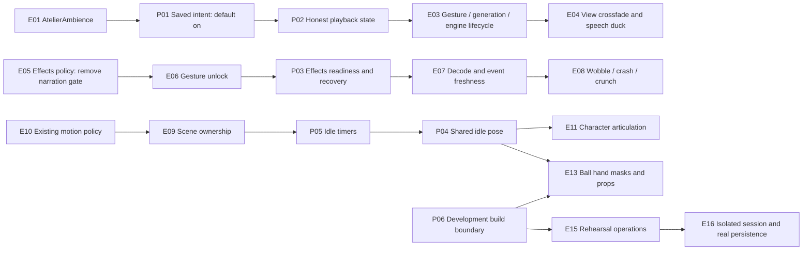

# Atelier architecture diff: source findings and proposed contracts

Status: execution authorized after architecture and checklist. The full tracked
source snapshot and semantic inventory are in [SNAPSHOT/INDEX.md](SNAPSHOT/INDEX.md)
and [SNAPSHOT/SEMANTIC-ENTITIES.md](SNAPSHOT/SEMANTIC-ENTITIES.md).
Source baseline: `676cab6df2bfd22804116f819aedb5a8a51e3709`, GitHub `master`.
Miro: https://miro.com/app/board/uXjVEWFWoZA=/

## Entity references for this diff

Existing references below describe inspected code. Proposed references reserve
names and ownership; they do not assert that these entities exist. The final
whole-codebase inventory must incorporate these rows before checklist creation.

| ID | State | File / entity | Responsibility or proposed contract |
| --- | --- | --- | --- |
| E01 | Existing | `src/components/atelier/AtelierAmbience.tsx` / `AtelierAmbience` | Owns ambience engine, controls, loading and error state. |
| E02 | Existing | same / `enabled`, `setEnabled` | Boolean currently initialized to false; no persisted enable preference. |
| E03 | Existing | same / `start`, `stop`, `generation`, `engine` | Creates and tears down loop sources; generation suppresses stale preparation. |
| E04 | Existing | same / `adjust`, `settings`, `volume` | Crossfades views and ducks ambience during speech; stores volume. |
| E05 | Existing | `src/services/atelierSound.ts` / `allowed` | Currently requires narration `readingAloud`, visible document and unmuted effects. |
| E06 | Existing | same / `unlockAtelierSound`, `effectContext` | Gesture unlock and preloading; failures are currently swallowed. |
| E07 | Existing | same / `loadFoley`, `foleyBuffers`, `playFoley` | Cached audio decode, bounded event freshness, source lifecycle. |
| E08 | Existing | same / `playAtelierBreak`, `playAtelierWobble`, `playAtelierCrunch` | Material-specific sounds; suppress stale wobble after break. |
| E09 | Existing | `src/components/atelier/AtelierScene.tsx` / `AtelierScene`, `animate` | Owns phase and motion-policy application and renders character/trinkets. |
| E10 | Existing | `src/services/atelierMotion.ts` / `canAnimateAtelier` | Pause, reduced motion, document and scene visibility gate. |
| E11 | Existing | `src/components/atelier/AtelierCharacter.tsx` / `AtelierCharacter`, `mouthShape`, `gaze`, `mishapStill` | Voice-driven mouth and mishap response; no occasional idle blink sequence. |
| E12 | Existing | same / `LEFT_HAND_PATH`, `RIGHT_HAND_PATH` | Shared articulated hand outlines. |
| E13 | Existing | `src/components/atelier/AtelierTrinkets.tsx` / `AtelierTrinkets` | Ball hand masks, interactive props, effect toggle and rehearsal controls. |
| E14 | Existing | `src/components/atelier/AtelierScene.css` / hand, head and ball-hand-mask selectors | Thinking/speaking and continuous small cradle animation; masks must track hands. |
| E15 | Existing | `src/services/atelierMemories.ts` / `isAtelierRehearsal`, `setAtelierRehearsal`, `resetAtelierRehearsal`, `nextRehearsalAppointment` | Rehearsal operations presently lack production guards. |
| E16 | Existing | same / `sessions`, `rehearsals`, `identity`, `getAtelierMemory`, `save` | Session and persistent damage/placement state; rehearsal storage isolation. |
| P01 | Proposed | E01 / `ambiencePreference` | Persist explicit on/off; absent preference means on. |
| P02 | Proposed | E01 / `playbackState` | Distinguish waiting-for-gesture, preparing, playing, off and failed; on intent is not proof of playback. |
| P03 | Proposed | `src/services/atelierSound.ts` / `AtelierAudioStatus`, `subscribeAtelierAudioStatus` | Report blocked/preparing/ready/failed effects and recover on an actual gesture; no unbounded event backlog. |
| P04 | Proposed | E09 / `idlePose`, `setIdlePose`, `IdlePose` | Shared `{blink:boolean,gesture:'rest'\|'tilt'\|'massage'}` state for head, eyelids, hands and ball masks; reset on higher-priority activity. |
| P05 | Proposed | E09 / `idleTimers` | Schedule occasional blink, head shift and ball massage while idle; dispose on pause/hide/unmount. |
| P06 | Proposed | E13 and E15 / build-time `import.meta.env.DEV` condition | Hide rehearsal UI and disable its mutators in production, regardless of storage or URL state. |
| P07 | Proposed | E01 / `resume`, `toggle`, `visibility`, `activate`, `ticket`, `context`, `master`, `audio`, `buffers`, `source`, `gain`, `index`, `name`, `response`, `next`, `event`, `current`, `now` | Audio lifecycle helpers and callback-local values; reuse existing engine/generation/settings names. |
| P08 | Proposed | E05–E08 / `audioStatus`, `audioListeners`, `preparing`, `setAudioStatus`, `getAtelierAudioStatus`, `subscribeAtelierAudioStatus`, `listener`, `status`, `context`, `names`, `error` | Shared effect readiness state and subscription lifecycle. |
| P09 | Proposed | E09 / `idleTimers`, `schedule`, `blink`, `gesture`, `mishap`, `delay`, `callback`, `timer`, `next`, `disposed`, `busyUntil`, `event`, `detail` | Idle timer ownership; neutral reset; no pending animation bursts after hide or phase change. |
| P10 | Proposed | E13 / `soundStatus`, `setSoundStatus`; E14 / `data-idle-gesture`, `data-idle-blink`, `.atelier-character__eyelids`, `atelier-idle-tilt`, `atelier-idle-blink` | Effects feedback and shared scene-driven articulation selectors. |

## Current to proposed behavior

| Requirement | Current source behavior | Proposed behavior | Entity refs |
| --- | --- | --- | --- |
| AR01 | Ambience starts disabled. | Default on intent; start immediately when the browser allows, otherwise on the first actual pointer/keyboard activation. Show truthful waiting/preparing state. Respect saved off and volume. | E01–E04, P01–P02 |
| AR02 | Effects are silent when narration is off. | Effects depend on their own room-sound preference, document visibility and actual audio readiness, independently of narration mute. Retain separate ambience preference. | E05–E08, P03 |
| AR03 | Late loads may miss the first contact; failures are swallowed. | Prewarm on legitimate interaction; expose actionable sound failure/retry. Preserve freshness cancellation so delayed downloads do not produce ghost crashes or wobble after a fall. | E06–E08, P03 |
| AR04 | Existing waveform choices already encode material differences. | Retain supplied bowlingball sound for non-gem shelf contact, existing gem contact and material-specific crashes. Preserve awkward audible crash and current roughly 3.2-second reaction. No substitute synthesized Foley. | E07–E08, E11 |
| AR05 | Idle has small looping cradle motion but no occasional blink/scry sequence. | Occasional blink, head movement and visibly massaging cloudy ball; no idle lip-sync. One shared pose drives hands and their masks. Speech, listening, thinking and mishaps preempt idle. | E09–E14, P04–P05 |
| AR06 | Motion policy already exists. | Idle acting obeys pause/reduced motion/background visibility, remains active in the visible inset, and resumes without a catch-up burst. Keep artwork fallback and permanent ball cloud behavior. | E09–E14, P04–P05 |
| AR07 | Rehearsal controls and service mutations are unrestricted. | Render rehearsal/reset/next-appointment controls only in development and guard mutators too. Preserve ordinary volume, sound, motion, theme and shelf interactions. | E13, E15–E16, P06 |
| AR08 | Damage has real-session and rehearsal persistence paths. | Production cannot use rehearsal to erase damage. Refresh retains taped repairs; whole Natally history erasure and future verified replacements retain their separately defined semantics. | E15–E16, P06 |
| AR09 | Ambience has generation cleanup and view ducking. | Preserve a single active loop pair, crossfade and speech ducking; no duplicate sources after remount, cancelled preparation or view changes. | E01–E04, P01–P02 |

## Proposed dependency and ownership diagram

This Mermaid is an architectural relationship diagram, not the full syntax AST.

## Timing choices and priority

Proposed starting choreography: allow a small blink/head variation roughly every
4–9 seconds and an occasional 3–5-second massage after 12–24 idle seconds. These
are explicit design choices for visible, non-periodic acting, not measurements,
golden-ratio derivations or externally validated standards. Determine the final
observable rubric before coding; do not tune criteria after seeing implementation.
Mishap reaction takes priority; actual speech controls the mouth. Listening and
thinking retain their own poses. Idle pose and all matching ball masks return to
the same neutral coordinates when preempted.

## Continuous demonstration coverage to resolve during architecture-to-checklist

Carry this increment into the existing complete onboarding-to-reading-to-export
journey, not a separate sampled success list. The eventual scene mapping must
include default-on audio with browser activation, actual audible view crossfade
and speech ducking, visible idle motion in full and inset views, independent voice
and room mute, first-use asset readiness/retry, shelf/gem/crash material sounds,
mishap preemption, saved off/volume through refresh, background/return, reduced
motion, taped repair persistence and production control absence. Demonstrate the
development-only rehearsal through an explicitly identified environment
transition; it is not proof of production behavior. Preserve account, device,
keyboard, narration/highlight and export coverage from the complete architecture.

The operator has released the hold. The four-state tasks in CHECKLIST.md map every
requirement using the snapshot and these proposed references. The trajectory in
DOCS/DEMONSTRATIONS/2026-10-23-atelier-repair-journey.md is defined before coding.
Audio needs listening evidence;
animation needs temporal evidence. Source findings do not prove delivered repairs.
