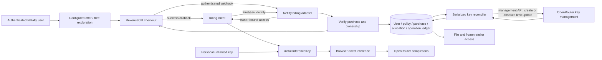

# Billing provisioning architecture delta — 23 October 2026

This extends the whole-codebase AST/entity snapshot linked from ARCHITECTURE.md.
It supersedes the direct-inference delta's deferral of billing and its statement
that Netlify will host only Swiss Ephemeris. Robin explicitly authorized a Netlify
module that creates or tops up user keys after RevenueCat purchase success.
Inference remains direct. Commercial rules and record fields are specified separately
in [BILLING-SPEC.md](../BILLING-SPEC.md).

## Requirements

| ID | Observable requirement |
| --- | --- |
| BP01 | Upfront, dismissible offer and free exploration; exact purchased inclusions and configured allowance shown before payment. |
| BP02 | RevenueCat confirmed purchase calls Netlify reconciliation; authenticated webhook recovers a closed browser. |
| BP03 | First verified grant creates a managed OpenRouter user key; later grants increase that same key's lifetime limit. |
| BP04 | Restore, repeated callback, duplicate events and uncertain provider responses never duplicate a grant or lose a purchase. |
| BP05 | User records, policy versions, purchase ledger, key generations, refunds and operational recovery are durable and account scoped. |
| BP06 | Pricing/allowances come from .env policy. Robin's unlimited personal key remains unchanged and uses the common inference client. |
| BP07 | The client automatically installs verified managed access, shows pending/retry/ready truthfully and resumes waiting work; account changes invalidate responses. |
| BP08 | Downloads and one-year frozen atelier are separately verified entitlements; no implied unlimited future conversation. |
| BP09 | Portable billing core with Netlify adapter, no inference proxy; service status, provider usage and actual delivery distinguish pending work. |
| BP10 | The observed onboarding save must accept the explicitly selected plain/Merlin style under owner-only Firestore rules. |
| BP11 | $30 bundle includes PDF, one year hosted SPA and ten completed conversational turns summarized in both artifacts; remaining turns and summary revision remain coherent across restore and replay. |
| BP12 | Bundle economics provision all costs and fixed-cost subsidy for pay-as-you-go users; ten-turn entitlement is separate from internal USD ceiling; 40% applies only to prepaid top-ups. |

## Preimplementation inventory

Each row extends the baseline snapshot. Record fields are exhaustively named in the
separate billing specification. Before introducing additional implementation symbols,
extend this inventory; no unenumerated helper is implicitly approved by a task label.

| Ref | File and enumerated entities | Contract |
| --- | --- | --- |
| B01 | `DOCS/BILLING-SPEC.md`; all named configuration variables and record fields in its tables | Binding commercial and identity contract; no invented allocation amount |
| B02 | `src/services/billingAccess.ts`: `BillingAccess`, `requestBillingAccess`, `billingEndpoint`, `reconcileBillingAccess`, `readBillingAccess`; parameters `accountUid`, `install`, `isCurrentSession`, `reconcile`; bindings `owner`, `endpoint`, `token`, `response`, `result`, `current`, `key`, `existingKey`, `expiresAt`, `limit`, `usage`, `error`, `installed`; result fields `state`, `message`, `limitUsd`, `usageUsd`, `installed`, `includedTurns`, `remainingTurns`, `reservedTurns` | Fixed configured service URL; Firebase token, bounded request, response ownership/expiry validation; validate integer turn counts; install through D01 only if compatible with existing personal key |
| B03 | `src/components/InferenceAccessSettings.tsx`: existing component/state/connect/disconnect; additions `refreshBilling`, `billingState`, `setBillingState`, `access`, `owner`, `error`; `src/services/inferenceAccess.ts`: existing D01 plus `sourceStorageBase`, `InferenceKeySource`, `loadInferenceKeySource(uid)`, optional `source` parameter to `installInferenceKey`, `sourceKey`, `record` | Visible Check purchased access; preserve working personal key; source metadata tied to exact saved key, reject stale results; later checkout calls B02 |
| B04 | `src/components/PurchaseAccess.tsx`: existing purchase provider/offer controller plus `reconcileBillingAccess` integration and actual RevenueCat purchase-success callback | Requires source inventory extension with actual SDK callback entities before implementation; never fabricate checkout success |
| B05 | `netlify/functions/billing-access.mjs`, `billing-reconcile.mjs`, `billing-revenuecat.mjs`; handlers `default(request,context)`, `config`; shared `billingHttp`, `verifyFirebaseOwner`, `verifyWebhookAuthorization`; bindings `request`, `context`, `owner`, `body`, `result`, `error`, `origin`, `headers` | HTTP adapter to portable core; credential and purchase verification, no-store, approved-origin CORS |
| B06 | `billing/policy.mjs`: `readBillingPolicy`, `parseUsdMicros`, `calculateAllocation`; `env`, `policy`, `value`, `amount`, `product`, `purchase`, `basisPoints`; all B01 config fields | Exact decimal parsing, immutable policy lookup, no default initial allowance |
| B07 | `billing/revenuecat.mjs`: `verifyRevenueCatPurchase`, `listRevenueCatPurchases`; `accountUid`, `reference`, `policy`, `response`, `result`, `purchase`, `cursor`, `purchases` | Verified exact project/app/environment/product and settled transaction; pagination and aliases explicit |
| B08 | `billing/ledger.mjs`: `getBillingAccess`, `recordBillingEvent`, `recordPurchaseAllocation`, `claimBillingOperation`, `completeBillingOperation`, `failBillingOperation`; `database`, `client`, `accountUid`, `event`, `purchase`, `policy`, `allocation`, `operation`, `result`, `error`; B01 table/column names | PostgreSQL transactions/constraints, durable intents and per-account serialization |
| B09 | `billing/openrouter.mjs`: `createManagedKey`, `readManagedKey`, `setManagedKeyLimit`, `disableManagedKey`, `reconcileManagedKey`; `operation`, `policy`, `response`, `result`, `hash`, `key`, `limit`, `usage`, `error` | Management calls, bounded deadlines, absolute target updates, create uncertainty reconciliation; never mutate personal key |
| B10 | `billing/provision.mjs`: `reconcileCustomer`, `processBillingEvent`, `processPendingOperations`; `accountUid`, `event`, `policy`, `purchases`, `purchase`, `allocation`, `operation`, `access`, `error` | Shared purchase callback/webhook reconciliation and durable recovery |
| B11 | `billing/keyCipher.mjs`: `encryptUserKey`, `decryptUserKey`; `key`, `ciphertext`, `version`, `nonce`, `tag`, `cipher`, `decipher`, `result`; `netlify/database/migrations/001_billing.sql`: B01 tables/columns/indexes/constraints | Recoverable per-user credential, versioned encryption and durable schema; provider side effects outside transaction |
| B12 | `.env.example`, ignored `.env`, `.env.local`, `netlify.toml`, `package.json`, lockfile; B01 variables; deploy adapter/database dependency | Configure actual catalog and credentials without publishing user/admin keys; preserve existing offering |
| B13 | `firebase/intake.rules`: existing `owner(uid)`, `validIntake(data)`; `data.readingStyle`; named database deployment config | Add optional `plain`/`merlin` to allowed fields with enum check; preserve existing owner-only limits and deny-by-default |
| B14 | `DOCS/DEMONSTRATIONS/2026-10-23-billing-provisioning.md`, `DOCS/DEMONSTRATIONS/2026-10-23-billing-delivery-observations.md`, `CHECKLIST.md`, `DOCS/ARCHITECTURE.md`, direct-inference delta | Continuous rubric and exact observed status; retain unfinished earlier requirements |
| B15 | Proposed `billing/turns.mjs`: `reserveIncludedTurn`, `completeIncludedTurn`, `releaseIncludedTurn`, `readIncludedTurns`; parameters/bindings `accountUid`, `conversationId`, `requestId`, `turnId`, `providerGenerationIds`, `responseRevision`, `database`, `client`, `grant`, `turn`, `result`, `error`; B01 turn table fields | Transactional grant/reservation/completion with stable request identity; uncertain completion reconciled; provider USD limit is not a turn counter |
| B16 | Proposed `billing/readingSummary.mjs`: `scheduleReadingSummary`, `publishReadingSummary`; parameters/bindings `archiveId`, `conversationId`, `revision`, `includedTurnIds`, `summaryObjectRef`, `pdfObjectRef`, `operation`, `result`, `error`; B01 summary record fields | Versioned shared summary for PDF/SPA; original observation retained, no extra turn charged; exact archive adapter entities must be enumerated before coding |

The ten-turn correction replaces any implied dollar allowance sold with the base
bundle. B12 includes `BILLING_INCLUDED_TURNS=10` and all six cost-provision variables
enumerated in B01. Their unknown amounts remain blank until calibrated, not zero.
B03's ready display shows included/remaining/reserved turns, not an inference-dollar
balance presented as the product. B02 validates the corresponding server fields.

Actual RevenueCat SDK, cryptographic, worker and SQL adapter details must be expanded
with concrete signatures and bindings when their current API/configuration is read,
before coding those rows. These proposed rows are a bounded extension, not a claim
that those files already exist. Source snapshot remains the baseline for existing code.

## Superseding correction: canonical policy and managed bypass

B01/B06/B12 now require canonical registered IDs described in BILLING-SPEC.md.
Current config is `v2`; verbose aliases are not supported. Add to B06 inventory
`policyDefinitions`, `validatePolicyVersion(value)`, `definition`; fail before grants
for unknown, malformed or retired policy. B01/B10/B12 add `BILLING_BYPASS_UIDS`,
`BILLING_BYPASS_EXPIRES_AT`, `BILLING_BYPASS_GRANT_ID`, grant source
`development_bypass`, and `grantDevelopmentBypass(accountUid,policy)` with `grant`,
`expiresAt`, `allowlist`. Same allocation/provisioning path as purchase, no fake receipt.
B02/B03 add `accessSource`, `bypassExpiresAt`; B03 explicitly shows temporary bypass.
The user authorizes replacing the active personal-key connection with managed access
once it succeeds. Preserve the original credential; no management mutation of it.
Earlier personal-key-preservation wording does not block this explicitly authorized
switch. Disabling bypass applies to new unpaid activity, not independent paid grants.
