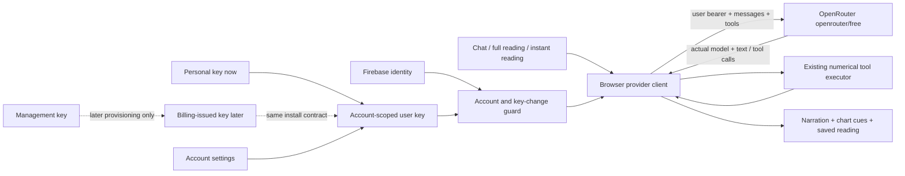

# Direct user-key inference — binding correction, 23 October 2026

Supersedes R05/R06/R09 and temporary-relay statements in the restart delta.
Robin's personal key is analogous to a billing-issued user inference key.
Implement the direct browser path now, without an LLM relay. The management
key is used only for issuance/management. The subsequent billing-provisioning delta
activates that work and extends Netlify's role. RP01/RP02/RP04/RP05 remain binding.

## Requirements

| ID | Outcome |
| --- | --- |
| DI01 | Chat, first reading, instant reading and tool continuations call the fixed OpenRouter HTTPS endpoint directly with `openrouter/free` and the account's user key. No relay or paid/GLM fallback. |
| DI02 | Account-scoped browser key settings; Robin's personal key uses the future issued-key contract. No individual or management key baked into shared assets. Missing/invalid access preserves the question and points to Account settings, not Firebase re-login. |
| DI03 | Actual model, six-tool budget, strict validation, account/key-change guards, complete answers, factual context, narration and cues preserved. Attached images use OpenRouter multimodal messages. |
| DI04 | Remove deployed LLM function and frontend relay URL dependency. Netlify's intended role is the separately architected portable Swiss service; its implementation remains separately tracked. |
| DI05 | Explicit connection/replacement/removal in Account settings; validate directly with OpenRouter before saving, reject management keys. Disconnect invalidates pending output. History erasure preserves access. Later verified billing uses the same install contract; no invented entitlement. |

## Enumerated implementation entities (before coding)

| Ref | File, entities, parameters and local bindings | Contract |
| --- | --- | --- |
| D01 | `src/services/inferenceAccess.ts`: `keyStorageBase`, `loadInferenceKey(uid)`, `installInferenceKey(uid,key,isCurrentSession)`, `removeInferenceKey(uid)`; `storageKey`, `normalized`, `response`, `result` | Existing `accountStorageKey`; base `natally_openrouter_user_key_v1`. GET fixed `/api/v1/key`, reject non-OK and `data.is_management_key`, guard current account before/after, save with readback; surface storage errors. |
| D02 | `src/services/hostedInference.ts`: existing `HostedPayload`, `HostedAuthenticationError`, `CalculationExecutor`, `completeHosted`, `requestHostedInference`; `owner`, `key`, `isCurrent`, `messages`, `toolMessages`, `response`, `result`, `choice`, `calls`, `completed`, `results`, `call`, `content`, `round`, `error`, `retryAfter`, `providerError`, `message`; parameters `payload`, `token`, `endpoint`, `execute`, `isCurrentSession` | Existing function names retained for callers. Token is user OpenRouter key; endpoint restricted to fixed provider URL. Firebase establishes account identity only. Key equality also guards output. OpenAI-compatible messages/tools, 4096 max tokens, 65s bound, actual model required. 401/403 means key connection, 402 budget, 429 rate limit with available delay. Preserve assistant tool messages including provider reasoning details. |
| D03 | `src/components/InferenceAccessSettings.tsx`: `InferenceAccessSettings({accountUid})`; state `key`, `connected`, `busy`, `notice`; `connect(event)`, `disconnect()`; `owner`, `error`; `src/components/AuthModal.tsx` existing `user` branch | User-key entry, Connect, connected status, Disconnect. Guard asynchronous save with `auth.currentUser.uid`; remount by UID. No auto-charge/provision. |
| D04 | `netlify/functions/chat.mjs`, `.env.example`, `HOSTED_CHAT.md`, ignored `.env.local`; `netlify.toml`, `netlify/public` | Delete chat function; remove obsolete relay variable. Preserve operator `.env` key roles without Vite exposure. Publish a deployment without chat function. Dated delivery records remain historical. |
| D05 | `DOCS/ARCHITECTURE.md`, `CHECKLIST.md`, restart demonstration script | Architecture/rubric before coding; source/deployment/observed journey remain distinct. |

DI-1 implements D01–D04, then commit/push. DI-2 deploys SPA and removes
Netlify chat, then records JR0–JR6. RP-1 source remains implemented; relay
commit 212837f is superseded and was not deployed. Later Swiss and billing
implementation remain explicit outstanding work, not implied completion.

JR0 connects Robin's key through Account settings and captures a real direct
OpenRouter request. JR1–JR6 retain the full onboarding/voice/cues/replay/export
journey. JR5 demonstrates refresh and account/key scope. JR6 disconnects,
requests a message, observes the preserved retryable question, reconnects
and retries. Erasure of real history requires action-time consent. Any
unavailable scene remains unfinished rather than substituted with fixtures.

### Observed response deadline correction

After the intake schema correction, the real initial reading reached OpenRouter
and received HTTP 200 headers, then its response body was aborted at the 65-second
deadline. D02's JSON catch incorrectly called that unreadable JSON. Extend D02 with
binding `deadline`: one 180-second AbortSignal shared by the entire request/tool
continuation sequence, rather than a fresh deadline per round. The body catch binds
`error`, checks account scope and abort status, and retains the question with an
accurate timeout message. This operational allowance is not a latency acceptance
claim; record actual completion time and unresolved provider behavior in JR3.
