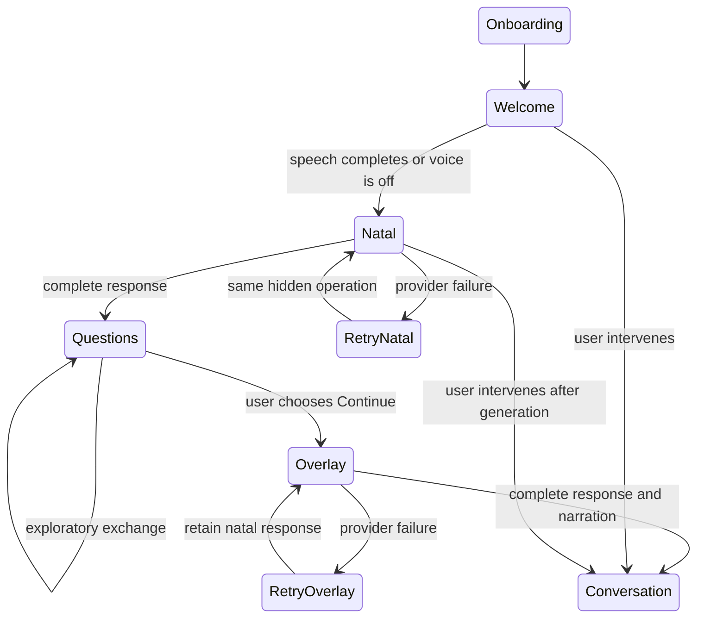

# Two-response opening and inference recovery

Pre-implementation extension of the whole-codebase snapshot linked in ARCHITECTURE.md.
Baseline: 40fa605. User corrections: hidden initial instructions; welcome must finish;
thorough natal reading followed by a distinct current-sky/natal overlay horoscope;
no arbitrary word-count range; independent Gen-Z personality and active chart control.

## Entity inventory extension

Existing entities retain their snapshot definitions. Only the following changes are authorized here.

| ID | File and enumerated entities/bindings | Contract |
| --- | --- | --- |
| O01 | `src/services/openingReading.ts`: `OpeningStage` (`natal`, `now`), `openingPrompt(stage)`, `stage`, `shared`; `src/App.tsx`: existing `runCalculation`, `setExternalReadingToInject`, `input` | Hidden two-stage instructions; coverage not word quotas; initial injection identifies operation, never impersonates user |
| O02 | `src/components/NatallyChatbot.tsx`: `messagesRef`, `openingGeneration`, `failedOpeningStage`, `runOpening(stage,includeWelcome)`, `generation`, `active`, `greeting`, `completed`, `openingStage`; existing `handleSendMessage`, `requestActive`, `requestId`, `requestChart`, `messages`, `userMsg`, `topicTag`, `retrying`, `mediaToSave`, `result`, `natallyMsg`, external-reading effect and retry button | Internal operations do not append user bubbles, disclose to SOUL, use attachments, or repopulate composer. Retry retains stage. Current messages ref supplies completed natal response to overlay. User input invalidates pending opening sequence. Account/chart generations retain existing guards |
| O03 | same component: existing `presentMessage(message)`, `completed`, `active`, `capture`; explicit `Promise<boolean>` return | Await real speech completion. Voice-off progresses without invented timings. Cancelled narration does not trigger the next stage. Release inference busy state before narration so user can intervene |
| O04 | `src/services/hostedInference.ts`: existing `completeHosted`, `messages`, `toolMessages`, `deadline`, `round`, `completed`, `result`, `choice`, `calls`, `content`; new `maxTokens`, `continuations`, `partialText`, `continuationModel`; `.env.example`: `VITE_OPENROUTER_MAX_TOKENS` | Default output budget 16384, explicit low reasoning effort, complete supplied conversation instead of last-20 truncation. At most two length continuations retain text and same routed free model. Empty reasoning-only length can retry under the same bound. No paid fallback. Existing six-tool limit independent of continuation count; five-minute operation deadline |
| O05 | `src/services/natallyChat.ts`: existing `NATALLY_SYSTEM_PROMPT`, `buildChartPresentationPrompt(chart)`; new `exampleTarget` | One-shot voice example is style, not a fabricated user fact. Dynamic cue example uses an actual inventory target. Chart DOM is actively directed through supported presentation actions |
| O06 | `DOCS/ARCHITECTURE.md`, `CHECKLIST.md`, `DOCS/DEMONSTRATIONS/2026-10-23-opening-sequence.md` | Link specification and one continuous acceptance journey, record actual delivery limits |

The two prepared responses do not consume the ten included conversational exchanges;
clarification/exploration between natal and horoscope does use that allowance;
tool rounds and continuations are not extra turns. Existing billing work remains active.

OpenRouter documents that reasoning can consume the output budget and produce empty
`length` responses: https://openrouter.ai/docs/guides/best-practices/reasoning-tokens .
16384 is an operational output ceiling with continuation, not a requested reading length.
The free router chooses a compatible model; context capacity is provider/model-specific,
not something the client can enlarge by inventing a context-size parameter.

## Latest user refinement before implementation

Pause after natal interpretation and invite exploratory questions. Continue to current
horoscope only on the person's explicit navigation choice. No forced question, no
automatic timer. The route remains visible through clarifications and survives refresh.
High-temperature, dreamy, associative, nearly febrile Delphine-talk: permitted to ramble
and lose the thread rather than harden into pronouncements. Implement in shared SOUL
with a short direction, not a new list of prohibited phrases or advisory rules.

| ID | Additional inventory | Contract |
| --- | --- | --- |
| O07 | `PersistentChatMessage.openingStage`; derived `natalOpening`, `nowOpening` in NatallyChatbot; existing `goToPassage`, `messages`, `isTyping`, `runOpening`; `.natally-reading-route`, `.natally-reading-route__stations` in ReadingStage.css | Small subway-style route: Natal → Explore → Now. Completed messages carry stage identity; replay/navigation targets actual saved responses. Continue remains available through exploration, disabled during inference. No automatic second response |
| O08 | `SOUL.md`; existing `NATALLY_SYSTEM_PROMPT`, `askNatally`, `completeHosted`; `VITE_OPENROUTER_TEMPERATURE` | One shared character direction; default temperature 1.45, configurable, validated 0–2. No verbosity ceiling. Operational cue/geometry contracts preserved |
| O09 | `ReadingStage` and its existing `extraControls`, `inRoom`, `onView`, `onPause`, `inset`, `place`; `AtelierAmbience` existing `enabled`, `volume`, `start`, `error`; ReadingStage.css `.reading-stage__options`, `.reading-stage__options-body`; `App` existing extraControls and `AtelierThemeSelector` | Remove ambient toggle/volume surface; default ambience active with existing interaction unlock and speech ducking. Secondary season/docking/motion controls in compact Room options disclosure; one view-switch button and instant horoscope remain. Drag/focus retained |

Continuous scenes 2–3 now stop at Explore: hear the invitation, ask clarification,
observe it answered without auto-advancing, then explicitly Continue to horoscope.
Show the compact route and quiet main toolbar throughout. Inspect Account's ten-turn
terms; no artificial turn deduction before the billing ledger exists.

| O10 | `src/services/openingReading.ts`: `LEGACY_OPENING_PROMPT`, `isLegacyOpeningPrompt(text)`; NatallyChatbot `legacyOpeningPending`, state initializer `saved`, `cleaned`, `index`, `message`; `src/services/soul.ts`: existing `loadSoulState`, `state.user.entries`, new `entries` | Match the exact old generated instruction only; remove it from visible saved conversation and user disclosures. If it has no subsequent Natally answer, resume the hidden opening on mount. Actual user messages remain unchanged. This repairs the already-affected account without erasing its history |
