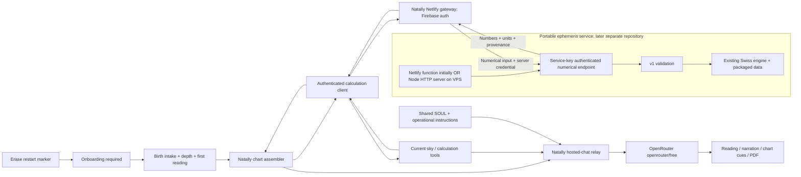

# Reading restart, production inference and standalone calculation service

Architecture delta against `85add6e` on `master`, 23 October 2026. Existing
entities inherit their definitions from the whole-codebase AST/entity inventory
linked by ARCHITECTURE.md. Proposed entities below extend that inventory before
implementation. This document specifies intended behaviour, not deployed state.

**Current scope correction:** Robin requested delivery through RP01–RP05 using
the personal October 10 key from `.env` or environment. R05's relay is a temporary
delivery path for that bounded repair. The later target supersedes the draft
gateway placement below: billing provisions an individual OpenRouter/Venice key
using server-held admin keys, browser inference calls the provider directly,
and Netlify runs only the portable ephemeris service. Complete that later
provisioning/authentication architecture before its implementation. S01–S10 below
remain a retained draft, not an approved claim that the final gateway is on Netlify.

## Requirements and scope

| ID | Required outcome |
| --- | --- |
| RP01 | Erasing all Natally history starts a new onboarding journey, including reading depth, and then a full first reading automatically. An existing cloud intake must not bypass this restart, including after refresh. |
| RP02 | Preserve authentication; protect account boundaries and reject late responses. Only successful onboarding/calculation clears the restart requirement. Failures leave a visible retry path. |
| RP03 | Use OpenRouter `openrouter/free` for hosted chat, first readings, instant readings and calculation continuations. Keys stay on the relay. No silent GLM or paid fallback. |
| RP04 | Preserve validated tool calls, calculated facts, timestamps, narration focus and complete answers. Record the actual returned model, since the free router can select different models. |
| RP05 | Natally has her own sustained Gen-Z, rambling, oversharing character. Remove report-like first-reading constraints and stock chatbot caveat introductions. Uncertainty remains factual and is expressed in her own voice. |
| SE01 | Architect the same Swiss Ephemeris numerical engine as a portable authenticated HTTP service designed for a VPS, initially deployed through a thin Netlify adapter, initially in this private repository and extracted to its own repository after release. |
| SE02 | Only Natally's authenticated backend can call the engine. The numerical service receives mathematical inputs, never Firebase identity, names, chat, artwork, PDF content, prompts or billing. |
| SE03 | Return numerical positions, speeds, time conversions, house cusps/angles and explicit engine/data provenance. Natally owns its presentation and interpretation. Preserve current supported calculations, arbitrary dates and unknown-time limitations. |
| SE04 | Package WASM/data on the server, support cold/warm invocations and reject missing/invalid results. After cutover, the delivered SPA contains no Swiss Ephemeris executable/data or embedded fallback. |
| SE05 | Authenticated gateway, bounded payloads, explicit timeouts/errors, no shared response cache or sensitive request logging. A failed current-sky refresh preserves the previous dated chart and labels its status honestly. |
| SE06 | Deployment order: numerical service, authenticated gateway, then frontend. Keep independent versions and a stable numerical contract for the later repository move. |
| DL01 | Commit and push each completed task. Live delivery and the continuous observed journey remain distinct from source completion. |

SE01–SE06 are architecture and checklist scope in this request; their implementation
is separately tracked and is not silently folded into the urgent provider/restart
repair. The previous requirement to use a different hosting provider is superseded
by the current same-host/different-endpoint initial deployment. The core remains host-neutral and VPS-oriented. Existing private-development and undecided Natally
licence status remain; this design makes no legal determination about the eventual
product licence. Preserve upstream notices and source provenance with the engine.

## Enumerated implementation references

Every coding task below uses these reference IDs or the existing V01–V06 and full
snapshot entities. Extend this table before introducing a new interface or owner.

| Ref | File / entities | Ownership and planned change |
| --- | --- | --- |
| R01 | `src/services/natallyHistory.ts`: `eraseWholeNatallyHistory`; proposed `onboardingRestartKey(accountUid)`, `requiresFreshOnboarding(accountUid)`, `completeFreshOnboarding(accountUid)` | Account-scoped localStorage key `natally_onboarding_restart_v1:${accountUid}`; value `required`. Write after all erasures succeed and before publishing completion. If writing fails, report partial erasure and retain the retry path. Read strictly; remove only after successful first-reading handoff. |
| R02 | `src/App.tsx`: history-erasure effect, `profileLoader`, `profileState`, `chartInput`, `chartResult`, `chartRef`, `booted`, `sessionGeneration`, `historyRevision` | Completed erase clears chart/UI and marks profile ready with no intake. Profile load and callback both respect R01 so late/cloud intake cannot reopen the old room. Existing generation/account guards remain. |
| R03 | `src/App.tsx`: `handleOnboarded`, `runCalculation`, `externalReadingToInject`; `FirstLight` existing intake contract | Complete all onboarding steps, calculate, queue one full first-reading request; then clear R01. Existing offer remains dismissible and does not cancel the queued reading. Failures retain onboarding and input. |
| R04 | `src/components/EraseNatallyHistoryDialog.tsx`: existing copy and completion state; `src/components/NatallyChatbot.tsx`: initial message | Explain restart accurately; greeting belongs to Natally's brand and is not a substitute for the first reading. |
| R05 | `netlify/functions/chat.mjs`: `handleChat`, `model`, `messages`, `upstream`, `completion`, existing response fields | Replace coding-plan URL/key/model with fixed OpenRouter endpoint and `openrouter/free`; no client model override. Remove provider-specific thinking parameter; allow 4096 output tokens for the substantial reading and hidden presentation instructions. Preserve validation, auth, limit, six-tool budget and incomplete-answer rejection. |
| R06 | `.env.example`, `HOSTED_CHAT.md`: relay configuration | Functions-scoped `OPENROUTER_API_KEY`; fixed free router; existing `FIREBASE_API_KEY`, `FRONTEND_ORIGIN`. Remove obsolete hosted GLM instructions; distinguish optional legacy local-server settings. |
| R07 | `SOUL.md`, `NATALLY_SYSTEM_PROMPT` (V01–V03), first-reading text in R03 | State limits conversationally without “one honest caveat”, “as an AI” or report-preface boilerplate; substantial first reading ~900–1200 words, unless the user explicitly requests less. Facts outrank flourishes. No invented user biography. |
| R08 | R02 callback local `restartRequired`, normalized `state` | Recheck R01 after asynchronous profile load before exposing intake. Existing history lifecycle retains partial-erasure state and retry; only complete erasure requests onboarding. |
| R09 | `netlify/functions/chat.mjs`: proposed `providerError`, `retryAfter`; existing `headers`, `respond` | OpenRouter 401/403 is a server credential failure (503), not a false user sign-in failure. Preserve 429 and Retry-After, explain exhausted provider budget (402 -> 503); no silent fallback. |

Initial full-reading range is a product pacing choice, not an empirical guarantee:
900–1200 words leaves room for natal, current sky and Natally's digressions. The
4096 output-token ceiling accommodates that range and presentation cues. Retain
the 32000-character system budget; replace competing copy rather than repeatedly
appending duplicate personality instructions.
| S01 | Existing `src/services/ephemeris.ts`: `getSwissEph`, `calculateNatalChart`, `NatalChartInput`, `NatalChartResult`, `formatLongitude`, `getHouseForLongitude`, `ZODIAC_SIGNS` | Replace engine calls with S07 numerical results; retain presentation fields, colour, tiering, interpretation and aspect geometry in Natally. Remove browser engine import and singleton at cutover. |
| S02 | Existing `src/services/transits.ts`: `calculateCurrentSkySnapshot`, `calculateTransitAspects`; `src/services/calculationTools.ts`: `createCalculationSession`; `src/services/hostedInference.ts`: `completeHosted` | Route numerical sky queries through S07; preserve dated target identities, natal/transit distinction, tool IDs and existing session limits. Tools still orchestrate in Natally; the engine does not run an LLM. |
| S03 | Proposed `services/ephemeris/lib/http.mjs`: `handleCalculation(request, {env, calculate})`; `netlify/functions/ephemeris.mjs`: default adapter and `config` | Portable Web Request/Response handler owns service-key auth, validation and errors. The Netlify adapter only supplies environment and delegates. No Netlify imports in the core. Response only S05. |
| S04 | Proposed `services/ephemeris/lib/engine.mjs`: `getEngine()`, `calculateNumerics(input)`, `enginePromise`; `services/ephemeris/vendor/swisseph/` | Move the existing wrapper/WASM/data with notices intact. Reset a rejected initialization promise so a later request can retry. Never share user data or mutable request-specific configuration across invocations. |
| S05 | Proposed `services/ephemeris/lib/contract.mjs`: `validateCalculationRequest(value)`, `validateCalculationResult(value)`, `SCHEMA_VERSION`, `BODY_IDS`, `HOUSE_SYSTEMS`; `CalculationRequest`, `CalculationResult`, `CalculationFailure` schemas below | Numerical wire contract, no frontend or Natally imports. Server and client validators have the same v1 contract; application adapter checks response before rendering. |
| S06 | Proposed `netlify/functions/calculate.mjs`: `handleCalculate(request)`; `netlify/lib/session.mjs`: `verifySession(request, env, fetchImpl)` | Gateway validates Firebase token and permitted origin, strips identity from upstream payload, uses `EPHEMERIS_API_URL` and server-only `EPHEMERIS_SERVICE_KEY`. Refactor chat's existing identity lookup into the same helper without changing its behaviour. |
| S07 | Proposed `src/services/calculationClient.ts`: `requestCalculation(input, signal?)`, `CalculationRequest`, `CalculationResult`, `CalculationServiceError` | Obtain current Firebase ID token, call `VITE_CALCULATION_API_URL`, validate v1 response; abort/stale account results cannot update charts. No engine import or fallback. |
| S08 | Proposed `services/ephemeris/package.json`, `services/ephemeris/server.mjs`: `startServer({host,port,env})`, `services/ephemeris/Dockerfile`, `services/ephemeris/.dockerignore`, `services/ephemeris/README.md`, `services/ephemeris/PROVENANCE.md`; existing root `netlify.toml`, `.env.example`, local ignored `.env`, frontend asset-copy configuration | Node HTTP server maps /v1/calculate to S03, with bounded streaming body reads and graceful shutdown. Container/VPS and Netlify use the same core and vendor files. Initial Netlify function is on the existing relay project. Package explicit vendor assets. Keep application secrets and user data out of the image. Move vendor/public assets out of SPA delivery. |
| S09 | Existing `src/vendor/swisseph/src/swisseph.js`: `SwissEph.initSwissEph`, `julday`, `sidtime`, `houses`, `calc_ut`, `getLastError`, `version`; generated `wasm/swisseph.js`, `.wasm`, `.data` | Reuse these exact engine operations. Preserve relative vendor paths in server bundle; Node locator already exists but packaged runtime resolution must be observed. Do not copy Natally personality, UI or chart-description code into the service. |
| S10 | `DOCS/CALCULATION-API.md`, this document, demonstration script and delivery record | Replace obsolete placement assumptions, document v1 inputs/outputs and deployment identities; eventual repo extraction changes service release location, not client contract. |

## Runtime and ownership diagram



## Numerical v1 contract

`POST /v1/calculate` on a VPS; initially `POST /.netlify/functions/ephemeris`
on the relay host. Both expose the same JSON contract and use only `Authorization: Bearer
<EPHEMERIS_SERVICE_KEY>` at the standalone engine. The gateway uses a Firebase
bearer instead. CORS is not authentication. The standalone endpoint has no browser
CORS grant; the gateway permits the configured frontend origin and OPTIONS.

`CalculationRequest` fields (all explicitly enumerated):

| Field | Type / rule |
| --- | --- |
| `schemaVersion` | Literal `1`. |
| `requestId` | UUID generated by caller; echoed for correlation, no account ID. |
| `instantUtc` | Canonical ISO UTC date/time with `Z`, including optional milliseconds; calendar-valid and finite. Same birth-offset conversion as current Natally before sending. No server “now” substitution. |
| `bodies` | Unique array of 1–12 allowlisted names: Sun, Moon, Mercury, Venus, Mars, Jupiter, Saturn, Uranus, Neptune, Pluto, Chiron, TrueNode. |
| `ephemeris` | `swiss` or `moshier`; natal requests retain Swiss preference; current sky retains its current Moshier selection. |
| `allowMoshierFallback` | Boolean; only permitted if all requested bodies are supported by that calculation. A fallback must be reported per body, never labelled Swiss. |
| `houses` | Optional `{latitude, longitude, system}`; finite latitude -90..90, longitude -180..180. `system` allowlist initially `P` (the currently supported Placidus option). Other actual product-supported systems must be inventoried before expansion. Omit for sky-only or unknown-time requests. |

`CalculationResult` fields: `schemaVersion:1`, matching `requestId`, matching
`instantUtc`, finite `julianDayUT`, finite `siderealTimeHours`,
`bodies:[{id,longitudeDeg,latitudeDeg,distanceAu,longitudeSpeedDegPerDay,
latitudeSpeedDegPerDay,distanceSpeedAuPerDay,ephemerisUsed}]`, optional
`houses:{system,cuspsDeg:[12 numbers],ascendantDeg,midheavenDeg}`,
`provenance:{engine,engineVersion,wrapperVersion,dataRevision,serviceRevision}`,
`warnings:[{code,body?,message}]`. Angles normalized to [0,360); full precision in
wire data. No formatted astrology prose, planet glyphs, colours, user input echo,
aspects, personal identity or predictions. Service metadata contains fixed release
versions/checksums, never server paths or environment values.

`CalculationFailure` fields: `schemaVersion:1`, `requestId` when valid,
`error:{code,message,retryable}`. HTTP 400 malformed/unsupported input, 401 absent
or invalid auth, 413 oversized body, 422 unsupported epoch/body/house calculation,
429 rate limit, 503 missing configuration/engine data, 504 timeout, 502 invalid
upstream result at the gateway. No invented coordinates or silent replacement of
Placidus at polar latitudes. Invalid/nonfinite/null engine outputs fail explicitly.

Payload maximum 16 KiB; one instant and at most twelve bodies per request. Batch
date ranges are outside v1. Numeric supported epoch bounds must be derived from
the packaged data and exposed in service documentation before cutover; no guessed
year limits. Missing Chiron data must surface as such. Source inspections show
current natal fallback catches exceptions but does not prove every return value
valid: server adapter must inspect errors/results and actual calculation mode.

## Packaging, security, cutover

The portable numerical core uses ordinary Node facilities and Web Request/Response;
it has no Netlify SDK, event/context or environment API dependency. A Node HTTP
entry point and container make the VPS the normal long-running deployment shape.
`HOST` defaults to 127.0.0.1 and `PORT` to 8080; containers explicitly set HOST to
0.0.0.0 behind the operator's TLS reverse proxy. SIGTERM stops accepting new work,
allows bounded in-flight completion, then exits. The process can restart under a
VPS supervisor; persistent user state is unnecessary.

Initially deploy a thin `netlify/functions/ephemeris.mjs` on the SAME relay project,
separate from `chat.mjs` and the Firebase-authenticated `calculate.mjs` gateway.
Explicit function `included_files` contains the portable service's vendor
JS/WASM/data; retain the relative paths expected by its Node loader. Cold/warm
initialization must work without downloading runtime assets. There is no required
second Netlify project or Oracle login for this first deployment.

Configuration belongs in environment, with these initial non-secret values in
local ignored `.env` and documented in `.env.example`:

```dotenv
VITE_CHAT_API_URL=https://natally-hosted-chat.netlify.app/.netlify/functions/chat
VITE_CALCULATION_API_URL=https://natally-hosted-chat.netlify.app/.netlify/functions/calculate
EPHEMERIS_API_URL=https://natally-hosted-chat.netlify.app/.netlify/functions/ephemeris
```

`EPHEMERIS_SERVICE_KEY` stays server-only and is not checked into examples. The
relay gateway forwards to the EPHEMERIS_API_URL; it must never point back at itself.
For the later VPS move, deploy the same portable service and change that one
server URL to its HTTPS `/v1/calculate` endpoint. Frontend and model contract do
not change. Netlify takes runtime variables from its Functions environment; local
`.env` alone does not configure a deployed function. Model and calculation
endpoints remain independent.

Use at least 256 bits of random service credential material, Functions scope only,
and constant-time comparison. No secret in a `VITE_` variable or git. Gateway
validates Firebase before contacting the service. Apply provider rate limiting
plus authenticated per-user throttling at the gateway; an in-memory window is
only per-instance protection and must not be described as a global quota.
Abort gateway upstream after 15 seconds and frontend after 25 seconds, with an
explicit retry action. These are initial operation bounds, not timing claims.
Use `Cache-Control: no-store`; logs record request ID/status/duration only, never
birth inputs, bearer tokens or full payloads. No database or account store in the
numerical program. Refuse caller-supplied upstream URLs and arbitrary engine flags.

Publish engine and gateway functions on the initial relay host with their URL/secret configured, then
publish the frontend with its gateway URL. Every current getSwissEph caller must
have been replaced before removing the vendored browser runtime and public assets.
No production path silently returns to local WASM. A later service outage reports
unavailability; saved charts and recordings remain viewable. Moving the service to
its own repository after release preserves this numerical API and provenance.

Official platform references consulted: [Netlify function packaging/configuration](https://docs.netlify.com/build/functions/configuration/)
and [OpenRouter free router](https://openrouter.ai/openrouter/free). The latter
routes across available free models and filters for requested capabilities;
actual output quality and tool continuation still require the real journey.

## Restart and voice state transitions

Write R01 after all history erasures succeed, before publishing completion.
If that write fails, report partial erasure using the existing retry flow.
On complete, clear chart result/ref, current/archived
presentation, boot flag and pending reading, then show FirstLight for the same
authenticated account. Profile loading ignores old local/cloud intake while R01
is present. A refreshed or returning browser resumes onboarding. Successful intake
save and calculation queue the full reading once and clear the marker. Provider
failure after handoff leaves a retryable reading in the room, not repeated intake.

Keep V01 shared and last in chat/reading instructions. A necessary limitation such
as unknown birth time can sound like Natally without a stock “honest caveat” or a
lecture. Examples guide register, not fabricated biographical facts. First reading
must cover natal themes and dated current relationships with chart cues, while
retaining the selected plain-English or advanced explanatory depth.
