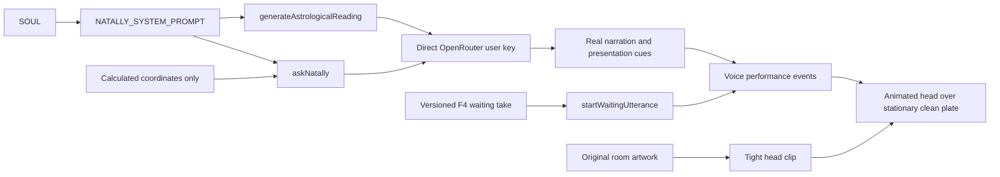

# Natally's voice, waiting cue and articulated silhouette

Pre-implementation delta against master `2631cb7`, extending the complete AST and
entity inventory linked from ARCHITECTURE.md. User observations: the live reading
is definitive and formal despite the requested febrile Gen-Z character; the waiting
utterance loses "look"; the head carries unwanted background at its cut boundary.

## Contract

SOUL is the one character direction used by chat, opening, instant horoscope and
saved readings. Keep calculated geometry precise while the interpretation is
associative, dreamy, slang-rich, rambling and open-ended. Her diction belongs to
her, independently of the visitor. Replace competing lecturer/cadence directions;
do not add a larger prohibition list. Supply a concrete in-character example.
Remove arbitrary reading word quotas and stop labeling stock personality/numerology
interpretations as verified Swiss geometry. Existing calculation tools and actual
DOM presentation actions remain available throughout the conversation.

The delivered 15:29 reply still used a formal personality verdict. Its request
placed a long reading-language policy after SOUL's example, including a second
copy at the current question. VC08 replaces that competing policy with a concise
Plain English / Full Merlin distinction and the example extracted directly from
SOUL's `Your next spoken answer` section. The existing late delivery-note placement
then carries the actual voice example beside the question without another persona
copy or another inference call. Preserve language persistence and exact geometry.

Replace the defective waiting recording with a clearly articulated F4 rendering
of "Let me take a closer look." The original wording drops the word even at
higher preparation quality; use the complete natural phrase rather than shipping
that defective take again. Use three complete short phrases, including "Give me
a moment." and "Let me follow that thread." Use new asset identities so existing browser caches
cannot serve the old take after reload. Keep real playback, captions and mouth
events together; no synthetic waiting timers are introduced.

Retain the original character pixels. Trace the animated head's SVG boundary along
the turban, ears, chin and narrow antenna rather than carrying surrounding room
pixels. The unchanged room clean plate stays stationary behind the head. Live
inspection also isolated a compositing defect: applying the hand-occlusion mask
and head clip to the same SVG image exposes a rectangular patch. VC06 places the
head clip on an outer group and the hand mask on its inner image; the outer
silhouette remains the final visible boundary during animation.

## Enumerated entity extension

| ID | Existing / proposed entities and variables | Change |
| --- | --- | --- |
| VC01 | `SOUL.md`; `src/services/natallyChat.ts`: `NATALLY_SYSTEM_PROMPT`, imported `soul` | Concise operational contract followed by one character direction and an associative voice example; remove competing expert/lecturer and clause-length steering |
| VC02 | same service: `buildStructuredNatalContext(chart,userLore)`, `themes`, import `computeThemesAndWisdom`, `placementsList`, `aspectsList`, `houseCuspsList` | Remove prewritten personality/numerology priming from the verified coordinate block; retain actual bodies, houses, angles and calculated chords |
| VC03 | `src/services/readings.ts`: `generateAstrologicalReading(req)`, `prompt`, `quickNow`, request `temperature`; existing `VITE_OPENROUTER_TEMPERATURE` | Coverage and associative voice replace 550–750-word quota and formulaic practical advice; share chat's configured temperature |
| VC04 | `scripts/prepare-waiting-voice.mjs`: `phrases`, `out`, `revision`, `tts`, `response`, `embedding`, `result`, `samples`, `rate`, `wav`, `id`, `text`, `i`; new `steps`, `sourceFile`; `public/voice/waiting/{look,moment,thread}-v2.wav`, `provenance.json` | Reuse the existing complete `closer.wav` take for the look cue; prepare the other replacements at 16 inference steps; per-asset provenance records text and reused source or generation settings |
| VC05 | `src/services/voiceService.ts`: `WAITING_PHRASES`, `loadWaitingBuffer(id)`, `startWaitingUtterance`, `waitingBuffers`, existing caption and playback events | Point the look phrase at its new recorded asset identity; actual speech remains cancellable by user interaction |
| VC06 | `src/components/atelier/AtelierCharacter.tsx`: `AtelierCharacter`, existing head `clipPath`; new exported `HEAD_PATH`, `ANTENNA_PATH`; existing `source`, `plate`, `ref`, head group | Trace the native 2048×1280-coordinate silhouette with SVG paths; keep original identity and current blink/mouth/scrying animation |
| VC07 | `DOCS/DEMONSTRATIONS/2026-10-23-voice-and-cutout.md`, `DOCS/ARCHITECTURE.md`, `CHECKLIST.md` | Extend the existing continuous journey with real cue playback, a fresh unsteered reading and moving silhouette evidence |
| VC08 | `src/services/readingStyle.ts`: existing `readingStylePrompt`, `style`, `loadReadingStyle`; new imported `soul`, constant `voiceExample` extracted from SOUL | Replace the long competing language policy with a short depth distinction followed by the canonical voice example, used by existing chat/reading callers |

## Implementation sequence

- [x] VC01–VC03, VC08: implement shared character direction and reading scope; commit and push. Generated-voice acceptance remains open in CHECKLIST.md.
- [x] VC04–VC06: replace the waiting take and tighten the head boundary; commit and push.
- [ ] VC07: build for delivery, deploy to natally.surge.sh, record the continuous
  browser journey below and publish its observed outcome. Keep unfinished wider
  opening/billing/archive work visible; this delta does not complete those tasks.

The standing no-automated-testing rule applies. Final acceptance is the actual
recorded product journey, not a build or prompt inspection.

The [delivery observations](../DEMONSTRATIONS/2026-10-23-voice-and-cutout-observations.md)
record completed audio/cutout evidence separately from the still-open generated
personality requirement and provider failures.
