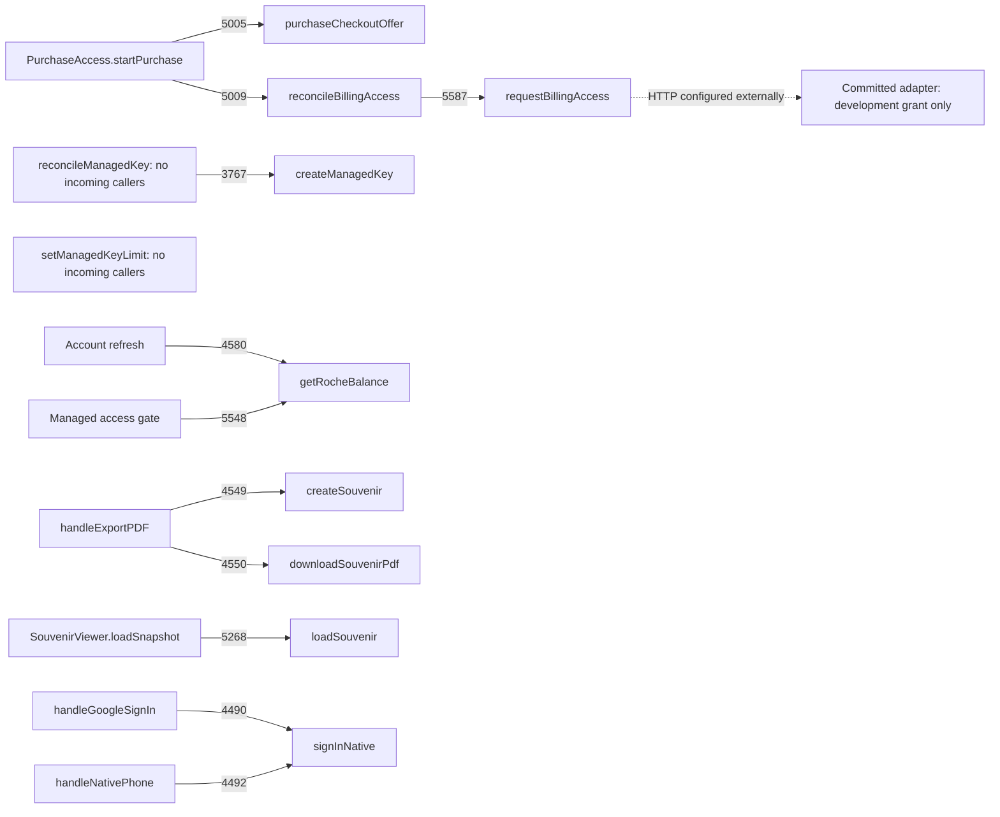

# CodeGraph versus architecture: immutable snapshot audit

**Read-only findings for architectural discussion. No product fixes or architecture edits were made by this audit.**

## Snapshot and evidence

- Requested time: **2026-10-28 04:50:31 UTC** (00:50:31 America/Toronto).
- Commit: **f3470d4ffec6438582e643f6f2e7e542513676d1**.
- Code/source capture completed: 2026-10-28T04:51:17.216428+00:00.
- Authoritative local architecture location at this commit: `DOCS/ARCHITECTURE.md`; there is no root `ARCHITECTURE.md` in the inspected tracked tree. Referenced architecture increments and the later operator-directed `DOCS/ROCHE-CUSTOMER-ARCHITECTURE.md` were also inspected. Explicit current operator corrections take precedence over stale prose and proposals.
- Isolated source: `.tmp/snapshot-audit-20261028-045031/source`; archive SHA-256 `b4725a64ab1130f281557e34b7f8627fe01ee07219716238d6ed937631575516`.
- Included code: `src`, `scripts`, `billing`, `netlify`, Rust source/config, tests, entry HTML/PWA configuration and relevant version/build configuration. Assets/binaries, external dependencies and `.codex-remote-attachments` were excluded. The precise inclusion list and observed dirty-file hashes are in `provenance.json` beside the source. Referenced architecture increments were exported separately from the same commit.
- Fresh **CodeGraph 1.6.2** index created on the isolated source at 04:51:23.460 UTC: **156 files, 2,715 nodes, 6,853 edges**, extraction version 27, complete, zero pending references, zero pending changed files. SQLite `PRAGMA integrity_check`: **ok**.
- Commands: `codegraph init <isolated-source>`, `codegraph status --json .`, `codegraph callers reconcileManagedKey --json`, `codegraph callers requestBillingAccess --json`, and read-only node/edge SQL on that index. Graph IDs and source anchors below refer to this index and this commit, not a moving checkout. Focused graph evidence is retained in `graph-evidence.json` beside the source.

The desired result is that implementation matches the approved architecture and any remaining difference is an explicitly unfinished checklist item. This snapshot does **not** meet that condition: it contains expected backlog, stale/conflicting specifications, and implemented symbol-contract gaps.

## Divergences table

| ID | Classification | Evidence at this snapshot | Consequence / discussion item |
|---|---|---|---|
| G01 | Expected checklist backlog: account provisioning and funding | `billing/openrouter.mjs:174` `reconcileManagedKey` is node `function:686eaa5a556d752d87c67d83e190bf31`, with zero incoming call/import edges. `setManagedKeyLimit` at line 139 is node `function:b18fa2728a34762f3e46f36894bf9bdb`, also with zero incoming edges. `createManagedKey` has only its internal caller `reconcileManagedKey` (edge 3767). `DOCS/ROCHE-CUSTOMER-ARCHITECTURE.md:14-21` and `CHECKLIST.md:14-32` explicitly require signup reuse/create-zero and purchase funding and say implementation remains pending. | The low-level module exists, but the required account/purchase lifecycle does not reach it. This is unfinished work, not evidence that a different provider or ledger is needed. |
| G02 | Expected backlog plus incomplete operational path | `PurchaseAccess.tsx:143` calls `purchaseCheckoutOffer` (edge 5005), then line 156 calls `reconcileBillingAccess` (edge 5009). That reaches `requestBillingAccess` through edge 5587. The client requires a configured endpoint (`billingAccess.ts:88-90`). The committed `netlify/functions/reading-access.mjs:40-49` only returns a development-email grant or unavailable; it does not implement ordinary-user purchased funding. | Checkout initiation is wired, but the committed server adapter does not fulfill ordinary customer purchases. Do not infer completion from checkout source or a provider success result. |
| G03 | Expected checklist backlog: shared ROCHE spend/redemption | `getRocheBalance` at `revenueCatCheckout.ts:361` is wired to account refresh (edge 4580) and the managed access gate (edge 5548); it reads literal `all.ROCHE` at line 383. `completeHosted` returns response text/model (`hostedInference.ts:206,227`) and has no graph edge to a ROCHE debit operation. No function node named for redemption/coupon/currency writes was found; focused source inspection shows only `showDiscountCodeField` and label override (`revenueCatCheckout.ts:294-307`). | Balance display is implemented; automatic shared-balance spending, issued one-use gifts, target/campaign attribution and allowance synchronization remain backlog under `ROCHE-CUSTOMER-ARCHITECTURE.md:23-45,75-95,102-108`. External provider configuration is outside this static audit, so absence here is not proof no external operation exists. |
| G04 | Stale documentation contradicting settled RevenueCat specification | The main architecture's governing correction still describes server-held credentials/backend operation ownership (`DOCS/ARCHITECTURE.md:63-65,113-120`), while the later ROCHE document specifies the customer key and association with RevenueCat and direct customer-key inference (`ROCHE-CUSTOMER-ARCHITECTURE.md:7-21,57-66`). Historical main line 753 additionally calls a local append-only ROCHE ledger authoritative; the main file labels historical material subordinate at lines 20-22. | Do not implement the old ledger or server-inference design to satisfy stale prose. RevenueCat authority was already explicit for weeks; this is a documentation failure, not an architectural choice or an authorized competing model. Correct stale documentation to that existing requirement. |
| G05 | Implemented contract divergence / stale symbol ownership | `DOCS/ARCHITECTURE.md:1347` assigns checkout ownership to `src/services/purchaseCheckout.ts` and `requestPurchaseQuote`; that file/symbol is absent. Actual ownership is `revenueCatCheckout.ts` (`getCheckoutOffer:199`, `purchaseCheckoutOffer:252`, `restoreCheckoutCustomer:329`). `PurchaseAccess.startPurchase` reaches it through graph edge 5005. | The purchase path is not wholly absent; its implemented names and ownership differ from the specified entity contract. Decide which contract is current and update the closed entity/checklist mappings before treating this as aligned. Do not add a redundant adapter merely to make the old filename exist. |
| G06 | Implemented entity inventory gap; native runtime unverified | `AuthModal.handleGoogleSignIn:67` and `handleNativePhone:87` call `signInNative` via edges 4490/4492. `nativeAuth.ts:9` invokes `native_sign_in`; `src-tauri/src/lib.rs:8` registers the command and `native_auth.rs:96` opens `https://natally.robin.mba/auth/native.html`. These exact bridge symbols are not enumerated in the inspected main architecture/increments. The older build section still says native implementation is needed (`ARCHITECTURE.md:1179`). | Native bridge source is wired, not missing. Its closed architecture inventory/status is stale or incomplete, and actual Windows browser-to-app sign-in remains unverified by this static audit. Graph cannot resolve the string-based TS-to-Rust invoke edge; that segment was checked directly in source. |
| G07 | Aligned implementation path; delivery acceptance still unverified | `ExportModal.handleExportPDF:89-90` calls `createSouvenir` and `downloadSouvenirPdf` (edges 4549/4550). `SouvenirViewer.loadSnapshot:80` reaches `loadSouvenir` (edge 5268). `App.tsx:586-588` routes the souvenir URL; the viewer includes the chart (`SouvenirViewer.tsx:280`). `souvenir.ts:337-382` checks RevenueCat entitlements, builds a frozen record, and writes under the owner UID in Firebase. | This is real artifact-path wiring, not just a promised PDF. A retention timestamp at `souvenir.ts:350` alone does not prove one-year hosting or a paid deployed journey. Exact new souvenir function/schema ownership is not enumerated in the main architecture. |
| G08 | Aligned free authored path; voice/runtime unverified | The unpaid branch at `NatallyChatbot.tsx:655-684` uses `getAuthoredChartExplanation` or `getAuthoredConversationClose`, creates an authored message, calls presentation, and returns before the later inference path. Graph edges 4774/4811 link authored explanation to the chatbot; edges 6140-6143 reuse it for souvenir chapters. | The source implements the requested prewritten-content path rather than free LLM generation. Actual voice sound, name insertion, chart interactions and full background content require runtime acceptance; no audio/listening claim is made here. |
| G09 | Build specification drift and unfinished migration | `scripts/release-state.mjs:8` requires RPM/PWA and line 16 rejects major zero. `version.json` at this snapshot still has major zero. The architecture's older matrix at lines 1175-1177 omits RPM/PWA and defines a test build. CodeGraph edge 3967 connects the private web build hook to `generatePwa`; PowerShell/shell matrix behavior was inspected directly because it is not in the graph's supported-language set. | Next build is intentionally rejected until the canonical version track is resolved through the prescribed mechanism. The approved complete target list and artifact status need synchronization with the current build contract; running the coordinator alone is not completion proof. |
| G10 | Proposal, not a required divergence | `ARCHITECTURE.md:1613-1656` explicitly labels the PWA automatic-update design optional and not approved. Current `generatePwa` is wired (edge 3967) and current `public/pwa.js` provides registration/installation. The automatic-update draft is preserved separately at `d408c60`, not integrated into this snapshot. | Missing `registerSW`/dirty-update-chip behavior from that optional proposal is **not** a failed approved requirement and must not become a release gate. CC16 is subordinate/noncanonical per the operator. |

## Graph flow actually observed

Dotted HTTP edge is a source-described external boundary, not a resolved CodeGraph call edge. There is no graph path from the purchase/account entry into the isolated key-management module at this snapshot.

## Preserved alternatives and dirty-tree boundary

The seven observed dirty/untracked fulfillment files were copied and hashed separately at capture; they were not indexed as if committed. They match the purpose of the preserved alternative `ec99b908be8f75cfe2278463002e3adb97184dc6` on `checkpoint/2026-10-28-fulfillment-alternatives`. That alternative contains inference-store/RevenueCat-access/download-access drafts. Their presence in the active worktree is not evidence that the snapshot implements or authorizes them. The PWA proposal is separately preserved at `d408c60b028fc1d3204ea0f879eb98ff0a43675c`.

Current operator-directed assumption-led continuation is recorded in `DOCS/CHECKPOINTS.md` at the snapshot. That permits transparent, recoverable execution decisions; it does not turn unapproved architecture into governing specification. Architectural changes found necessary by these rows must be surfaced for discussion and handled in architect mode separately from coding.

## Limits and next review decision

This is a targeted static conformance audit, not an exhaustive proof of every symbol or a full product rubric. CodeGraph resolved JavaScript/TypeScript/TSX/Rust/Python structure; it did not inspect provider dashboards, deployment bytes, browser/native runtime, payment receipts, stored customer accounts, user voice output, or physical devices. Dynamic callbacks, SDK internals, HTTP endpoints and TS-to-Rust command strings require the explicitly identified source corroboration and later runtime evidence. A missing graph edge is reported as a missing indexed connection, not universal proof of impossibility.

No checkout, deployment, build, server mutation, product edit or architectural repair was performed. Root may review and publish this report. The immediately actionable distinction is: G01-G03 are explicitly unfinished lifecycle work; G04-G06/G09 need specification/inventory reconciliation; G07-G08 have aligned source paths but lack delivery acceptance; G10 remains outside the required specification.

## Requested as-built candidate and preserved original

- File-level candidate: `architecture-current-ast-20261028-045031.puml`.
- Exact symbol/edge export and per-file diagrams: `architecture-current-ast-20261028-045031-details/graph.json`, `index.json`, and 156 standalone `.puml` files.
- Original architecture, unchanged: `evidence-20261028-045031/ARCHITECTURE.snapshot.md`, SHA-256 `ff836b121f6599adbb57de20943294ca2574f716006e8851dc079c7cd453978e`.
- Source/capture provenance and focused graph evidence are alongside that original.

Excluding unfinished checklist backlog and unapproved proposals, five distinct
contract-drift groups were found: commercial authority/key ownership; checkout
symbol ownership; native-auth entity/status inventory; souvenir schema/function
inventory; and build target/version-state contract. The as-built candidate records
what the index contains; it is not an approved normative replacement. No additional
scope or implementation is proposed by this export.
