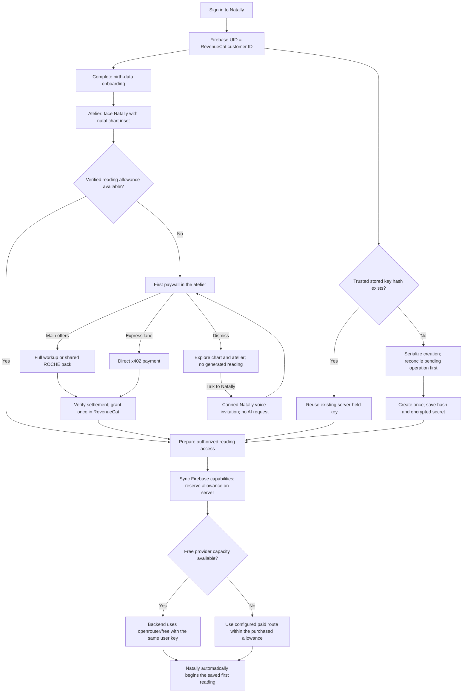

# Natally billing specification

Status: design updated 26 October 2026. Purchase provisioning is not yet deployed.
The 25 October operator request introduces the minimal real-payment tester policy
`v3` and explicitly binds **ROCHE**, with RevenueCat authoritative across card,
Lightning and x402. See [the implementation and configuration record](LIVE-PAYMENTS-2026-10-25.md).
That record supersedes the older initial price and currency-choice boundary below;
full frozen-archive/summary delivery remains a separate acceptance requirement.
The 26 October onboarding correction below requires verified paid reading access
before any generated reading, including when inference uses `openrouter/free`.
Chart and atelier exploration remain available without purchasing. This supersedes
the earlier unconditional free-reading path; the correction is specified, not deployed.
This document defines the commercial records and purchase-to-inference contract.
Implementation entities are enumerated in
[the billing architecture delta](ARCHITECTURE/2026-10-23-billing-provisioning.md),
with tasks in [CHECKLIST.md](../CHECKLIST.md) and a continuous demonstration script.

## The experience

People may calculate and explore their chart and atelier before purchasing.
Immediately after onboarding, show Natally facing the user in the atelier with the
natal chart inset. Check existing reading access: eligible users begin their first
reading automatically; otherwise present the first paywall in that same setting.
Dismissal leaves chart and atelier exploration available, without starting inference.
Unpaid download actions open the same offer, which dismisses when clicked outside.
The two main offers are **For every budget**: the **full workup at $30 after testing**
(PDF, one year of hosted interactive SPA access and ten follow-up turns summarized
in both), and **prepaid $ROCHE packs usable across all our apps**. The **x402 express
lane** bypasses pack purchase with a direct payment; it is not a third main package.
Current minimal tester prices remain unchanged. Before payment,
show the actual currency/price, files, ten-turn inclusion and hosted-access term.
The customer is buying this experience, not $12 or another dollar balance of inference.
The interactive atelier preserves the reading's observation rather than silently
recalculating an archived reading against a later sky. Further turns beyond the ten
are separately funded. The bundle must cover all costs, including a contribution
toward fixed costs subsidizing pay-as-you-go users.
Do not describe an undeployed archive or unavailable checkout as an existing benefit.

Provision or recover the account's managed OpenRouter key automatically after
Firebase sign-in and RevenueCat customer registration. Key existence alone grants
no reading access. After a payment on any supported rail, Natally asks the billing
service to verify settlement and reconcile that customer's access. The service:

1. Records the verified allocation once and grants its RevenueCat capabilities/ROCHE.
2. Synchronizes fresh RevenueCat capabilities into the same Firebase user record.
3. Updates the allowance on the same managed key, recovering unfinished creation if needed.
4. Returns ready reading access and automatically resumes the saved first-reading request.

RevenueCat webhooks independently run the same reconciliation, so closing the browser
after paying does not lose the purchase. Reopening, restoring purchases and repeated
notifications recover the same allocation; they never purchase it again.

To keep the managed key out of the app, the proposed target is authenticated backend
inference: the server uses the encrypted user key and streams the answer to Natally.
This supersedes direct browser inference for managed access if implemented; the
current client still receives the key. No infrastructure migration is implied.

## Onboarding, purchase gate and first reading — 26 October 2026

Status: operator-directed flow, implementation and live acceptance still required.
The post-onboarding purchase gate applies even when free-model capacity is available.
The earlier capacity-dependent free-reading proposal is superseded: `openrouter/free`
is a provider route, not permission to generate an unpaid reading in Natally.

1. Firebase signs in the user. Register/find the customer in the existing RevenueCat
   project using that exact Firebase UID, regardless of their eventual payment rail.
2. Look up the server-owned `provider_key_hash` for the UID/provider/environment.
   If present, reuse that key; only absent hashes enter serialized creation/recovery.
   Persist the returned hash and encrypted bearer secret together. A missing browser
   copy never creates another key. Key existence alone does not authorize a reading.
3. Complete birth-data onboarding, save the profile, calculate the natal chart and
   arrive facing Natally in the atelier with the natal chart inset. Account/key
   preparation may run alongside onboarding. No generated reading starts yet.
4. Check fresh server-authorized reading access. An existing eligible prepaid balance,
   verified x402 grant or qualifying package with remaining allowance skips checkout.
   Do not make a previously funded user buy again merely because they signed in again.
5. Otherwise show the first paywall over the atelier/chart context: full workup and
   shared ROCHE packs, with an x402 express action. The complete workup qualifies
   only when its advertised delivery is available. Never describe tester downloads
   as a delivered one-year hosted SPA. Use the actual server quote.
6. Dismissing the offer keeps the full chart and atelier interactions usable: click,
   zoom, focus, hover for planet information, rotate, return to the atelier and play
   with the scene, including breaking objects. These interactions do not reopen the
   paywall unless the user explicitly asks for a generated interpretation. Talking
   to Natally while unpaid plays one short canned upsell in her fixed voice and
   reopens the same paywall. No model request generates or personalizes that response.
   Automatic opening, quick readings and specialist readings use the same access
   gate. Local calculations, navigation and replay of owned output spend no new turn.
7. After verified payment, update the same RevenueCat customer, Firebase projection
   and managed key. Once access is ready, automatically begin the saved first reading
   without another button press or repeating onboarding. A pending verification keeps
   the request and receipt; it never asks for another payment to resolve uncertainty.
8. Use a stable account/chart/request identity so callback, webhook, reload and retry
   cannot generate the first reading twice or allocate the same purchase twice.
   A failed response retains the request; it is not a completed chargeable turn.



The merge into `Prepare authorized reading access` requires both ready key preparation
and a verified reading allowance. The server-relay path is the proposed no-client-key
design, not deployed behavior. Opening natal/horoscope responses remain part of the
funded package experience; the ten additional exchanges retain their separate ledger.

### Unpaid conversation and the multi-step paywall

The unpaid response uses a small set of fixed Natally phrases, played as bundled
recordings or local TTS. It must work without an OpenRouter key, quota or payment.
Handle both typed and spoken requests at the access gate before calling inference;
do not synthesize an upsell through an LLM or charge a conversational turn for it.
One explicit request triggers one phrase and one paywall opening; debounce repeated
events and stop overlapping playback. Chart/atelier manipulation alone is silent.
Suggested fixed copy:

- "Your chart is ready to explore. Add reading credits, and I'll walk you through it."
- "Ready to hear your reading? Choose credits or a one-time payment to begin."
- "I can guide you through your chart. Here are your reading options."

The paywall is one dismissible multi-step flow in the atelier context, with one
unique selling point per benefit page. Preserve the current page when reopened.
Every benefit page has a small visible "See reading options" CTA that jumps directly
to the final options page. Users can navigate back or dismiss at any step; they do
not have to finish the presentation to buy. The final page has selectable products
and payment options, the actual price/inclusions, and a prominent purchase CTA.

| Page | Single benefit / purpose | CTA |
| --- | --- | --- |
| 1 | Your chart, explained for you: a personal natal reading | Small: See reading options |
| 2 | Hear your reading while exploring: Natally's voice with chart focus | Small: See reading options |
| 3 | One prepaid ROCHE balance, usable across all our apps | Small: See reading options |
| 4 | For every budget: full workup ($30 after testing) or prepaid ROCHE packs; separate x402 express action | Large: Pay [quoted price] and begin |

These are proposed copy labels for the authorized structure, not a claim that the
RevenueCat draft has been edited or published. Bind all prices and inclusions to
real available products. Do not advertise unfinished archive delivery. The final
CTA launches the selected checkout; verified fulfillment then starts the saved
reading automatically. Returning funded users bypass the promotional flow.

### Provider capacity and payment readiness

Extra keys do not multiply shared free capacity. Count requests, including retries
and tool continuations, and coordinate concurrent users. Check access and provider
readiness before inference; daily quota metadata cannot guarantee the next request.
A purchase does not remove a free-model rate limit. When free capacity is exhausted,
use the configured funded paid route within the same verified allowance. If neither
route works, retain the pending reading without another charge or a false readiness
claim. Honor retry hints; unrelated outages/429s are not reasons to buy again.

Runtime routing/capacity settings, once implemented, must be documented in
`.env.example`. Do not introduce inert configuration flags or change immutable
settled purchase terms merely to illustrate this design. This correction does not
declare a live free quota, select a paid model, or change the current tester prices.

## Canonical policy identifiers

`BILLING_POLICY_VERSION` must match `^v[1-9][0-9]*$` and also exist in the explicit
policy registry. No whitespace trimming, case conversion, leading zeros, date suffixes,
fuzzy matching or unknown-version fallback is permitted. `v2` is valid; `V2`, `v02`,
`v2 ` and a syntactically valid but undefined `v10` fail with a named configuration
error. Product mappings, grants, quotes and immutable records use that same validated ID.
Definitions and commercial descriptions belong here, never in the identifier.

| ID | Definition | Availability |
| --- | --- | --- |
| `v1` | Reserved historical draft before the ten-turn commercial definition; no funded grant or released offer | Retired, cannot create grants |
| `v2` | $30 reading PDF, one year frozen interactive SPA, ten completed follow-up turns summarized in both; prepaid top-ups allocate 40%; all cost provisions configured separately | Historical full-price design; not offered by tester checkout |
| `v3` | Initial tester products: $0.99 card / 1 sat Lightning / configured 0.01 USDC; ten completed turns; selected-reading downloads on the reading product; explicit finite provider subsidy and ROCHE grant; card top-ups allocate 40% | Current tester implementation; live credentials and acceptance tracked separately |

The earlier verbose identifier was an unpublished configuration draft. Change it in
configuration and references before any allocations; do not support parallel aliases.
Published policy records are immutable: a new definition requires the next registered
ID. Startup must reject malformed or unregistered versions before accepting purchases.

## Money and experimental configuration

All commercial settings come from server environment configuration, maintained in
the operator's ignored `.env` and deployed as function environment variables. Public
offer descriptions come from the service's validated quote; do not separately bake
an allowance or a price into the SPA. Changing `.env` requires applying the updated
deployment configuration. It does not retroactively change purchased allowances.

| Variable | Meaning | Initial configuration |
| --- | --- | --- |
| `BILLING_POLICY_VERSION` | Immutable policy revision used for an allocation | `v2` |
| `BILLING_OFFER_PRICE_USD` | Base PDF/hosted SPA bundle price; store quote is authoritative for an actual charge | `30.00`; checkout must match or provide a separately mapped quote |
| `BILLING_INCLUDED_TURNS` | Completed conversational turns included with the bundle | `10` |
| `BILLING_INCLUDED_INFERENCE_USD` | Internal provider cost ceiling supporting the included experience; not a customer cash entitlement | Unset pending cost calibration; explicitly not $12 and not 40% of the base offer |
| `BILLING_TOPUP_ALLOCATION_BPS` | Fraction of eligible prepaid USD assigned to inference, in basis points | `4000`, meaning 40% |
| `BILLING_ARCHIVE_ACCESS_YEARS` | Purchased frozen-atelier access duration | `1` |
| `BILLING_PRODUCTS_JSON` | Exact RevenueCat app/store/product mappings to `reading_bundle` or `inference_topup`, their policy revision and inclusions | Empty until actual catalog is bound |
| `BILLING_ENVIRONMENT` | Accepted RevenueCat environment | `PRODUCTION`; non-production is isolated |
| `REVENUECAT_PROJECT_ID` | Existing ecosystem project | `projaba0bd94`, authenticated CLI readback 23 October 2026 |
| `REVENUECAT_OFFERING_ID` | Explicit Natally offering; do not replace another app's current offering | `ofrng352609e01b`, lookup key `Natally`; authenticated readback confirms non-default, no assigned price/product |
| `REVENUECAT_SECRET_API_KEY` | Server purchase/customer lookup credential | Operator configuration |
| `REVENUECAT_WEBHOOK_AUTH` | Exact configured webhook Authorization value | Operator configuration |
| `OPENROUTER_ADMIN_KEY` | Creates and updates managed customer keys | Existing management credential, issued 23 October 2026 |
| `BILLING_KEY_ENCRYPTION_KEY` | Key-record encryption secret, with an explicit key version | Operator configuration |
| `BILLING_DATABASE_URL` | Portable PostgreSQL connection for durable records | Deployment configuration; Netlify adapter may supply its connection |
| `BILLING_ALLOWED_ORIGIN` | Browser origin allowed to request access | `https://natally.surge.sh` |
| `VITE_BILLING_API_URL` | Public billing service base URL; no secret | Same configured Netlify host as the Swiss service, separate endpoints |

Amounts in records use integer USD microdollars (1 USD = 1,000,000 units). Reject
negative, non-finite or excessively large configuration. Convert to provider decimal
USD only at the OpenRouter boundary. Round fractional microdollars down once, when
creating an immutable allocation. Retain the original currency and store price.
Eligible top-up value is the verified transaction's USD purchase value before store
commissions, excluding separately charged taxes; a receipt whose USD/tax basis is
ambiguous requires reconciliation rather than a guessed conversion. Discounts use
the actual eligible paid amount, not the nominal package price.

For base-offer allowance `I`, verified eligible top-up value `P`, and configured
basis points `B`:

```
base allocation = I
top-up allocation = floor(P * B / 10000)       // integer microdollars
allocated lifetime budget = sum(posted allocations) - sum(posted reversals)
remaining budget = max(0, provider limit - provider lifetime usage)
```

At the initial 40% setting, a $10 eligible top-up buys $4 of shared inference budget,
denominated in ROCHE by the benchmark formula below, not a second Natally wallet.
This fraction does not apply to the $30 bundle. Its ten-turn entitlement and its
internal `BILLING_INCLUDED_INFERENCE_USD` ceiling are separate quantities; a USD limit
does not represent a number of conversational turns. Allocation policy is snapshotted against
the purchase/quote, so delayed notifications and restore use the original terms.
An unknown historical policy is held for reconciliation, not repriced under today's
`.env`. A policy change must be versioned and retain prior product/policy mappings.

OpenRouter's key limit is a spending ceiling against the operator's funded provider
account, not a transfer of money to a separate user wallet. The operator must fund
the provider account. Free-model rate limits and availability still apply even with
an unused allowance. The 26 October capacity policy requires a configured, bounded
paid route when free capacity is exhausted; that routing change is not yet deployed.

### Bundle unit economics

Cost calibration must include the complete delivered experience, not only the five
visible model responses. Keep these server-side experimental settings alongside the
policy; blank means unmeasured, never zero cost:

| Variable | Cost provision per bundle |
| --- | --- |
| `BILLING_COST_PAYMENT_USD` | Payment/store/RevenueCat charges, including applicable fixed and percentage fees |
| `BILLING_COST_GENERATION_USD` | Initial reading, ten exchanges, tool continuations, retries, summaries and any hosted voice/media generation |
| `BILLING_COST_HOSTING_YEAR_USD` | One year of SPA/archive hosting, storage, bandwidth, database and operational services |
| `BILLING_COST_SUPPORT_USD` | Support, maintenance and refund/incident provision |
| `BILLING_COST_FIXED_SUBSIDY_USD` | Allocated fixed costs including the contribution supporting pay-as-you-go users |
| `BILLING_COST_RESERVE_USD` | Operational reserve for cost uncertainty |

```
bundle contribution = verified net bundle revenue
  - payment costs - complete generation costs - annual hosting costs
  - support provision - fixed-cost/subsidy allocation - reserve
```

Count tax and fees once: the revenue/cost basis must show where they were deducted.
Measure provider and hosting usage before claiming sustainable economics. Free-model
development behavior is not a production cost forecast. Set the internal key ceiling
to a bounded generation provision supported by those measurements; do not allocate
the remainder of $30 to inference. A provision that cannot deliver the promised ten
turns requires an operator cost/policy correction, not silently reducing purchased
turns or making the customer buy again to finish them. Snapshot all cost assumptions
and grant terms with the policy. The temporary bypass uses the same cost policy; it is not an unlimited personal-key exception.

## Ten-turn entitlement and the saved reading

Implementation interpretation of the package: ten completed user-to-Natally
conversational exchanges including clarification and exploratory questions between the natal reading and horoscope, in addition to the two automatic opening responses (thorough natal reading, then
current-sky/natal overlay horoscope) unlocked by verified reading access. One completed answer consumes one turn. Internal tool calls,
TTS chunks, replays, summary generation and retries of the same unfinished answer
are not extra turns. A failed answer does not consume a completed turn.

The service grants ten turns once per verified bundle purchase. Reserve a turn
atomically before starting a new paid exchange, using a stable conversation/turn ID;
commit it once when the complete answer is delivered, or release it on confirmed
failure. Recovery of an uncertain operation must reconcile the same turn rather
than open another reservation. Concurrent tabs cannot reserve more than the available
balance. Restore or webhook duplication never replenishes a spent ten-turn grant.
The app shows remaining included turns and offers separately priced continuation
when exhausted, while retaining replay and purchased access.

Each completed included exchange updates a versioned conversation summary used by
both PDF generation and the hosted SPA. Both must identify the same summary revision
and include all completed included exchanges at export time. Regenerating this summary
is part of the bundle cost, not an additional charged turn. The hosted archive can
append those ten exchanges while preserving its original chart observation; previous
PDFs remain the exported revision, and the app offers the updated PDF. One-year hosted
access starts at purchase and is not silently renewed by a summary update.

Turn entitlement is application-level accounting; a provider USD ceiling cannot
enforce ten conversational turns. The proposed backend relay reserves and completes
turns from observed provider outcomes, without trusting a client completion claim.

## Key ownership and temporary purchase bypass

The active path provisions a managed customer key for Robin just as for other users.
The personal OpenRouter key is no longer a prerequisite or the development substitute.
Keep any previously supplied personal credential untouched; do not mutate or adopt it
through the management API. The proposed backend path uses the managed result only
after provisioning succeeds, and returns reading output without the bearer key.

A temporary server-configured bypass issues a distinct `development_bypass` grant for
an explicitly configured account. It runs the same allocation, turn-ledger, managed-key
and access delivery code as a verified purchase, with no fabricated RevenueCat receipt,
purchase or revenue. Show its status in Account. Configuration includes a finite expiry,
account allowlist and unique grant ID; repeated access cannot replenish the grant.
Disabling it requires a real purchase for new paid activity, including Robin's account;
never revoke independently purchased access or erase a conversation. Paid access takes
precedence over bypass. A browser flag cannot enable this grant.

One active key belongs to each UID/provider/environment. Its trusted stored hash is
the creation guard: present means reuse/update, absent permits serialized creation.
Persist creation intent first; an absent hash with an uncertain operation requires
reconciliation, not a blind second create. Save the returned hash and encrypted
secret durably before reporting ready. Lost browser storage never changes this guard.
A present hash with missing ciphertext enters recovery; do not erase the hash to
force creation. The hash identifies the key but cannot recover its bearer secret.
Create with a finite ceiling, no periodic reset and no unpaid inference access.
Top-ups update the same key and preserve consumed usage; observe every mutation.
Explicit rotation disables the old key before the replacement can spend, carries
only remaining authority, and preserves lifetime usage across generations.

RevenueCat customer attributes can mirror non-secret status or an opaque reference
for dashboard convenience. They are publicly writable via SDK keys and therefore
cannot be the trusted creation guard, secret store, entitlement or balance ledger.
The encrypted bearer and authoritative hash stay in the server-owned key record;
RevenueCat remains authoritative for customer commerce and ROCHE. Firebase receives
capabilities/readiness only. Neither attributes, custom claims nor owner-readable
Firestore documents receive the bearer secret. Backend inference needs that secret,
not just its hash; OpenRouter returns it only at creation.

## Durable user and purchase records

Firebase UID is the canonical Natally account ID and RevenueCat App User ID. Complete
login before starting checkout; anonymous aliases and transfers require explicit
server reconciliation. Email and client-supplied account identifiers are not ownership
proof. Production and non-production records never share a budget or key.

| Record | Required fields | Invariants |
| --- | --- | --- |
| `billing_users` | `account_uid`, `revenuecat_project_id`, `revenuecat_app_user_id`, `environment`, `status`, `created_at`, `updated_at` | Unique account/environment and verified RC identity mapping |
| `billing_policies` | `version`, `effective_from`, `product_mappings`, `offer_price_usd_micros`, `included_turns`, `included_usd_micros`, `topup_bps`, `archive_years`, `cost_snapshot`, `snapshot`, `created_at` | Immutable once referenced; no retroactive repricing; customer turns distinct from internal spend ceiling |
| `billing_purchases` | `purchase_id`, `account_uid`, `project_id`, `app_id`, `environment`, `store`, `transaction_id`, `original_transaction_id`, `product_id`, `purchased_at`, `currency`, `paid_amount`, `eligible_usd_micros`, `policy_version`, `status`, `verified_at` | Unique project/app/environment/store/transaction; a renewal has its own transaction, not the subscription's original ID |
| `billing_allocations` | `allocation_id`, `purchase_id`, `account_uid`, `kind`, `amount_usd_micros`, `reverses_id`, `created_at` | One initial grant per eligible purchase; immutable compensating entries for refunds; no destructive balance edits |
| `billing_keys` | `account_uid`, `provider`, `environment`, `generation`, `provider_key_hash`, `encrypted_key`, `encryption_version`, `source`, `status`, `limit_usd_micros`, `usage_usd_micros`, `prior_usage_usd_micros`, `observed_at`, `created_at`, `updated_at` | Only managed keys are mutated; one active generation; provider hash is the management identifier, not the bearer secret |
| `billing_events` | `project_id`, `environment`, `event_id`, `transaction_id`, `type`, `received_at`, `status`, `attempts`, `last_error` | Deduplicate event delivery separately from purchase allocation |
| `billing_operations` | `operation_id`, `account_uid`, `key_generation`, `kind`, `target_limit_usd_micros`, `state`, `attempts`, `lease_until`, `provider_key_hash`, `created_at`, `updated_at`, `last_error` | Durable create/update intent; serialized per account; retry applies the same absolute target |
| `billing_entitlements` | `account_uid`, `purchase_id`, `resource_id`, `formats`, `archive_id`, `starts_at`, `expires_at`, `status` | Purchases name actual included files and frozen conversation, not all future readings |
| `billing_turn_grants` | `grant_id`, `purchase_id`, `account_uid`, `conversation_id`, `granted_turns`, `policy_version`, `created_at`, `status` | One ten-turn grant per qualifying purchase; immutable amount, reversal linked to purchase |
| `billing_turns` | `turn_id`, `grant_id`, `account_uid`, `conversation_id`, `request_id`, `state`, `reserved_at`, `completed_at`, `released_at`, `provider_generation_ids`, `response_revision` | Unique logical turn/request; reserved/completed/released or needs_reconciliation; no charge per tool/TTS chunk |
| `reading_summary_revisions` | `archive_id`, `conversation_id`, `revision`, `included_turn_ids`, `summary_object_ref`, `pdf_object_ref`, `created_at`, `status` | PDF and SPA use the same completed summary revision; content belongs to archive storage, not billing audit logs |

Only the service writes these records. In the proposed relay design, browser status
contains access state, never the provider bearer or management credential. Keep the
recoverable ciphertext server-side and chat content outside the billing ledger.

## Service and client contract

The following is the proposed server-inference target; the current client-key
response contract requires an explicit implementation change before this is live.

| Route | Caller and input | Result |
| --- | --- | --- |
| `GET /billing/offer` | Signed-in user; intended reading/resource and product | Verified catalog quote, policy version, ten included turns, PDF/SPA inclusions, archive duration, checkout availability |
| `POST /billing/reconcile` | Firebase Bearer token; optional purchase reference as a lookup hint | Verify RC ownership/payment, enqueue or apply missing allocations, return `pending`, `ready`, `unavailable`, or `needs_attention` |
| `GET /billing/access` | Firebase Bearer token | Account-bound readiness/allowance without `apiKey`; no new grant merely for checking |
| Authenticated reading endpoint | Firebase Bearer token, chart/conversation, stable request ID and prompt | Server checks access, reserves shared allowance, uses stored key, streams answer and settles observed usage; exact route belongs to implementation |
| `POST /billing/revenuecat` | RevenueCat with configured webhook Authorization | Durably accept and deduplicate event, reconcile the verified customer; acknowledge only after durable receipt |
| Turn reserve/complete/release operations | Trusted backend; account, conversation and stable request ID | Reserve once, settle observed outcome, release confirmed unused allowance; client cannot declare usage or completion |
| Existing download-access adapter | Firebase Bearer token and resource/format | Verify file entitlement under `COMMERCE-DOWNLOAD-API.md`; separate from inference allowance |

All browser replies use `Cache-Control: no-store`, approved-origin CORS and a bounded
validity time. Validate Firebase token audience, issuer, expiry and UID on the server.
The client sends no provider key, requested allowance or authoritative cost. Reject
mismatched UIDs, expired status and changed login generations. Ready status contains
`state`, `accountUid`, `provider`, `source`, `keyGeneration`, observed limits/usage,
included/remaining/reserved turns and a short-lived `expiresAt`, but no `apiKey`.
Status expiry does not expire prepaid credit. Reserve against fresh server state
for each inference; a ready response alone is not spending authority. Disconnects
and missing usage leave an operation pending reconciliation, never a guessed refund.
Keep streaming and tool continuations bounded and bound to the same request/account.

Purchase success triggers reconciliation automatically. The screen says `Payment
received · preparing reading access` while pending and offers retry without another
checkout. Restore/check access, app return and sign-in recover unfinished provisioning.
Once ready, display remaining included turns and continue the waiting reading. Keep
internal provider budgeting separate from the customer-facing bundle entitlement. An
unconfigured service shows that purchases are unavailable and preserves free
exploration and any working personal key. Never convert a callback, URL flag, cached
balance, local-storage edit or client receipt claim into a paid grant.

## Processing and recovery

The authenticated purchase callback and authenticated webhook converge on one server
reconciler. Qualifying, settled purchase records must match the configured app,
environment and exact product mapping. Renewal grants require an explicitly mapped
renewing product. Free trials, billing issues, invoice issuance, expiration, unknown
products and dashboard sample events cannot create production credit.

Persist the verified purchase and its allocation transactionally with a unique
purchase identity, then persist an operation with the absolute desired provider
limit. Serialize operations for each account/key. A retry reuses the target, never
repeats `current limit + delta`. On an uncertain PATCH, read the actual limit and
complete or retry the same target. A worker lease/outbox prevents request termination
from losing paid work; periodic reconciliation recovers after webhook retries stop.
Do not hold a database transaction open across an unbounded provider call.

Refunds reverse the original allocation once and revoke only the corresponding
purchase entitlements. Turning off renewal is not itself a refund. If refunded
allowance was already consumed, retain the resulting debt in the ledger, disable
further managed spending when no positive budget remains, and show the real state.
Later top-ups first offset that deficit. Usage cannot be refunded by resetting it.
Transfers/aliases must not give two accounts access to one bearer key; pause the
affected provisioning until ownership is reconciled. An unavailable provider or RC
API leaves a durable pending operation, not a false payment failure or another charge.

## Relationship to $ROCHE and the other payment paths

Use literal **ROCHE**, as explicitly selected, in the shared RevenueCat project.
The operator's proposed denomination is one ROCHE per token of inference budget at
the highest-cost frontier API benchmark. Name the model, provider, billable token
category (input/output/etc.), rate and observation date; no numeric rate is chosen
here. Freeze a single unit definition across apps rather than silently revaluing
outstanding balances whenever a model's price changes.

For eligible payment `P` USD and benchmark `R` USD per token:

```
ROCHE credited = floor(0.40 * P / R)
ROCHE consumed = actual charged inference USD / R
```

The 40% fraction is the configured eligible prepaid allocation, not automatically
40% of the full-workup price. Persist the quote, fraction and unit version per grant.
Cheaper models consume proportionately fewer units; raw input/output token counts
are not equivalent costs. Use verified provider usage/cost, including continuations;
missing cost is unknown, not zero. Carry fractional debit residue in exact server
accounting so many cheap requests are not individually rounded up or lost.
All apps reserve/settle against the same authoritative spendable ROCHE balance.
Never allocate a full pack to a Natally key while leaving it spendable elsewhere.
Use durable idempotent reservations and reconciliation around RevenueCat mutations;
provider key ceilings bound the reserved authority rather than create another wallet.
Card, Lightning and x402 customers use the same UID/RevenueCat record; express x402
access need not mint a prepaid pack. Existing promotional grants and old balances
must not be relabeled into token units without an explicit migration policy.
Cross-app debit coordination and this denomination remain unimplemented.

## Delivery truth and demonstration

Current implementation/deployment evidence is in [the live-payment record](LIVE-PAYMENTS-2026-10-25.md).
The 26 October paywall, automatic first-reading gate, key-hash refinements, backend
inference and shared token-unit metering are design work, not deployed acceptance.
The [billing demonstration](DEMONSTRATIONS/2026-10-23-billing-provisioning.md) must
prove settled payment, same-key reuse/top-up/restore, first reading and owned delivery.

## Provider references

Provider mechanics checked 23–26 October 2026. Later Natally app/products/paywall
readback supersedes the 23 October empty-catalog snapshot; see the live-payment record.
Natally offering `ofrng352609e01b` stays separate from default `ofrngf3e410be57`.

- [OpenRouter management keys](https://openrouter.ai/docs/guides/overview/auth/management-api-keys): administrative creation and update of user keys.
- [OpenRouter limits](https://openrouter.ai/docs/api_reference/limits): shared capacity, daily quota metadata and rate-limit recovery; checked 26 October 2026.
- [RevenueCat webhooks](https://www.revenuecat.com/docs/integrations/webhooks): authenticated delivery and finite retry behavior.
- [RevenueCat event fields](https://www.revenuecat.com/docs/integrations/webhooks/event-types-and-fields): purchase identity, environment and lifecycle distinctions.
- [RevenueCat customer attributes](https://www.revenuecat.com/docs/customers/customer-attributes): custom metadata is publicly writable, not secure storage.
- [OpenRouter key creation](https://openrouter.ai/docs/api/api-reference/api-keys/create-a-new-api-key): returns the hash and once-only bearer secret.
- [OpenRouter usage accounting](https://openrouter.ai/docs/cookbook/administration/usage-accounting): charged cost and token categories for settlement.
