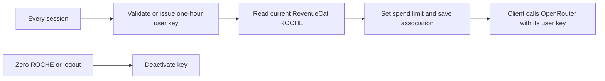

# Natally billing specification

## Governing correction — 28 October 2026

The current operator-approved contract is
[SESSION-KEY-ARCHITECTURE.md](SESSION-KEY-ARCHITECTURE.md), alongside
[ROCHE-CUSTOMER-ARCHITECTURE.md](ROCHE-CUSTOMER-ARCHITECTURE.md). The former
AD-20261027 reference was superseded and must not supply implementation decisions.
RevenueCat owns customer/account commerce, purchases and shared literal ROCHE.
Firebase owns identity and operational content linked to that customer.
Clients use their provisioned user key for direct OpenRouter inference. Every
session validates the key, reuses a valid one-hour-limited key or issues one,
then reads current RevenueCat ROCHE, sets the spending limit from that value
and saves/verifies the association on RevenueCat. Logout or zero ROCHE disables
the key. A provider key is not a second wallet. Creation-only issuance, lifetime
allocation ledgers and inference-relay requirements below are historical only.

The authorized small evaluation prices come from the live RevenueCat products;
customer-facing assets must not label users or offers as testers. The souvenir
adds the extensive PDF and interactive retained atelier to the same experience,
including enough ROCHE for at least ten exploratory turns. Free exploration uses
authored explanations and the existing real-time voice engine, without LLM calls.
No new hosting, database, relay or substitute currency is authorized here.



The numeric ROCHE-to-USD conversion and purchase-grant mapping must use the
established commercial configuration. The historical 40% allocation alone does
not define a ROCHE unit. Do not invent a conversion or grant from the text below.

No working checkout, purchased allowance or provider funding is established by
this documentation change. See the pre-authored
[continuous external rubric](DEMONSTRATIONS/2026-10-27-prepaid-purchase-screencast.md).

## Historical design — 23 October 2026; superseded where conflicting

The remaining text is retained as historical evidence, not current authority.
Purchase provisioning is not yet deployed. It formerly defined commercial
records and a purchase-to-inference contract; use the governing correction above.
Implementation entities are enumerated in
[the billing architecture delta](ARCHITECTURE/2026-10-23-billing-provisioning.md),
with tasks in [CHECKLIST.md](../CHECKLIST.md) and a continuous demonstration script.

## The experience

People may generate and explore their chart and readings before purchasing.
Onboarding presents an upfront offer with an equally clear free-exploration path.
Unpaid download actions open the same offer, which dismisses when clicked outside.
The base offer is **$30 for the PDF and one year of hosted interactive SPA access,
plus ten conversational turns, summarized in both the PDF and SPA**. Before payment,
show the actual currency/price, files, ten-turn inclusion and hosted-access term.
The customer is buying this experience, not $12 or another dollar balance of inference.
The interactive atelier preserves the reading's observation rather than silently
recalculating an archived reading against a later sky. Further turns beyond the ten
are separately funded. The bundle must cover all costs, including a contribution
toward fixed costs subsidizing pay-as-you-go users.
Do not describe an undeployed archive or unavailable checkout as an existing benefit.

After a successful RevenueCat purchase, Natally asks the billing service to reconcile
that customer's purchases. The service verifies the purchase with RevenueCat and:

1. Creates a managed OpenRouter user key if this customer has none.
2. Increases the allowance on the same managed key if one already exists.
3. Returns the user's reading access to their authenticated client.

RevenueCat webhooks independently run the same reconciliation, so closing the browser
after paying does not lose the purchase. Reopening, restoring purchases and repeated
notifications recover the same allocation; they never purchase it again.

The browser sends prompts directly to OpenRouter. Netlify hosts billing/provisioning
and the separately architected Swiss Ephemeris endpoint, not an inference relay.
The billing core must remain portable to a VPS; HTTP handlers and storage adapters
are deployment adapters, not business rules.

## Canonical policy identifiers

`BILLING_POLICY_VERSION` must match `^v[1-9][0-9]*$` and also exist in the explicit
policy registry. No whitespace trimming, case conversion, leading zeros, date suffixes,
fuzzy matching or unknown-version fallback is permitted. `v2` is valid; `V2`, `v02`,
`v2 ` and a syntactically valid but undefined `v10` fail with a named configuration
error. Product mappings, grants, quotes and immutable records use that same validated ID.
Definitions and commercial descriptions belong here, never in the identifier.

| ID | Definition | Availability |
| --- | --- | --- |
| `v1` | Reserved historical draft before the ten-turn commercial definition; no funded grant or released offer | Retired, cannot create grants |
| `v2` | $30 reading PDF, one year frozen interactive SPA, ten completed follow-up turns summarized in both; prepaid top-ups allocate 40%; all cost provisions configured separately | Current experimental policy |

The earlier verbose identifier was an unpublished configuration draft. Change it in
configuration and references before any allocations; do not support parallel aliases.
Published policy records are immutable: a new definition requires the next registered
ID. Startup must reject malformed or unregistered versions before accepting purchases.

## Money and experimental configuration

All commercial settings come from server environment configuration, maintained in
the operator's ignored `.env` and deployed as function environment variables. Public
offer descriptions come from the service's validated quote; do not separately bake
an allowance or a price into the SPA. Changing `.env` requires applying the updated
deployment configuration. It does not retroactively change purchased allowances.

| Variable | Meaning | Initial configuration |
| --- | --- | --- |
| `BILLING_POLICY_VERSION` | Immutable policy revision used for an allocation | `v2` |
| `BILLING_OFFER_PRICE_USD` | Base PDF/hosted SPA bundle price; store quote is authoritative for an actual charge | `30.00`; checkout must match or provide a separately mapped quote |
| `BILLING_INCLUDED_TURNS` | Completed conversational turns included with the bundle | `10` |
| `BILLING_INCLUDED_INFERENCE_USD` | Internal provider cost ceiling supporting the included experience; not a customer cash entitlement | Unset pending cost calibration; explicitly not $12 and not 40% of the base offer |
| `BILLING_TOPUP_ALLOCATION_BPS` | Fraction of eligible prepaid USD assigned to inference, in basis points | `4000`, meaning 40% |
| `BILLING_ARCHIVE_ACCESS_YEARS` | Purchased frozen-atelier access duration | `1` |
| `BILLING_PRODUCTS_JSON` | Exact RevenueCat app/store/product mappings to `reading_bundle` or `inference_topup`, their policy revision and inclusions | Empty until actual catalog is bound |
| `BILLING_ENVIRONMENT` | Accepted RevenueCat environment | `PRODUCTION`; non-production is isolated |
| `REVENUECAT_PROJECT_ID` | Existing ecosystem project | `projaba0bd94`, authenticated CLI readback 23 October 2026 |
| `REVENUECAT_OFFERING_ID` | Explicit Natally offering; do not replace another app's current offering | `ofrng352609e01b`, lookup key `Natally`; authenticated readback confirms non-default, no assigned price/product |
| `REVENUECAT_SECRET_API_KEY` | Server purchase/customer lookup credential | Operator configuration |
| `REVENUECAT_WEBHOOK_AUTH` | Exact configured webhook Authorization value | Operator configuration |
| `OPENROUTER_ADMIN_KEY` | Creates and updates managed customer keys | Existing management credential, issued 23 October 2026 |
| `BILLING_KEY_ENCRYPTION_KEY` | Key-record encryption secret, with an explicit key version | Operator configuration |
| `BILLING_DATABASE_URL` | Portable PostgreSQL connection for durable records | Deployment configuration; Netlify adapter may supply its connection |
| `BILLING_ALLOWED_ORIGIN` | Browser origin allowed to request access | `https://natally.surge.sh` |
| `VITE_BILLING_API_URL` | Public billing service base URL; no secret | Same configured Netlify host as the Swiss service, separate endpoints |

Amounts in records use integer USD microdollars (1 USD = 1,000,000 units). Reject
negative, non-finite or excessively large configuration. Convert to provider decimal
USD only at the OpenRouter boundary. Round fractional microdollars down once, when
creating an immutable allocation. Retain the original currency and store price.
Eligible top-up value is the verified transaction's USD purchase value before store
commissions, excluding separately charged taxes; a receipt whose USD/tax basis is
ambiguous requires reconciliation rather than a guessed conversion. Discounts use
the actual eligible paid amount, not the nominal package price.

For base-offer allowance `I`, verified eligible top-up value `P`, and configured
basis points `B`:

```
base allocation = I
top-up allocation = floor(P * B / 10000)       // integer microdollars
allocated lifetime budget = sum(posted allocations) - sum(posted reversals)
remaining budget = max(0, provider limit - provider lifetime usage)
```

At the initial 40% setting, a $10 eligible top-up adds $4 of provider allowance.
This fraction does not apply to the $30 bundle. Its ten-turn entitlement and its
internal `BILLING_INCLUDED_INFERENCE_USD` ceiling are separate quantities; a USD limit
does not represent a number of conversational turns. Allocation policy is snapshotted against
the purchase/quote, so delayed notifications and restore use the original terms.
An unknown historical policy is held for reconciliation, not repriced under today's
`.env`. A policy change must be versioned and retain prior product/policy mappings.

OpenRouter's key limit is a spending ceiling against the operator's funded provider
account, not a transfer of money to a separate user wallet. The operator must fund
the provider account. Free-model rate limits and availability still apply even with
an unused allowance. No automatic paid-model fallback is introduced by billing.

### Bundle unit economics

Cost calibration must include the complete delivered experience, not only the five
visible model responses. Keep these server-side experimental settings alongside the
policy; blank means unmeasured, never zero cost:

| Variable | Cost provision per bundle |
| --- | --- |
| `BILLING_COST_PAYMENT_USD` | Payment/store/RevenueCat charges, including applicable fixed and percentage fees |
| `BILLING_COST_GENERATION_USD` | Initial reading, ten exchanges, tool continuations, retries, summaries and any hosted voice/media generation |
| `BILLING_COST_HOSTING_YEAR_USD` | One year of SPA/archive hosting, storage, bandwidth, database and operational services |
| `BILLING_COST_SUPPORT_USD` | Support, maintenance and refund/incident provision |
| `BILLING_COST_FIXED_SUBSIDY_USD` | Allocated fixed costs including the contribution supporting pay-as-you-go users |
| `BILLING_COST_RESERVE_USD` | Operational reserve for cost uncertainty |

```
bundle contribution = verified net bundle revenue
  - payment costs - complete generation costs - annual hosting costs
  - support provision - fixed-cost/subsidy allocation - reserve
```

Count tax and fees once: the revenue/cost basis must show where they were deducted.
Measure provider and hosting usage before claiming sustainable economics. Free-model
development behavior is not a production cost forecast. Set the internal key ceiling
to a bounded generation provision supported by those measurements; do not allocate
the remainder of $30 to inference. A provision that cannot deliver the promised ten
turns requires an operator cost/policy correction, not silently reducing purchased
turns or making the customer buy again to finish them. Snapshot all cost assumptions
and grant terms with the policy. The temporary bypass uses the same cost policy; it is not an unlimited personal-key exception.

## Ten-turn entitlement and the saved reading

Implementation interpretation of the package: ten completed user-to-Natally
conversational exchanges including clarification and exploratory questions between the natal reading and horoscope, in addition to the two automatic opening responses (thorough natal reading, then
current-sky/natal overlay horoscope) already available to explore. One completed answer consumes one turn. Internal tool calls,
TTS chunks, replays, summary generation and retries of the same unfinished answer
are not extra turns. A failed answer does not consume a completed turn.

The service grants ten turns once per verified bundle purchase. Reserve a turn
atomically before starting a new paid exchange, using a stable conversation/turn ID;
commit it once when the complete answer is delivered, or release it on confirmed
failure. Recovery of an uncertain operation must reconcile the same turn rather
than open another reservation. Concurrent tabs cannot reserve more than the available
balance. Restore or webhook duplication never replenishes a spent ten-turn grant.
The app shows remaining included turns and offers separately priced continuation
when exhausted, while retaining replay and purchased access.

Each completed included exchange updates a versioned conversation summary used by
both PDF generation and the hosted SPA. Both must identify the same summary revision
and include all completed included exchanges at export time. Regenerating this summary
is part of the bundle cost, not an additional charged turn. The hosted archive can
append those ten exchanges while preserving its original chart observation; previous
PDFs remain the exported revision, and the app offers the updated PDF. One-year hosted
access starts at purchase and is not silently renewed by a summary update.

Turn entitlement is application-level accounting. OpenRouter's USD spending limit
does not enforce five turns, and a browser-held provider key can be used outside the
Natally UI. The service maintains the authoritative app turn ledger and the provider
ceiling bounds managed spend; do not claim a provider-enforced turn cap. These small
reservation/completion calls carry billing identifiers, not an inference relay:
prompts and responses continue directly between the browser and OpenRouter.

## Key ownership and temporary purchase bypass

The active path provisions a managed customer key for Robin just as for other users.
The personal OpenRouter key is no longer a prerequisite or the development substitute.
Keep any previously supplied personal credential untouched; do not mutate or adopt it
through the management API. Switch the active client credential to the managed result
only after provisioning succeeds, as explicitly authorized on 23 October.

A temporary server-configured bypass issues a distinct `development_bypass` grant for
an explicitly configured account. It runs the same allocation, turn-ledger, managed-key
and access delivery code as a verified purchase, with no fabricated RevenueCat receipt,
purchase or revenue. Show its status in Account. Configuration includes a finite expiry,
account allowlist and unique grant ID; repeated access cannot replenish the grant.
Disabling it requires a real purchase for new paid activity, including Robin's account;
never revoke independently purchased access or erase a conversation. Paid access takes
precedence over bypass. A browser flag cannot enable this grant.

Normal customers receive one active managed key per provider and billing environment.
Create it with the allocated lifetime limit and no automatic daily/monthly reset.
A top-up changes its cumulative limit; it does not create a new key, reset usage,
replace remaining credit, or duplicate the initial allowance. Re-fetch provider
metadata after every mutation before reporting `ready`.

Key rotation transfers only the remaining allowance to the new key, records the old
key's final usage, and disables the old key before the replacement can spend. The
ledger remains lifetime/account scoped across key generations. An ambiguous create
must be reconciled by its persisted operation identity before retrying creation.
If a key was created but its plaintext was lost, recover and disable that orphan
before creating a replacement; never give two active keys the same budget.

## Durable user and purchase records

Firebase UID is the canonical Natally account ID and RevenueCat App User ID. Complete
login before starting checkout; anonymous aliases and transfers require explicit
server reconciliation. Email and client-supplied account identifiers are not ownership
proof. Production and non-production records never share a budget or key.

| Record | Required fields | Invariants |
| --- | --- | --- |
| `billing_users` | `account_uid`, `revenuecat_project_id`, `revenuecat_app_user_id`, `environment`, `status`, `created_at`, `updated_at` | Unique account/environment and verified RC identity mapping |
| `billing_policies` | `version`, `effective_from`, `product_mappings`, `offer_price_usd_micros`, `included_turns`, `included_usd_micros`, `topup_bps`, `archive_years`, `cost_snapshot`, `snapshot`, `created_at` | Immutable once referenced; no retroactive repricing; customer turns distinct from internal spend ceiling |
| `billing_purchases` | `purchase_id`, `account_uid`, `project_id`, `app_id`, `environment`, `store`, `transaction_id`, `original_transaction_id`, `product_id`, `purchased_at`, `currency`, `paid_amount`, `eligible_usd_micros`, `policy_version`, `status`, `verified_at` | Unique project/app/environment/store/transaction; a renewal has its own transaction, not the subscription's original ID |
| `billing_allocations` | `allocation_id`, `purchase_id`, `account_uid`, `kind`, `amount_usd_micros`, `reverses_id`, `created_at` | One initial grant per eligible purchase; immutable compensating entries for refunds; no destructive balance edits |
| `billing_keys` | `account_uid`, `provider`, `environment`, `generation`, `provider_key_hash`, `encrypted_key`, `encryption_version`, `source`, `status`, `limit_usd_micros`, `usage_usd_micros`, `prior_usage_usd_micros`, `observed_at`, `created_at`, `updated_at` | Only managed keys are mutated; one active generation; provider hash is the management identifier, not the bearer secret |
| `billing_events` | `project_id`, `environment`, `event_id`, `transaction_id`, `type`, `received_at`, `status`, `attempts`, `last_error` | Deduplicate event delivery separately from purchase allocation |
| `billing_operations` | `operation_id`, `account_uid`, `key_generation`, `kind`, `target_limit_usd_micros`, `state`, `attempts`, `lease_until`, `provider_key_hash`, `created_at`, `updated_at`, `last_error` | Durable create/update intent; serialized per account; retry applies the same absolute target |
| `billing_entitlements` | `account_uid`, `purchase_id`, `resource_id`, `formats`, `archive_id`, `starts_at`, `expires_at`, `status` | Purchases name actual included files and frozen conversation, not all future readings |
| `billing_turn_grants` | `grant_id`, `purchase_id`, `account_uid`, `conversation_id`, `granted_turns`, `policy_version`, `created_at`, `status` | One ten-turn grant per qualifying purchase; immutable amount, reversal linked to purchase |
| `billing_turns` | `turn_id`, `grant_id`, `account_uid`, `conversation_id`, `request_id`, `state`, `reserved_at`, `completed_at`, `released_at`, `provider_generation_ids`, `response_revision` | Unique logical turn/request; reserved/completed/released or needs_reconciliation; no charge per tool/TTS chunk |
| `reading_summary_revisions` | `archive_id`, `conversation_id`, `revision`, `included_turn_ids`, `summary_object_ref`, `pdf_object_ref`, `created_at`, `status` | PDF and SPA use the same completed summary revision; content belongs to archive storage, not billing audit logs |

Only the service writes these records. Browser status contains the authenticated
account's access state and provider metadata; it does not expose management secrets
or other customers' records. The user key is returned only to its authenticated owner.
Store its recoverable ciphertext because OpenRouter only returns the plaintext on
creation. Avoid storing chat prompts in the billing ledger.

## Service and client contract

| Route | Caller and input | Result |
| --- | --- | --- |
| `GET /billing/offer` | Signed-in user; intended reading/resource and product | Verified catalog quote, policy version, ten included turns, PDF/SPA inclusions, archive duration, checkout availability |
| `POST /billing/reconcile` | Firebase Bearer token; optional purchase reference as a lookup hint | Verify RC ownership/payment, enqueue or apply missing allocations, return `pending`, `ready`, `unavailable`, or `needs_attention` |
| `GET /billing/access` | Firebase Bearer token | Account-bound managed key and observed allowance when ready; otherwise actionable status; no new grant merely for checking |
| `POST /billing/revenuecat` | RevenueCat with configured webhook Authorization | Durably accept and deduplicate event, reconcile the verified customer; acknowledge only after durable receipt |
| `POST /billing/turns/reserve` | Firebase Bearer token; conversation and stable request ID | Atomic reservation of one available included turn, or exhausted/pending state; no model prompt |
| `POST /billing/turns/complete` | Same authenticated owner and reserved turn ID; delivered response revision/provider references | Idempotent completion and summary-update scheduling; uncertain outcomes require reconciliation |
| `POST /billing/turns/release` | Same owner and turn ID; failed/cancelled operation reference | Release confirmed incomplete operation once; cannot undo an already completed turn |
| Existing download-access adapter | Firebase Bearer token and resource/format | Verify file entitlement under `COMMERCE-DOWNLOAD-API.md`; separate from inference allowance |

All browser replies use `Cache-Control: no-store`, approved-origin CORS and a bounded
validity time. Validate Firebase token audience, issuer, expiry and UID on the server.
The client sends neither an admin key nor a requested allowance. It rejects mismatched
UIDs, expired responses and changed login generations before installing a returned
key through `installInferenceKey`. Managed access carries provider `openrouter`,
source `managed`, key generation, observed limit/usage, and `expiresAt` for the response;
that response expiry is not an invented expiry of the user's prepaid credit.

The ready JSON fields are `state: "ready"`, `accountUid`, `provider: "openrouter"`,
`source: "managed"`, `apiKey`, positive integer `keyGeneration`, finite nonnegative
`limitUsd` and `usageUsd`, and ISO `expiresAt` no more than five minutes ahead.
It also includes nonnegative integer `includedTurns`, `remainingTurns`, `reservedTurns`;
remaining plus reserved cannot exceed included. These counts summarize the account's
active bundle grants; turn reservation additionally binds the intended conversation.
The UI shows turn entitlement; dollar fields remain operational provider metadata.
Other states return `state`, `accountUid` and the same short-lived `expiresAt`.
The client does not send the personal key to this service or echo a returned bearer
key into UI notices. GET access reads; POST reconcile is the purchase/restore trigger.

Purchase success triggers reconciliation automatically. The screen says `Payment
received · preparing reading access` while pending and offers retry without another
checkout. Restore/check access, app return and sign-in recover unfinished provisioning.
Once ready, display remaining included turns and continue the waiting reading. Keep
internal provider budgeting separate from the customer-facing bundle entitlement. An
unconfigured service shows that purchases are unavailable and preserves free
exploration and any working personal key. Never convert a callback, URL flag, cached
balance, local-storage edit or client receipt claim into a paid grant.

## Processing and recovery

The authenticated purchase callback and authenticated webhook converge on one server
reconciler. Qualifying, settled purchase records must match the configured app,
environment and exact product mapping. Renewal grants require an explicitly mapped
renewing product. Free trials, billing issues, invoice issuance, expiration, unknown
products and dashboard sample events cannot create production credit.

Persist the verified purchase and its allocation transactionally with a unique
purchase identity, then persist an operation with the absolute desired provider
limit. Serialize operations for each account/key. A retry reuses the target, never
repeats `current limit + delta`. On an uncertain PATCH, read the actual limit and
complete or retry the same target. A worker lease/outbox prevents request termination
from losing paid work; periodic reconciliation recovers after webhook retries stop.
Do not hold a database transaction open across an unbounded provider call.

Refunds reverse the original allocation once and revoke only the corresponding
purchase entitlements. Turning off renewal is not itself a refund. If refunded
allowance was already consumed, retain the resulting debt in the ledger, disable
further managed spending when no positive budget remains, and show the real state.
Later top-ups first offset that deficit. Usage cannot be refunded by resetting it.
Transfers/aliases must not give two accounts access to one bearer key; pause the
affected provisioning until ownership is reconciled. An unavailable provider or RC
API leaves a durable pending operation, not a false payment failure or another charge.

## Relationship to $ROCHE and the other payment paths

An inference allowance is measured in provider USD. It is separate from $ROCHE
currency units, file ownership and archive access. Do not invent a conversion rate.
The existing project record has unresolved `AICREDIT` versus `ROCHE` catalog binding;
do not create another currency or silently select one. A future settled Alby/Blink/
x402 payment can feed the same purchase ledger through its own verified adapter and
configured conversion policy. No such payment is implied by this RevenueCat contract.

## Delivery truth and demonstration

Current verified delivery: account-scoped personal user-key installation and direct
OpenRouter request path are deployed. The billing client transport and Account's
Check purchased reading access are implemented, with no service URL configured yet.
Actual checkout-success wiring, turn ledger and summaries, durable purchase ledger, RevenueCat
catalog/credentials, automatic provisioning, download entitlement service, and frozen
archive hosting remain separately tracked until demonstrated. An architecture or
successful deployment alone is not payment/provisioning completion.

The continuous billing journey is defined in
[the billing demonstration script](DEMONSTRATIONS/2026-10-23-billing-provisioning.md).
It follows the actual offer through a settled purchase, key creation, reading,
top-up on the same key, restore without duplication, and owned downloads/archive.
Unavailable scenes remain explicit outstanding work.

## Provider references

API mechanics were checked on 23 October 2026; Natally-specific allocation and UX
decisions above are this product's contract.

RevenueCat authenticated CLI readback on 23 October confirms the existing Natally
offering `ofrng352609e01b`, non-default, without assigned products/prices or a paywall.
The app inventory contains no Natally Web Billing app yet. Existing ecosystem default
`ofrngf3e410be57` is unchanged. CLI OAuth is valid; its separate MCP OAuth connection
still needs refresh, which does not block using the authenticated CLI.

- [OpenRouter management keys](https://openrouter.ai/docs/guides/overview/auth/management-api-keys): administrative creation and update of user keys.
- [RevenueCat webhooks](https://www.revenuecat.com/docs/integrations/webhooks): authenticated delivery and finite retry behavior.
- [RevenueCat event fields](https://www.revenuecat.com/docs/integrations/webhooks/event-types-and-fields): purchase identity, environment and lifecycle distinctions.
