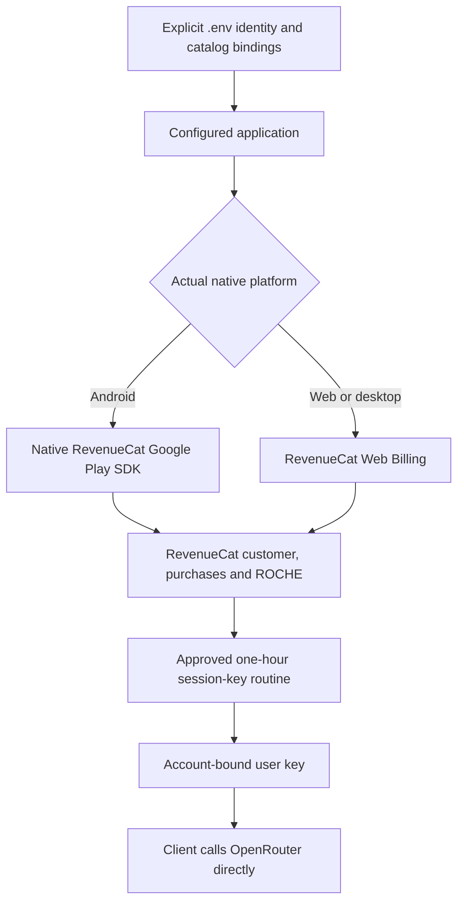

# Checkout identity and Google Play binding — 28 October 2026

## Confirmed provider changes

RevenueCat project: `projaba0bd94` (dashboard `aba0bd94`). Existing Web Billing
app: `app941a60bf95`. Offering: `ofrng352609e01b`, identifier `Natally`.

| Surface | Record | Confirmed customer-facing value |
| --- | --- | --- |
| Reading package | `pkge6aa35dff37` | Souvenir reading |
| Credit package | `pkgea7558a8e12` | Exploration credits |
| Reading customer-facing product Title | `proda88125bed7` | Souvenir reading |
| Credit customer-facing product Title | `prod2f046e3b64` | Exploration credits |

The separate customer-facing product Title, not just its administrative display
name, was responsible for the old checkout wording. Both actual checkouts opened
from `https://natally.robin.mba/?app=1` displayed their corrected titles. Evidence:
`../TEST-RESULTS/checkout-exploration-production-title-28oct2026.jpg` and
`../TEST-RESULTS/checkout-souvenir-production-title-28oct2026.jpg`. No payment was
submitted. Price and grants were not changed; these observations do not prove
ROCHE fulfillment, the newer $5 minimum, or paid inference.

The live project lacked a Natally Google Play app. Created `app28d43b6b40`,
`Natally (Google Play)`, for `mba.robin.natally`, deriving the name and package
from the installation's `.env` identity. Its production public SDK key was
retrieved successfully. Native SDK integration, store credentials, actual Play
products and store-distributed purchase acceptance are separate requirements.
Do not describe this app-binding creation as activated Play payments.

## Observed failure and repair scope

Before the repair, `billingAccess.ts` returned "Purchasing is not connected yet" when
`VITE_BILLING_API_URL` is absent. All paywall Restore buttons converge on
`PurchaseAccess.restore`, which reads RevenueCat then calls that disconnected
access routine. `InferenceAccessSettings` and `LearnAndPayments` also contained
unconditional old payment-unavailable copy despite a functioning Web checkout.
These are implementation defects, not evidence that a customer's payment failed.

The approved UX-PLAY-1 contract in `ARCHITECTURE.md` requires native RevenueCat
Play billing on Android and Web Billing elsewhere. Native bridge source and
purchase/restore recovery source are now implemented. Native boundary checks
passed 11/11, recovery service/handler checks passed 27/27, billing-terms checks
passed 5/5, and TypeScript passed. These are controlled-boundary/source results,
not a real Play purchase or managed-key acceptance. The complete coordinator
started v1.13.86779, versionCode 100013, invocation
`c19c2e74-fa33-43cc-91de-0b7654f83776` at 2026-10-28T16:59:52.233Z.
It completed at 2026-10-28T17:31:59.641Z with all 12 outputs verified and matching
frozen source. The actual APK compiled the native bridge, identifies
`mba.robin.natally`, and contains `com.android.vending.BILLING`. The complete
inventory is `dist/natally-ai-studio-v1.13.86779-test-build-inventory.json`.
The retained web artifact is deployed to both existing domains through the
coordinator's -DeployExisting mode, with 178/178 HTTP byte checks matching. Actual
Android device purchasing remains unverified. A deployed web Restore lookup
returned no purchases/0 ROCHE for the inspected account, separately reporting
unconnected reading access; it did not prove restoration for a known purchaser.
See `natally-public-entry.md` for the observed PWA caching limitation and screenshots.
Existing per-user inference source directly contacts OpenRouter;
automatic one-hour key lifecycle integration remains unfinished. Do not restore
the Netlify inference relay or introduce a new host to hide this unfinished work.

## Existing Google Play developer account and prepared listing

### Working-subscription acceptance audit

The completed native matrix is one part of UX-PLAY-1, not its acceptance.
The following evidence was checked against the current source and provider state:

| Required result | Current evidence | State |
| --- | --- | --- |
| Android opens native Play billing | Native bridge compiles in the actual v1.13 APK; no store-distributed purchase has been observed. | IN_PROGRESS |
| Monthly-first $5/$10/$25 packs and one-off alternatives | Current `PurchaseKind`/`FigmaPaywall` flow still quotes only reading and conversation mappings. The six-pack selector is not implemented by the bridge. | IN_PROGRESS |
| Real Play catalog and native bindings | Natally creation form is prepared in the existing developer account; legal declarations await confirmation. Native product IDs remain absent. | IN_PROGRESS |
| Correct shared ROCHE grant | Provider read found distinct AICREDIT/ROCHE records and existing incorrect NATALTURN grants; currency identity and numeric grant policy are not resolved. No balances or grants were changed by this audit. | IN_PROGRESS |
| Purchase immediately permits a reading | Direct OpenRouter chat source exists, but `syncCustomerSessionKey` has no application caller and automatic one-hour key integration is unfinished. | IN_PROGRESS |
| Device purchase, cancellation/pending, renewal and reinstall/restore | No Android device was attached in the observed adb inventory; no emulator executable was present in the configured SDK. These customer scenes are not recorded. | NOT_STARTED |
| Fee/net/HST breakdown | Current provider sources, observed tax-profile status and explicit receipt arithmetic are recorded in `../PROPOSALS/28oct2026-atelier-roche/PRICING-HST.md` and KStore. | COMPLETE |

This audit does not authorize an architectural change, a currency migration,
activation of the historical $1 offer, or a replacement hosting dependency.

The existing developer account was located through the signed-in account chooser:

| Setting | Observed value |
| --- | --- |
| Google account | `robin.realtor416@gmail.com` |
| Developer name | Robin L. M. Cheung, MBA |
| Developer account ID | `5081294861182355482` |
| Account type | Personal account |
| Prepared app name | Natally |
| Prepared package | `mba.robin.natally` — Google reports available |
| Prepared default language | English (United States), `en-US` |
| Prepared distribution | App, free to install; paid features through in-app products |

The account's visible app table did not contain Natally. The creation form is
prepared but not submitted: Google requires the Developer Programme Policies
and US export-law declarations. Operator confirmation was requested at that
action boundary. This is not a missing developer enrollment, and no new account
was created. The earlier checks of `robinsaiworld@gmail.com` and
`rochemediaservices@gmail.com` opened account creation instead of this account.

Evidence: `../TEST-RESULTS/play-create-natally-prepared-28oct2026.jpg` and
`../TEST-RESULTS/play-create-declarations-28oct2026.jpg`. The existing account is
shared infrastructure; retain its identifier in the global Admin-Manual Play
record as well as this project binding. Native product IDs remain unconfigured
until real Play products exist. Do not substitute Web product IDs for Play IDs.

The live payments profile was then inspected read-only. It is a Canadian
individual profile with accepted Canadian tax information, including a GST/HST
registration number (submitted 24 March 2026). The overview shows CA$0 earnings,
no transactions, a CA$1 payout threshold, and a prompt to add a payout method.
The reduced-fee enrollment card still requires creating an account group and
accepting its service-fee terms. No tax, banking, fee-enrollment or merchant
setting was changed. Evidence: `../TEST-RESULTS/play-tax-and-fee-status-28oct2026.jpg`.
Current fee arithmetic and the registered/unregistered distinction are in
`../PROPOSALS/28oct2026-atelier-roche/PRICING-HST.md`.

## Currency identity requiring operator resolution

An authenticated RevenueCat v2 read on 28 October returned these distinct
records from `/projects/projaba0bd94/virtual_currencies`:

| Actual code | Actual display name | Observed product grants |
| --- | --- | --- |
| `AICREDIT` | ROCHE | Existing Kintsugi packs grant 50, 200 and 1000; description identifies this historical code as the shared ecosystem currency. |
| `ROCHE` | Roche Credit | Legacy product grants list amount 0 and trial amount 100; Natally products are absent. |
| `NATALTURN` | Natally exploration turns | Both existing Natally Web products grant 10; these are the already reported incorrect Natally grants. |

The canonical catalog at `revenuecat/ROBINS-AI-WORLD-CATALOG.md` was retrieved
from KStore (legacy indexed revision 1, `exact:false`) and also documents the
50/200/1000 `AICREDIT` pack grants. It does not supply a verified Natally
ROCHE-to-USD conversion. Current Natally architecture/source requires literal
code `ROCHE`, so the distinction is material. Operator clarification was requested
between the established ecosystem balance displayed as ROCHE (`AICREDIT`) and
the separate code `ROCHE`. Provider descriptions and this audit do not approve
a currency migration or amend the frozen architecture. No grants, balances,
currency names/codes, or customer records were changed.

## Relay-removal status — operator question, 28 October 2026

The operator asked whether per-user keys had architected out the Netlify relay.
Current source sends inference directly to OpenRouter in
`src/services/hostedInference.ts`. However, the first paragraph of
`DOCS/SESSION-ADAPTER-INTEGRATION.md` explicitly retains the existing Netlify
adapter for key provisioning. The approved session-key document marks that
adapter and client lifecycle as not wired, and `.env` has no
`VITE_BILLING_API_URL`. Therefore the inference relay is absent from the current
client path, but complete removal of the Netlify dependency is not represented
by that integration document or a verified user-key lifecycle. This records the
contradiction without selecting or implementing a new host or architecture.

Real purchase -> literal ROCHE -> one-hour key -> direct inference -> renewal
and logout remains unverified. A successful Restore of commercial ownership,
a connected personal key, or passing isolated helper tests does not establish
automatic managed-key provisioning.

At 18:37 UTC on 28 October, a read-only credential check distinguished the two
bindings: the available process `OPENROUTER_API_KEY` returned HTTP 401 from
`GET https://openrouter.ai/api/v1/keys`; `OPENROUTER_ADMIN_KEY` was absent from
the current process and project `.env`. The separately issued management key
documented in `BILLING-SPEC.md` has not been tested by this observation. No key
was created, funded, changed or disabled. Exact non-secret probe evidence is
`DOCS/TEST-RESULTS/openrouter-management-binding-28oct2026.json`. The integration
document now explicitly records that retaining Netlify is an unresolved design
and does not establish approval to implement that dependency or another host.
The subsequent existing Netlify CLI lookup for `OPENROUTER_ADMIN_KEY`, production
context/functions scope on site `f48513f6-0319-4672-8959-4d3f4c7fd1b5`, exited
successfully but returned `{}` and no value. KStore's referenced password-register
reads also returned no document content. These scoped lookup failures do not
establish that the previously issued management credential is invalid or lost.

## Configuration authority

The operator reiterated that app names, identifiers and customer-facing checkout
configuration belong in `.env`, particularly for open-source reuse. The rule is
recorded in KStore Admin-Manual `TOOLING_CONVENTIONS/global-agent-rules.md`,
revision 8, exact SHA-256
`665cccf5630049f6605acc70fd1d5d4bb31db5e3b87936d718d2776f03ee379c`.
Live provider labels have been corrected; their reusable source configuration
must be projected from explicit installation inputs, not hardcoded defaults.

The diagram describes the agreed target. App-binding creation and direct-client
source are observed; native integration, session wiring and complete customer
acceptance must be reported separately.
