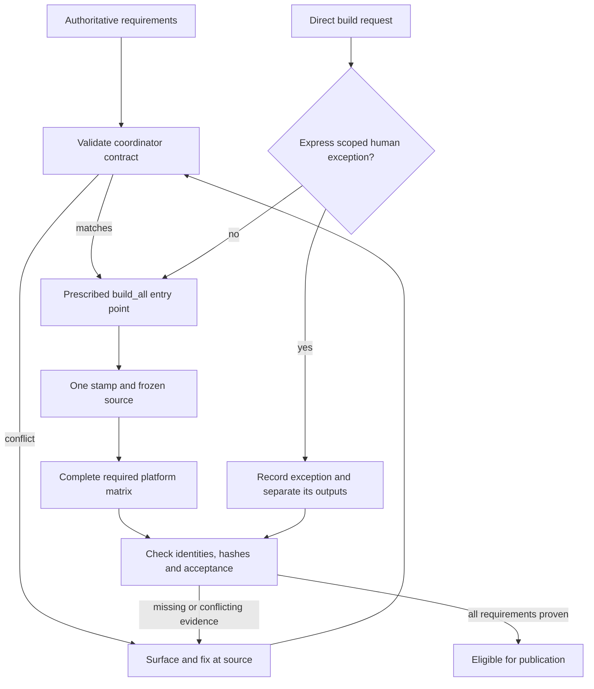

# Global build authority: incident and proposed structural revision

Status: PROPOSED FOR DISCUSSION. Existing prescribed-build requirements remain in
force. This proposal does not authorize manual builds or declare the release ready.

## Precipitating incident and evidence

The operator challenged Natally's major-zero build identity and missing platform
coverage, then requested an improvement to global rules if a manual build bypass
had occurred. The operator also required errors to be fixed on encounter rather
than allowed to propagate from architecture prose into build decisions.

The retained transcript at
`.tmp/homepage-release/dist/natally-ai-studio-v0.11.85692-build.log` records:

```text
Start time: 20261027185256
Host Application: C:\Windows\System32\WindowsPowerShell\v1.0\powershell.exe -NoProfile -ExecutionPolicy Bypass -File scripts/build-all-platforms.ps1
```

The corresponding inventory records invocation
`479645ed-3d2c-4693-a468-d50b05a54989`, source commit
`80c2942b9db8fb074bfee22b7f1631e4e50a26a0`, and
`artifactMatrixComplete: true`. Its required targets omit RPM and PWA.
The old stamp function accepted major zero. Existing regression tests also used
major zero as valid. An architecture sentence prescribed a major-zero starting
value; it has now been removed.

Finding: this affected invocation used the coordinator. A manual-build bypass is
NOT established. The executable coordinator, tests, and completion definition
failed to enforce the user's requirements. The architecture sentence was an
additional conflict that should have been corrected immediately; evidence here
does not establish which historical edit caused the stamp implementation.

## Proposed global rule

1. Before a build, identify the project's prescribed `build_all.*` entry point
   from authoritative Admin-Manual instructions. Use that entry point for release
   generation, continuation, platform parity, and canonical version stamping.
2. Never substitute a direct compiler, packager, platform-only build, copied
   output, or manually edited version for that workflow without an express human
   instruction covering the specific exception. A broad request to finish,
   urgency, quota pressure, or a coordinator failure is not that instruction.
   When an exception is explicitly requested, record its instruction and scope;
   do not promote its output to a complete coordinated release without the normal
   parity and acceptance checks.
3. Validate the coordinator against the current authoritative requirements before
   allowing it to produce or approve a release. Invoking the correct filename is
   insufficient. Required platforms, version invariants, frozen source identity,
   and artifact checks must be executable gates. A contradiction stops the
   affected build and triggers correction at its source; independent work continues.
4. Architecture documents describe ownership and flow; they cannot supply current
   build values or override build policy. On encountering a conflict, surface and
   correct it immediately, including affected consumers and tests. Do not normalize
   the conflict by copying it into another document or expected test result.
5. Make direct release-build entry points refuse operation without a valid active
   coordinator invocation and frozen source identity. Where a tool cannot enforce
   this itself, enforce it in the project wrapper and artifact acceptance gate.
   Do not pretend an environment variable alone proves authorized provenance.
6. Completion evidence must bind each required artifact to its canonical version,
   source, invocation, and content hash. A manifest's `complete` flag cannot override
   omitted requirements. Reject partial matrices even when every listed target passes.
7. Verify failure cases, including bypassed context, stale source, invalid version,
   and a missing required target. Derive these cases from authoritative requirements,
   not solely from whatever the current implementation accepts.

## Why this improves the previous rule

The previous rule said to use the coordinator and avoid manual stamps. This
incident shows that compliance with the entry-point instruction alone can still
produce a noncompliant result. The proposed revision adds enforceable requirements
at entry, generation, and acceptance, plus an explicit boundary for human-authorized
exceptions. It also tests rejection behavior and requires correcting contradictory
inputs on encounter. This is a structural improvement only where those gates are
implemented and exercised; saving this prose alone does not establish prevention.

## Proposed control flow



## Current correction status

Natally now rejects major-zero stamps and continuation, requires RPM, and includes
PWA generation in its matrix. Source corrections were pushed through `ca64d02`.
Focused release/PWA checks passed; current source has not yet completed a new full
matrix or deployed-user acceptance. The old inventory is not acceptable release
evidence under the corrected requirements. The existing Ubuntu-24.04 WSL build
environment now has the RPM verification tools installed.
