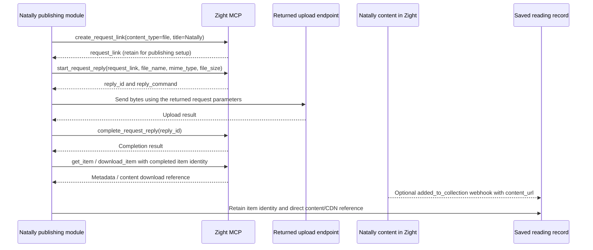

# Zight MCP: observed connection and file-publishing contract

Recorded 23 October 2026 from the authenticated server's live tool inventory.
This is an integration discovery record. Natally's deployed runtime is not yet
connected to these tools. Product source baseline: `3be0015`.

Robin already uses Zight's direct content/CDN URLs in email and webpages. Natally
will reuse that established mechanism for PDFs, reading content and media. The
work here is obtaining the upload and retrieval contract, not deciding whether
Zight can host an executable application.

## Connection and access actually observed

| Entity | Observed value |
| --- | --- |
| Z01 — server | `https://mcp.zight.com/mcp`, Streamable HTTP; server identifies as `zight-mcp`, version `1.0.0` |
| Z02 — authorization | OAuth connected successfully for Robin's existing Zight account; requested scopes `mcp:read mcp:download mcp:write`; live discovery reports `authStatus: oAuth` |
| Z03 — inventory | Eleven tools; complete returned schemas in [ZIGHT-MCP-TOOLS.json](ZIGHT-MCP-TOOLS.json); no tool-discovery error or further inventory page |
| Z04 — content destination | A dedicated Natally collection/request collection; its actual identifier remains to be obtained through the publishing setup |
| Z05 — completion callback | Existing KonnectzIT receiver remains configured in Zight. Receiver choice remains configurable so n8n can replace it when restored |

The authorization page described reading files, creating/sharing content and
renaming/organizing items. The current tool inventory is the narrower concrete
set below; the broad consent wording is not evidence of an unlisted tool. A
collection organizes the content; no collection-specific OAuth scope was
advertised in this connection.

Codex's `zight` MCP registration is enabled in the operator configuration. The
inventory was retrieved through protocol access after OAuth completed. No model
turn or browser automation was used to enumerate these tools. No file upload or
new collection has been performed as part of this discovery.

## Eleven tools exposed by this connection

| Tool | Inputs | Operation |
| --- | --- | --- |
| `search_items` | Optional `name`, `type`, `page`, `per_page` | Find items and their IDs/slugs |
| `get_item` | Required `id` | Retrieve full item metadata |
| `download_item` | Required `id` | Return image data for images; a download URL for other item types |
| `get_transcript` | Required `id` | Retrieve a recording transcript |
| `get_ocr` | Required `id` | Retrieve extracted text and line/bounding-box data |
| `get_data_logs` | Required `id` | Return the item's Insights ZIP download URL |
| `create_request_link` | `content_type`, optional `title`, `description`, `expires_at`, `collect_logs`, `custom_id`, `integration_name` | Create a file/image/video request in the connected account's current workspace |
| `start_request_reply` | Required `request_link`, `file_name`, `mime_type`, `file_size` | Start a file/image submission; return `reply_id` and `reply_command` for sending the bytes |
| `complete_request_reply` | Required `reply_id` | Finalize the uploaded reply and send it to the request's workspace |
| `get_agent` | `agent_id` or `recording`; optional `parameters` | Return an existing Zight agent's recorded workflow steps |
| `report_agent_run` | Required `agent_id`, `status`, `steps` | Record the outcome of such a workflow |

`start_request_reply` explicitly accepts **any file** for a file request. Its
input is file metadata, not a base64 copy of the whole PDF/audio file. The tool
returns a command containing the upload request for that particular reply; the
file bytes are transmitted separately, followed by finalization. This supplies
the MCP-managed route for obtaining the upload endpoint/protocol.

The reply is described as anonymous and stored in the requester's workspace.
Use a Natally-specific request owned by Robin's connected workspace, and retain
its returned identity. The eleven-tool inventory includes no standalone
create/move-collection operation. Obtain the request's collection association
during setup rather than inventing a collection argument absent from the schema.

## Natally publishing sequence

The first request-link creation is publishing setup, not automatically one new
request for every PDF. Retain the returned link/identifier and determine its
reuse and collection behavior from the actual result. The tool documents that
request-link creation is not automatically retried after an uncertain result.

For each file, retain `reply_id` while sending the bytes and call completion once
after successful transfer. Inspect the returned upload request before coding its
HTTP adapter; do not assume PUT, multipart POST, particular headers or a fixed
storage host before that response exists.

Natally's saved reading stores the finished item's ID and direct content URL.
Its native audio player can load that URL while retaining the reading's cue
timeline; PDF downloads and image/media elements use their own content URLs.
Purchase entitlement, ten-turn allowance and the one-year frozen-atelier period
remain defined in [BILLING-SPEC.md](../BILLING-SPEC.md).

## Webhook continuation

Zight documents an `added_to_collection` payload containing `collection_name`,
`collection_url`, `item_url`, `item_type`, `name` and `content_url`. Those fields
provide the callback mapping from the dedicated collection to the saved-reading
record. `item_created` can arrive before upload/processing completes, so it is
not the completion signal. The current KonnectzIT webhook was observed in the
account; its workflow and actual delivery have not been inspected or modified.

Use the observed item/collection identities for callback correlation. The
request-link tool's `custom_id` is tied to named premium integrations; it is not
a general arbitrary metadata field for Natally.

## Evidence and remaining work

- Configured endpoint and successful OAuth login confirmed by the Codex MCP CLI.
- Authenticated protocol discovery returned all eleven tools, exact schemas,
  server version and OAuth status; the adjacent JSON preserves that response.
- Upload-request parameters, completed item/CDN fields, Natally collection
  identity and a production publish remain to be obtained through actual tool
  calls. They are not claimed as executed by the inventory result.
- Natally's MCP runtime integration and the end-to-end paid reading/archive
  journey remain product work. This discovery does not mark them complete.

Primary references: [embedding uploaded content](https://support.zight.com/hc/en-us/articles/5823953596567-Embedding-Content-with-Zight),
[webhook payloads](https://support.zight.com/hc/en-us/articles/31446701947031-What-is-a-Webhook-and-How-to-use-it),
and the live schema captured in this directory. The live schema is more specific
than the general MCP marketing description.
