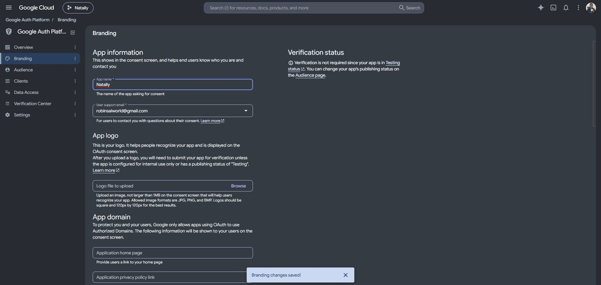

# Natally live-payment implementation — 25 October 2026

This implements the initial tester payment pass requested by the operator. RevenueCat
is the authoritative commercial customer/entitlement/ROCHE registry. Firebase remains
the authentication provider. The verified Firebase UID is the RevenueCat customer ID
for **every** rail, including x402, Alby and Blink. No anonymous or email identity merge
is performed. The currency code is **ROCHE**, explicitly selected by the operator;
AICREDIT is not Natally's currency regardless of its display name.

## Tester policy v3

| Product | Card | Lightning (Alby or Blink) | x402 | Inclusion |
| --- | --- | --- | --- | --- |
| Tester reading | US$0.99 | 1 sat | 0.01 USDC when configured | Ten completed turns, downloads of the selected reading, one promotional ROCHE |
| Tester conversation credits | US$0.99 | 1 sat | 0.01 USDC when configured | Ten further completed turns, one promotional ROCHE |

The explicit tester provider allowance is $0.02 for the reading bundle and the
non-USD tester rails. This is a subsidy, not a BTC/ROCHE exchange rate. Card top-ups
allocate 40% of actual settled USD excluding separately charged tax, rounded down
once to integer USD micros. All allocations retain the order's policy/product
snapshot. The full-price v2 archive/summary design remains documented separately;
cloud frozen-atelier hosting and synchronized PDF/SPA summary revisions are not
included or represented as delivered by this tester pass.

RevenueCat Web Billing enforces a [US$0.99 minimum](https://www.revenuecat.com/docs/web/web-billing/multi-currency-support).
The first $0.50 plan passed preview but failed at apply. Its two product records were
created without prices. The corrected plan `d1e26d09-ea31-4f6b-b072-90be9a58ef84`
applied successfully with READY results for both products; configured-price readback
confirmed 990000 USD micros each. The failed plan was discarded. No purchase was made.

| RevenueCat object | Bound identifier |
| --- | --- |
| Existing project | `projaba0bd94` |
| Existing offering / SDK lookup | `ofrng352609e01b` / `Natally` (non-default) |
| Natally Web Billing app | `app941a60bf95` |
| Reading product / package | `proda88125bed7` / `pkge6aa35dff37` (`natally_reading_test`) |
| Credit product / package | `prod2f046e3b64` / `pkgea7558a8e12` (`natally_roche_test`) |
| Reading capability | `entlbc6dd8a62a` (`natally_reading`) |
| Download capability | `entl2ef69e9c03` (`natally_downloads`) |

Do not attach permanent product entitlements or automatic virtual-currency grants to
these consumables. The verified ledger grants finite promotional capabilities and
ROCHE exactly once. Existing ecosystem products and the default offering are preserved.

## Code and identity flow

`src/services/payments.ts` registers signed-in accounts, retries transient signup sync,
opens the RevenueCat Web SDK under the UID, sends x402 wallet authorizations, and
refreshes Firebase ID tokens after synchronization. `PaymentMethods.tsx` shows the
server catalog, saved invoices, pending-order recovery and explicit user payment
actions. `billingAccess.ts` refreshes managed access before inference. Personal keys
and the finite existing development grant remain distinct.

`netlify/functions/billing.mjs` verifies revoked/disabled Firebase sessions through
the Admin SDK. It exposes authenticated `/billing/customer`, `/offer`, `/orders`,
`/orders/:id/receipt`, `/orders/:id/settle`, `/access`, `/reconcile`,
`/download-access` and `/turns/{reserve,complete,release}`. Requests carry no model
prompts. CORS permits only the configured frontend origin. Responses are no-store,
account-bound, and expire within one minute. Bodies are limited to 64 KiB.

`netlify/lib/billing-identity.mjs` creates/reconciles RevenueCat customers, reads fresh
entitlements and the literal ROCHE balance, then writes `customClaims.natally` and
`users/{uid}/billing/capabilities`. Other custom-claim namespaces are preserved. Claims
contain only mapped entitlement expiry timestamps, not provider secrets. Firestore
allows the owner to read this document; clients cannot create or edit it. Consumers
must respect each capability's expiry (`0` represents RevenueCat lifetime access).

`billing-commerce.mjs` binds orders to the UID, resource, immutable quote and provider
receipt. Client callbacks are lookup hints only. RevenueCat one-time purchases are
freshly fetched, must belong to the UID and configured SKU, and must be production,
purchased ownership, quantity one, and settled. Card, Lightning and x402 receipts all
share the ledger and RevenueCat-first grants. Refunds create compensating allocations
and suspend the managed key before remote compensation; completed usage is retained.

`billing-rails.mjs` uses merchant NWC make/lookup invoice for Alby, authenticated Blink
invoice creation/status, and x402 v2 exact EIP-3009 verify/settle with a configured HTTPS
facilitator. The x402 amount, network, asset and payee come from the stored quote.
Authorization nonce identity and settlement transaction identity are globally unique.
The settlement intent is persisted before submitting; an uncertain result is held for
reconciliation rather than paid again. The unused historical browser-only guest grant
was removed; wallet callbacks/localStorage do not confer paid access.

`billing-store.mjs` uses PostgreSQL session advisory locks per UID, a unique receipt
identity across accounts, immutable allocation entries and durable order/operation
state. `billing-access.mjs` encrypts issued OpenRouter keys with AES-256-GCM and UID
associated data, uses the management key only server-side, and updates the same key's
absolute lifetime limit with no reset period. Orphan key creation is reconciled by
persisted generation/name and the orphan is disabled before replacement. Missing
evidence keeps access pending. A scheduled recovery processes the oldest account once
per minute; user reconciliation and RevenueCat webhooks also recover pending work.

## Configuration and deployment

All variables and exact catalog values are documented in [`.env.example`](../.env.example).
Server secrets must be in Netlify's **functions** scope or a private server environment,
never VITE variables. The existing .env does not automatically configure Netlify.

### Firebase naming and account verification — 2026-10-26 04:27 UTC

Firebase CLI/MCP session `5DF56` successfully authenticated as
**robinsaiworld@gmail.com**. The account's access to the existing project was verified;
this records the account used for administration, not an unverified claim that it is
the project's sole owner. No authorization code or token is stored in this record.

| Setting | Previous value | Verified value |
| --- | --- | --- |
| Firebase / Google Cloud project display name | Gemini API | Natally |
| Firebase web app display name | ai-studio-applet-webapp | Natally |
| Google OAuth consent app name | robinsaiworld@gmail.com's Apps | Natally |
| Google support email | robinsaiworld@gmail.com | robinsaiworld@gmail.com |
| Google developer contact | Empty required field | robinsaiworld@gmail.com |

The project and web-app names were changed with field-masked Firebase Management
PATCH requests, then independently read back through the Firebase connector. Google
Auth Platform Branding confirmed **Branding changes saved!** for the consent app
name and required developer contact. The existing Google provider remains enabled
with client ID `358982402678-uap9cjq5u7tkjaei1etc8e6q97tqg70c.apps.googleusercontent.com`.
The Google OAuth app remains in its existing **Testing** publishing status.

The immutable project ID is still `gen-lang-client-0714568880`, project number
`358982402678`, web app ID `1:358982402678:web:b58ae851992532cf66d557`, and named
Firestore database `ai-studio-remixastrosphere-1ee57c33-6487-411a-a872-59fbf4cbfc63`.
No project, database or customer migration was performed. The configured auth
redirect domain remains `gen-lang-client-0714568880.firebaseapp.com`; removing that
technical hostname from the sign-in redirect requires a separate branded auth domain,
not just changing display names. See [Firebase's redirect-domain guidance](https://firebase.google.com/docs/auth/web/google-signin#customizing-the-redirect-domain-for-google-sign-in).

This follow-up completes management sign-in and the three name changes. Runtime
Firebase Admin credentials, deployment of capability rules, payment backend deployment
and real payment/Firebase synchronization acceptance remain unfinished as listed below.

### Observed release status at 2026-10-26 03:26 UTC

- Source commit `20a3531178cceca547adc1983883a16cc5cb9e68`, frontend assets
  `990961da548aa83f7acc8b751fac0c2a64cab9ac`, and explicit backend build configuration
  `9e72b1356473b4b17c67eaa6ba35826c64d73bcd` were pushed to
  `origin/codex/live-payments` and remotely verified. Master was not merged.
- Frontend production deployment succeeded at <https://natally.surge.sh>;
  release <https://1792984505278-natally.surge.sh>. Live HTML, entry JavaScript and
  stylesheet match local SHA-256 hashes (see the adjacent release evidence JSON).
  The signed-out sign-in screen renders and the captured browser log has no warnings
  or errors. Authenticated checkout and physical-device behavior remain unverified.
- Netlify non-secret production catalog/project settings are installed. New
  `REVENUECAT_WEBHOOK_AUTH` and `BILLING_KEY_ENCRYPTION_KEY` values are stored as
  server-only production secrets. Keep the encryption key stable; do not regenerate
  it during ordinary deployments. The example file intentionally contains no values.
- RevenueCat webhook registration was **not** performed: automatic approval review
  rejected the registration command with the sole reason `blocked by policy`.
  Its authorization value is installed in Netlify, but the RevenueCat integration
  must still be registered using that exact value.
- Backend deployment is **not complete**. A full worktree upload failed because its
  `.git` pointer references a Windows path. A clean full archive hit upload HTTP 500.
  A reduced backend archive uploaded successfully, but cloud build
  `6adec6e333761bedbcbf3aa7` exited with code 4. Local inspection found an inherited
  frontend build command, so `netlify.toml` now selects the backend syntax check.
  Retry `6adec78f312a64be993861d0` still failed during `building site` with code 4.
  The connector exposes this status but no detailed build log; the browser dashboard
  session is signed out. No further cloud root cause is asserted.
- Both functions bundle with `netlify functions:build --src netlify/functions`.
  `netlify build --offline` reaches Database setup but cannot provision without an
  API client; that local error does not establish the cloud build failure's cause.
  Database creation and deployed migration are unverified.
- The previous backend remains published: unsigned `/billing/access` returns 401,
  while the new `/billing/customer` and `/billing/revenuecat/webhook` routes return
  404. Consequently the new payment API and Firebase projection are not live.
- Firebase management sign-in is awaiting the operator's authorization code. Local
  config uses display name **Natally**, but the remote project/web-app display names
  and Firestore rules have **not** been changed. Runtime Firebase Admin credentials,
  the RC v2 server key, OpenRouter management key, Lightning receiving credentials
  and x402 production configuration remain missing. No real payment was made.

The backend-only upload is a clean archive of `netlify/`, `netlify.toml`,
`package.json`, `package-lock.json` and `firebase-applet-config.json` from the
published commit. It excludes `.git`, `.env` and the unrelated frontend/media tree.
Inspect the failed build at
[Netlify deploy details](https://app.netlify.com/sites/f48513f6-0319-4672-8959-4d3f4c7fd1b5/deploys/6adec78f312a64be993861d0)
before another deployment attempt.

### Activation steps still required

1. Supply a RevenueCat **v2** secret with customer read/write and purchase read/write
   permissions. CLI OAuth is management-session access, not a deployable server key.
2. Supply Firebase Admin credentials for existing project `gen-lang-client-0714568880`
   and database `ai-studio-remixastrosphere-1ee57c33-6487-411a-a872-59fbf4cbfc63`.
   Project, web-app and OAuth display names are now verified as **Natally** under
   operator account `robinsaiworld@gmail.com`. Keep immutable IDs and existing user accounts. `.firebaserc`
   selects this project under the `natally` alias; `firebase.json` selects this database.
3. Supply the OpenRouter management key, a stable random 32-byte base64 encryption
   key, and either Netlify Database or `BILLING_DATABASE_URL`. Apply the checked-in
   Postgres migration when using an external database. Netlify Database applies its
   `netlify/database/migrations` during deploy.
4. Supply Alby receiving NWC credentials and/or Blink merchant key/BTC wallet ID.
   The example's 1-sat price must be accepted by that wallet/node and routing path.
5. Supply the x402 facilitator URL/auth, production EVM network, asset address and
   recipient address. The example's 10000 atomic units assumes 6-decimal USDC.
   No network, asset, facilitator or payee is invented. Only EIP-3009 is supported
   by this pass; unsupported crypto schemes remain disabled.
6. Deploy backend to `natally-hosted-chat`, then configure the RevenueCat webhook at
   `https://natally-hosted-chat.netlify.app/billing/revenuecat/webhook` with the exact
   `REVENUECAT_WEBHOOK_AUTH` Authorization value. Production events trigger fresh
   reconciliation. Configure all relevant purchase, refund, entitlement, currency and
   transfer events. A non-2xx result is retriable; duplicate grants remain idempotent.
7. Deploy Firestore rules, then the frontend. An unset server RC key retains the
   existing finite development access route while payment endpoints stay unavailable.

## Recovery and acceptance

Do not clear a pending settlement or ask the customer to pay again. For x402 ambiguity,
compare the persisted authorization identity/order with the facilitator/on-chain
receipt, verify recipient/network/asset/amount, and record the confirmed result before
fulfillment. A response lost before an invoice was saved requires merchant lookup by
the persisted order description. Unknown managed-key creation requires checking the
persisted key name, disabling any orphan, then retrying. These cases are explicit
operator reconciliation; there is no unsafe automatic second charge.

Turn reservations are durable and account scoped. Completion retries use their same
request ID; a lost completion acknowledgement is retried on account synchronization.
An abandoned reservation without evidence of completion remains reserved for review.
Client turn reporting is application accounting, not enforcement against a user who
extracts their direct OpenRouter key; the provider's finite spend ceiling still applies.

Automated checks: `node --test tests/billing.test.mjs` covers SQL migration, receipt
ownership/uniqueness, grant retry after lost acknowledgement, refunds and failed
compensation, finite turns, customer identity, ROCHE-only projection, production SKU
gates, callback hints, ambiguous x402 settlement and encrypted cumulative provider keys.
These fixtures do not establish real payment settlement or Firebase/provider acceptance.
The production build passes. Repository-wide typechecking retains the pre-existing
`tests/mascot.test.tsx:16` removed `avatarUrl` prop error, already recorded in CHECKLIST.
Dependency audit still reports eight high and one critical advisory; dependency
remediation is not claimed by this pass and remains a production acceptance item.

Required live journey: sign up; see the UID in RevenueCat before any rail; make one
authorized payment on each configured rail; verify settled receipt, one allocation,
ROCHE balance, Firebase claims/document and managed key; reload and retry without a
duplicate grant; consume a turn; test an authorized refund and account switch. Keep
cloud archive/summary delivery separately unfinished.
