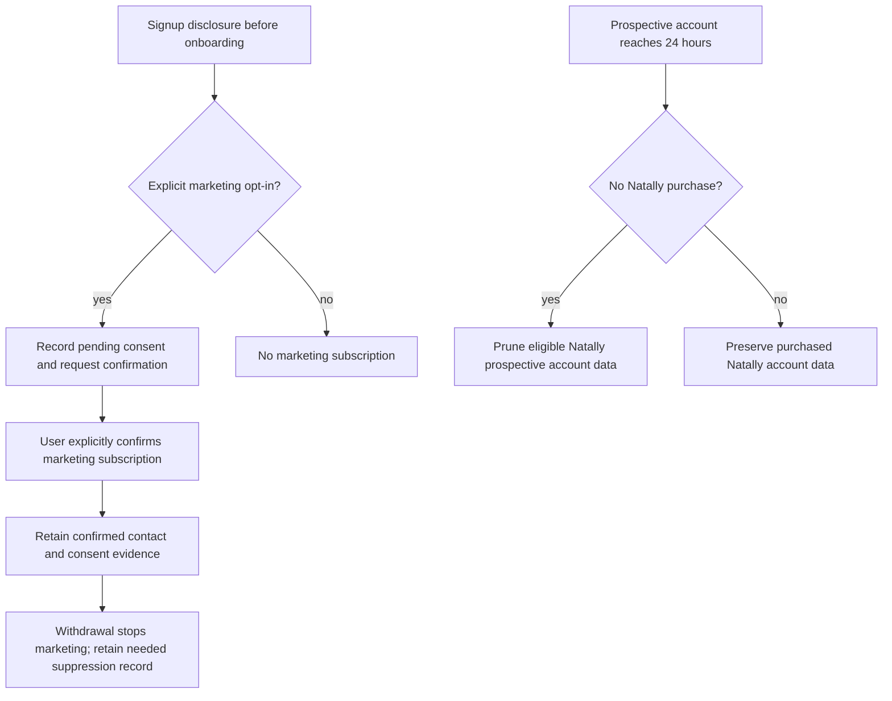

# New visitor through first reading

Operator-corrected account lifecycle, 28 October 2026. This is the required
journey, not evidence of completed deployment. RevenueCat is the commercial
source of truth; Firebase provides authentication and operational storage.

```mermaid
flowchart TD
  VISIT["Marketing homepage"] --> INTENT["Choose souvenir, interaction credits, or free exploration; retain intent"]
  INTENT --> AUTH{"Create account or log in?"}
  AUTH -->|create| CUSTOMER["Create RevenueCat customer record"]
  CUSTOMER --> BIRTH["Onboard birth date, time and place"]
  AUTH -->|log in| LOAD["Load existing RevenueCat customer"]
  LOAD --> PROFILE{"Existing birth profile?"}
  PROFILE -->|no| BIRTH
  PROFILE -->|yes| CHART["Actual calculated natal chart and atelier"]
  BIRTH --> CHART
  CHART --> KEYCHECK{"Issuer-valid associated key within one-hour lifetime?"}
  KEYCHECK -->|yes| REUSE["Reuse valid key"]
  KEYCHECK -->|no| ISSUE["Issue key with one-hour expiry, initially zero limit"]
  REUSE --> CURRENT["Read current shared ROCHE from RevenueCat"]
  ISSUE --> CURRENT
  CURRENT --> SYNC["Set limit from current ROCHE; save association; deactivate if zero"]
  SYNC --> SELECTED{"Purchase intent already selected?"}
  SELECTED -->|yes| CHECKOUT["Matching product checkout; retain selected offer"]
  SELECTED -->|no| FIRST["Screen 1: souvenir, prominent price and direct purchase card"]
  FIRST -->|buy| CHECKOUT
  FIRST -->|next| SECOND["Screen 2: interaction credits, price and direct purchase card"]
  SECOND -->|buy| CHECKOUT
  SECOND -->|next| THIRD["Screen 3: both offers side by side, each directly purchasable"]
  THIRD -->|buy either| CHECKOUT
  FIRST -->|dismiss| FREE["Free interactive chart and atelier"]
  SECOND -->|dismiss| FREE
  THIRD -->|dismiss| FREE
  FREE --> VOICE["Prewritten explanation, personalized name, existing realtime voice; no LLM"]
  VOICE --> UPSELL["Relevant purchase invitation and leading question"]
  UPSELL -->|buy| CHECKOUT
  CHECKOUT --> CONFIRM{"RevenueCat confirms purchase?"}
  CONFIRM -->|no| FREE
  CONFIRM -->|yes| BENEFIT{"Purchased product"}
  BENEFIT -->|souvenir| SOUVENIR["Souvenir entitlements plus ROCHE for reading and at least ten exploratory turns"]
  BENEFIT -->|credits| CREDITS["ROCHE allocation from configured payment percentage"]
  SOUVENIR --> FUND["Set valid OpenRouter key limit from current ROCHE"]
  CREDITS --> FUND
  FUND --> VERIFIED{"Fulfillment verified?"}
  VERIFIED -->|pending| PENDING["Show pending fulfillment; no repeat purchase"]
  PENDING --> VERIFIED
  VERIFIED -->|ready| READING["First personal reading through customer OpenRouter key"]
  READING --> EXPLORE["Natally voice and interactive co-exploration; operational history in Firebase"]
  EXPLORE --> SAVE["Souvenir buyers: extensive PDF and personal interactive encyclopedia, hosted at least one year"]
```

The canonical key lifecycle, including issuer-disabled keys, expiry, session
teardown, nightly zero-balance cleanup and Google Play restoration, is defined in
[SESSION-KEY-ARCHITECTURE.md](SESSION-KEY-ARCHITECTURE.md). Everyone follows the same
validity → reuse/issue → current ROCHE → set limit → save association routine.
No previous key balance or limit is consulted. Source helpers exist, but the
complete deployed session and purchase-to-reading journey remain unverified.

## Prospective account pruning and double opt-in

Before birth-data onboarding, disclose that an unpaid prospective account may
be pruned after 24 hours, while separately confirmed marketing contact can be
retained. Initial signup opt-in and a subsequent explicit confirmation are both
required; ordinary account creation or a provider-verified email alone is not
the second marketing opt-in. Keep consent text version, both confirmation times,
contact, campaign/source attribution and withdrawal state. Include an unsubscribe
route. Do not silently opt people in through acceptance of Terms.

Prune eligible inactive Natally prospective-account data after 24 hours when
there has been no Natally purchase. A shared ROCHE balance is not an exemption.
Leave the RevenueCat customer, shared ROCHE balance and purchase history intact;
a returning user reconnects to that same authoritative customer record. Preserve confirmed marketing contact and
consent evidence separately from the pruned Natally prospective profile; no birth
chart or conversation is retained merely for marketing. Pending or withdrawn
marketing consent is not an active marketing subscription.

Implementation status: signup disclosure/confirmation and pruning are not yet
wired or deployed. These requirements must be reflected in Terms and Privacy
before enabling pruning. The existing account/key adapters do not implement them.

## Nightly fallback

Nightly maintenance deactivates keys with an authoritative zero ROCHE balance.
It supplements the one-hour session lifetime and immediate logout/zero-balance
deactivation; it does not delete customer data or change the ROCHE balance.
