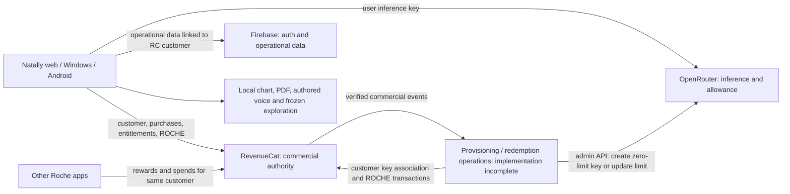
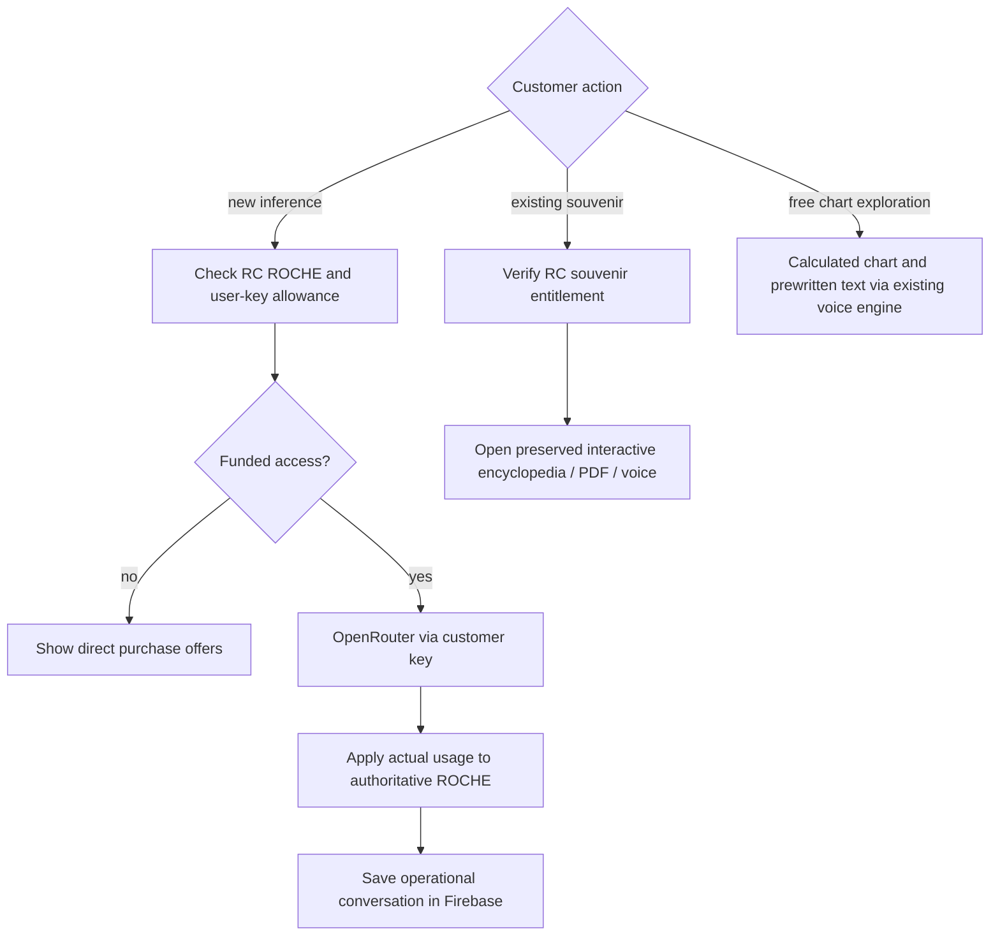
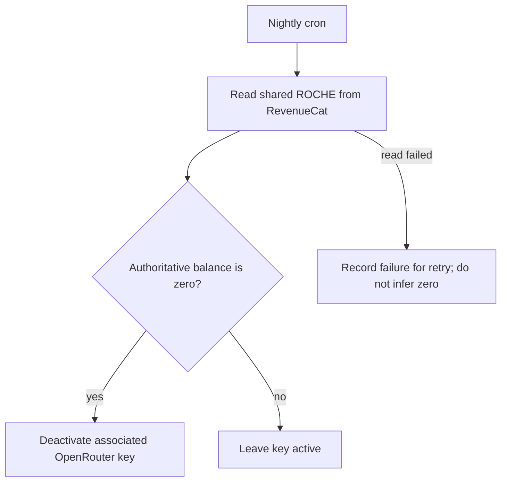

## Settled customer and ROCHE architecture — 27 October 2026

The operator has answered the architecture question. This supersedes the prior
pending-approval text and suggestion to add Hugging Face hosting. Do not add
hosting services or expand the rejected Netlify drafts.

RevenueCat owns the customer account, purchases, entitlements and shared balance,
enumerated and displayed as ROCHE. Other apps may award ROCHE that customers can
spend in Natally. Rewards, gift-code grants and purchases feed the same authoritative
customer balance; do not create a separate Natally-only commercial ledger.
Firebase holds operational data, including conversations, keyed or linked to the
RevenueCat customer identity. Preserve the existing authentication integration.

Every session follows the adopted one-hour key contract in
DOCS/SESSION-KEY-ARCHITECTURE.md: validate the associated key; reuse a valid key
or issue a new one-hour key; read current RevenueCat ROCHE; set the spending
limit from that balance; save and verify the association. Zero ROCHE or session
logout/teardown deactivates the key. Shared ROCHE changes in any app synchronize
the applicable key. No old key limit or balance is an input to the new limit.
New and existing customers use the same routine. Implementation remains incomplete.

The optional field remains "Have a code?" with an "Apply" action. Support single-use
redemption codes (including configured partner/AppSumo codes), gift codes granting
ROCHE without a purchase, code benefits alongside a purchase, and percentage offers
such as 25% off. Enforce the actual code's redemption and combination rules. A
percentage offer changes the payable price; a ROCHE gift grants currency. Repeated
submission must not grant a single-use benefit twice. Display actual authoritative
ROCHE balance and actual checkout price, never an invented successful redemption.

Status: requirements confirmed; implementation and live purchase/redemption,
cross-app balance and allowance synchronization still need verification.

## Issued-code attribution rule

Gift and percentage-off codes default to individually issued, single-use codes
validated against the issued-code list. Do not assume discounts are reusable.
Each code retains its campaign and intended marketing target; successful redemption
records the RevenueCat customer and redemption outcome against that attribution.
Keep intended target and actual redeemer distinguishable for campaign analytics.
Enforce any explicit recipient restriction without assuming every target is an
email address. Reusable or shareable codes require an explicit campaign exception;
they are not the default. Duplicate/retried redemption must not grant benefits
again. The code is a mutually beneficial attributed marketing instrument, not
an anonymous generic coupon. Implementation and live verification remain pending.

## Component and authority model

These diagrams specify the required behavior. They do not assert that the missing
provisioning and redemption operations have been implemented or deployed. No new
hosting provider is part of this model.

## Account, payment and code flows

The canonical session lifecycle is [SESSION-KEY-ARCHITECTURE.md](SESSION-KEY-ARCHITECTURE.md).
The structured flow applies equally to new customers, existing customers and
restored purchases. Code redemption still validates issued single-use codes and
campaign attribution; gifts change authoritative ROCHE and percentage offers
change the actual checkout price. Every resulting balance change enters the
same session synchronization path.

## Paid exploration and preserved content

Brainstormer executable import compatibility is not asserted; these are structured
Mermaid source diagrams. No Brainstormer investigation is required for this record.

## Authoritative nightly rule — latest operator correction

Each night, cron reads the customer shared ROCHE balance from RevenueCat.
If it is exactly zero, deactivate the associated OpenRouter key. If nonzero,
leave it active. Failed or unknown balance reads are not zero. This operation
never deletes the customer, account data, purchases, marketing contact or ROCHE.
This fallback is additional to the adopted one-hour session-key expiry and
logout/zero-balance deactivation. Earlier 24-hour key-expiry interpretations are superseded.

