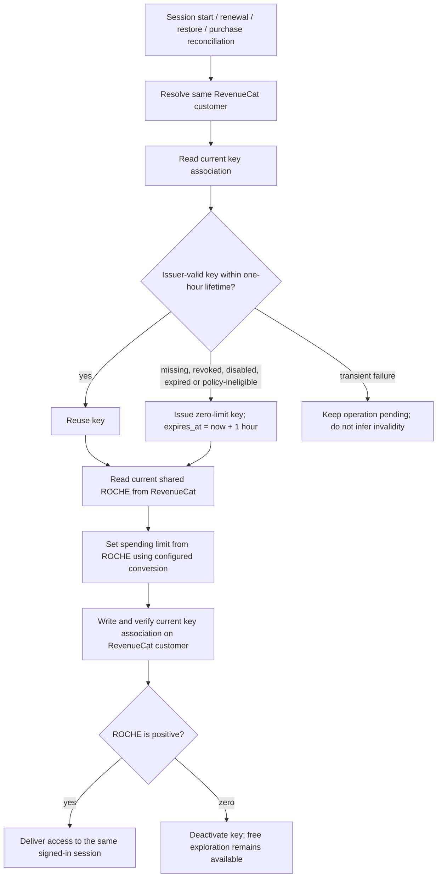

# Session key architecture: RevenueCat-authoritative ROCHE

Adopted operator direction, 28 October 2026. Key lifetime chosen explicitly:
**one hour maximum from issuance**. This replaces creation-only provisioning,
24-hour key expiry and activity-based expiry interpretations. It describes the
required implementation; the full session workflow is not yet deployed.

## Authority and invariants

- RevenueCat owns the customer, purchases, entitlements and shared literal ROCHE.
- Firebase owns authentication and operational data linked to that customer.
- An OpenRouter key is disposable access to the operator's collective provider
  funds with a maximum spend, not a customer wallet or a second balance.
- Every customer uses the same session-start routine, including new users,
  returning users, reinstalls and customers with existing keys.
- Check issuer validity first. A stored key/hash match alone is insufficient.
- Reuse a valid key that complies with the one-hour lifetime. Otherwise issue a
  new key with `expires_at = issuance time + 3600 seconds`, initially zero-limit.
- Both paths then read current RevenueCat ROCHE, set the key spending limit using
  the configured conversion policy, and save the current key association to the
  RevenueCat customer. Do not read or carry forward the old key limit or balance.
- Zero ROCHE deactivates access; it does not delete customer or purchase records.
- Logout/session teardown deactivates the key. Abrupt termination may not deliver
  teardown; provider expiry bounds its lifetime. Nightly zero-ROCHE deactivation
  remains a fallback and must read RevenueCat rather than infer zero from errors.
- An active session refreshes before expiry through the same routine. It must
  preserve the current question and conversation across replacement.
- One-hour API acceptance and expiry behavior require live verification; a UI
  preset is not proof of an API minimum. Do not label that verification complete.

## Session start and renewal



```mermaid
sequenceDiagram
  participant App
  participant Adapter as Existing provisioning adapter
  participant RC as RevenueCat
  participant OR as OpenRouter
  App->>Adapter: Authenticated session start
  Adapter->>RC: Read customer key association
  Adapter->>OR: Check associated key validity
  alt Missing or invalid key
    Adapter->>OR: Issue key, zero limit, one-hour expiry
  end
  Adapter->>RC: Read current ROCHE
  Adapter->>OR: Set limit from current ROCHE
  Adapter->>RC: Save current key association
  Adapter->>RC: Verify association readback
  Adapter-->>App: Current access or unfunded state
  RC-->>Adapter: Authoritative currency change in any app
  Adapter->>RC: Read latest ROCHE
  Adapter->>OR: Update limit; deactivate if zero
  App->>Adapter: Logout / session teardown
  Adapter->>OR: Deactivate associated key
```

## Event and exception contract

| Event | Required action | Must not happen |
|---|---|---|
| New or returning session | Same validity → issue/reuse → ROCHE → limit → association path | New-customer-only restriction on recovery |
| Issuer disables an exposed key | Replace unusable key under existing customer | Treat matching association as valid access |
| Provider timeout, rate limit or outage | Pending/retry; preserve question and association | Treat failure as invalidity or zero ROCHE |
| Purchase, gift, reward, spend or reversal in any app | Refresh authoritative ROCHE and apply current limit | Keep an old per-app allowance or duplicate grant |
| ROCHE reaches zero | Deactivate key | Delete RevenueCat customer or confiscate records |
| Logout or teardown | Deactivate key; clear session's installed access | Clear shared ROCHE or purchase history |
| Active key nearing expiry | Refresh without losing conversation; supersede old association | Extend access by copying the old limit |
| Google Play reinstall/restore | Resolve same customer, restore purchases via RevenueCat, run session routine | Regrant already-issued credits or infer balance from receipts |
| Interrupted issuance or association write | Reconcile operation before retrying issuance | Blindly create repeated funded keys |
| Concurrent balance events | Use newest RevenueCat read and serialize mutations for customer | Apply delayed event's balance as current |
| Concurrent sessions using shared current key | Handle invalidation through same routine | Silently introduce another balance or per-app commercial authority |

## Ownership and implementation map

| Component | Responsibility | Current evidence |
|---|---|---|
| `billing/revenuecat-customer.mjs` | Customer read/create distinction; key association read/write/readback | Committed adapter; 21 focused checks passed |
| `readCustomerRoche` | Read literal ROCHE including real zero; complete pagination | Committed and pushed; 9 focused checks passed against repository source |
| `billing/openrouter.mjs` | Issue, validate, set limit, deactivate | Common validity/issue/read-limit routine committed and pushed; 16 focused checks passed against repository source |
| Existing `reading-access` adapter | Authenticated session orchestration and currency-change reconciliation | Not wired to this contract |
| Client auth/session lifecycle | Start, renewal, logout, account switch, installed-key invalidation | Not wired to this contract |
| RevenueCat currency-change handling | Update applicable key on changes from every app | Not deployed or verified |
| Nightly maintenance | Deactivate only authoritative zero-ROCHE keys | Not deployed or verified |

No new hosting provider, commercial database or copied balance is introduced.
The existing allocation policy determines conversion; configuration must remain
explicit. Key issuance, purchase grants and currency debits are distinct operations.

## Acceptance scenes

SK01: New customer completes onboarding; session obtains one-hour key, initial
zero allowance remains non-inferencing, and free chart/voice works.
SK02: Existing valid key is reused; deliberately different old limit is overwritten
from current ROCHE without consulting that old limit.
SK03: Matching but issuer-disabled key is replaced; same customer and ROCHE persist.
SK04: Purchase or other-app balance change updates the active limit from RevenueCat;
zero deactivates it. No duplicate grant occurs on callback retries.
SK05: Logout deactivates; subsequent login restores from current ROCHE. Reinstall
and Google Play restore do not grant purchased currency again.
SK06: Active renewal preserves the question; abandoned key expires within one hour.
SK07: Provider/RevenueCat failure leaves pending state rather than assumed zero,
invalidity or successful access. Recovery completes without another purchase.

All scenes remain unverified in the deployed application.

Source checkpoint: `18a1670a78dff1152a7b6bc30c3bace2d5ec003e`, published
to `origin/master` with remote SHA readback. The 21 customer-attribute checks,
9 ROCHE-reader checks and 16 session-key checks pass against the completed
repository modules. Session-key and ROCHE-reader test harnesses remain local
under `.tmp/`; their execution does not establish application integration or
live provider acceptance. An earlier test invocation overlapped the required
line-by-line publication and encountered an intermediate syntax error; the
completed RevenueCat module was subsequently rerun successfully (30 checks).
